# THIẾT KẾ HƯỚNG ĐỐI TƯỢNG & HỢP ĐỒNG HÀM (OOP DESIGN & API CONTRACT)
## HỆ THỐNG PETCARE CRM TOÀN DIỆN CHO DOANH NGHIỆP DỊCH VỤ THÚ CƯNG

> **Dự án**: PetCare CRM  
> **Nền tảng**: Python 3.10+ / Frappe Framework v15  
> **Phiên bản tài liệu**: 2.0  
> **Ngày lập**: 26/10/2026  

---

## 1. SƠ ĐỒ LỚP & ĐỒ THỊ PHỤ THUỘC (CLASS DIAGRAM & DEPENDENCY GRAPH)

```mermaid
classDiagram
    %% Tầng Domain Pure Math (Không chạm Database)
    class CarePatternAnalyzer {
        +filter_iqr_outliers(deltas: List[int]) List[int]
        +calculate_ewma(deltas: List[int], alpha: float) float
        +calculate_average_interval(visit_dates: List[date]) Optional[int]
    }

    class RiskDetectionService {
        +evaluate_status(days_since_last: int, average_interval: int, threshold_days: int, at_risk_ratio: float) PatternStatus
    }

    class PricingCalculator {
        +calculate_final_price(original_price: float, discount_type: str, discount_value: float) Tuple[float, float]
    }

    %% Tầng Domain Service
    class MembershipDomainService {
        +is_active(membership: MembershipDTO, check_date: date) bool
        +find_applicable_benefit(membership: MembershipDTO, service_type: str, pet: Optional[str]) Optional[BenefitDTO]
        +calculate_rollover(old_benefits: List[BenefitDTO], new_plan: PlanDTO) List[BenefitDTO]
    }

    %% Tầng Application / Use Case Coordinators (Quản lý Transaction & DB)
    class LeadConversionCoordinator {
        -adapter: FrappeRepositoryAdapter
        +convert_lead(lead_name: str, create_opportunity: bool) ConversionResult
    }

    class ServiceVisitCheckoutCoordinator {
        -pricing_calc: PricingCalculator
        -membership_service: MembershipDomainService
        -adapter: FrappeRepositoryAdapter
        +checkout_visit(visit_data: VisitInputDTO) VisitCheckoutResult
    }

    class MembershipLifecycleCoordinator {
        -membership_service: MembershipDomainService
        -adapter: FrappeRepositoryAdapter
        +enroll_membership(customer: str, plan_name: str, pet: Optional[str]) str
        +topup_wallet(membership_id: str, amount: float, method: str) TransactionResult
        +renew_membership(old_membership_id: str, new_plan_name: str, rollover: bool) str
    }

    class CareRetentionCoordinator {
        -analyzer: CarePatternAnalyzer
        -risk_service: RiskDetectionService
        -adapter: FrappeRepositoryAdapter
        +scan_pet(pet_id: str, today_date: date) Optional[RecommendationDTO]
        +run_daily_scan() ScanSummaryDTO
        +handle_recommendation_action(rec_id: str, action: str, note: str) bool
    }

    %% Tầng Persistence Adapter
    class FrappeRepositoryAdapter {
        +get_pet_visits(pet_id: str) List[ServiceVisitDTO]
        +get_active_membership(customer: str, pet: Optional[str]) Optional[MembershipDTO]
        +save_service_visit(doc: dict) str
        +update_benefit_usage(membership_id: str, benefit_type: str, delta: int) void
        +record_transaction(tx_data: dict) str
        +save_recommendation(rec_data: dict) str
    }

    %% Quan hệ phụ thuộc
    CareRetentionCoordinator --> CarePatternAnalyzer : uses (pure math)
    CareRetentionCoordinator --> RiskDetectionService : uses (pure rule)
    CareRetentionCoordinator --> FrappeRepositoryAdapter : reads/writes DB
    
    ServiceVisitCheckoutCoordinator --> PricingCalculator : uses (pure math)
    ServiceVisitCheckoutCoordinator --> MembershipDomainService : uses (pure rule)
    ServiceVisitCheckoutCoordinator --> FrappeRepositoryAdapter : reads/writes DB

    MembershipLifecycleCoordinator --> MembershipDomainService : uses (pure rule)
    MembershipLifecycleCoordinator --> FrappeRepositoryAdapter : reads/writes DB

    LeadConversionCoordinator --> FrappeRepositoryAdapter : reads/writes DB
```



---

## 2. PHÂN ĐỊNH TRÁCH NHIỆM RÕ RÀNG (CLASS RESPONSIBILITIES & BOUNDARIES)

Để khắc phục hoàn toàn hiện tượng "God Class" (ví dụ: một lớp tự mình vừa tính toán thống kê, vừa query SQL, vừa trừ tiền ví, vừa gửi email):

| Nhóm lớp (Class Category) | Tên lớp | Được truy cập DB? | Trách nhiệm chính |
| :--- | :--- | :---: | :--- |
| **Pure Domain (Toán & Quy tắc)** | `CarePatternAnalyzer` | **KHÔNG** | Nhận danh sách số nguyên (khoảng cách ngày), thực hiện thuật toán IQR lọc dị thường và EWMA trọng số thời gian. |
| **Pure Domain (Toán & Quy tắc)** | `RiskDetectionService` | **KHÔNG** | So sánh khoảng cách ngày với ngưỡng chu kỳ, trả về trạng thái `STABLE`, `DUE_SOON`, hoặc `OVERDUE` (At-Risk). |
| **Pure Domain (Toán & Quy tắc)** | `PricingCalculator` | **KHÔNG** | Nhận giá gốc và thông tin ưu đãi (`FREE`, `%`, `FIXED`), tính ra đơn giá thực thu và số tiền tiết kiệm. |
| **Pure Domain (Nghiệp vụ thẻ)** | `MembershipDomainService`| **KHÔNG** | Kiểm tra tính hợp lệ về mặt thời gian, tìm quyền lợi phù hợp với dịch vụ, tính toán quyền lợi cộng dồn (Rollover). |
| **Use Case Coordinator** | `LeadConversionCoordinator` | **CÓ** (qua Adapter) | Điều phối luồng chuyển đổi Lead thành Contact & Pet; quản lý transaction tạo đồng thời nhiều bảng. |
| **Use Case Coordinator** | `ServiceVisitCheckoutCoordinator` | **CÓ** (qua Adapter) | Tiếp nhận lượt dịch vụ, phối hợp tính giá, cấn trừ quyền lợi thẻ, trừ số dư ví, cập nhật cân nặng Pet trong 1 transaction an toàn. |
| **Use Case Coordinator** | `MembershipLifecycleCoordinator` | **CÓ** (qua Adapter) | Xử lý mở thẻ mới, nạp tiền ví, gia hạn thẻ và bảo lưu quyền lợi tồn (Rollover). |
| **Use Case Coordinator** | `CareRetentionCoordinator` | **CÓ** (qua Adapter) | Điều phối quét dữ liệu lịch sử của Pet, gọi `CarePatternAnalyzer`, tạo bản ghi `Care Recommendation` và công việc nhắc hẹn. |
| **Persistence Adapter** | `FrappeRepositoryAdapter` | **CÓ** (Frappe ORM) | Điểm duy nhất giao tiếp với Frappe ORM (`frappe.db.get_list`, `frappe.get_doc`), chuyển đổi DocType sang Dataclass DTO. |

---

## 3. HỆ THỐNG NGOẠI LỆ NGHIỆP VỤ (EXCEPTION HIERARCHY)

Tất cả các ngoại lệ nghiệp vụ đều kế thừa từ lớp cơ sở `PetCareException` để tầng API/Controller có thể bắt lỗi tập trung và chuyển thành thông báo người dùng an toàn:

```python
class PetCareException(Exception):
    """Lớp cơ sở cho toàn bộ ngoại lệ nghiệp vụ của PetCare CRM."""
    pass

class ValidationError(PetCareException):
    """Lỗi dữ liệu đầu vào không hợp lệ (sai số điện thoại, thiếu trường bắt buộc)."""
    pass

class EntityNotFoundException(PetCareException):
    """Không tìm thấy thực thể được yêu cầu trong cơ sở dữ liệu."""
    pass

class MembershipExpiredException(PetCareException):
    """Thẻ hội viên đã quá hạn sử dụng, không được phép cấn trừ quyền lợi."""
    pass

class BenefitExhaustedException(PetCareException):
    """Quyền lợi dịch vụ trong gói hội viên đã được dùng hết (remaining_quantity <= 0)."""
    pass

class InsufficientBalanceException(PetCareException):
    """Số dư ví tài khoản không đủ để thanh toán phiếu dịch vụ."""
    pass

class InvalidStateTransitionException(PetCareException):
    """Chuyển đổi trạng thái không hợp lệ (ví dụ: chuyển từ Converted ngược về New)."""
    pass
```

---

## 4. QUẢN LÝ GIAO TÁC & RANH GIỚI AN TOÀN (TRANSACTION BOUNDARIES)

Mọi thao tác thay đổi trạng thái hoặc ghi nhận tài chính đều tuân thủ nguyên tắc **All-or-Nothing**:
* **Điểm bắt đầu giao tác**: Khi Use Case Coordinator bắt đầu thực hiện thao tác checkout hoặc nạp tiền ví.
* **Điểm kết thúc giao tác (`frappe.db.commit()`)**: Chỉ được gọi khi tất cả các bản ghi liên quan (`Service Visit`, `Membership Benefit`, `Membership Transaction`, `Pet`) đã được ghi thành công vào database.
* **Xử lý sự cố (`frappe.db.rollback()`)**: Bắt bất kỳ ngoại lệ nào phát sinh trong quá trình thực thi để hoàn tác toàn bộ thay đổi, đảm bảo số dư ví và số lượt quyền lợi không bao giờ bị lệch dữ liệu.

---

## 5. HỢP ĐỒNG HÀM & API CHI TIẾT (FUNCTION / API CONTRACTS)

### 5.1. Hàm `checkout_service_visit`
* **Mục đích**: Tiếp nhận thú cưng làm dịch vụ, tính giá ưu đãi, cấn trừ quyền lợi và xuất phiếu.
* **Input Parameters**:
  * `pet`: `str` (Tên nhận diện thú cưng - Bắt buộc).
  * `service_type`: `str` (Loại dịch vụ thực hiện - Bắt buộc).
  * `visit_date`: `Optional[str]` (Ngày làm dịch vụ, mặc định hôm nay).
  * `weight_kg`: `Optional[float]` (Cân nặng đo được hôm nay của thú cưng).
  * `technician`: `Optional[str]` (Kỹ thuật viên phụ trách).
  * `notes`: `Optional[str]` (Ghi chú lâm sàng / dặn dò chăm sóc).
* **Output**:
  ```json
  {
    "status": "success",
    "visit_id": "SV-2026-00124",
    "customer": "CT-00045",
    "pet": "Bé Bơ",
    "original_price": 250000.0,
    "final_price": 0.0,
    "membership_used": "MEM-2026-00012",
    "benefit_redeemed": "Grooming",
    "remaining_quantity": 4
  }
  ```
* **Exceptions có thể xảy ra**: `EntityNotFoundException`, `MembershipExpiredException`, `BenefitExhaustedException`.
* **Side Effects**:
  * Tạo mới 1 bản ghi `Service Visit`.
  * Trừ 1 lượt của `Membership Benefit` tương ứng.
  * Cập nhật `weight_kg` mới nhất vào hồ sơ `Pet`.
  * Tạo 1 bản ghi kiểm toán trong `Benefit Redemption Ledger`.
* **Transaction**: Bắt buộc 原子性 (Atomic). Rollback nếu có lỗi.
* **Quyền hạn**: `PetCare Receptionist`, `PetCare Specialist`, `PetCare Manager`.
* **Idempotency**: Không cho phép tạo trùng 2 phiếu cùng 1 Pet, cùng 1 dịch vụ trong cùng 1 phút.

---

### 5.2. Hàm `convert_lead_to_customer`
* **Mục đích**: Chuyển đổi Lead tiềm năng thành Khách hàng (`Contact`) và Thú cưng (`Pet`).
* **Input Parameters**:
  * `lead_id`: `str` (Mã Lead cần chuyển đổi - Bắt buộc).
  * `pet_name`: `Optional[str]` (Tên bé cưng, nếu lấy từ ghi chú Lead).
  * `species`: `Optional[str]` (Loài thú cưng: Dog / Cat / Rabbit).
  * `breed`: `Optional[str]` (Giống loài).
  * `create_opportunity`: `bool` (Có tạo kèm Sales Opportunity không).
  * `opportunity_amount`: `Optional[float]` (Giá trị cơ hội kỳ vọng nếu tạo).
* **Output**:
  ```json
  {
    "status": "success",
    "contact_id": "CT-Nguyễn-Văn-A",
    "pet_id": "Miu Miu",
    "opportunity_id": "OPP-2026-00034",
    "message": "Chuyển đổi Lead thành công."
  }
  ```
* **Exceptions**: `EntityNotFoundException`, `InvalidStateTransitionException` (nếu Lead đã Converted trước đó).
* **Side Effects**: Tạo `Contact`, tạo `Pet`, tạo `Opportunity` (nếu chọn), chuyển trạng thái Lead sang `Converted`.
* **Transaction**: Atomic transaction bao trùm toàn bộ các bản ghi tạo mới.

---

### 5.3. Hàm `renew_customer_membership`
* **Mục đích**: Gia hạn thẻ hội viên với chính sách kế thừa quyền lợi tồn (Rollover).
* **Input Parameters**:
  * `membership_id`: `str` (Mã thẻ cũ cần gia hạn).
  * `new_plan_name`: `str` (Tên gói hội viên chu kỳ mới).
  * `allow_rollover`: `bool` (Có cộng dồn số lượt chưa sử dụng từ thẻ cũ không).
* **Output**:
  ```json
  {
    "status": "success",
    "old_membership": "MEM-2026-00005",
    "new_membership": "MEM-2026-00089",
    "rollover_benefits_count": 3,
    "balance_transferred": 500000.0,
    "new_end_date": "2027-10-26"
  }
  ```
* **Exceptions**: `EntityNotFoundException`, `ValidationError`.
* **Transaction**: Atomic transaction.

---

### 5.4. Hàm `daily_petcare_scan` (Scheduler Endpoint)
* **Mục đích**: Tác vụ chạy ngầm định kỳ quét toàn bộ hệ thống để dự báo chu kỳ và cảnh báo rời bỏ.
* **Input Parameters**: Không có (chạy tự động qua scheduler).
* **Output**:
  ```json
  {
    "status": "success",
    "scanned_pets": 150,
    "stable_count": 128,
    "due_soon_count": 14,
    "at_risk_count": 8,
    "recommendations_created": 6,
    "expired_memberships": 2
  }
  ```
* **Side Effects**: Tạo các bản ghi `Care Recommendation` mới ở trạng thái `NEW`; cập nhật trạng thái thẻ quá hạn sang `Expired`.
* **Transaction**: Xử lý từng thú cưng độc lập (mỗi thú cưng commit riêng lẻ để không làm treo batch job nếu 1 con bị lỗi dữ liệu).
