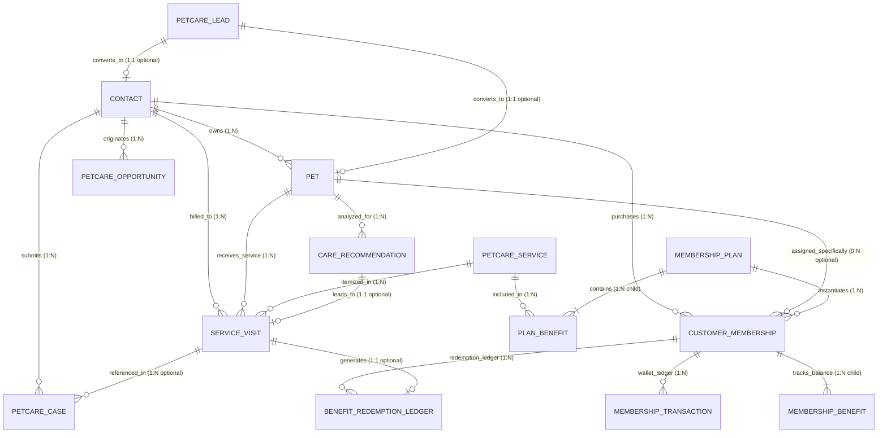

# ĐẶC TẢ HỢP ĐỒNG DỮ LIỆU & THỰC THỂ (DATA CONTRACT & ERD)
## HỆ THỐNG PETCARE CRM TOÀN DIỆN CHO DOANH NGHIỆP DỊCH VỤ THÚ CƯNG

> **Dự án**: PetCare CRM  
> **Nền tảng**: Frappe Framework v15  
> **Phiên bản tài liệu**: 2.0  
> **Ngày cập nhật**: 26/10/2026  

---

## 1. SƠ ĐỒ THỰC THỂ LIÊN KẾT TỔNG THỂ (ENTITY RELATIONSHIP DIAGRAM - ERD)

---

## 2. QUY TẮC PHÂN ĐỊNH KHÁCH HÀNG (CUSTOMER) VÀ THÚ CƯNG (PET)

* **Khách hàng (`Contact` - Frappe Core)**:
  * Là **Chủ thể pháp lý / Chủ nuôi** chịu trách nhiệm tài chính, giao tiếp, ký kết hợp đồng và đứng tên sở hữu thẻ hội viên.
  * Là người nhận các thông báo SMS/Zalo/Email và thực hiện thanh toán tiền dịch vụ.
* **Thú cưng (`Pet`)**:
  * Là **Đối tượng thụ hưởng dịch vụ thực tế** (nhận tắm, cắt tỉa, spa, khám, lưu trú).
  * Mỗi thú cưng có hồ sơ sinh học riêng biệt: loài, giống, ngày sinh, cân nặng theo dõi qua từng lần ghé thăm, tình trạng dị ứng hóa chất hoặc tính cách đặc thù.
* **Quy tắc liên kết giữa Membership, Customer và Pet**:
  1. **Thẻ Hội Viên Gia Đình (Family Plan - Mặc định)**: Trường `pet` trong `Customer Membership` để trống (`None`). Mọi quyền lợi lượt dịch vụ và số dư ví trong thẻ được phép cấn trừ cho **bất kỳ thú cưng nào** thuộc quyền sở hữu của `Contact` đó.
  2. **Thẻ Hội Viên Chuyên Biệt (Dedicated Pet Plan)**: Trường `pet` được chọn cụ thể một bé thú cưng. Khi tạo phiếu `Service Visit`, hệ thống chỉ cho phép cấn trừ quyền lợi thẻ nếu thú cưng nhận dịch vụ trùng khớp với bé cưng ghi trên thẻ.
  3. **Lịch sử chu kỳ chăm sóc**: Được tính toán và phân tích **theo từng Thú cưng riêng lẻ (`Pet`)**, bởi vì mỗi bé có tốc độ mọc lông, chu kỳ tắm và cơ địa hoàn toàn khác nhau.

---

## 3. ĐẶC TẢ CHI TIẾT CÁC THỰC THỂ (ENTITY SPECIFICATIONS)

### 3.1. Thực thể `PetCare Lead` (Khách hàng tiềm năng)
* **Tình trạng trong Repo**: DocType mới cần bổ sung (thay thế phụ thuộc vào `CRM Lead` của Frappe CRM).
* **Mục đích**: Ghi nhận và nuôi dưỡng khách hàng tiềm năng trước khi trở thành khách hàng chính thức.

| Tên trường (Field Name) | Kiểu dữ liệu (Field Type) | Bắt buộc (Reqd) | Quan hệ / Giá trị (Options) | Ý nghĩa nghiệp vụ |
| :--- | :--- | :---: | :--- | :--- |
| `lead_name` | Data | **Có** | | Họ và tên khách hàng tiềm năng |
| `phone` | Data | **Có** | | Số điện thoại liên hệ (10 số VN) |
| `email` | Data | Không | | Email liên hệ |
| `lead_source` | Select | **Có** | `Facebook Ads\nZalo\nHotline\nWalk-in\nReferral\nWebsite` | Kênh tiếp cận ban đầu |
| `status` | Select | **Có** | `New\nContacted\nQualified\nUnqualified\nConverted` | Trạng thái vòng đời Lead |
| `lead_owner` | Link | **Có** | `User` | Nhân viên tư vấn phụ trách |
| `initial_pet_info`| Small Text | Không | | Nhu cầu sơ bộ của bé cưng |
| `priority` | Select | **Có** | `Low\nMedium\nHigh` | Mức độ ưu tiên xử lý |
| `unqualified_reason`| Small Text | Không | | Lý do Lead không tiềm năng |
| `converted_contact` | Link | Không | `Contact` | Khách hàng được tạo ra sau chuyển đổi |
| `converted_pet` | Link | Không | `Pet` | Thú cưng được tạo ra sau chuyển đổi |

* **Validation Rules**:
  * Kiểm tra định dạng số điện thoại Việt Nam hợp lệ (bắt đầu bằng 0, độ dài 10 ký tự số).
  * Nếu `status == 'Unqualified'`, bắt buộc phải có nội dung trong `unqualified_reason`.
  * Nếu `status == 'Converted'`, khóa không cho phép sửa đổi dữ liệu (Read-only).
* **Phân quyền (RBAC)**: `PetCare Sales` (Read, Write, Create); `PetCare Manager` (Full control).

---

### 3.2. Thực thể `Contact` (Khách hàng / Chủ nuôi)
* **Tình trạng trong Repo**: DocType chuẩn có sẵn trong lõi **Frappe Framework**.
* **Mục đích**: Lưu trữ thông tin định danh và liên lạc của chủ nuôi.

| Tên trường | Kiểu dữ liệu | Bắt buộc | Quan hệ / Giá trị | Ý nghĩa nghiệp vụ |
| :--- | :--- | :---: | :--- | :--- |
| `name` | Data (PK) | **Có** | Autoname | Định danh duy nhất của Contact |
| `first_name` | Data | **Có** | | Tên gọi của khách hàng |
| `last_name` | Data | Không | | Họ và tên đệm |
| `phone` / `mobile_no` | Data | **Có** | | Số điện thoại chính |
| `email_id` | Data | Không | | Địa chỉ hòm thư điện tử |
| `customer_tier` | Select | Không | `Standard\nLoyal\nVIP\nVVIP` | Phân hạng khách hàng |
| `total_spent` | Currency | Không | | Tổng chi tiêu tích lũy (VNĐ) |

---

### 3.3. Thực thể `Pet` (Hồ sơ Thú cưng)
* **Tình trạng trong Repo**: Đã có sẵn tại `petcare_crm/petcare_crm/doctype/pet/`.
* **Mục đích**: Lưu trữ hồ sơ sinh học, thể trạng và đặc điểm chăm sóc của thú cưng.

| Tên trường | Kiểu dữ liệu | Bắt buộc | Quan hệ / Giá trị | Ý nghĩa nghiệp vụ |
| :--- | :--- | :---: | :--- | :--- |
| `pet_name` | Data (PK) | **Có** | Unique | Tên nhận diện của thú cưng |
| `customer` | Link | **Có** | `Contact` | Chủ sở hữu (Foreign Key) |
| `species` | Select | **Có** | `Dog\nCat\nRabbit\nOther` | Loài thú cưng |
| `breed` | Data | Không | | Giống loài (Poodle, Corgi, Ragdoll...) |
| `birth_date` | Date | Không | | Ngày sinh (ước tính) |
| `gender` | Select | Không | `Male\nFemale\nNeutered` | Giới tính |
| `weight_kg` | Float | Không | | Cân nặng hiện tại (kg) |
| `medical_notes` | Small Text | Không | | Tiền sử dị ứng, bệnh lý, tính cách |

---

### 3.4. Thực thể `PetCare Opportunity` (Cơ hội bán hàng)
* **Tình trạng trong Repo**: DocType mới cần bổ sung (thay thế phụ thuộc vào `CRM Deal`).
* **Mục đích**: Quản lý phễu kinh doanh các gói dịch vụ lớn, thẻ hội viên dài hạn hoặc combo spa.

| Tên trường | Kiểu dữ liệu | Bắt buộc | Quan hệ / Giá trị | Ý nghĩa nghiệp vụ |
| :--- | :--- | :---: | :--- | :--- |
| `opportunity_title`| Data | **Có** | | Tên tiêu đề cơ hội tư vấn |
| `customer` | Link | **Có** | `Contact` | Khách hàng mục tiêu |
| `pet` | Link | Không | `Pet` | Thú cưng liên quan |
| `stage` | Select | **Có** | `Prospecting\nQualification\nProposal\nNegotiation\nClosed Won\nClosed Lost` | Giai đoạn bán hàng |
| `expected_amount` | Currency | **Có** | | Giá trị kỳ vọng của hợp đồng (VNĐ) |
| `probability` | Percent | **Có** | `10` đến `100` | Xác suất thành công (%) |
| `sales_person` | Link | **Có** | `User` | Chuyên viên kinh doanh phụ trách |
| `expected_closing` | Date | Không | | Ngày dự kiến chốt giao dịch |
| `lost_reason` | Select | Không | `Price Too High\nCompetitor\nNo Longer Has Pet\nRelocated\nOther` | Lý do thất bại |
| `lost_notes` | Small Text | Không | | Ghi chú giải trình khi thất bại |

---

### 3.5. Thực thể `PetCare Service` (Danh mục dịch vụ)
* **Tình trạng trong Repo**: DocType mới cần bổ sung (chuẩn hóa danh mục thay cho trường Select cứng).
* **Mục đích**: Định nghĩa danh mục dịch vụ, đơn giá niêm yết và thời lượng tiêu chuẩn.

| Tên trường | Kiểu dữ liệu | Bắt buộc | Quan hệ / Giá trị | Ý nghĩa nghiệp vụ |
| :--- | :--- | :---: | :--- | :--- |
| `service_code` | Data (PK) | **Có** | Unique | Mã dịch vụ (ví dụ: `SRV-SPA-01`) |
| `service_name` | Data | **Có** | | Tên dịch vụ hiển thị |
| `category` | Select | **Có** | `Grooming & Spa\nHealthcare & Clinic\nHotel & Boarding\nTraining` | Nhóm dịch vụ |
| `standard_price` | Currency | **Có** | | Đơn giá niêm yết chuẩn (VNĐ) |
| `estimated_duration`| Int | Không | | Thời lượng dự kiến (phút) |
| `is_active` | Check | **Có** | Default 1 | Đang kinh doanh hay tạm ngưng |

---

### 3.6. Thực thể `Service Visit` (Phiếu dịch vụ tiếp nhận)
* **Tình trạng trong Repo**: Đã có sẵn tại `petcare_crm/petcare_crm/doctype/service_visit/`.
* **Mục đích**: Ghi nhận một lần thú cưng đến làm dịch vụ thực tế tại cơ sở.

| Tên trường | Kiểu dữ liệu | Bắt buộc | Quan hệ / Giá trị | Ý nghĩa nghiệp vụ |
| :--- | :--- | :---: | :--- | :--- |
| `name` | Data (PK) | **Có** | `SV-.YYYY.-.#####` | Số phiếu dịch vụ tự sinh |
| `pet` | Link | **Có** | `Pet` | Thú cưng được chăm sóc |
| `customer` | Link | **Có** | `Contact` | Khách hàng thanh toán |
| `service_type` | Data / Link | **Có** | Liên kết tới Service | Dịch vụ được thực hiện |
| `visit_date` | Date | **Có** | | Ngày thực hiện dịch vụ |
| `original_price` | Currency | **Có** | | Đơn giá gốc chưa giảm |
| `final_price` | Currency | **Có** | | Đơn giá thực thu sau ưu đãi |
| `membership` | Link | Không | `Customer Membership` | Thẻ hội viên áp dụng cấn trừ |
| `benefit_used` | Data | Không | | Tên quyền lợi đã trừ trong thẻ |
| `technician` | Link | Không | `User` | Kỹ thuật viên phụ trách làm dịch vụ |
| `notes` | Small Text | Không | | Ghi chú tình trạng lông móng sau làm |

---

### 3.7. Thực thể `Customer Membership` & `Membership Benefit` (Thẻ Hội Viên)
* **Tình trạng trong Repo**: Đã có sẵn tại `customer_membership/` và `membership_benefit/`.
* **Mục đích**: Quản lý thời hạn thẻ, số dư tài khoản ví và số lượng quyền lợi dịch vụ còn tồn.

| Tên trường | Kiểu dữ liệu | Bắt buộc | Quan hệ / Giá trị | Ý nghĩa nghiệp vụ |
| :--- | :--- | :---: | :--- | :--- |
| `name` | Data (PK) | **Có** | `MEM-.YYYY.-.#####` | Mã thẻ hội viên tự sinh |
| `customer` | Link | **Có** | `Contact` | Chủ sở hữu thẻ |
| `pet` | Link | Không | `Pet` | Bé được gán thẻ (để trống = Family) |
| `membership_plan`| Link | **Có** | `Membership Plan` | Gói hội viên đã mua |
| `start_date` | Date | **Có** | | Ngày bắt đầu hiệu lực |
| `end_date` | Date | **Có** | | Ngày kết thúc hiệu lực |
| `status` | Select | **Có** | `Active\nExpired\nExhausted\nRenewed\nCancelled` | Trạng thái hiệu lực của thẻ |
| `balance` | Currency | Không | Default 0.0 | Số dư ví nạp trả trước (VNĐ) |
| `benefits` | Table | Không | `Membership Benefit` | Bảng chi tiết quyền lợi lượt |

* **Bảng con `Membership Benefit`**:
  * `benefit_type`: Loại dịch vụ được hưởng (ví dụ: `Grooming`, `Spa`).
  * `total_quantity`: Tổng số lượt ban đầu của gói (+ số lượt rollover nếu có).
  * `used_quantity`: Số lượt đã sử dụng thực tế.
  * `remaining_quantity`: Số lượt còn lại (`total_quantity - used_quantity`).
  * `discount_type`: `FREE` (Miễn phí 100%), `PERCENTAGE` (% chiết khấu), `FIXED` (Trừ tiền cố định).
  * `discount_value`: Giá trị chiết khấu tương ứng.

---

### 3.8. Thực thể `Benefit Redemption Ledger` (Nhật ký cấn trừ quyền lợi)
* **Tình trạng trong Repo**: DocType mới cần bổ sung để chuẩn hóa kiểm toán cấn trừ quyền lợi.
* **Mục đích**: Lưu trữ vết kiểm toán (Audit Trail) cho từng lần quyền lợi thẻ bị cấn trừ, liên kết chặt chẽ giữa `Service Visit` và `Customer Membership`.

| Tên trường | Kiểu dữ liệu | Bắt buộc | Quan hệ / Giá trị | Ý nghĩa nghiệp vụ |
| :--- | :--- | :---: | :--- | :--- |
| `membership` | Link | **Có** | `Customer Membership` | Thẻ hội viên bị cấn trừ |
| `service_visit` | Link | **Có** | `Service Visit` | Phiếu dịch vụ tiêu dùng lượt |
| `benefit_type` | Data | **Có** | | Quyền lợi áp dụng |
| `quantity_redeemed`| Int | **Có** | Default 1 | Số lượt cấn trừ (thường là 1) |
| `discount_applied` | Currency | **Có** | | Số tiền được miễn/giảm trong phiếu |
| `redemption_time` | Datetime | **Có** | | Thời điểm chính xác cấn trừ |

---

### 3.9. Thực thể `Care Recommendation` (Đề xuất chăm sóc cá nhân hóa)
* **Tình trạng trong Repo**: Đã có sẵn tại `care_recommendation/`.
* **Mục đích**: Lưu trữ các đề xuất giữ chân khách hàng do động cơ AI/EWMA sinh ra khi phát hiện thú cưng sắp đến hạn (`DUE_SOON`) hoặc có nguy cơ rời bỏ (`AT_RISK`).

| Tên trường | Kiểu dữ liệu | Bắt buộc | Quan hệ / Giá trị | Ý nghĩa nghiệp vụ |
| :--- | :--- | :---: | :--- | :--- |
| `name` | Data (PK) | **Có** | `REC-.YYYY.-.#####` | Mã khuyến nghị tự sinh |
| `pet` | Link | **Có** | `Pet` | Thú cưng cần chăm sóc |
| `customer` | Link | **Có** | `Contact` | Chủ nuôi cần liên hệ |
| `service_type` | Data | **Có** | | Dịch vụ được khuyến nghị |
| `pattern_status` | Select | **Có** | `STABLE\nDUE_SOON\nOVERDUE` | Trạng thái chu kỳ tại thời điểm quét |
| `average_interval_days` | Int | Không | | Chu kỳ trung bình tính bằng EWMA |
| `days_since_last_visit`| Int | Không | | Số ngày đã trôi qua kể từ lần gần nhất |
| `due_date` | Date | Không | | Ngày dự kiến cần đưa bé đi làm dịch vụ |
| `status` | Select | **Có** | `NEW\nCONTACTED\nBOOKED\nDISMISSED` | Trạng thái xử lý của nhân viên CSKH |
| `converted_visit` | Link | Không | `Service Visit` | Phiếu dịch vụ phát sinh khi BOOKED |
| `dismissed_reason`| Select | Không | `Sick\nTravel\nToo Expensive\nOther` | Lý do nếu bị từ chối |
