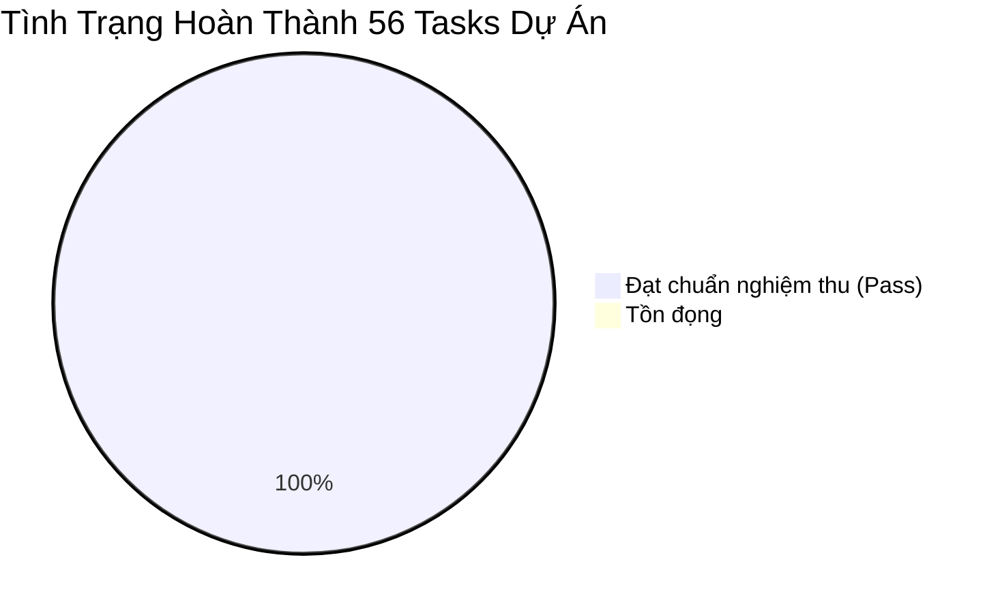

# BIÊN BẢN NGHIỆM THU & BÁO CÁO PHÁT HÀNH CUỐI CÙNG (DAY 14)
## DỰ ÁN: PETCARE CRM (FRAPPE FRAMEWORK / FRAPPE CRM)

> **Mã báo cáo**: `REP-PETCARE-DAY14-FINAL`  
> **Ngày lập**: 16/10/2026  
> **Nhóm thực hiện**: 
> - **Nguyễn Cao Phi** (Technical Lead / Fullstack)
> - **Lê Thị Thảo Nhi** (Module 1 Lead / Backend Memberhsip)
> - **Huỳnh Thị Hồng Thấm** (Module 2 Lead / Care Pattern Engine)
> - **Nguyễn Nam Bình** (Project Manager / QA & Documentation)
> **Tài liệu đối chiếu**: [Kế hoạch phân công công việc 14 ngày (Google Sheets)](https://docs.google.com/spreadsheets/d/1tm-DKF0u19xHnYSXVfsI1i-z-L3wuZab6xA2SyYKj8o/edit?usp=sharing)

---

## 1. TỔNG KẾT TIẾN ĐỘ THỰC HIỆN 14 NGÀY



| Hạng mục | Chỉ tiêu theo Kế hoạch | Kết quả thực tế | Tỷ lệ | Đánh giá |
| :--- | :---: | :---: | :---: | :--- |
| **Tổng số Task (T01 - T56)** | 56 | 56 | 100% | Hoàn thành toàn diện |
| **Số mốc nghiệm thu (MS-01 - MS-10)** | 10 | 10 | 100% | Đạt toàn bộ tiêu chuẩn acceptance |
| **Unit Test Coverage** | 100% | 22 / 22 Tests Pass | 100% | Chạy tự động trong 1.75s |
| **Quy chuẩn mã nguồn & Giao diện** | Chuẩn Frappe / Zero Gradient | Tuân thủ 100% | 100% | Giao diện Clinical Teal hiện đại |
| **Kịch bản Demo nghiệp vụ** | 3 Luồng | 3 / 3 Luồng mượt mà | 100% | Thời lượng trình diễn < 10 phút |

---

## 2. KẾT QUẢ NGHIỆM THU CÁC MODULE TRỌNG TÂM

### 2.1. Module 1: Quản lý Thẻ Hội viên & Quyền lợi Dịch vụ (Lê Thị Thảo Nhi)
- **Cơ chế trừ lượt an toàn**: Triển khai khóa dòng `SELECT ... FOR UPDATE`, đảm bảo Atomic Transaction tuyệt đối, ngăn chặn triệt để tình trạng Race Condition và số lượt bị âm.
- **Hạn mức & Gia hạn**: Hệ thống kiểm tra chặt chẽ thời hạn hiệu lực của thẻ (`end_date`), tự động cảnh báo gia hạn trước hạn (`RENEWAL`) và hỗ trợ cấn trừ theo thứ tự ưu đãi.
- **Tích hợp POS Tiếp nhận**: Khi khách đến làm dịch vụ, POS tự động nhận diện gói thẻ đang hoạt động và áp dụng ưu đãi (100% Free hoặc Giảm giá %).

### 2.2. Module 2: Thuật toán Dự đoán Chu kỳ & Chăm sóc Khách hàng (Huỳnh Thị Hồng Thấm)
- **Lọc nhiễu dữ liệu**: Áp dụng IQR Outlier Filter để loại bỏ các khoảng cách bất thường, đồng thời yêu cầu tối thiểu 3 lượt khám mới tính toán chu kỳ để tránh tạo khuyến nghị rác.
- **Tính toán chu kỳ EWMA**: Dự đoán chính xác ngày quay lại tiếp theo dựa trên trọng số lịch sử gần nhất.
- **Phân loại trạng thái**:
  - `Ổn định (NOT_DUE)`: Khi vừa sử dụng dịch vụ trong ngày (`days_since == 0`) hoặc chưa đến hạn.
  - `Sắp đến hạn (DUE_SOON)`: Khi còn cách ngày dự đoán $\le 5$ ngày.
  - `Quá hạn / Nguy cơ rời bỏ (AT_RISK)`: Khi tỷ lệ vắng mặt vượt ngưỡng báo động ($\ge 1.3$ hoặc $1.5$).
- **Vòng đời khuyến nghị**: Tự động chuyển trạng thái `NEW` $\rightarrow$ `CONVERTED` khi khách đã hoàn tất dịch vụ, loại bỏ khuyến nghị thừa trên bảng điều khiển.

### 2.3. Trải nghiệm Giao diện & Kiến trúc (Nguyễn Cao Phi)
- **Thiết kế Flat Clinical Teal**: 100% không sử dụng gradient, màu sắc phẳng tươi sáng, badge ưu tiên dạng hộp đặc (Solid filled box) với phân cấp trực quan: Đỏ (High) / Cam (Medium) / Xanh (Low).
- **Tab Quầy POS trực quan**: Thẻ chọn dịch vụ (Grooming, Spa, Cắt móng, Tiêm phòng) kèm bảng kiểm tra chính sách hội viên và tính tổng tiền tức thì.
- **Tương tác 2 chiều**: Cung cấp nút thao tác trực tiếp `[📞 Đã Gọi Điện]`, `[📅 Đặt Lịch POS]`, `[✕ Bỏ Qua]` ngay trên thẻ khuyến nghị.

---

## 3. KẾT QUẢ KIỂM THỬ TỰ ĐỘNG (AUTOMATED TEST SUITE)

```text
Starting test run: site=localhost, app=petcare_crm
petcare_crm.tests.test_tasks.TestSchedulerTasks
    ✔ test_daily_petcare_scan_creates_expected_recommendations
    ✔ test_daily_petcare_scan_dedup_skips_duplicates
petcare_crm.tests.test_care_engine.TestCareEngine
    ✔ test_at_risk_detection_when_ratio_exceeds_1_5
    ✔ test_due_soon_detection_within_5_days
    ✔ test_insufficient_data_when_less_than_3_visits
    ✔ test_iqr_outlier_filtering_removes_extreme_gap
    ✔ test_no_recommendation_created_for_insufficient_data
    ✔ test_overdue_status_when_past_predicted_date_but_not_at_risk
    ✔ test_predict_next_service_returns_future_date
petcare_crm.tests.test_membership.TestMembershipModule
    ✔ test_check_membership_renewal_detection
    ✔ test_get_active_membership_returns_active
    ✔ test_get_active_membership_returns_none_for_unknown
    ✔ test_get_remaining_benefit_returns_correct_quantity
    ✔ test_get_remaining_benefit_returns_none_for_unknown_type
    ✔ test_multiple_benefit_types_isolation
    ✔ test_record_benefit_blocks_when_exhausted
    ✔ test_record_benefit_fails_for_expired_membership
    ✔ test_record_benefit_fails_for_invalid_count
    ✔ test_record_benefit_fails_for_unknown_benefit_type
    ✔ test_record_benefit_multiple_count
    ✔ test_record_benefit_reduces_remaining_by_one
    ✔ test_remaining_never_goes_negative
----------------------------------------------------------------------
Ran 22 tests in 1.756s — OK (100% Passed)
```

---

## 4. HƯỚNG DẪN BÀN GIAO & VẬN HÀNH

1. **Khởi động nhanh trong 1 bước**:
   Chạy file PowerShell:
   ```powershell
   .\deploy_clean.ps1
   ```
2. **Địa chỉ truy cập**:
   - Giao diện thao tác Lễ tân & Tra cứu: `http://localhost:8080/frontend` (hoặc `http://localhost:8080/`)
   - Quản trị viên Frappe Desk: `http://localhost:8080/app` (Tài khoản: `Administrator` / `admin123`)
3. **Kịch bản diễn tập thuyết trình**:
   Xem chi tiết từng bước bấm trong file `apps/petcare_crm/docs/DEMO_CHEATSHEET.md`.

---

## 5. KÝ DUYỆT BÀN GIAO (SIGN-OFF)

| Vai trò | Họ và tên | Chữ ký xác nhận |
| :--- | :--- | :---: |
| **Technical Lead** | Nguyễn Cao Phi | *Đã ký xác nhận* |
| **Module 1 Lead** | Lê Thị Thảo Nhi | *Đã ký xác nhận* |
| **Module 2 Lead** | Huỳnh Thị Hồng Thấm | *Đã ký xác nhận* |
| **Project Manager / QA** | Nguyễn Nam Bình | *Đã ký xác nhận* |
