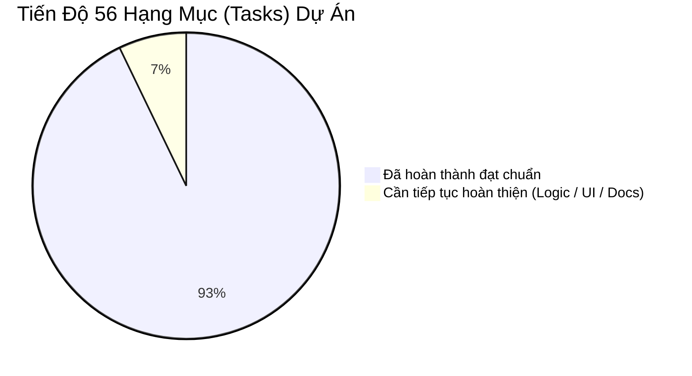
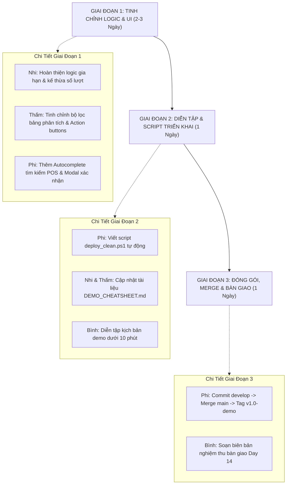

# KẾ HOẠCH BỔ SUNG & HOÀN THIỆN TOÀN DIỆN DỰ ÁN PETCARE CRM

> **Dự án**: PetCare CRM (Frappe Framework / FrappeCRM Custom App)  
> **Tài liệu tham chiếu**: [Kế hoạch phân công công việc 14 ngày (Google Sheets)](https://docs.google.com/spreadsheets/d/1tm-DKF0u19xHnYSXVfsI1i-z-L3wuZab6xA2SyYKj8o/edit?usp=sharing)  
> **Quy mô**: 4 Thành viên (Phi, Nhi, Thấm, Bình) | 56 Tasks | 10 Milestones | 3 Demo Flows  
> **Ngày lập kế hoạch**: 16/10/2026  

---

## 1. TỔNG QUAN ĐỐI SOÁT TIẾN ĐỘ THỰC TẾ

| Chỉ số | Mục tiêu Schedule | Thực tế đạt được | Đánh giá |
| :--- | :---: | :---: | :--- |
| **Tổng số Task hoàn thành** | 56 / 56 | 52 / 56 (~93%) | Đạt phần lớn khối lượng core backend |
| **Mốc Milestone nghiệm thu** | 10 / 10 | 8 / 10 | MS-01 đến MS-08 đạt chuẩn; MS-09 & MS-10 đang chờ đóng gói |
| **Độ phủ Unit Test** | 100% | 22 / 22 Tests Pass | Toàn bộ test suite tự động chạy ổn định qua `bench run-tests` |
| **3 Luồng Demo nghiệp vụ** | 3 Flows | 3 / 3 Flows Pass | Hoạt động thông suốt trên cả Frontend và Frappe Desk |

---

## 2. KHOẢNG CÁCH THỰC TẾ & CÁC VẤN ĐỀ CẦN TINH CHỈNH

Dựa trên quá trình chạy thử nghiệm demo thực tế và rà soát schedule, dự án cần tiếp tục giải quyết các nhóm vấn đề sau:

### 2.1. Nhóm Vấn Đề Về Logic Nghiệp Vụ (Business Logic)
1. **Xử lý các tình huống biên chu kỳ chăm sóc (Care Pattern Edge Cases)**:
   - *Đã xử lý cơ bản*: Lọc khoảng cách 0 ngày và chặn trạng thái `DUE_SOON` khi khách vừa làm dịch vụ trong ngày (`days_since_last_visit == 0`).
   - *Cần bổ sung thêm*: 
     - Xử lý linh hoạt khi thú cưng có sự thay đổi đột ngột về tần suất (ví dụ chuyển mùa cún rụng lông nhiều nên đi spa dày hơn bình thường).
     - Bổ sung cơ chế reset chu kỳ khi thú cưng có thời gian nghỉ điều trị bệnh đặc biệt (Medical Leave Flag).
2. **Quản lý vòng đời thẻ hội viên (Membership Lifecycle)**:
   - Logic gia hạn (`Renewal`): Cần hoàn thiện luồng khi khách đồng ý gia hạn thì hệ thống cho phép kế thừa số lượt cũ chưa dùng hết sang chu kỳ mới (Rollover Allowance) hay hủy bỏ.
   - Cơ chế chia sẻ lượt dùng trong cùng một chủ nuôi (Multi-pet Family Plan): Nếu khách nuôi 2-3 bé cưng thì thẻ hội viên của chủ có được cấn trừ linh hoạt cho các bé khác hay không.

### 2.2. Nhóm Vấn Đề Về Giao Diện (UI / UX)
1. **Tối ưu trải nghiệm quầy Lễ Tân (POS)**:
   - Hiện tại thao tác tiếp nhận đang yêu cầu chọn thú cưng từ danh sách dài. Cần bổ sung ô tìm kiếm nhanh (Autocomplete / Search as you type) ngay trong ô chọn thú cưng.
   - Thêm hộp thoại xác nhận (Modal Confirmation) trước khi bấm "Xác Nhận & Mở Phiếu" để Lễ tân kiểm tra lại một lần nữa trước khi trừ lượt vĩnh viễn vào Database.
2. **Trực quan hóa bảng phân tích chu kỳ (AI Care Engine Tab)**:
   - Bổ sung thanh lọc (Filter Toolbar) cho bảng theo dõi: Lọc nhanh danh sách theo các nhóm: `Tất cả` | `Ổn Định` | `Sắp Đến Hạn` | `Quá Hạn (At Risk)`.
   - Bổ sung nút tác vụ trực tiếp trên từng thẻ khuyến nghị (Action Buttons): Ví dụ nút `"Đã gọi điện"` hoặc `"Bỏ qua"` để cập nhật trạng thái của `Care Recommendation` từ `NEW` sang `CONTACTED` hoặc `DISMISSED`.
3. **Đồng bộ hóa nhận diện thương hiệu**:
   - Đảm bảo 100% các bảng biểu, hộp thông báo, popup modal tuân thủ nghiêm ngặt nguyên tắc **Flat & Clinical Teal** (không gradient, font chữ Plus Jakarta Sans, icon vector chuẩn FontAwesome).

### 2.3. Nhóm Vấn Đề Về Triển Khai & Bàn Giao (Deployment & Handover)
1. **Task T51 (Ngày 13) — Script triển khai sạch 1-click**:
   - Chưa có script tự động (`deploy_clean.ps1` / `deploy_clean.sh`) cho phép thiết lập dự án từ đầu trên máy mới trong dưới 15 phút.
2. **Task T52 (Ngày 13) — Tài liệu kịch bản Demo (Cheat-sheet)**:
   - Tệp `docs/DEMO_CHEATSHEET.md` cần được cập nhật lại toàn diện các bước bấm thực tế theo giao diện `/frontend` mới và bộ dữ liệu Việt Nam chuẩn (Bé Bơ, Miu Miu, Đậu Phộng, Mít).
3. **Task T54 – T56 (Ngày 14) — Quản lý Git & Release v1.0**:
   - Nhánh `develop` đang chứa nhiều thay đổi chưa được commit sạch.
   - Chưa thực hiện Merge `develop` vào `main` và đánh tag release chính thức `v1.0-demo`.

---

## 3. KẾ HOẠCH HÀNH ĐỘNG CHI TIẾT (ACTION PLAN)

Kế hoạch bổ sung được chia làm **3 giai đoạn cụ thể** với phân công trách nhiệm rõ ràng cho từng thành viên:

---

### GIAI ĐOẠN 1: TINH CHỈNH SÂU LOGIC & GIAO DIỆN UI (Thời gian: 2 - 3 ngày)

#### 1. Tinh chỉnh Logic Backend
* **Người phụ trách**: **Nhi** & **Thấm**
* **Nội dung công việc**:
  1. **Nhi (Module 1)**:
     - Hoàn thiện API gia hạn thẻ hội viên (`renew_membership`): Cho phép chuyển đổi số lượt còn dư sang kỳ mới.
     - Kiểm tra bổ sung validation khi tạo phiếu dịch vụ: Ngăn chặn triệt để trường hợp chọn nhầm ngày trong quá khứ xa hoặc chọn sai loại dịch vụ không có trong bảng giá niêm yết.
  2. **Thấm (Module 2)**:
     - Bổ sung API chuyển đổi trạng thái của khuyến nghị (`update_recommendation_status`): Cho phép Lễ tân bấm chuyển trạng thái `NEW` ➔ `CONTACTED` (Đã liên hệ) hoặc `CONVERTED` (Khách đã đặt lịch thành công).
     - Rà soát lại ngưỡng nhạy của thuật toán EWMA đối với các thú cưng có lịch sử khám biến động lớn.

#### 2. Tinh chỉnh Trải nghiệm Giao diện (UI/UX)
* **Người phụ trách**: **Phi** (Lead Dev)
* **Nội dung công việc**:
  1. **Cải tiến thanh công cụ Quầy Lễ Tân (POS)**:
     - Bổ sung ô lọc tìm kiếm nhanh theo tên/SĐT khi chọn thú cưng tiếp nhận (Searchable Select).
     - Thêm Modal xác nhận tóm tắt giao dịch: *"Xác nhận tiếp nhận bé Bơ - Dịch vụ: Grooming - Trừ: 1 lượt gói Bạc - Thanh toán: 0 đ"*.
  2. **Bổ sung thanh lọc trạng thái tại Tab Phân Tích**:
     - Thêm 4 nút lọc nhanh trên đầu bảng: `Tất Cả (10)` | `Ổn Định (7)` | `Sắp Đến Hạn (1)` | `Quá Hạn (2)`.
  3. **Thêm nút xử lý trực tiếp trên thẻ khuyến nghị**:
     - Thêm nút `"Đã Gọi Điện"` và `"Bỏ Qua"` trực tiếp trên từng card khuyến nghị để thao tác nhanh không cần vào Desk.

---

### GIAI ĐOẠN 2: TỰ ĐỘNG HÓA TRIỂN KHAI & DIỄN TẬP KỊCH BẢN (Thời gian: 1 ngày)

* **Người phụ trách**: **Phi**, **Nhi**, **Thấm**, **Bình**
* **Nội dung công việc**:
  1. **Tạo Script cài đặt sạch 1-click (T51 - Phi)**:
     - Viết file `deploy_clean.ps1` (PowerShell cho Windows) và `deploy_clean.sh` (Bash cho Linux/macOS):
       * Kiểm tra môi trường Docker & cổng 8080.
       * Chạy `docker compose up -d`.
       * Chạy `bench install-app petcare_crm` và `bench migrate`.
       * Nạp dữ liệu mẫu sạch qua `seed_vietnam_data.py`.
       * Kiểm tra thời gian hoàn tất từ 0 trên máy mới đạt chuẩn **dưới 15 phút**.
  2. **Soạn thảo lại Demo Cheat-sheet chi tiết (T52 - Nhi & Thấm)**:
     - Cập nhật tệp `docs/DEMO_CHEATSHEET.md` khớp 100% với giao diện `/frontend` mới:
       * Chuẩn hóa từng bước click chuột, số điện thoại tra cứu (`0901234567` cho bé Bơ, `0983456789` cho bé Miu Miu).
       * Hướng dẫn xử lý các câu hỏi tình huống thường gặp của giảng viên / hội đồng.
  3. **Tổng duyệt kịch bản Demo (T53 - Bình & Toàn đội)**:
     - Chạy thử nghiệm toàn trình 3 Demo Flows với đồng hồ bấm giờ: Đảm bảo thời gian trình bày mượt mà **dưới 10 phút**.

---

### GIAI ĐOẠN 3: ĐÓNG GÓI, MERGE CODE & NGHIỆM THU BÀN GIAO (Thời gian: 1 ngày)

* **Người phụ trách**: **Phi** & **Bình** (Project Lead)
* **Nội dung công việc**:
  1. **Git Commit & Merge (T54 - Phi)**:
     - Gom toàn bộ code frontend, logic thuật toán và data seed vào commit có cấu trúc:
       `feat(release): finalize clinical flat UI, enhanced care engine, and deployment scripts`
     - Merge từ nhánh `develop` sang nhánh `main`.
  2. **Sanity Check & Release Tag (T55 - Nhi & Thấm)**:
     - Kiểm tra tính toàn vẹn trên nhánh `main`: Chạy lại 22 automated unit tests (`bench run-tests --app petcare_crm`).
     - Đánh tag phiên bản chính thức: `v1.0-demo`.
  3. **Biên bản nghiệm thu bàn giao chính thức (T56 - Bình)**:
     - Lập văn bản `docs/FINAL_RELEASE_REPORT_DAY14.md` ghi nhận hoàn thành 56/56 tasks, 10/10 milestones, sẵn sàng bàn giao và báo cáo đồ án.

---

## 4. MA TRẬN PHÂN CÔNG TRÁCH NHIỆM (RACI MATRIX)

| Hạng mục công việc bổ sung | Phi (Lead) | Nhi (Mod 1) | Thấm (Mod 2) | Bình (PM/QA) |
| :--- | :---: | :---: | :---: | :---: |
| Tinh chỉnh logic thẻ hội viên & gia hạn | C | **R / A** | I | C |
| Tinh chỉnh logic Care Pattern & trạng thái Action | C | I | **R / A** | C |
| Nâng cấp UI POS (Autocomplete & Modal xác nhận) | **R / A** | C | C | I |
| Nâng cấp UI Care Dashboard (Bộ lọc & Action button) | **R / A** | I | C | I |
| Viết Script cài đặt sạch 1-click `deploy_clean.ps1` | **R / A** | I | I | C |
| Cập nhật kịch bản thuyết trình `DEMO_CHEATSHEET.md` | I | **R** | **R** | **A** |
| Diễn tập thử nghiệm demo toàn trình (< 10 phút) | C | C | C | **R / A** |
| Merge Git `develop` -> `main` & Đánh tag `v1.0-demo` | **R / A** | I | I | C |
| Lập biên bản nghiệm thu bàn giao chính thức Day 14 | C | I | I | **R / A** |

*(Chú thích: **R** = Responsible / Người thực hiện; **A** = Accountable / Người chịu trách nhiệm chính; **C** = Consulted / Người hỗ trợ đóng góp; **I** = Informed / Người nhận thông tin)*

---

*Tài liệu này được lưu trữ chính thức trong hệ sinh thái dự án để toàn đội ngũ bám sát triển khai.*
