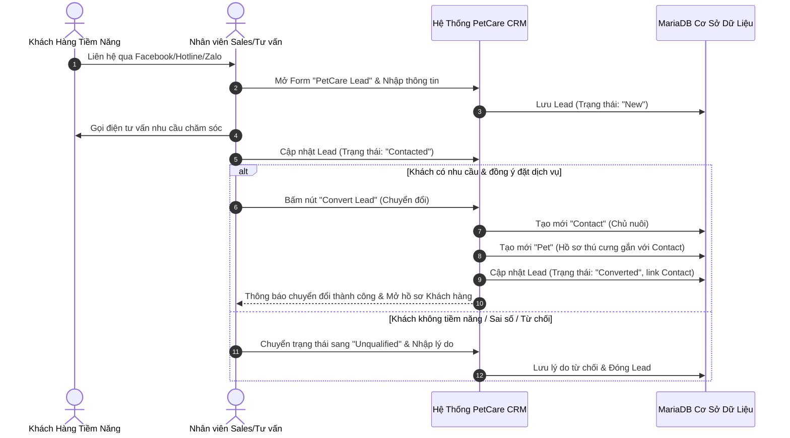
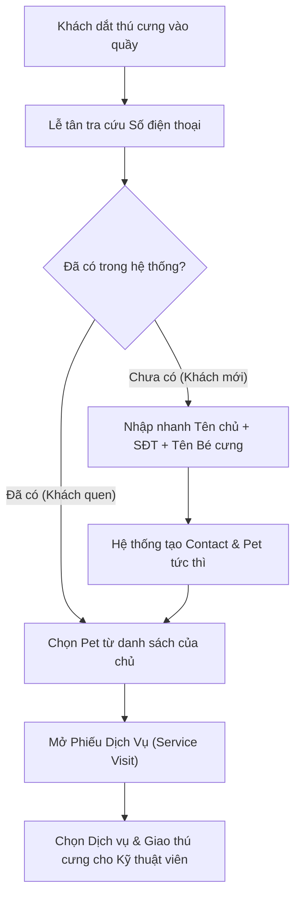
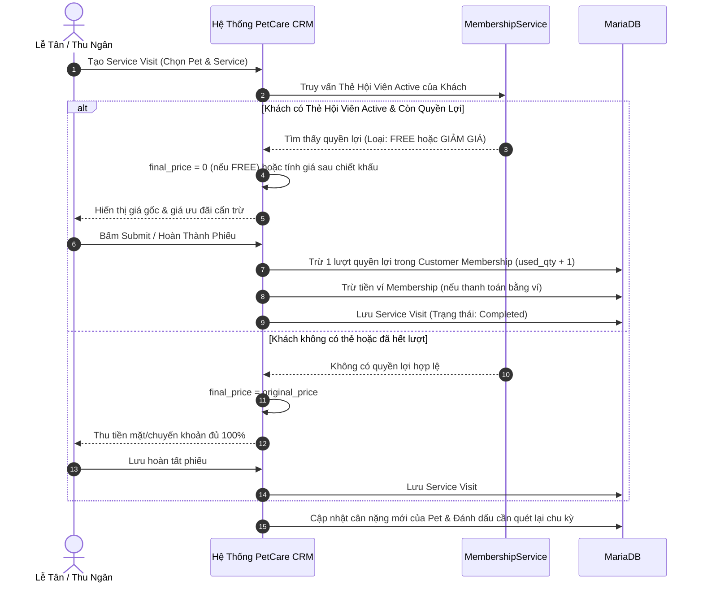
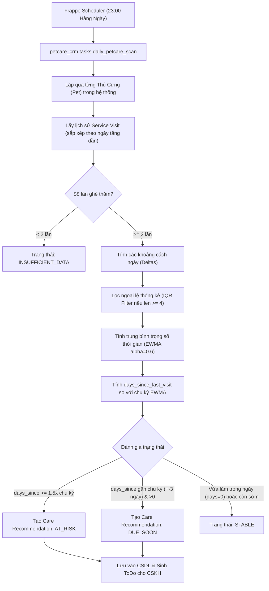

# QUY TRÌNH NGHIỆP VỤ VẬN HÀNH CHI TIẾT (PROCESS FLOWS)
## HỆ THỐNG PETCARE CRM TOÀN DIỆN CHO DOANH NGHIỆP DỊCH VỤ THÚ CƯNG

> **Dự án**: PetCare CRM  
> **Nền tảng**: Frappe Framework v15  
> **Phiên bản tài liệu**: 2.0  
> **Mã tài liệu**: FLOW-PETCARE-CRM-2026  

---

## MỤC LỤC CÁC QUY TRÌNH NGHIỆP VỤ CỐT LÕI

1. [FLOW-01: Tiếp nhận Lead Đa kênh & Chuyển đổi Khách hàng (Lead Intake & Conversion)](#flow-01-tiếp-nhận-lead-đa-kênh--chuyển-đổi-khách-hàng)
2. [FLOW-02: Quản lý Phễu Cơ hội Bán hàng (Sales Opportunity Pipeline)](#flow-02-quản-lý-phễu-cơ-hội-bán-hàng)
3. [FLOW-03: Tiếp nhận Khách Vãng lai Trực tiếp tại Quầy (Walk-in Direct Service)](#flow-03-tiếp-nhận-khách-vãng-lai-trực-tiếp-tại-quầy)
4. [FLOW-04: Đăng ký Thẻ Hội viên & Nạp Tiền Ví (Membership Enrollment & Top-Up)](#flow-04-đăng-ký-thẻ-hội-viên--nạp-tiền-ví)
5. [FLOW-05: Mở Phiếu Dịch vụ, Cấn trừ Ưu đãi & Quyết toán (Service Visit & Benefit Redemption)](#flow-05-mở-phiếu-dịch-vụ-cấn-trừ-ưu-đãi--quyết-toán)
6. [FLOW-06: Gia hạn Thẻ Hội viên & Kế thừa Quyền lợi (Membership Renewal & Rollover)](#flow-06-gia-hạn-thẻ-hội-viên--kế-thừa-quyền-lợi)
7. [FLOW-07: Động cơ Quét Chu kỳ Chăm sóc Tự động (Daily Care Scan & At-Risk Detection)](#flow-07-động-cơ-quét-chu-kỳ-chăm-sóc-tự-động)
8. [FLOW-08: Xử lý Đề xuất Giữ chân Khách hàng (Care Recommendation Handling)](#flow-08-xử-lý-đề-xuất-giữ-chân-khách-hàng)

---

### FLOW-01: TIẾP NHẬN LEAD ĐA KÊNH & CHUYỂN ĐỔI KHÁCH HÀNG

* **Mã quy trình**: `FLOW-01`
* **Tên quy trình**: Tiếp nhận Lead đa kênh và Chuyển đổi thành Khách hàng & Thú cưng.
* **Actor (Người thực hiện)**: Nhân viên Tư vấn / Telesales (`PetCare Sales`).
* **Precondition (Điều kiện tiên quyết)**:
  * Nhân viên đã đăng nhập vào Frappe Desk với Role `PetCare Sales` hoặc `PetCare Manager`.
* **Main Flow (Luồng chính)**:
  1. Nhân viên mở danh sách `PetCare Lead` trên Desk và bấm "New".
  2. Điền thông tin bắt buộc: Họ tên Lead, Số điện thoại (10 chữ số), Nguồn tiếp cận (Facebook Ads, Zalo, Hotline...).
  3. Điền thông tin bổ sung: Email, Tên thú cưng sơ bộ, Loài, Ghi chú nhu cầu (ví dụ: cần tắm cắt tỉa cho cún Poodle 5kg).
  4. Bấm "Save". Hệ thống lưu Lead ở trạng thái `New` và tự động gán `lead_owner` là nhân viên đang thao tác.
  5. Nhân viên thực hiện cuộc gọi trao đổi với khách, ghi chú lại nội dung tư vấn vào mục Timeline/Comments và chuyển trạng thái sang `Contacted`.
  6. Sau khi khách hàng xác nhận sẽ sử dụng dịch vụ, nhân viên chuyển trạng thái sang `Qualified`.
  7. Nhân viên bấm nút hành động **"Convert Lead"** trên thanh công cụ.
  8. Hệ thống hiển thị hộp thoại xác nhận chuyển đổi. Nhân viên xác nhận.
  9. Hệ thống khởi tạo tự động bản ghi `Contact` mới (Khách hàng) và bản ghi `Pet` mới (Hồ sơ thú cưng liên kết với Contact).
  10. Trạng thái Lead được cập nhật thành `Converted` kèm liên kết tham chiếu tới Contact vừa sinh.
* **Alternate Flows (Luồng nhánh)**:
  * *Nhánh A1 (Số điện thoại đã tồn tại)*: Nếu số điện thoại của Lead trùng với một `Contact` đã có sẵn trong cơ sở dữ liệu, hệ thống hiển thị cảnh báo và cho phép nhân viên chọn liên kết Lead vào Contact cũ thay vì tạo trùng lặp.
  * *Nhánh A2 (Tạo kèm Opportunity)*: Nếu Lead có nhu cầu mua gói thẻ hội viên trị giá cao, tại bước chuyển đổi, nhân viên tích chọn "Tạo Cơ hội bán hàng" để hệ thống tự động sinh thêm bản ghi `PetCare Opportunity`.
* **Error Flows (Luồng lỗi)**:
  * *Lỗi E1 (Số điện thoại không hợp lệ)*: Nhân viên nhập số điện thoại sai định dạng (chứa chữ cái, dưới 10 số). Hệ thống hiển thị thông báo lỗi `frappe.throw` và chặn không cho lưu.
  * *Lỗi E2 (Chuyển sang Unqualified mà không nhập lý do)*: Khi chọn trạng thái `Unqualified`, nếu trường `unqualified_reason` để trống, hệ thống ngăn chặn lưu và yêu cầu nhập lý do.
* **Postconditions (Kết quả sau quy trình)**:
  * Bản ghi `Contact` và `Pet` được tạo lập thành công sẵn sàng cho các nghiệp vụ tiếp theo.
  * Lead chuyển sang trạng thái `Converted`, không cho phép sửa đổi dữ liệu.
* **Acceptance Criteria (Tiêu chí nghiệm thu)**:
  * Thời gian thao tác chuyển đổi Lead sang Contact + Pet không quá 3 giây.
  * 100% dữ liệu từ Lead (tên, sđt, email, tên thú cưng, loài) được sao chép nguyên vẹn sang Contact và Pet.

---

### FLOW-02: QUẢN LÝ PHỄU CƠ HỘI BÁN HÀNG (SALES OPPORTUNITY PIPELINE)

* **Mã quy trình**: `FLOW-02`
* **Tên quy trình**: Quản lý Cơ hội bán hàng và Phễu kinh doanh (Opportunity Pipeline).
* **Actor**: Chuyên viên Kinh doanh / Quản lý (`PetCare Sales`, `PetCare Manager`).
* **Precondition**: Khách hàng (`Contact`) đã tồn tại trong hệ thống.
* **Main Flow**:
  1. Nhân viên mở Form `PetCare Opportunity` từ Desk hoặc từ màn hình hồ sơ `Contact`.
  2. Chọn Khách hàng (`customer`), Thú cưng liên quan (`pet` - tùy chọn).
  3. Nhập tiêu đề cơ hội (ví dụ: "Tư vấn Gói Hội Viên Vàng 1 Năm cho bé Bơ"), giá trị kỳ vọng (ví dụ: 5.000.000 VNĐ), ngày kỳ vọng chốt.
  4. Cơ hội được khởi tạo ở giai đoạn `Prospecting` (Tìm hiểu nhu cầu).
  5. Nhân viên tư vấn bảng quyền lợi, dịch vụ qua điện thoại/Zalo và kéo thả cơ hội trên Kanban Board qua các giai đoạn:
     * `Prospecting` -> `Qualification` (Đánh giá ngân sách và nhu cầu của chủ nuôi).
     * `Qualification` -> `Proposal` (Gửi bảng báo giá chi tiết và ưu đãi kèm theo).
     * `Proposal` -> `Negotiation` (Thương lượng lịch thanh toán hoặc tặng thêm lượt spa).
  6. Khách hàng đồng ý mua gói dịch vụ: Nhân viên chuyển giai đoạn sang `Closed Won`.
  7. Hệ thống mở nút tắt **"Tạo Thẻ Hội Viên"** hoặc **"Mở Phiếu Dịch Vụ"** để hoàn tất thủ tục bán hàng.
* **Alternate Flows**:
  * *Nhánh A1 (Khách từ chối chốt hợp đồng)*: Khách hàng không đồng ý mua. Nhân viên chuyển trạng thái sang `Closed Lost`, chọn bắt buộc lý do thất bại (`lost_reason`) và nhập phân tích nguyên nhân để phục vụ báo cáo tối ưu phễu.
* **Error Flows**:
  * *Lỗi E1 (Giá trị cơ hội âm hoặc bằng 0)*: Hệ thống báo lỗi và chặn lưu nếu `expected_amount <= 0`.
* **Postconditions**:
  * Cơ hội được cập nhật chính xác vào báo cáo Doanh số kỳ vọng (Sales Forecast) và Phễu bán hàng (Pipeline Funnel).
* **Acceptance Criteria**:
  * Bảng Kanban phản ánh chính xác trạng thái kéo thả theo thời gian thực.

---

### FLOW-03: TIẾP NHẬN KHÁCH VÃNG LAI TRỰC TIẾP TẠI QUẦY (WALK-IN DIRECT SERVICE)

* **Mã quy trình**: `FLOW-03`
* **Tên quy trình**: Tiếp nhận khách vãng lai trực tiếp tại quầy không qua phễu Lead.
* **Actor**: Lễ tân / Thu ngân (`PetCare Receptionist`).
* **Precondition**: Khách hàng trực tiếp mang thú cưng đến quầy dịch vụ.
* **Main Flow**:
  1. Lễ tân hỏi số điện thoại của khách hàng và nhập vào ô tìm kiếm nhanh.
  2. Nếu số điện thoại chưa tồn tại:
     * Lễ tân mở form tạo nhanh `Contact` (nhập Tên chủ nuôi, Số điện thoại).
     * Nhập nhanh hồ sơ `Pet` (Tên bé, Loài: Chó/Mèo, Giống loài, Cân nặng hiện tại).
  3. Nếu số điện thoại đã tồn tại: Hệ thống hiển thị danh sách tất cả các bé thú cưng của khách hàng đó để Lễ tân chọn đúng bé đi làm dịch vụ hôm nay.
  4. Lễ tân bấm "Mở Phiếu Dịch Vụ" (`Service Visit`).
  5. Chọn dịch vụ thực hiện (ví dụ: Tắm vệ sinh tiêu chuẩn), phân công Kỹ thuật viên chăm sóc.
  6. In phiếu tiếp nhận bàn giao bé cho bộ phận Spa.
* **Postconditions**: Khách hàng không bị bắt buộc đi qua phễu Lead/Sales mà được phục vụ ngay lập tức.
* **Acceptance Criteria**: Thời gian tiếp nhận và xuất phiếu cho khách mới tại quầy không quá 60 giây.

---

### FLOW-04: ĐĂNG KÝ THẺ HỘI VIÊN & NẠP TIỀN VÍ (MEMBERSHIP ENROLLMENT & TOP-UP)

* **Mã quy trình**: `FLOW-04`
* **Tên quy trình**: Đăng ký thẻ hội viên mới và nạp tiền trả trước vào ví tài khoản.
* **Actor**: Lễ tân / Thu ngân (`PetCare Receptionist`), Quản lý (`PetCare Manager`).
* **Precondition**: Khách hàng (`Contact`) đã có hồ sơ trong hệ thống.
* **Main Flow**:
  1. Nhân viên mở form `Customer Membership` và chọn Khách hàng.
  2. Chọn Gói hội viên (`membership_plan`: ví dụ "Gói Spa Định Kỳ 10 Buổi").
  3. Hệ thống tự động điền các thông tin:
     * Thời hạn hiệu lực: `start_date` = hôm nay, `end_date` = hôm nay + `validity_days` của gói.
     * Danh sách quyền lợi (`benefits`): Tự động sao chép danh mục quyền lợi từ `Plan Benefit` (ví dụ: 10 lượt Tắm Spa, giảm 15% Dịch vụ Nhuộm).
  4. Phạm vi áp dụng:
     * Nếu để trống trường `pet`: Thẻ áp dụng theo dạng **Family Plan** (dùng chung cho mọi thú cưng của khách hàng này).
     * Nếu chọn thú cưng cụ thể: Thẻ chỉ áp dụng cho riêng bé đó.
  5. Bấm "Save". Thẻ được kích hoạt ở trạng thái `Active`.
  6. Khách hàng nạp thêm 2.000.000 VNĐ vào ví thẻ để dùng dần:
     * Nhân viên bấm nút "Nạp Tiền Ví" (Top-Up).
     * Hệ thống hiển thị màn hình tạo `Membership Transaction`: Loại `Top Up`, số tiền 2.000.000 VNĐ, chọn hình thức thanh toán (Tiền mặt / Chuyển khoản VietQR), ghi nhận mã tham chiếu giao dịch.
     * Lưu giao dịch: Hệ thống tự động cập nhật số dư `balance` của thẻ từ 0 -> 2.000.000 VNĐ.
* **Error Flows**:
  * *Lỗi E1 (Số tiền nạp <= 0)*: Hệ thống báo lỗi và chặn lưu.
* **Postconditions**: Thẻ hội viên `Active` sẵn sàng cấn trừ quyền lợi; số dư ví cập nhật chính xác.

---

### FLOW-05: MỞ PHIẾU DỊCH VỤ, CẤN TRỪ ƯU ĐÃI & QUYẾT TOÁN (SERVICE VISIT & REDEMPTION)

* **Mã quy trình**: `FLOW-05`
* **Tên quy trình**: Mở phiếu dịch vụ, cấn trừ quyền lợi hội viên và quyết toán.
* **Actor**: Lễ tân (`PetCare Receptionist`), Kỹ thuật viên Spa (`PetCare Specialist`).
* **Precondition**: Thú cưng có mặt tại cơ sở; dịch vụ đã hoàn thành.
* **Main Flow**:
  1. Nhân viên mở phiếu `Service Visit`. Chọn Thú cưng (`pet`).
  2. Hệ thống tự động tra cứu và điền Khách hàng (`customer`) là chủ của bé.
  3. Chọn Dịch vụ (`service_type` hoặc `service`): Hệ thống tự động điền đơn giá gốc (`original_price`).
  4. Động cơ `MembershipService.apply_membership_benefits()` tự động kiểm tra thẻ hội viên:
     * Nếu có thẻ `Active` và còn lượt dịch vụ tương ứng:
       * Tự động gán trường `membership` và `benefit_used`.
       * Nếu quyền lợi là `FREE`: `final_price` = 0 VNĐ.
       * Nếu quyền lợi là `PERCENTAGE` 20%: `final_price` = `original_price` * 0.8.
  5. Nhân viên kiểm tra thông tin, nhập cân nặng thực tế hôm nay của bé (ví dụ: 5.2 kg) và bấm "Save".
  6. Hệ thống thực hiện transaction an toàn trong CSDL:
     * Tăng `used_quantity` của quyền lợi lên 1, giảm `remaining_quantity` đi 1.
     * Cập nhật cân nặng mới vào hồ sơ `Pet`.
  7. Phiếu hoàn tất, in hóa đơn thanh toán giao cho khách hàng.
* **Error Flows**:
  * *Lỗi E1 (Thẻ hết hạn hoặc hết số lượt)*: Hệ thống không cho cấn trừ ưu đãi mà giữ nguyên `final_price` = `original_price`, thông báo rõ lý do trên màn hình để lễ tân giải thích cho khách.
  * *Lỗi E2 (Số dư ví không đủ thanh toán)*: Nếu khách chọn thanh toán bằng ví trả trước nhưng `balance < final_price`, hệ thống báo lỗi không đủ số dư và yêu cầu nạp thêm hoặc thu tiền mặt phần chênh lệch.
* **Acceptance Criteria**:
  * Đảm bảo tính nhất quán dữ liệu (ACID transaction): Không bao giờ xảy ra tình trạng phiếu dịch vụ đã lưu nhưng quyền lợi trong thẻ chưa bị trừ, hoặc ngược lại.

---

### FLOW-06: GIA HẠN THÈ HỘI VIÊN & KẾ THỪA QUYỀN LỢI (MEMBERSHIP RENEWAL & ROLLOVER)

* **Mã quy trình**: `FLOW-06`
* **Tên quy trình**: Gia hạn thẻ hội viên và xử lý kế thừa quyền lợi tồn (Rollover).
* **Actor**: Lễ tân / CSKH (`PetCare Receptionist`, `PetCare Sales`), Quản lý (`PetCare Manager`).
* **Precondition**: Khách hàng có thẻ hội viên cũ sắp hết hạn hoặc vừa hết hạn.
* **Main Flow**:
  1. Nhân viên mở thẻ hội viên cũ (`Customer Membership`).
  2. Bấm nút hành động **"Gia Hạn Thẻ" (Renew Membership)**.
  3. Hệ thống mở cửa sổ tùy chọn gia hạn:
     * Chọn Gói hội viên mới (mặc định chọn gói cùng loại hoặc nâng cấp gói cao hơn).
     * Tùy chọn **"Bảo lưu số lượt chưa sử dụng" (Rollover Unused Benefits)**: [Có / Không].
  4. Nhân viên chọn "Có" (Đồng ý cộng dồn lượt tồn) và bấm "Xác Nhận Gia Hạn".
  5. Hệ thống thực hiện:
     * Tạo một bản ghi `Customer Membership` mới với thời hạn bắt đầu từ ngày hôm nay (hoặc nối tiếp ngày hết hạn thẻ cũ).
     * Sao chép quyền lợi của gói mới, đồng thời cộng dồn toàn bộ số lượt `remaining_quantity` còn dư từ thẻ cũ vào thẻ mới.
     * Chuyển toàn bộ số dư ví trả trước (`balance`) từ thẻ cũ sang thẻ mới qua giao dịch `Membership Transaction`.
     * Chuyển trạng thái thẻ cũ sang `Renewed`, lưu mã liên kết tới thẻ mới.
* **Acceptance Criteria**:
  * Thẻ mới có tổng quyền lợi = Quyền lợi gói mới + Lượt tồn thẻ cũ.
  * Lịch sử giao dịch ghi nhận rõ nguồn gốc số dư và số lượt kế thừa.

---

### FLOW-07: ĐỘNG CƠ QUÉT CHU KỲ CHĂM SÓC TỰ ĐỘNG (DAILY CARE SCAN & AT-RISK DETECTION)

* **Mã quy trình**: `FLOW-07`
* **Tên quy trình**: Quét chu kỳ chăm sóc hàng ngày và phát hiện khách hàng có nguy cơ rời bỏ.
* **Actor**: Hệ thống tự động (`Frappe Scheduler Daemon`).
* **Precondition**: Hệ thống chạy nền 24/7; các bản ghi `Service Visit` đã được lưu trữ trong CSDL.
* **Main Flow**:
  1. Vào 23:00 hàng ngày, Frappe Scheduler tự động kích hoạt hàm `daily_petcare_scan()`.
  2. Hệ thống duyệt danh sách tất cả các thú cưng đang hoạt động.
  3. Với mỗi thú cưng, truy xuất danh sách `Service Visit` đã thực hiện, sắp xếp theo thời gian.
  4. Gọi `CarePatternService.calculate_average_interval()`:
     * Tính danh sách khoảng cách ngày giữa các lần liên tiếp.
     * Áp dụng thuật toán IQR loại bỏ các khoảng cách dị thường (ví dụ: cún đi du lịch 6 tháng mới về).
     * Áp dụng thuật toán EWMA với $\alpha = 0.6$ tính chu kỳ chuẩn xác nhất hiện tại.
  5. Gọi `CarePatternService.evaluate_pet_care_status()`:
     * Tính `days_since_last_visit = today() - last_visit_date`.
     * Nếu `days_since_last_visit == 0`: Trạng thái `STABLE` (bỏ qua không cảnh báo vì vừa làm dịch vụ hôm nay).
     * Nếu `days_since_last_visit >= 1.5 * average_interval`: Trạng thái `OVERDUE` (Khách hàng có nguy cơ rời bỏ dịch vụ - At Risk).
     * Nếu nằm trong ngưỡng sắp đến hạn ($\pm 3$ ngày quanh chu kỳ): Trạng thái `DUE_SOON`.
  6. Nếu trạng thái là `DUE_SOON` hoặc `OVERDUE`:
     * Động cơ kiểm tra xem đã có `Care Recommendation` nào đang ở trạng thái `NEW` hoặc `CONTACTED` trong vòng 7 ngày qua chưa.
     * Nếu chưa có: Tạo mới một bản ghi `Care Recommendation` với trạng thái `NEW`, đề xuất dịch vụ phù hợp kèm ngày đến hạn kỳ vọng.
     * Tự động tạo một công việc nhắc nhở `ToDo` phân công cho Chuyên viên CSKH gọi điện chăm sóc.
* **Acceptance Criteria**:
  * Tác vụ quét chạy ngầm không gây nghẽn database, thời gian xử lý dưới 50ms cho mỗi thú cưng.
  * Không bao giờ sinh trùng lặp đề xuất chăm sóc cho cùng một thú cưng trong cùng một chu kỳ.

---

### FLOW-08: XỬ LÝ ĐỀ XUẤT GIỮ CHÂN KHÁCH HÀNG (CARE RECOMMENDATION HANDLING)

* **Mã quy trình**: `FLOW-08`
* **Tên quy trình**: Tiếp nhận, gọi điện chăm sóc và xử lý kết quả đề xuất giữ chân khách hàng.
* **Actor**: Chuyên viên CSKH / Lễ tân (`PetCare Care Specialist`, `PetCare Receptionist`).
* **Precondition**: Có các bản ghi `Care Recommendation` ở trạng thái `NEW` trên hệ thống.
* **Main Flow**:
  1. Nhân viên CSKH mở màn hình danh sách `Care Recommendation` trên Desk (hoặc lọc danh sách `Due Soon` / `At Risk`).
  2. Xem thông tin đề xuất: Tên bé, Tên chủ nuôi, Số điện thoại, Dịch vụ đề xuất, Số ngày đã trễ.
  3. Nhân viên bấm nút gọi điện thoại cho chủ nuôi:
     * Chào hỏi, hỏi thăm tình trạng lông móng và sức khỏe của bé.
     * Nhắc lịch spa định kỳ và thông báo ưu đãi đặc biệt dành cho bé.
  4. Sau cuộc gọi, nhân viên bấm nút **"Đã Liên Hệ" (Mark Contacted)** trên thanh tác vụ của đề xuất và ghi chú tóm tắt nội dung trao đổi vào Timeline.
  5. Xử lý phản hồi của khách hàng:
     * **Trường hợp A (Khách đồng ý đặt lịch)**:
       * Nhân viên bấm nút **"Đặt Lịch Dịch Vụ" (Book Service)**.
       * Hệ thống tự động mở phiếu `Service Visit` điền sẵn Khách hàng, Thú cưng và Dịch vụ đề xuất.
       * Bản ghi `Care Recommendation` tự động chuyển trạng thái sang `BOOKED` (Thành công giữ chân khách).
     * **Trường hợp B (Khách từ chối / Hoãn lại)**:
       * Nhân viên bấm nút **"Bỏ Qua / Từ Chối" (Dismiss)**.
       * Hệ thống hiển thị popup yêu cầu chọn lý do: `Bé đang điều trị bệnh`, `Chủ bận đi công tác`, `Chê giá đắt`, `Đã làm nơi khác`, `Khác`.
       * Trạng thái đề xuất chuyển sang `DISMISSED`.
* **Postconditions**:
  * Đề xuất được giải quyết triệt để, cập nhật dữ liệu vào báo cáo Đo lường tỷ lệ giữ chân khách hàng (Retention Conversion Rate).
* **Acceptance Criteria**:
  * Mọi đề xuất `BOOKED` đều có liên kết chính xác tới mã phiếu `Service Visit` phát sinh.
  * Mọi đề xuất `DISMISSED` đều có lý do từ chối rõ ràng làm căn cứ cải tiến dịch vụ.
