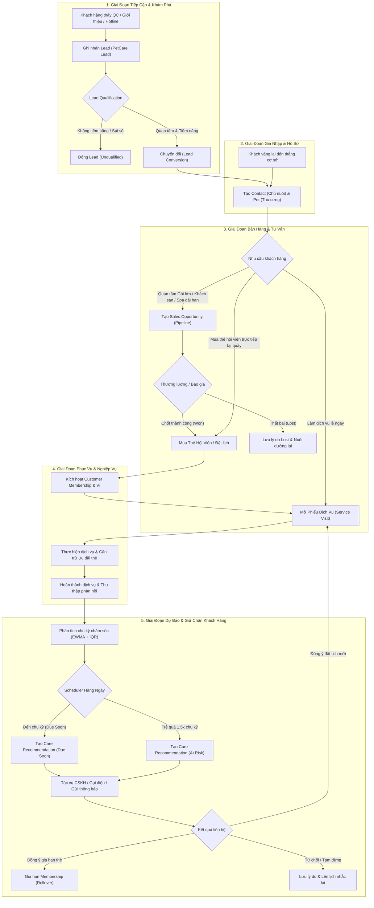

# TÀI LIỆU PHẠM VI SẢN PHẨM (PRODUCT SCOPE)
## HỆ THỐNG PETCARE CRM TOÀN DIỆN CHO DOANH NGHIỆP DỊCH VỤ THÚ CƯNG

> **Dự án**: PetCare CRM  
> **Nền tảng**: Frappe Framework v15 (Desk Standard UI & Python Backend)  
> **Phiên bản tài liệu**: 2.0  
> **Ngày cập nhật**: 26/10/2026  
> **Trạng thái**: Đã phê duyệt chuyển hướng CRM hoàn chỉnh  

---

## 1. TỔNG QUAN DỰ ÁN & MỤC TIÊU CHIẾN LƯỢC

### 1.1. Bối cảnh chuyển đổi
Ban đầu, dự án chỉ tập trung vào 2 phân hệ độc lập: **Quản lý Thẻ hội viên (Membership Management)** và **Khách hàng thân thiết (Customer Loyalty)**. Tuy nhiên, trong môi trường vận hành thực tế của các chuỗi spa, khách sạn và phòng khám thú cưng, vòng đời của khách hàng không bắt đầu từ thẻ hội viên mà bắt đầu từ khi phát sinh nhu cầu (Lead), trải qua quá trình tư vấn (Sales Opportunity), sử dụng dịch vụ đơn lẻ (Service Visit), sau đó mới nâng cấp lên Hội viên (Membership), và cần được chăm sóc dự báo chu kỳ (Personalized Retention) để chống rời bỏ dịch vụ (At-Risk).

### 1.2. Mục tiêu hệ thống PetCare CRM hoàn chỉnh
Xây dựng một hệ thống CRM chuyên biệt cho ngành chăm sóc thú cưng vận hành trơn tru trên nền tảng **Frappe Framework**, đảm bảo:
1. **Quản trị xuyên suốt vòng đời khách hàng (End-to-End Customer Lifecycle)**: Từ Lead tiềm năng -> Khách hàng chính thức gắn liền với Hồ sơ Thú cưng -> Bán gói/Dịch vụ -> Tiếp nhận thực tế -> Chăm sóc dự phòng -> Tái ký gia hạn.
2. **Linh hoạt luồng nghiệp vụ**: Không ép buộc mọi khách hàng phải qua cùng một phễu cứng nhắc. Khách hàng thân thiết có thể vào thẳng quầy dịch vụ; khách vãng lai có thể đăng ký thẻ ngay tại quầy; khách trực tuyến được chuyển đổi tự động từ Lead.
3. **Chuẩn hóa kiến trúc OOP & Nền tảng Frappe**: Tận dụng tối đa các thành phần lõi của Frappe Desk (Contact, Communication, ToDo, Workflow, Report) kết hợp với các DocType và Service Layer độc lập của PetCare CRM, loại bỏ triệt để các phụ thuộc phức tạp vào ứng dụng thứ ba không cần thiết.

---

## 2. CHÂN DUNG NGƯỜI DÙNG & VAI TRÒ (USER PERSONAS & RBAC)

| Vai trò (Role) | Đối tượng thực tế | Trách nhiệm chính trên hệ thống | Giao diện sử dụng chính |
| :--- | :--- | :--- | :--- |
| **Lễ tân / Thu ngân (PetCare Receptionist)** | Nhân viên trực quầy lễ tân, trực điện thoại | Tiếp nhận khách vãng lai, mở phiếu Service Visit, tra cứu thẻ hội viên, cấn trừ quyền lợi, nạp tiền ví, thu tiền và in phiếu. | Desk List View, Service Visit Form, Membership Lookup |
| **Nhân viên Tư vấn / Sales (PetCare Sales)** | Chuyên viên chăm sóc khách hàng mới & telesales | Tiếp nhận Lead, phân loại nguồn, gọi điện tư vấn dịch vụ/combo, quản lý cơ hội bán hàng (Opportunity Pipeline), chuyển đổi Lead thành Contact & Pet. | PetCare Lead, Opportunity Kanban Board, Activity Log |
| **Kỹ thuật viên Spa / Bác sĩ (PetCare Specialist)** | Thợ cắt tỉa lông, tắm spa, nhân viên lưu chuồng | Cập nhật tình trạng sức khỏe, cân nặng, hình ảnh thực tế của thú cưng trong phiếu Service Visit, ghi nhận phản hồi/dị ứng. | Service Visit Form (Read & Update status/notes), Pet Profile |
| **Chuyên viên CSKH (PetCare Retention / Care)** | Nhân viên chăm sóc sau dịch vụ, chăm sóc khách cũ | Quản lý danh sách Pet sắp đến hạn (`Due Soon`) và khách hàng có nguy cơ rời bỏ (`At Risk`), thực hiện cuộc gọi chăm sóc, cập nhật kết quả Care Recommendation. | Care Recommendation List View, At-Risk Dashboard, ToDo |
| **Quản trị viên / Chủ cơ sở (PetCare Manager)** | Quản lý chi nhánh, giám đốc vận hành | Cấu hình bảng giá dịch vụ, chính sách thẻ hội viên, theo dõi báo cáo doanh thu, phễu bán hàng, tỷ lệ giữ chân khách hàng, phân quyền nhân sự. | PetCare Workspace, Analytics Dashboards, System Reports |

---

## 3. VÒNG ĐỜI KHÁCH HÀNG TOÀN DIỆN (CUSTOMER LIFECYCLE)

Vòng đời khách hàng trong PetCare CRM được thiết kế theo cấu trúc mạng lưới linh hoạt (Flexible Lifecycle Graph), hỗ trợ nhiều điểm chạm (touchpoints) khác nhau:

---

## 4. MA TRẬN PHÂN LOẠI PHẠM VI (SCOPE CLASSIFICATION)

Để đảm bảo dự án hoàn thành đúng tiến độ, đạt chuẩn đồ án chuyên nghiệp, kiến trúc vững chắc và tránh phân tán nguồn lực vào các tính năng không cốt lõi, phạm vi sản phẩm được phân loại thành 3 nhóm rõ rệt:

### 4.1. Nhóm BẮT BUỘC (MUST HAVE) — Cốt lõi của PetCare CRM
Đây là các chức năng bắt buộc phải có để hệ thống vận hành trọn vẹn và đạt tiêu chuẩn CRM chuyên nghiệp:

1. **Phân hệ Marketing & Lead Management**:
   - Ghi nhận Lead đa kênh (Facebook, Zalo, Hotline, Giới thiệu, Khách ghé trực tiếp).
   - Quản lý trạng thái vòng đời Lead: `New`, `Contacted`, `Qualified`, `Unqualified`, `Converted`.
   - Phân công Lead cho nhân viên kinh doanh phụ trách (Lead Owner).
   - Tự động hóa chuyển đổi: Chuyển Lead thành hồ sơ `Contact` (Khách hàng) và `Pet` (Hồ sơ thú cưng) chỉ với 1 click.
2. **Phân hệ Quản lý Hồ sơ Khách hàng & Thú cưng (Customer & Multi-Pet Management)**:
   - Hồ sơ Khách hàng chuẩn hóa (tận dụng `Contact` của Frappe Framework) với đầy đủ kênh liên lạc.
   - Hồ sơ Thú cưng (`Pet`) quan hệ 1-Nhiều với Chủ nuôi (1 khách nuôi nhiều bé cưng).
   - Thuộc tính thú cưng quan trọng: Loài (Chó, Mèo, Thỏ...), giống loài, cân nặng, ngày sinh, đặc điểm tính cách, tiền sử y tế/dị ứng.
   - Dòng thời gian hoạt động thống nhất (Unified Timeline): Xem toàn bộ lịch sử tương tác, cuộc gọi, dịch vụ và thẻ hội viên trên một màn hình.
3. **Phân hệ Quản lý Cơ hội Bán hàng (Sales Pipeline & Opportunity)**:
   - Quản lý Opportunity theo các giai đoạn: `Prospecting`, `Qualification`, `Proposal`, `Negotiation`, `Closed Won`, `Closed Lost`.
   - Giá trị dự kiến cơ hội, xác suất chốt, ngày kỳ vọng chốt hợp đồng.
   - Ghi nhận lý do thất bại (Lost Reason) để tối ưu chiến lược tư vấn.
4. **Phân hệ Quản lý Danh mục Dịch vụ & Phiếu tiếp nhận (Service Operations)**:
   - Danh mục dịch vụ chuẩn (`PetCare Service`) với tên, mã, phân loại, đơn giá niêm yết, thời lượng ước tính.
   - Phiếu tiếp nhận dịch vụ (`Service Visit`): Tiếp nhận thú cưng, chọn dịch vụ, kỹ thuật viên thực hiện, giá gốc, quyền lợi hội viên áp dụng, giá thực thu.
5. **Phân hệ Quản lý Thẻ hội viên, Quyền lợi & Ví nạp (Membership Lifecycle & Wallet)**:
   - Gói hội viên (`Membership Plan`): Cấu hình quyền lợi chiết khấu theo %, giảm tiền trực tiếp hoặc miễn phí số lượt dịch vụ.
   - Thẻ hội viên khách hàng (`Customer Membership`): Kích hoạt, thời hạn hiệu lực, trạng thái (`Active`, `Expired`, `Cancelled`).
   - Hỗ trợ chính sách Thẻ gia đình (áp dụng cho mọi thú cưng của cùng một chủ) hoặc Thẻ chỉ định riêng từng thú cưng.
   - Cơ chế cấn trừ tự động quyền lợi và nạp/trừ ví trả trước (`Membership Transaction`).
   - Quy trình gia hạn (`Renewal`) và chính sách kế thừa số lượt chưa sử dụng (`Rollover Allowance`).
6. **Phân hệ Dự báo Chu kỳ & Giữ chân Khách hàng (Personalized Care & Retention Engine)**:
   - Động cơ toán học OOP phân tích lịch sử dịch vụ: Tự động lọc ngoại lệ thống kê bằng khoảng tứ phân vị (IQR) và tính chu kỳ trung bình có trọng số theo thời gian (EWMA).
   - Tự động gán trạng thái chu kỳ: `STABLE`, `DUE_SOON`, `OVERDUE` (At-Risk), `INSUFFICIENT_DATA`.
   - Tạo đề xuất chăm sóc cá nhân hóa (`Care Recommendation`) và theo dõi chuyển đổi: `New` -> `Contacted` -> `Booked` / `Dismissed`.
7. **Tự động hóa & Báo cáo quản trị (Automation & Analytics)**:
   - Scheduler chạy ngầm hàng ngày (Daily Cron Scan) quét toàn bộ hồ sơ thú cưng và thẻ hội viên.
   - PetCare CRM Workspace trên Frappe Desk tích hợp Dashboard Charts và Number Cards (Tỷ lệ chuyển đổi Lead, Phễu bán hàng, Doanh thu dịch vụ, Danh sách khách hàng At-Risk).
   - Bộ kiểm thử tự động (Automated Unit Tests) độ phủ cao đảm bảo logic nghiệp vụ an toàn tuyệt đối.

### 4.2. Nhóm NÊN CÓ (SHOULD HAVE) — Nâng cao trải nghiệm vận hành
Được bổ sung khi các luồng Must-Have đã ổn định và kiểm thử đạt chuẩn:
- Tự động gửi email thông báo / nhắc lịch hẹn (Email notification qua SMTP / Mailtrap) khi có khuyến nghị chăm sóc hoặc thẻ sắp hết hạn.
- Cơ chế gán nhãn (Tagging) phân nhóm thú cưng (ví dụ: `VIP`, `Khó tính`, `Dị ứng cồn`, `Cần chăm sóc nhẹ tay`).
- Màn hình tra cứu nhanh dành cho Lễ tân tại quầy (Quick Reception Desk View).

### 4.3. Nhóm NGOÀI PHẠM VI (OUT OF SCOPE) — Không triển khai ở giai đoạn này
Các chức năng sau đây **tuyệt đối không triển khai** nhằm bảo toàn tính tập trung và ổn định của đồ án:
- ❌ **Cổng thanh toán trực tuyến (Online Payment Gateways)** như VNPay, MoMo, Stripe, PayPal: Mọi thanh toán đều được nhân viên thu ngân ghi nhận hình thức thực tế (Tiền mặt, Quẹt thẻ POS ngân hàng, Chuyển khoản VietQR đối soát thủ công).
- ❌ **Quản lý kho hàng & kiểm kê tồn kho chuyên sâu (ERP Inventory / Stock Ledger)**: Hệ thống tập trung vào CRM Quản lý dịch vụ và khách hàng; không quản lý chuỗi cung ứng xuất-nhập-tồn hàng hóa phức tạp.
- ❌ **Hệ thống bệnh án lâm sàng thú y chuyên sâu (Veterinary EMR)**: Không xây dựng phân hệ phẫu thuật nội trú, phim chụp X-Quang, phác đồ hóa trị thú y.
- ❌ **Ứng dụng di động độc lập (Native iOS / Android Apps)**: Người dùng sử dụng giao diện chuẩn Frappe Desk và Web Portal đáp ứng tốt trên máy tính và trình duyệt máy tính bảng.
- ❌ **Mô hình AI / Học máy (Heavy Deep Learning / LLM Server)**: Toàn bộ thuật toán dự báo chu kỳ chăm sóc được giải quyết triệt để và minh bạch bằng mô hình thống kê EWMA kết hợp IQR chạy trực tiếp trong mã nguồn Python tối ưu nhẹ nhàng.

---

## 5. ĐÁNH GIÁ TẬN DỤNG NỀN TẢNG FRAPPE FRAMEWORK

| Nhu cầu CRM PetCare | Thành phần Frappe Framework có sẵn | Triển khai trong PetCare CRM |
| :--- | :--- | :--- |
| **Thông tin Chủ nuôi** | Built-in DocType `Contact` & `Address` | Tái sử dụng `Contact` làm đối tượng Khách hàng trung tâm, mở rộng liên kết. |
| **Ghi chú & Tương tác** | Built-in DocTypes `Communication`, `Note`, `Comment`, `Activity Log` | Tận dụng cơ chế Timeline mặc định của Frappe Desk cho mọi DocType. |
| **Công việc nhắc nhở** | Built-in DocType `ToDo`, `Event` | Tự động sinh `ToDo` cho nhân viên khi có cảnh báo At-Risk hoặc lịch hẹn chăm sóc. |
| **Quy trình & Phê duyệt** | Built-in `Workflow`, `Workflow State`, `Workflow Action` | Cấu hình quy trình phê duyệt giảm giá gói thẻ hội viên hoặc hủy phiếu dịch vụ. |
| **Thông báo hệ thống** | Built-in `Notification` & `Email Queue` | Kích hoạt cảnh báo hệ thống khi có thẻ hội viên hết hạn hoặc Lead mới phát sinh. |
| **Phân quyền người dùng** | Built-in Role Permission Manager | Phân chia quyền hạn chi tiết cho 4 vai trò (Receptionist, Sales, Specialist, Manager). |
| **Báo cáo & Biểu đồ** | Built-in `Dashboard`, `Dashboard Chart`, `Number Card`, `Report Builder` | Xây dựng màn hình PetCare CRM Workspace trực quan không cần viết mã frontend tùy biến. |
| **Core CRM Entities** | *Không có sẵn trong Frappe core* | Xây dựng các DocType tùy chỉnh chuẩn mực: `PetCare Lead`, `PetCare Opportunity`, `PetCare Service`, `Pet`, `Service Visit`, `Customer Membership`... |
