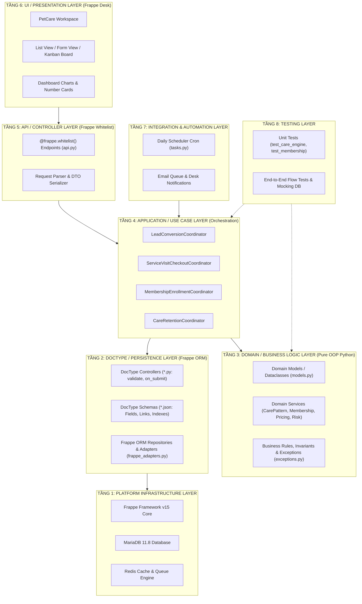

# KIẾN TRÚC TỔNG THỂ HỆ THỐNG (SYSTEM ARCHITECTURE)
## HỆ THỐNG PETCARE CRM TOÀN DIỆN CHO DOANH NGHIỆP DỊCH VỤ THÚ CƯNG

> **Dự án**: PetCare CRM  
> **Nền tảng**: Frappe Framework v15 (Python 3.10+ & MariaDB 10.6+)  
> **Phiên bản kiến trúc**: 2.0 (Clean Architecture & OOP Alignment)  
> **Ngày lập**: 26/10/2026  

---

## 1. MÔ HÌNH PHÂN TẦNG KIẾN TRÚC (8-LAYER ARCHITECTURE)

Hệ thống PetCare CRM tuân thủ nguyên tắc **Clean Architecture** và **Separation of Concerns (SoC)**, phân định rõ ranh giới giữa nền tảng Frappe Framework, tầng nghiệp vụ miền (Domain), tầng điều phối ứng dụng (Application), và tầng hiển thị (Presentation):



---

## 2. TRÁCH NHIỆM CHI TIẾT CỦA TỪNG TẦNG (LAYER RESPONSIBILITIES)

### Tầng 1: Frappe Platform Layer (Nền tảng hạ tầng)
* **Thành phần**: Frappe Framework v15, MariaDB InnoDB Engine, Redis Cache, Redis Queue, Background Workers.
* **Trách nhiệm**: Cung cấp các dịch vụ hệ thống cốt lõi: kết nối CSDL, quản lý session người dùng, phân quyền truy cập Role-Based Access Control (RBAC), hàng đợi tác vụ nền (background job queue), và scheduler kích hoạt định kỳ.
* **Quy tắc**: Không sửa đổi mã nguồn lõi của Frappe Framework; mọi mở rộng phải nằm trong custom app `petcare_crm`. Không phụ thuộc vào app ngoài `frappe/crm`.

### Tầng 2: DocType / Persistence Layer (Lưu trữ & ORM)
* **Thành phần**: Các tệp `doctype/**/*.json` và `doctype/**/*.py` (Document controller).
* **Trách nhiệm**:
  * Định nghĩa cấu trúc bảng CSDL, khóa ngoại, kiểu dữ liệu và chỉ mục (indexing).
  * Thực thi vòng đời của Frappe Document: `validate()`, `before_save()`, `on_submit()`, `on_cancel()`.
  * Đảm bảo tính toàn vẹn cấp cơ sở dữ liệu: kiểm tra khóa ngoại, ràng buộc duy nhất (unique), và kiểm tra giá trị hợp lệ trước khi lưu.
* **Quy tắc**: DocType Controller chỉ làm nhiệm vụ kiểm tra tính hợp lệ của bản ghi và đồng bộ dữ liệu trực tiếp; **không chứa các thuật toán thống kê phức tạp** hoặc logic toán học cồng kềnh.

### Tầng 3: Domain / Business Logic Layer (Nghiệp vụ miền thuần khiết)
* **Thành phần**: Các module Python thuần trong `petcare_crm/utils/` (`models.py`, `care_pattern_service.py`, `membership_service.py`, `pricing_service.py`, `exceptions.py`).
* **Trách nhiệm**:
  * Chứa toàn bộ quy tắc nghiệp vụ cốt lõi, công thức tính toán và thuật toán chuyên sâu (ví dụ: công thức EWMA $\alpha=0.6$, thuật toán IQR loại bỏ dị thường thống kê, công thức tính chiết khấu gói thẻ).
  * Sử dụng các **Python Dataclasses** hoặc **Result Objects** độc lập để đại diện cho kết quả xử lý nghiệp vụ, không phụ thuộc vào `frappe.model.document.Document`.
* **Quy tắc**: Tầng Domain **không được phép gọi trực tiếp câu lệnh SQL hay API HTTP**. Tầng này có thể chạy kiểm thử độc lập mà không cần khởi động toàn bộ môi trường Frappe.

### Tầng 4: Application / Use Case Layer (Điều phối nghiệp vụ)
* **Thành phần**: Các Use Case Coordinators và Adapter Services (`frappe_adapters.py`, `frappe_recommendation_engine.py`, `lead_conversion_coordinator.py`).
* **Trách nhiệm**:
  * Tiếp nhận yêu cầu từ Controller/API, lấy dữ liệu cần thiết từ Tầng Persistence, chuyển giao cho Tầng Domain xử lý, và lưu lại kết quả.
  * Thiết lập **Transaction Boundary** an toàn (`frappe.db.commit()`, `frappe.db.rollback()`): Đảm bảo các thao tác ghi nhận phiếu dịch vụ và cấn trừ quyền lợi thẻ hội viên được thực hiện nguyên khối (ACID).
  * Phát sinh các sự kiện nghiệp vụ (Domain Events) hoặc kích hoạt tạo ToDo/Notification cho nhân viên.

### Tầng 5: API / Controller Layer (Giao diện lập trình)
* **Thành phần**: `petcare_crm/api.py` với các hàm được trang trí bằng `@frappe.whitelist()`.
* **Trách nhiệm**:
  * Tiếp nhận HTTP Request từ giao diện Desk hoặc các client bên ngoài.
  * Kiểm tra quyền hạn người dùng (`frappe.has_permission()`).
  * Parse và validate dữ liệu đầu vào; bắt và chuyển đổi các ngoại lệ miền (`PetCareException`) thành mã lỗi và thông báo thân thiện với người dùng (`frappe.throw()`).
  * Trả về dữ liệu chuẩn JSON cho client.
* **Quy tắc**: Tuyệt đối không viết trực tiếp logic nghiệp vụ hoặc query CSDL phức tạp trong API endpoint; API chỉ đóng vai trò Wrapper gọi xuống Application/Use Case Layer.

### Tầng 6: UI / Presentation Layer (Giao diện Desk)
* **Thành phần**:
  * Giao diện chuẩn của Frappe Desk: List Views, Form Views, Quick Entry Dialogs.
  * Kanban Boards dành cho Quản lý Cơ hội Bán hàng (`PetCare Opportunity`).
  * PetCare CRM Workspace (`workspace/petcare_crm.json`) tích hợp Number Cards (Số Lead mới, Số khách At-Risk, Doanh thu thẻ) và Dashboard Charts (Phễu bán hàng, Xu hướng dịch vụ).
  * Client scripts (`*.js`) tối ưu trải nghiệm: nút bấm hành động (Custom Buttons), tìm kiếm tự động, và hộp thoại xác nhận.
* **Quy tắc**: Không xây dựng ứng dụng độc lập bằng React/Vue SPA; sử dụng 100% khả năng UI của Frappe Desk để đảm bảo tính đồng bộ và bảo trì lâu dài.

### Tầng 7: Integration & Automation Layer (Tự động hóa & Tích hợp)
* **Thành phần**: `petcare_crm/tasks.py`, `hooks.py` (`scheduler_events`).
* **Trách nhiệm**:
  * Quản lý các cron job chạy định kỳ: `daily_petcare_scan` (chạy hàng đêm lúc 23:00) quét toàn bộ hồ sơ thú cưng, đánh giá chu kỳ và cảnh báo hết hạn thẻ.
  * Hàng đợi gửi Email tự động (`Email Queue`) thông báo cho khách hàng hoặc nhắc việc cho nhân sự.

### Tầng 8: Testing Layer (Kiểm thử tự động)
* **Thành phần**: Thư mục `petcare_crm/tests/` (`test_membership.py`, `test_care_engine.py`, `test_tasks.py`).
* **Trách nhiệm**:
  * Đảm bảo tính đúng đắn của toàn bộ business logic qua hệ thống Unit Test tự động chạy bằng lệnh `bench run-tests --app petcare_crm`.
  * Kiểm tra các tình huống biên (Edge cases): chia cho 0, ngày hết hạn trong quá khứ, cấn trừ vượt số lượng tồn, số dư ví âm, dị thường khoảng cách ngày.

---

## 3. NGUYÊN TẮC THIẾT KẾ OOP & QUẢN LÝ GIAO TÁC (TRANSACTION BOUNDARIES)

1. **Single Responsibility Principle (SRP)**:
   * Mỗi service class chỉ chịu trách nhiệm cho một miền nghiệp vụ duy nhất. Ví dụ: `PricingService` chỉ tính tiền; `BenefitRedemptionService` chỉ xử lý trừ lượt; `CarePatternAnalyzer` chỉ xử lý thuật toán EWMA/IQR.
2. **Dependency Inversion & Adapters**:
   * Tầng nghiệp vụ không phụ thuộc trực tiếp vào ORM của Frappe mà giao tiếp thông qua Adapter Interface (`frappe_adapters.py`), cho phép dễ dàng mock dữ liệu khi viết unit test độc lập.
3. **Transaction Boundaries**:
   * Mọi use case có tác động thay đổi trạng thái tài chính hoặc trừ quyền lợi (như Mở phiếu dịch vụ cấn trừ thẻ, Nạp tiền ví, Gia hạn thẻ) phải được bao bọc trong khối giao tác an toàn:
   ```python
   try:
       # Bước 1: Validate điều kiện nghiệp vụ
       # Bước 2: Tạo bản ghi Service Visit
       # Bước 3: Cấn trừ quyền lợi thẻ hội viên
       # Bước 4: Ghi nhật ký giao dịch
       frappe.db.commit()
   except Exception as e:
       frappe.db.rollback()
       raise e
   ```
