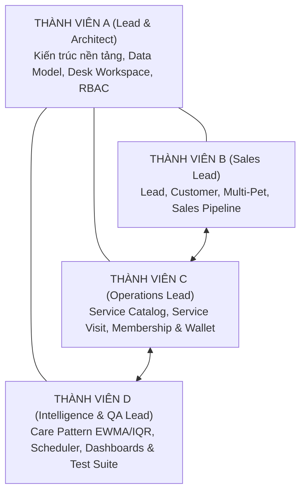
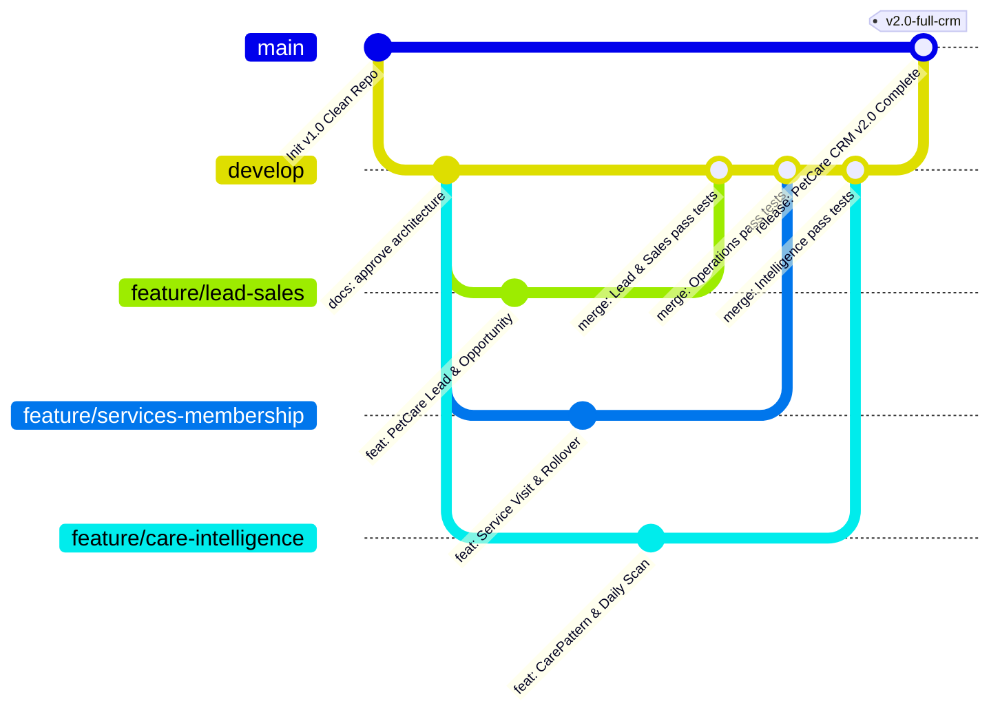

# PHÂN CÔNG TRÁCH NHIỆM NHÓM & QUY TRÌNH HỢP TÁC (TEAM OWNERSHIP & GIT WORKFLOW)
## HỆ THỐNG PETCARE CRM TOÀN DIỆN CHO DOANH NGHIỆP DỊCH VỤ THÚ CƯNG

> **Dự án**: PetCare CRM  
> **Nền tảng**: Frappe Framework v15  
> **Phiên bản tài liệu**: 2.0  
> **Quy mô nhóm**: 4 Thành viên (A, B, C, D)  
> **Ngày lập**: 26/10/2026  

---

## 1. MA TRẬN PHÂN CÔNG TRÁCH NHIỆM (RACI MATRIX)

Hệ thống được phát triển thống nhất trên một custom app Frappe duy nhất (`petcare_crm`). Bốn thành viên đảm nhận 4 mảng nghiệp vụ chuyên biệt với ranh giới rõ ràng:

| Phân hệ / Mô-đun | Thành viên A (Kiến trúc & Tích hợp) | Thành viên B (Lead & Sales) | Thành viên C (Dịch vụ & Thẻ) | Thành viên D (Trí tuệ & QA) |
| :--- | :---: | :---: | :---: | :---: |
| **Kiến trúc phân tầng & Base Setup** | **A (Accountable)** | C (Consulted) | C (Consulted) | C (Consulted) |
| **Marketing & Lead Management** | C (Consulted) | **R (Responsible)** | I (Informed) | I (Informed) |
| **Customer & Multi-Pet Management** | C (Consulted) | **R (Responsible)** | R (Hồ sơ dịch vụ) | I (Informed) |
| **Sales Opportunity & Kanban Pipeline** | C (Consulted) | **R (Responsible)** | I (Informed) | I (Informed) |
| **PetCare Service Catalog & Visits** | C (Consulted) | I (Informed) | **R (Responsible)** | C (Lịch sử làm đẹp) |
| **Membership Plan, Lifecycle & Wallet**| C (Consulted) | C (Bán thẻ) | **R (Responsible)** | I (Informed) |
| **Benefit Redemption & Ledger** | C (Consulted) | I (Informed) | **R (Responsible)** | I (Informed) |
| **Care Pattern Engine (EWMA + IQR)** | C (Consulted) | I (Informed) | C (Dữ liệu visit) | **R (Responsible)** |
| **Scheduler Quét Hàng Ngày (tasks.py)** | C (Hạ tầng Cron) | I (Informed) | C (Check hết hạn thẻ) | **R (Responsible)** |
| **Care Recommendations & Retention** | I (Informed) | R (Gọi CSKH) | I (Informed) | **R (Responsible)** |
| **Desk Workspace, Dashboards & Reports**| **R (Responsible)** | C (Metrics Sales) | C (Metrics Doanh thu) | **R (Metrics At-Risk)** |
| **Automated Test Suite & CI Testing** | C (Hạ tầng Test) | C (Unit Test B) | C (Unit Test C) | **R (Chủ trì QA)** |

*(Chú thích: **R** - Thực hiện chính (Responsible); **A** - Chịu trách nhiệm duyệt (Accountable); **C** - Tham vấn (Consulted); **I** - Nhận thông tin (Informed))*

---

## 2. CHI TIẾT PHÂN CÔNG TỪNG THÀNH VIÊN

### THÀNH VIÊN A: KiẾN TRÚC SƯ TRƯỞNG & ĐẦU MỐI TÍCH HỢP (ARCHITECT & INTEGRATION LEAD)
* **Phạm vi sở hữu**:
  * Chuẩn hóa cấu trúc thư mục, quy tắc Clean Architecture và mã hóa nền tảng.
  * Thiết kế và cấu hình phân quyền người dùng (Role Permission Manager) cho 4 nhóm: Receptionist, Sales, Specialist, Manager.
  * Xây dựng trang làm việc trung tâm `PetCare CRM Workspace` trên Frappe Desk.
  * Quản lý tệp cấu hình triển khai nhanh `deploy_clean.ps1`, Docker compose, scripts kiểm thử và quy trình merge mã nguồn.
* **Tệp mã nguồn quản lý**:
  * `petcare_crm/hooks.py`, `petcare_crm/modules.txt`, `license.txt`.
  * `deploy_clean.ps1`, `build_image.ps1`, `.gitignore`.
  * `docs/SYSTEM_ARCHITECTURE.md`, `docs/DATA_CONTRACT.md`.

### THÀNH VIÊN B: CHUYÊN VIÊN PHỄU BÁN HÀNG & KHÁCH HÀNG (SALES & CUSTOMER SPECIALIST)
* **Phạm vi sở hữu**:
  * Phát triển DocType `PetCare Lead` và toàn bộ luồng tiếp nhận khách tiềm năng từ đa nguồn.
  * Viết Use Case `LeadConversionCoordinator`: chuyển đổi Lead sang Contact và Pet tự động chỉ với 1 click.
  * Phát triển DocType `PetCare Opportunity` và chế độ xem Kanban Board trên Desk theo từng giai đoạn bán hàng.
  * Chuẩn hóa dữ liệu hồ sơ khách hàng `Contact` và liên kết 1-Nhiều với thú cưng `Pet`.
* **Tệp mã nguồn quản lý**:
  * `doctype/petcare_lead/`, `doctype/petcare_opportunity/`, `doctype/pet/`.
  * `petcare_crm/utils/lead_conversion_coordinator.py`, `petcare_crm/utils/sales_pipeline_service.py`.
  * `petcare_crm/tests/test_lead_sales.py`.

### THÀNH VIÊN C: CHUYÊN VIÊN VẬN HÀNH DỊCH VỤ & THẺ HỘI VIÊN (OPERATIONS SPECIALIST)
* **Phạm vi sở hữu**:
  * Chuẩn hóa danh mục dịch vụ `PetCare Service` và phiếu tiếp nhận `Service Visit`.
  * Hoàn thiện vòng đời thẻ hội viên `Customer Membership` và các quy tắc cấn trừ ưu đãi `MembershipService`.
  * Phát triển `Benefit Redemption Ledger` ghi nhận kiểm toán từng lần trừ lượt dịch vụ.
  * Hoàn thiện quy trình Gia hạn thẻ (`Renewal`) và kế thừa quyền lợi tồn (`Rollover Allowance`).
  * Quản lý giao dịch ví trả trước `Membership Transaction` đảm bảo số dư không âm.
* **Tệp mã nguồn quản lý**:
  * `doctype/petcare_service/`, `doctype/service_visit/`, `doctype/membership_plan/`, `doctype/customer_membership/`, `doctype/membership_transaction/`, `doctype/benefit_redemption_ledger/`.
  * `petcare_crm/utils/membership_service.py`, `petcare_crm/utils/pricing_calculator.py`.
  * `petcare_crm/tests/test_membership.py`.

### THÀNH VIÊN D: KỸ SƯ TRÍ TUỆ GIỮ CHÂN KHÁCH HÀNG & QA LEAD (INTELLIGENCE & QA LEAD)
* **Phạm vi sở hữu**:
  * Động cơ toán học `CarePatternAnalyzer` (lọc dị thường thống kê bằng IQR, tính trung bình trọng số thời gian EWMA).
  * Đánh giá trạng thái chu kỳ `RiskDetectionService` (phát hiện `DUE_SOON` và `AT_RISK` quá 1.5 lần chu kỳ).
  * Quản lý vòng đời `Care Recommendation` và các nút tác vụ trên giao diện Desk: `Mark Contacted`, `Book Service`, `Dismiss`.
  * Tác vụ quét hàng ngày `daily_petcare_scan` trong `tasks.py`.
  * Chịu trách nhiệm tổng thể bộ kiểm thử tự động `tests/`, đảm bảo 100% test cases pass trước khi release.
* **Tệp mã nguồn quản lý**:
  * `doctype/care_recommendation/`.
  * `petcare_crm/utils/care_pattern_service.py`, `petcare_crm/utils/frappe_recommendation_engine.py`, `petcare_crm/tasks.py`.
  * `petcare_crm/tests/test_care_engine.py`, `petcare_crm/tests/test_tasks.py`.

---

## 3. CHIẾN LƯỢC QUẢN TRỊ NHÁNH GIT & TÍCH HỢP LIÊN TỤC (GIT FLOW)

Nhằm đảm bảo cả nhóm cùng làm việc trên **một repository và một ứng dụng duy nhất**, không phân rã thành các dự án con rời rạc:

### Quy tắc làm việc trên Git:
1. **Quy tắc 1 (Không commit trực tiếp vào `main` và `develop`)**:
   * Mọi thành viên bắt buộc phải tạo nhánh từ `develop` theo tiền tố:
     * `feature/lead-sales` (Thành viên B)
     * `feature/services-membership` (Thành viên C)
     * `feature/care-intelligence` (Thành viên D)
     * `feature/core-architecture` (Thành viên A)
2. **Quy tắc 2 (Kéo mã mới hàng ngày - Daily Rebase/Pull)**:
   * Trước khi bắt đầu viết code mỗi ngày, thành viên phải chạy `git pull origin develop` để đảm bảo code của mình luôn tương thích với các phần mới nhất mà đồng đội vừa tích hợp.
3. **Quy tắc 3 (Tiêu chuẩn Merge - Definition of Done)**:
   * Một nhánh tính năng chỉ được merge vào `develop` khi đáp ứng đủ 3 điều kiện:
     1. Mã nguồn tuân thủ đúng Data Contract và Class Design đã phê duyệt.
     2. Chạy bộ kiểm thử tự động đạt 100% Pass: `bench run-tests --app petcare_crm`.
     3. Được ít nhất một thành viên khác trong nhóm (trong đó có Thành viên A) review và phê duyệt.
