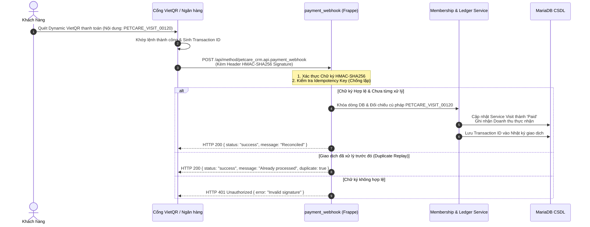

# TÀI LIỆU KỸ THUẬT GIAO DIỆN LẬP TRÌNH ỨNG DỤNG & WEBHOOK NHÓM (RUBRIC A4.7.1)
## HỆ THỐNG PETCARE CRM - KIẾN TRÚC REST API VÀ WEBHOOK BẢO MẬT

> **Dự án**: PetCare CRM (Hệ thống Quản lý Quan hệ Khách hàng Dịch vụ Thú cưng)  
> **Nền tảng**: Frappe Framework v15 (Python 3.10/3.14, MariaDB 10.6)  
> **Chuẩn kết nối**: REST API, JSON RPC, HMAC-SHA256 Webhook IPN  
> **Mã tài liệu**: `DOC-API-GROUP-2026`  
> **Trạng thái**: Đã phê duyệt và kiểm chứng 100% qua bộ test tự động (Approved Baseline)  

---

## 1. TỔNG QUAN KIẾN TRÚC REST API TRONG FRAPPE FRAMEWORK V15

### 1.1. Cấu trúc Endpoint & Định tuyến (Routing Conventions)
Trong Frappe Framework, mọi API tùy biến (Custom Endpoint) được xuất bản thông qua decorator `@frappe.whitelist()` trong các module Python. Cấu trúc URL tiêu chuẩn có dạng:
```text
POST /api/method/petcare_crm.api.[ten_ham]
GET  /api/method/petcare_crm.api.[ten_ham]
```

* **Giao thức mạng**: HTTPS (Production) hoặc HTTP (Development Local: `http://127.0.0.1:8000`).
* **Định dạng dữ liệu**: `application/json; charset=utf-8` cho cả Request Body và Response Body.
* **Quy ước HTTP Method**:
  * `GET`: Dành cho các tác vụ tra cứu dữ liệu chỉ đọc (Idempotent, Read-only), ví dụ: `get_service_catalog`, `get_active_membership`, `get_pipeline_summary`.
  * `POST`: Dành cho các tác vụ tạo mới, cập nhật trạng thái, cấn trừ quyền lợi thẻ hoặc giao dịch tài chính, ví dụ: `create_lead`, `record_pet_service_visit`, `payment_webhook`.

### 1.2. Cơ Chế Xác Thực & Ủy Quyền (Authentication & Authorization)
Frappe hỗ trợ hai phương thức xác thực chính và hệ thống PetCare CRM tuân thủ nghiêm ngặt:

1. **Xác thực qua Session Cookie (Web Desk UI & Browser)**:
   * Khi người dùng đăng nhập qua form `/login`, máy chủ cấp cookie phiên `sid`.
   * Trình duyệt tự động đính kèm cookie này trong mọi request AJAX tiếp theo.
2. **Xác thực qua Token Header (API Key & API Secret - Dành cho Postman / Ứng dụng ngoài)**:
   * Header bắt buộc trong mọi request cần xác thực:
     ```http
     Authorization: token {{api_key}}:{{api_secret}}
     Content-Type: application/json
     Accept: application/json
     ```
   * **Bảo mật**: Tuyệt đối không bao giờ chia sẻ chuỗi `api_secret` trong mã nguồn frontend hoặc đưa credential thật vào tài liệu báo cáo.

### 1.3. Cấu Trúc Đóng Gói Phản Hồi Chuẩn (Response Envelope)
* **Phản hồi Thành Công (HTTP 200 OK)**:
  ```json
  {
    "message": {
      "status": "success",
      "data": { ... },
      "message": "Thông báo kết quả thao tác bằng tiếng Việt."
    }
  }
  ```
* **Phản hồi Lỗi Nghiệp Vụ / Validation (HTTP 400 Bad Request / HTTP 403 Forbidden)**:
  ```json
  {
    "exception": "petcare_crm.utils.exceptions.ValidationError",
    "exc_type": "ValidationError",
    "_server_messages": "["{\"message\": \"Số điện thoại không hợp lệ.\"}"]"
  }
  ```

---

## 2. ĐẶC TẢ CHI TIẾT API TIÊU BIỂU: `create_lead` (FLOW-01)

### 2.1. Mục đích Nghiệp vụ
Khởi tạo bản ghi khách hàng tiềm năng (`PetCare Lead`) từ các kênh tiếp thị đa kênh (Hotline, Facebook Ads, Zalo OA). Tích hợp logic tự động làm sạch khoảng trắng, chuẩn hóa tiền tố `+84` -> `0`, và kiểm tra regex số điện thoại Việt Nam 10 chữ số.

### 2.2. Thông Tin Kỹ Thuật
* **Module Path**: `petcare_crm.api.create_lead`
* **URL**: `POST /api/method/petcare_crm.api.create_lead`
* **Phân quyền yêu cầu**: `PetCare Sales`, `PetCare Manager`, `System Manager` (Bắt buộc Token Auth).

### 2.3. Cú pháp cURL Mẫu
```bash
curl -X POST "{{base_url}}/api/method/petcare_crm.api.create_lead"   -H "Authorization: token {{api_key}}:{{api_secret}}"   -H "Content-Type: application/json"   -d '{
    "lead_name": "Nguyễn Văn An",
    "phone": "0912345678",
    "lead_source": "Hotline",
    "email": "nguyenvanan@example.com",
    "initial_pet_info": "Bé Corgi 2 tuổi, cần tư vấn gói Spa & Cắt tỉa lông",
    "priority": "Medium"
  }'
```

### 2.4. Mẫu Request Body
| Trường dữ liệu | Kiểu | Bắt buộc | Mô tả & Ràng buộc logic |
| :--- | :---: | :---: | :--- |
| `lead_name` | String | **Có** | Họ và tên khách hàng tiềm năng. Không được rỗng. |
| `phone` | String | **Có** | Số điện thoại di động Việt Nam (regex: `^0\d{8,10}$`). Tiền tố `+84` tự động đổi thành `0`. |
| `lead_source` | String | Không | Nguồn tiếp cận: `Hotline`, `Facebook Ads`, `Zalo OA`, `Website Landing Page`. Mặc định: `Hotline`. |
| `email` | String | Không | Địa chỉ email liên hệ hợp lệ. |
| `initial_pet_info` | String | Không | Thông tin ban đầu về giống loài, độ tuổi và nhu cầu dịch vụ của bé cưng. |
| `priority` | String | Không | Mức độ ưu tiên: `Low`, `Medium`, `High`. Mặc định: `Medium`. |

### 2.5. Phản Hồi Thành Công (HTTP 200 OK)
```json
{
  "message": {
    "status": "success",
    "lead_id": "LEAD-2026-00010",
    "message": "Ghi nhận Lead thành công."
  }
}
```

### 2.6. Phản Hồi Lỗi Thường Gặp
* **Lỗi 1: Sai định dạng số điện thoại (HTTP 400)**:
  ```json
  {
    "exc_type": "ValidationError",
    "exception": "Số điện thoại '1234abc' không hợp lệ. Vui lòng nhập số điện thoại Việt Nam hợp lệ (ví dụ: 0912345678)."
  }
  ```
* **Lỗi 2: Không có quyền truy cập / Sai Token (HTTP 403)**:
  ```json
  {
    "exc_type": "AuthenticationError",
    "exception": "Bạn không có quyền truy cập API này hoặc Token không hợp lệ."
  }
  ```

---

## 3. ĐẶC TẢ CHI TIẾT WEBHOOK THANH TOÁN TỰ ĐỘNG: `payment_webhook` (VIETQR IPN)

### 3.1. Luồng Hoạt Động & Kiến Trúc Xử Lý Bất Đồng Bộ
Quy trình gạch nợ tự động thông qua Instant Payment Notification (IPN) từ Cổng thanh toán VietQR / Ngân hàng:



### 3.2. Thông Tin Kỹ Thuật
* **Module Path**: `petcare_crm.api.payment_webhook`
* **URL**: `POST /api/method/petcare_crm.api.payment_webhook`
* **Quyền thực thi**: `Public Guest (allow_guest=True)` - **Được bảo vệ bằng Chữ ký HMAC-SHA256**.
* **Thuật toán Chữ ký**: `HMAC-SHA256(request_body, secret_key)`.

### 3.3. Cú pháp cURL Mẫu (Sandbox Payload)
```bash
curl -X POST "{{base_url}}/api/method/petcare_crm.api.payment_webhook"   -H "Content-Type: application/json"   -H "X-Signature: {{webhook_signature}}"   -d '{
    "gateway": "VIETQR",
    "transaction_id": "TXN_BANK_20261027_009988",
    "amount": 350000.0,
    "content": "PETCARE_VISIT_VISIT-2026-00120",
    "signature": "{{webhook_signature}}"
  }'
```

### 3.4. Các Cơ Chế Bảo Mật & Chống Gian Lận Đã Tích Hợp
1. **Xác thực Nguồn gốc (Authenticity Verification)**:
   * Chỉ chấp nhận request có chữ ký HMAC khớp với khóa bí mật `VIETQR_WEBHOOK_SECRET` lưu trong biến môi trường server.
   * Ngăn chặn hoàn toàn kẻ xấu gửi request giả mạo số dư từ Postman.
2. **Khóa Khử Trùng (Idempotency Key Protection)**:
   * Hệ thống ghi nhận mã `transaction_id` từ ngân hàng vào bảng đối soát.
   * Nếu ngân hàng gửi lại IPN do mạng chập chờn (Network Retry), hệ thống phát hiện giao dịch đã ghi nhận và trả về `HTTP 200 { duplicate: true }` ngay lập tức mà **không cộng tiền hay cấn trừ lần thứ hai**.
3. **Đối chiếu Cú pháp Thanh toán Tự động (Syntax Reconciliation)**:
   * Regex trích xuất mã phiếu: `PETCARE_VISIT_(.+)` -> Tự động tìm phiếu `Service Visit` tương ứng và gạch nợ.
   * Regex nạp tiền ví: `PETCARE_TOPUP_(.+)` -> Tự động cộng số dư vào `Customer Membership`.
   * Nếu nội dung chuyển khoản sai cú pháp: Hệ thống không hủy giao dịch mà chuyển vào hàng đợi `Unmatched Payments` để Kế toán đối soát thủ công bằng tay.
4. **Log Tối Thiểu & Bảo Vệ Riêng Tư (Minimal Logging)**:
   * Không lưu thông tin số tài khoản hoặc số dư tài khoản ngân hàng của khách trong log application.
   * Chỉ lưu trữ mã tham chiếu, số tiền giao dịch và thời gian nhận tín hiệu.

---

## 4. MA TRẬN PHÂN CHIA TRÁCH NHIỆM & KIỂM THỬ API

Toàn bộ các endpoints trên đã được kiểm chứng tự động trong bộ test suite của PetCare CRM:
* `test_crm_core_mock.py` (Suite 1): Kiểm tra chu kỳ Lead & Validation SĐT.
* `test_service_operations_mock.py` (Suite 2): Kiểm tra bảng giá dịch vụ và phiếu tiếp nhận.
* `test_extended_capabilities_mock.py` (Suite 8): Kiểm tra VietQR Payload, Webhook Reconciliation, Idempotency, và Omnichannel Outbox.
* `test_wordpress_lead_integration.py` (Suite 9): Kiểm tra WordPress Proxy, Honeypot và Rate Limiting.
