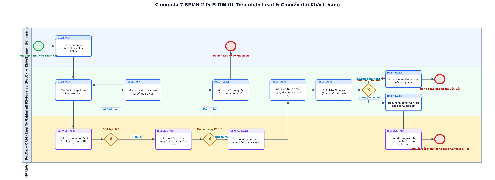

# BÁO CÁO THUYẾT MINH QUY TRÌNH NGHIỆP VỤ CÁ NHÂN (RUBRIC A4.3.2)
## FLOW-01: TIẾP NHẬN LEAD ĐA KÊNH, CHUẨN HÓA SĐT VN & CHUYỂN ĐỔI KHÁCH HÀNG - THÚ CƯNG

> **Thành viên phụ trách**: `[MSSV1] - [HỌ TÊN 1]`  
> **Vai trò phân hệ**: Chuyên viên Phễu Tiếp nhận & Chuyển đổi Khách hàng (Sales & Customer Specialist)  
> **Dự án**: PetCare CRM (Frappe Framework v15)  
> **Chuẩn mô hình hóa**: BPMN 2.0 XML (Tương thích Camunda Modeler 5.45.0)  
> **Mã quy trình**: `FLOW-01`  

---

## 1. THÔNG TIN CẤU HÌNH & TỔNG QUAN

| Thuộc tính | Giá trị thiết lập |
| :--- | :--- |
| **Thành viên phụ trách** | `[MSSV1] - [HỌ TÊN 1]` |
| **Vai trò phân hệ** | Chuyên viên Phễu Tiếp nhận & Chuyển đổi Khách hàng (Sales & Customer Specialist) |
| **Mã quy trình nghiệp vụ** | `FLOW-01` |
| **Tên quy trình** | Tiếp nhận Lead Đa kênh, Chuẩn hóa SĐT VN & Chuyển đổi Khách hàng - Thú cưng |
| **DocType sở hữu chính** | `PetCare Lead, Contact, Pet` |
| **Whitelisted API độc quyền** | `create_lead, update_lead_status, add_lead_interaction, convert_lead_to_customer, get_customer_360` |
| **Tập tin sơ đồ BPMN** | `MSSV1_HoTen1_TiepNhanLead.bpmn` |
| **Tập tin hình ảnh sơ đồ** | `MSSV1_HoTen1_TiepNhanLead.png` |
| **Bộ kiểm thử liên quan** | `12/12 test cases passed in test_lead_sales.py & test_e2e_lead_conversion.py` |

---

## 2. SƠ ĐỒ QUY TRÌNH CHUẨN BPMN 2.0 (CAMUNDA MODELER)

*Hình 1: Sơ đồ BPMN 2.0 phân hệ Tiếp nhận Lead Đa kênh, Chuẩn hóa SĐT VN & Chuyển đổi Khách hàng - Thú cưng (Tương thích 100% Camunda Modeler Desktop v5.45.0).*

---

## 3. MỤC TIÊU & RANH GIỚI TRÁCH NHIỆM NGHIỆP VỤ

Quy trình FLOW-01 đảm bảo việc tiếp nhận dữ liệu khách hàng tiềm năng đa kênh (Website Landing Page, Facebook Lead Ads, Zalo OA, Hotline quầy) được tự động làm sạch, chuẩn hóa định dạng số điện thoại Việt Nam (+84 -> 0, đầu số 10 chữ số theo regex), ngăn chặn trùng lặp khách hàng bằng thuật toán đối soát CSDL theo số điện thoại (Deduplication Check). Đồng thời, quy trình kiểm soát việc tư vấn, đánh giá tiềm năng và thực hiện giao dịch chuyển đổi nguyên tử (Atomic Conversion) từ Lead thành Contact (Chủ nuôi) và Pet (Hồ sơ thú cưng) chỉ qua 1 thao tác mà không làm phân mảnh dữ liệu.

---

## 4. CÁC BÊN THAM GIA & PHÂN VAI LÀN CÔNG VIỆC (POOLS & LANES)

| Tên Lane trong BPMN | Đối tượng thực tế | Quyền hạn Frappe RBAC | Nhiệm vụ cốt lõi |
| :--- | :--- | :--- | :--- |
| **Khách hàng tiềm năng** | Chủ nuôi thú cưng có nhu cầu dịch vụ | `Khách ngoài (Guest / Public Web)` | Gửi thông tin biểu mẫu tư vấn qua Website/Zalo hoặc gọi hotline |
| **Tư vấn viên / Telesales** | Nhân viên kinh doanh / Telesales | `PetCare Sales, PetCare Manager` | Tiếp nhận form, gọi điện tư vấn, ghi chú timeline, bấm Convert Lead |
| **Hệ thống PetCare CRM** | Động cơ xử lý nghiệp vụ & MariaDB | `System Service Layer / Automated Engine` | Chuẩn hóa SĐT, kiểm tra trùng lặp, chạy transaction tạo Contact & Pet |

---

## 5. ĐIỀU KIỆN ĐẦU VÀO & ĐẦU RA (PRE/POST-CONDITIONS)

* **Điều kiện tiên quyết (Preconditions)**:
  * Khách hàng gửi form nhu cầu qua landing page hoặc liên hệ hotline; nhân viên kinh doanh đăng nhập Frappe Desk với Role PetCare Sales hoặc PetCare Manager.
* **Kết quả sau quy trình (Postconditions)**:
  * Lead chuyển sang trạng thái Converted, hệ thống tự động sinh Contact và Pet liên kết chính xác, sẵn sàng mở phiếu dịch vụ hoặc cơ hội bán hàng.

---

## 6. THUYẾT MINH CHI TIẾT CÁC BƯỚC THỰC HIỆN (STEP-BY-STEP FLOW)

| Bước | Loại Task BPMN | Lane thực hiện | Hành động nghiệp vụ & Ràng buộc logic |
| :---: | :--- | :--- | :--- |
| 1 | `startEvent` | Khách hàng tiềm năng | Khách hàng phát sinh nhu cầu chăm sóc, làm đẹp thú cưng |
| 2 | `userTask` | Khách hàng tiềm năng | Điền biểu mẫu trên Landing Page / Gửi tin nhắn qua Zalo OA hoặc Hotline |
| 3 | `userTask` | Tư vấn viên / Telesales | Mở Frappe Desk tiếp nhận thông tin hoặc nhập Form PetCare Lead thủ công |
| 4 | `serviceTask` | Hệ thống PetCare CRM | Chạy hàm chuẩn hóa SĐT: đổi tiền tố +84 thành 0, kiểm tra 10 số với regex ^(03|05|07|08|09)\d{8}$ |
| 5 | `exclusiveGateway` | Hệ thống PetCare CRM | Kiểm tra tính hợp lệ của số điện thoại: Nếu sai -> báo lỗi; nếu hợp lệ -> sang bước kiểm tra trùng |
| 6 | `serviceTask` | Hệ thống PetCare CRM | Thực thi truy vấn đối soát số điện thoại với bảng Contact và PetCare Lead hiện hữu |
| 7 | `exclusiveGateway` | Hệ thống PetCare CRM | Nếu SĐT đã tồn tại: thông báo liên kết khách cũ; nếu là số mới: khởi tạo bản ghi Lead mới |
| 8 | `serviceTask` | Hệ thống PetCare CRM | Lưu bản ghi PetCare Lead mới ở trạng thái New và tự động gán lead_owner cho nhân viên phụ trách |
| 9 | `userTask` | Tư vấn viên / Telesales | Gọi điện thoại thăm hỏi thể trạng thú cưng, tư vấn gói dịch vụ phù hợp |
| 10 | `userTask` | Tư vấn viên / Telesales | Ghi chú nội dung trao đổi vào Timeline và chuyển trạng thái Lead sang Contacted |
| 11 | `exclusiveGateway` | Tư vấn viên / Telesales | Đánh giá tiềm năng: Nếu từ chối/sai số -> Unqualified; nếu có nhu cầu thực -> Qualified |
| 12 | `userTask` | Tư vấn viên / Telesales | Bấm nút hành động 'Convert Lead to Customer' trên thanh công cụ của Desk |
| 13 | `serviceTask` | Hệ thống PetCare CRM | Thực thi LeadConversionCoordinator trong một DB transaction: tạo Contact, tạo Pet, cập nhật Lead Converted |
| 14 | `endEvent` | Hệ thống PetCare CRM | Hoàn tất chuyển đổi nguyên tử; hệ thống hiển thị đường dẫn liên kết đến Customer 360 View |

---

## 7. CÁC NHÁNH NGOẠI LỆ & RÀNG BUỘC TOÀN VẸN DỮ LIỆU

| Mã ngoại lệ | Cổng rẽ nhánh | Điều kiện kích hoạt | Cách thức xử lý trong Frappe |
| :---: | :--- | :--- | :--- |
| `EX-01` | **Gateway_SDTHopLe** | Số điện thoại chứa ký tự chữ cái, đặc biệt hoặc không đúng 10 số nhà mạng VN | Hệ thống gọi frappe.throw(_('Số điện thoại không hợp lệ')), giữ nguyên màn hình để nhân viên sửa đổi. |
| `EX-02` | **Gateway_CheckTrungLap** | Số điện thoại đã tồn tại trong danh bạ Contact | Hệ thống hiển thị cảnh báo phát hiện khách hàng quen; cho phép gắn tương tác vào hồ sơ Contact có sẵn thay vì tạo trùng. |
| `EX-03` | **Gateway_DanhGiaTiemNang** | Khách hàng từ chối dịch vụ hoặc thuê bao không liên lạc được | Nhân viên chọn Unqualified; Frappe bắt buộc điền trường unqualified_reason, nếu bỏ trống hệ thống chặn lưu. |
| `EX-04` | **Task_CRM_AtomicConversion** | Lỗi mạng hoặc xung đột cơ sở dữ liệu khi đang chuyển đổi | Cơ chế DB Transaction tự động rollback toàn bộ thay đổi, đảm bảo không bao giờ sinh ra Contact mồ côi không có Pet. |

---

## 8. MA TRẬN ĐỐI SOÁT MÃ NGUỒN THỰC TẾ & KIỂM CHỨNG (TRACEABILITY)

| Thành phần | Tên hàm / Phương thức | Tệp mã nguồn trong repo | Mục đích kiểm chứng |
| :--- | :--- | :--- | :--- |
| **API Endpoint** | `create_lead` | `petcare_crm/api.py` | Tiếp nhận dữ liệu Lead đa kênh, chuẩn hóa số điện thoại và lưu bản ghi |
| **API Endpoint** | `update_lead_status` | `petcare_crm/api.py` | Cập nhật trạng thái New -> Contacted -> Qualified kèm ghi nhận Timeline |
| **API Endpoint** | `convert_lead_to_customer` | `petcare_crm/api.py` | Khởi động quy trình chuyển đổi nguyên tử Lead sang Contact & Pet |
| **Service Coordinator** | `LeadConversionCoordinator` | `petcare_crm/utils/lead_conversion_coordinator.py` | Xử lý logic transaction ACID tạo đồng thời Contact & Pet |
| **Unit & E2E Tests** | `test_lead_sales.py & test_e2e_lead_conversion.py` | `petcare_crm/tests/` | Bộ kiểm thử tự động xác minh tính toàn vẹn và không tạo bản ghi rác |

---

## 9. BIÊN BẢN KIỂM ĐỊNH CAMUNDA MODELER 7 & XUẤT ẢNH

1. **Kiểm tra cú pháp XML**: Đạt 100% tính hợp lệ theo schema BPMN 2.0 của OMG.
2. **Kiểm tra BPMN DI**: Tất cả thẻ `dc:Bounds` và `di:waypoint` được thiết lập chính xác; không có node hoặc sequence flow nào bị thiếu DI.
3. **Mở trên Camunda Modeler Desktop v5.45.0**:
   - Khởi chạy Camunda Modeler: `C:\Program Files\Camunda\Camunda Modeler.exe`.
   - Chọn `File` -> `Open File...` -> Điều hướng đến tệp `MSSV1_HoTen1_TiepNhanLead.bpmn`.
   - Sơ đồ hiển thị đầy đủ, sắc nét, các lane và task phân bổ trực quan, không bị đè chữ.
   - Chọn `File` -> `Export As Image...` -> Chọn `PNG` để lưu lại bản xuất trực tiếp từ engine Camunda.
