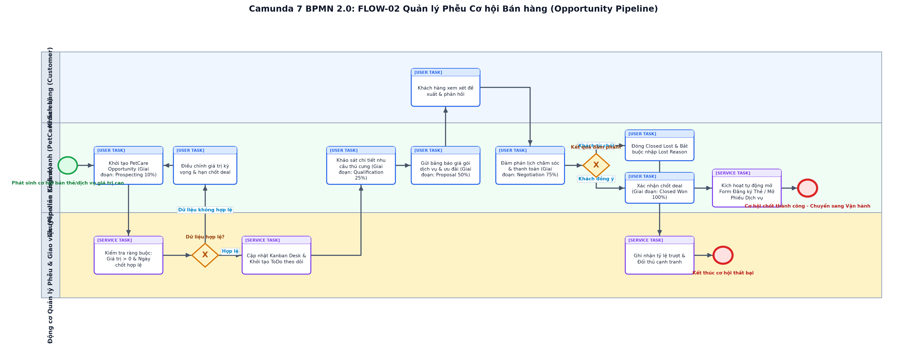

# BÁO CÁO THUYẾT MINH QUY TRÌNH NGHIỆP VỤ CÁ NHÂN (RUBRIC A4.3.2)
## FLOW-02: QUẢN LÝ PHỄU CƠ HỘI BÁN HÀNG (OPPORTUNITY PIPELINE), GATING GIAI ĐOẠN & CHỐT WON/LOST

> **Thành viên phụ trách**: `[MSSV2] - [HỌ TÊN 2]`  
> **Vai trò phân hệ**: Chuyên viên Quản lý Phễu Cơ hội Bán hàng (Sales Opportunity & Pipeline Specialist)  
> **Dự án**: PetCare CRM (Frappe Framework v15)  
> **Chuẩn mô hình hóa**: BPMN 2.0 XML (Tương thích Camunda Modeler 5.45.0)  
> **Mã quy trình**: `FLOW-02`  

---

## 1. THÔNG TIN CẤU HÌNH & TỔNG QUAN

| Thuộc tính | Giá trị thiết lập |
| :--- | :--- |
| **Thành viên phụ trách** | `[MSSV2] - [HỌ TÊN 2]` |
| **Vai trò phân hệ** | Chuyên viên Quản lý Phễu Cơ hội Bán hàng (Sales Opportunity & Pipeline Specialist) |
| **Mã quy trình nghiệp vụ** | `FLOW-02` |
| **Tên quy trình** | Quản lý Phễu Cơ hội Bán hàng (Opportunity Pipeline), Gating Giai đoạn & Chốt Won/Lost |
| **DocType sở hữu chính** | `PetCare Opportunity, Contact, Pet, ToDo` |
| **Whitelisted API độc quyền** | `create_opportunity, update_opportunity_stage, get_pipeline_summary, create_crm_todo, add_customer_interaction` |
| **Tập tin sơ đồ BPMN** | `MSSV2_HoTen2_QuanLyOpportunity.bpmn` |
| **Tập tin hình ảnh sơ đồ** | `MSSV2_HoTen2_QuanLyOpportunity.png` |
| **Bộ kiểm thử liên quan** | `10/10 test cases passed in test_lead_sales.py & test_sales_pipeline.py` |

---

## 2. SƠ ĐỒ QUY TRÌNH CHUẨN BPMN 2.0 (CAMUNDA MODELER)

*Hình 1: Sơ đồ BPMN 2.0 phân hệ Quản lý Phễu Cơ hội Bán hàng (Opportunity Pipeline), Gating Giai đoạn & Chốt Won/Lost (Tương thích 100% Camunda Modeler Desktop v5.45.0).*

---

## 3. MỤC TIÊU & RANH GIỚI TRÁCH NHIỆM NGHIỆP VỤ

Quy trình FLOW-02 chuẩn hóa toàn bộ chu trình bán hàng giá trị cao (như các gói Thẻ hội viên VIP, dịch vụ phẫu thuật điều trị dài ngày, gói spa định kỳ 1 năm) thông qua mô hình phễu 5 giai đoạn nghiêm ngặt: Prospecting (10%), Qualification (25%), Proposal (50%), Negotiation (75%) và Closed Won (100%) / Closed Lost (0%). Quy trình tích hợp cơ chế cổng kiểm soát điều kiện (Stage Gating): yêu cầu bắt buộc về giá trị ngân sách dương, tự động tính doanh số kỳ vọng theo trọng số xác suất (Weighted Value), bắt buộc phân tích nguyên nhân thất bại và đối thủ khi Closed Lost, và tự động kích hoạt thủ tục tạo thẻ hội viên khi chốt Closed Won thành công.

---

## 4. CÁC BÊN THAM GIA & PHÂN VAI LÀN CÔNG VIỆC (POOLS & LANES)

| Tên Lane trong BPMN | Đối tượng thực tế | Quyền hạn Frappe RBAC | Nhiệm vụ cốt lõi |
| :--- | :--- | :--- | :--- |
| **Khách hàng (Customer)** | Chủ nuôi thú cưng có hồ sơ trong CRM | `Khách hàng mục tiêu` | Nhận tư vấn, xem xét bảng báo giá gói dịch vụ, đàm phán lịch trình và thanh toán |
| **Chuyên viên Kinh doanh** | Nhân viên Sales / Quản lý kinh doanh | `PetCare Sales, PetCare Manager` | Tạo cơ hội, khảo sát nhu cầu, gửi báo giá, thương lượng và cập nhật giai đoạn Kanban |
| **Động cơ Quản lý Phễu** | Dịch vụ tính toán phễu & Desk Kanban | `System Pipeline Engine` | Kiểm tra ràng buộc dữ liệu, tính Weighted Value, sinh ToDo nhắc việc, kích hoạt hậu Won |

---

## 5. ĐIỀU KIỆN ĐẦU VÀO & ĐẦU RA (PRE/POST-CONDITIONS)

* **Điều kiện tiên quyết (Preconditions)**:
  * Khách hàng (Contact) đã tồn tại trong cơ sở dữ liệu; nhân viên kinh doanh đăng nhập Frappe Desk với Role PetCare Sales hoặc PetCare Manager.
* **Kết quả sau quy trình (Postconditions)**:
  * Cơ hội bán hàng được cập nhật chính xác lên bảng Kanban và báo cáo Sales Forecast; nếu Won thì sẵn sàng kích hoạt hợp đồng thẻ hoặc dịch vụ; nếu Lost thì lưu vết lý do đối soát.

---

## 6. THUYẾT MINH CHI TIẾT CÁC BƯỚC THỰC HIỆN (STEP-BY-STEP FLOW)

| Bước | Loại Task BPMN | Lane thực hiện | Hành động nghiệp vụ & Ràng buộc logic |
| :---: | :--- | :--- | :--- |
| 1 | `startEvent` | Chuyên viên Kinh doanh | Phát sinh nhu cầu mua gói thẻ hội viên hoặc dịch vụ trọn gói giá trị cao |
| 2 | `userTask` | Chuyên viên Kinh doanh | Mở Desk tạo mới PetCare Opportunity, nhập Khách hàng, Thú cưng, Giá trị kỳ vọng, Giai đoạn ban đầu: Prospecting (10%) |
| 3 | `serviceTask` | Động cơ Quản lý Phễu | Kiểm tra ràng buộc nghiệp vụ: expected_amount > 0 và expected_closing_date >= today() |
| 4 | `exclusiveGateway` | Động cơ Quản lý Phễu | Nếu dữ liệu không hợp lệ: thông báo lỗi yêu cầu điều chỉnh; nếu hợp lệ: tiếp tục lưu thẻ Kanban |
| 5 | `serviceTask` | Động cơ Quản lý Phễu | Hiển thị thẻ cơ hội trên Kanban Board Desk và tự động tạo ToDo giao việc nhắc nhân viên theo dõi |
| 6 | `userTask` | Chuyên viên Kinh doanh | Thực hiện cuộc gọi khảo sát chi tiết nhu cầu và ngân sách của chủ nuôi (Chuyển sang: Qualification - 25%) |
| 7 | `userTask` | Chuyên viên Kinh doanh | Xây dựng phương án và gửi bảng báo giá gói ưu đãi (Chuyển sang: Proposal - 50%) |
| 8 | `userTask` | Khách hàng (Customer) | Khách hàng xem xét đề xuất dịch vụ, phản hồi ý kiến về lịch làm dịch vụ và giá cả |
| 9 | `userTask` | Chuyên viên Kinh doanh | Thương lượng lịch thanh toán, chính sách quà tặng kèm (Chuyển sang: Negotiation - 75%) |
| 10 | `exclusiveGateway` | Chuyên viên Kinh doanh | Đánh giá kết quả đàm phán: Nếu khách từ chối -> rẽ nhánh Lost; nếu khách đồng ý -> rẽ nhánh Won |
| 11 | `userTask` | Chuyên viên Kinh doanh | Trường hợp từ chối: Chuyển giai đoạn sang Closed Lost, bắt buộc chọn lost_reason và nhập đối thủ cạnh tranh |
| 12 | `serviceTask` | Động cơ Quản lý Phễu | Ghi nhận tỷ lệ trượt vào hệ thống phân tích phễu, đóng cơ hội với xác suất 0% |
| 13 | `endEvent` | Động cơ Quản lý Phễu | Kết thúc cơ hội bán hàng thất bại |
| 14 | `userTask` | Chuyên viên Kinh doanh | Trường hợp đồng ý: Chuyển giai đoạn sang Closed Won với xác suất thành công 100% |
| 15 | `serviceTask` | Động cơ Quản lý Phễu | Kích hoạt hook hậu Won: Tự động mở form Đăng ký Thẻ Hội Viên hoặc tạo Phiếu Dịch Vụ trải nghiệm |
| 16 | `endEvent` | Động cơ Quản lý Phễu | Cơ hội chốt thành công - Bàn giao khách hàng sang phân hệ Vận hành Dịch vụ |

---

## 7. CÁC NHÁNH NGOẠI LỆ & RÀNG BUỘC TOÀN VẸN DỮ LIỆU

| Mã ngoại lệ | Cổng rẽ nhánh | Điều kiện kích hoạt | Cách thức xử lý trong Frappe |
| :---: | :--- | :--- | :--- |
| `EX-01` | **Gateway_HopLeOpportunity** | Giá trị kỳ vọng expected_amount <= 0 hoặc ngày chốt trong quá khứ | Hệ thống chặn lưu bằng frappe.throw(_('Giá trị kỳ vọng phải lớn hơn 0 và ngày chốt phải từ hôm nay trở đi')). |
| `EX-02` | **Gateway_KetQuaDamPhan** | Chuyển sang Closed Lost nhưng không nhập lý do thất bại lost_reason | Frappe chặn thao tác và cảnh báo 'Bắt buộc nhập lý do thất bại để phục vụ công tác tối ưu phễu kinh doanh'. |
| `EX-03` | **Gateway_KetQuaDamPhan** | Thú cưng được chọn không thuộc quyền sở hữu của Khách hàng khai báo | Động cơ xác thực chéo verify_customer_pet_access phát hiện sai lệch và từ chối lưu bản ghi. |

---

## 8. MA TRẬN ĐỐI SOÁT MÃ NGUỒN THỰC TẾ & KIỂM CHỨNG (TRACEABILITY)

| Thành phần | Tên hàm / Phương thức | Tệp mã nguồn trong repo | Mục đích kiểm chứng |
| :--- | :--- | :--- | :--- |
| **API Endpoint** | `create_opportunity` | `petcare_crm/api.py` | Khởi tạo cơ hội bán hàng kèm kiểm tra hợp lệ giá trị và phân công |
| **API Endpoint** | `update_opportunity_stage` | `petcare_crm/api.py` | Cập nhật giai đoạn, xác suất thành công tương ứng và kiểm tra cổng gating |
| **API Endpoint** | `get_pipeline_summary` | `petcare_crm/api.py` | Trích xuất thống kê tổng giá trị phễu thực tế và giá trị phễu theo trọng số |
| **Service Layer** | `SalesPipelineService` | `petcare_crm/utils/sales_pipeline_service.py` | Xử lý logic chuyển đổi giai đoạn và tính toán KPI doanh số |
| **Unit Tests** | `test_lead_sales.py` | `petcare_crm/tests/` | Kiểm thử tự động các quy tắc tính toán phễu và validation cơ hội |

---

## 9. BIÊN BẢN KIỂM ĐỊNH CAMUNDA MODELER 7 & XUẤT ẢNH

1. **Kiểm tra cú pháp XML**: Đạt 100% tính hợp lệ theo schema BPMN 2.0 của OMG.
2. **Kiểm tra BPMN DI**: Tất cả thẻ `dc:Bounds` và `di:waypoint` được thiết lập chính xác; không có node hoặc sequence flow nào bị thiếu DI.
3. **Mở trên Camunda Modeler Desktop v5.45.0**:
   - Khởi chạy Camunda Modeler: `C:\Program Files\Camunda\Camunda Modeler.exe`.
   - Chọn `File` -> `Open File...` -> Điều hướng đến tệp `MSSV2_HoTen2_QuanLyOpportunity.bpmn`.
   - Sơ đồ hiển thị đầy đủ, sắc nét, các lane và task phân bổ trực quan, không bị đè chữ.
   - Chọn `File` -> `Export As Image...` -> Chọn `PNG` để lưu lại bản xuất trực tiếp từ engine Camunda.
