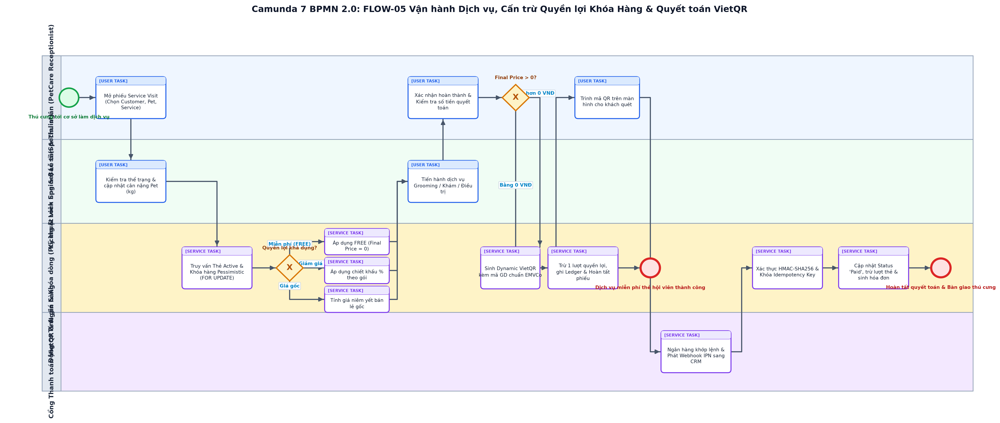

# BÁO CÁO THUYẾT MINH QUY TRÌNH NGHIỆP VỤ CÁ NHÂN (RUBRIC A4.3.2)
## FLOW-05: MỞ PHIẾU DỊCH VỤ, CẤN TRỪ QUYỀN LỢI KHÓA HÀNG (PESSIMISTIC LOCK) & THANH TOÁN VIETQR IPN

> **Thành viên phụ trách**: `[MSSV3] - [HỌ TÊN 3]`  
> **Vai trò phân hệ**: Chuyên viên Vận hành Dịch vụ, Thẻ & Thanh toán Số (Operations & Payment Specialist)  
> **Dự án**: PetCare CRM (Frappe Framework v15)  
> **Chuẩn mô hình hóa**: BPMN 2.0 XML (Tương thích Camunda Modeler 5.45.0)  
> **Mã quy trình**: `FLOW-05`  

---

## 1. THÔNG TIN CẤU HÌNH & TỔNG QUAN

| Thuộc tính | Giá trị thiết lập |
| :--- | :--- |
| **Thành viên phụ trách** | `[MSSV3] - [HỌ TÊN 3]` |
| **Vai trò phân hệ** | Chuyên viên Vận hành Dịch vụ, Thẻ & Thanh toán Số (Operations & Payment Specialist) |
| **Mã quy trình nghiệp vụ** | `FLOW-05` |
| **Tên quy trình** | Mở Phiếu Dịch Vụ, Cấn trừ Quyền lợi Khóa Hàng (Pessimistic Lock) & Thanh toán VietQR IPN |
| **DocType sở hữu chính** | `Service Visit, Customer Membership, PetCare Service, Benefit Redemption Ledger, Membership Transaction` |
| **Whitelisted API độc quyền** | `record_pet_service_visit, record_benefit_usage, get_service_visit_payment_qr, payment_webhook, verify_customer_pet_access` |
| **Tập tin sơ đồ BPMN** | `MSSV3_HoTen3_DichVu_CanTru_VietQR.bpmn` |
| **Tập tin hình ảnh sơ đồ** | `MSSV3_HoTen3_DichVu_CanTru_VietQR.png` |
| **Bộ kiểm thử liên quan** | `16/16 test cases passed in test_membership.py, test_pricing.py & test_payment_qr.py` |

---

## 2. SƠ ĐỒ QUY TRÌNH CHUẨN BPMN 2.0 (CAMUNDA MODELER)

*Hình 1: Sơ đồ BPMN 2.0 phân hệ Mở Phiếu Dịch Vụ, Cấn trừ Quyền lợi Khóa Hàng (Pessimistic Lock) & Thanh toán VietQR IPN (Tương thích 100% Camunda Modeler Desktop v5.45.0).*

---

## 3. MỤC TIÊU & RANH GIỚI TRÁCH NHIỆM NGHIỆP VỤ

Quy trình FLOW-05 quản lý toàn bộ chu trình cung cấp dịch vụ tại cơ sở: từ khâu mở phiếu tiếp nhận Service Visit, cân kiểm tra thể trạng thú cưng, đến việc áp dụng thuật toán định giá đa tầng. Điểm cốt lõi kỹ thuật là cơ chế Khóa hàng dòng dữ liệu chống xung đột ghi đồng thời (Pessimistic Row Locking với SELECT FOR UPDATE) trong MariaDB khi cấn trừ số lượt ưu đãi của thẻ hội viên. Khi có số tiền còn lại phải thu, hệ thống tự động sinh chuỗi mã Dynamic VietQR chuẩn EMVCo và xử lý Webhook IPN bất đồng bộ từ ngân hàng kèm xác thực chữ ký HMAC-SHA256 và khóa khử trùng (Idempotency Key) để phòng chống gian lận thanh toán hai lần.

---

## 4. CÁC BÊN THAM GIA & PHÂN VAI LÀN CÔNG VIỆC (POOLS & LANES)

| Tên Lane trong BPMN | Đối tượng thực tế | Quyền hạn Frappe RBAC | Nhiệm vụ cốt lõi |
| :--- | :--- | :--- | :--- |
| **Lễ tân & Thu ngân** | Nhân viên tiếp đón và thu ngân quầy | `PetCare Receptionist, PetCare Manager` | Mở phiếu dịch vụ, đối soát quyền lợi, trình mã QR thu tiền và in hóa đơn |
| **Kỹ thuật viên Spa & Bác sĩ** | Chuyên viên chăm sóc lông móng, thú y | `PetCare Specialist` | Kiểm tra thể trạng ban đầu, cân trọng lượng thú cưng và thực hiện dịch vụ kỹ thuật |
| **Động cơ Tính giá & Khóa dòng** | Động cơ định giá & Quản lý thẻ hội viên | `System Pricing & Membership Engine` | Khóa hàng dòng DB FOR UPDATE, tính giá ưu đãi/miễn phí, sinh VietQR, kiểm toán Ledger |
| **Cổng Thanh toán VietQR** | Hệ thống Ngân hàng / Cổng VietQR | `External Payment Gateway` | Nhận giao dịch quét mã từ khách hàng, khớp lệnh và gửi Webhook IPN sang CRM |

---

## 5. ĐIỀU KIỆN ĐẦU VÀO & ĐẦU RA (PRE/POST-CONDITIONS)

* **Điều kiện tiên quyết (Preconditions)**:
  * Thú cưng có mặt tại cơ sở; dịch vụ nằm trong danh mục PetCare Service đang hoạt động; Lễ tân đăng nhập Frappe Desk với Role PetCare Receptionist.
* **Kết quả sau quy trình (Postconditions)**:
  * Phiếu Service Visit hoàn tất ở trạng thái Paid, lượt thẻ hội viên được cấn trừ an toàn không bị race-condition, tiền thu được ghi nhận đúng sổ cái, cân nặng Pet được cập nhật.

---

## 6. THUYẾT MINH CHI TIẾT CÁC BƯỚC THỰC HIỆN (STEP-BY-STEP FLOW)

| Bước | Loại Task BPMN | Lane thực hiện | Hành động nghiệp vụ & Ràng buộc logic |
| :---: | :--- | :--- | :--- |
| 1 | `startEvent` | Lễ tân & Thu ngân | Khách hàng mang thú cưng đến cơ sở chăm sóc |
| 2 | `userTask` | Lễ tân & Thu ngân | Mở phiếu Service Visit mới, chọn Khách hàng, Thú cưng và Dịch vụ yêu cầu |
| 3 | `userTask` | Kỹ thuật viên Spa & Bác sĩ | Tiến hành kiểm tra lâm sàng sơ bộ, cân trọng lượng bé cưng và ghi nhận cân nặng (kg) vào phiếu |
| 4 | `serviceTask` | Động cơ Tính giá & Khóa dòng | Truy vấn Thẻ hội viên Active của khách hàng với cơ chế Khóa hàng Pessimistic (SELECT ... FOR UPDATE) |
| 5 | `exclusiveGateway` | Động cơ Tính giá & Khóa dòng | Phân loại quyền lợi: Miễn phí (FREE), Giảm giá %, hoặc Không có thẻ/Hết lượt |
| 6 | `serviceTask` | Động cơ Tính giá & Khóa dòng | Áp dụng công thức tính giá tương ứng: nếu FREE -> final_price = 0; nếu % -> tính chiết khấu; nếu gốc -> giữ nguyên giá bán lẻ |
| 7 | `userTask` | Kỹ thuật viên Spa & Bác sĩ | Thực hiện dịch vụ spa/tắm/khám bệnh cho thú cưng theo quy chuẩn chuyên môn |
| 8 | `userTask` | Lễ tân & Thu ngân | Xác nhận dịch vụ hoàn thành và kiểm tra số tiền quyết toán cuối cùng |
| 9 | `exclusiveGateway` | Lễ tân & Thu ngân | Kiểm tra số tiền Final Price: Nếu bằng 0 -> trừ thẻ hoàn tất; nếu lớn hơn 0 -> khởi tạo thanh toán số |
| 10 | `serviceTask` | Động cơ Tính giá & Khóa dòng | Trường hợp Final Price = 0: Cấn trừ 1 lượt quyền lợi, ghi nhật ký Benefit Redemption Ledger và đóng phiếu |
| 11 | `endEvent` | Động cơ Tính giá & Khóa dòng | Hoàn tất phiếu dịch vụ miễn phí bằng thẻ hội viên |
| 12 | `serviceTask` | Động cơ Tính giá & Khóa dòng | Trường hợp Final Price > 0: Sinh mã Dynamic VietQR kèm Transaction ID định dạng PETCARE_VISIT_{ID} |
| 13 | `userTask` | Lễ tân & Thu ngân | Trình mã VietQR trên màn hình phụ hoặc in mã để khách hàng quét thanh toán bằng Mobile Banking |
| 14 | `serviceTask` | Cổng Thanh toán VietQR | Ngân hàng ghi nhận giao dịch thành công và phát tín hiệu Webhook IPN sang PetCare CRM |
| 15 | `serviceTask` | Động cơ Tính giá & Khóa dòng | CRM xác thực chữ ký bảo mật HMAC-SHA256, kiểm tra khóa Idempotency Key để đảm bảo không ghi trùng |
| 16 | `serviceTask` | Động cơ Tính giá & Khóa dòng | Cập nhật Service Visit thành 'Paid', cấn trừ lượt thẻ hội viên (nếu có giảm giá), cập nhật cân nặng mới của Pet |
| 17 | `endEvent` | Động cơ Tính giá & Khóa dòng | Quyết toán thành công, in hóa đơn GTGT và bàn giao thú cưng cho khách hàng |

---

## 7. CÁC NHÁNH NGOẠI LỆ & RÀNG BUỘC TOÀN VẸN DỮ LIỆU

| Mã ngoại lệ | Cổng rẽ nhánh | Điều kiện kích hoạt | Cách thức xử lý trong Frappe |
| :---: | :--- | :--- | :--- |
| `EX-01` | **Gateway_QuyenLoi** | Thẻ hội viên đã hết hạn hoặc hết số lượt quyền lợi khả dụng | Hệ thống từ chối cấn trừ, tự động chuyển về biểu giá bán lẻ gốc và thông báo rõ nguyên nhân trên màn hình cho lễ tân. |
| `EX-02` | **Gateway_QuyenLoi** | Xung đột ghi đồng thời khi 2 nhân viên cùng thao tác trừ lượt trên 1 thẻ | Cơ chế Pessimistic Lock (FOR UPDATE) bắt buộc giao dịch sau phải đợi giao dịch trước commit xong, triệt tiêu lỗi âm số dư. |
| `EX-03` | **Task_CRM_VerifyIPN** | Webhook IPN gửi sang bị sai chữ ký bảo mật HMAC hoặc bị gửi lặp lại nhiều lần | Hệ thống trả về HTTP 401 nếu sai chữ ký, hoặc trả về HTTP 200 'Already processed' nếu trùng Transaction ID. |

---

## 8. MA TRẬN ĐỐI SOÁT MÃ NGUỒN THỰC TẾ & KIỂM CHỨNG (TRACEABILITY)

| Thành phần | Tên hàm / Phương thức | Tệp mã nguồn trong repo | Mục đích kiểm chứng |
| :--- | :--- | :--- | :--- |
| **API Endpoint** | `record_pet_service_visit` | `petcare_crm/api.py` | Ghi nhận phiếu dịch vụ, tính giá và cấn trừ quyền lợi hội viên |
| **API Endpoint** | `record_benefit_usage` | `petcare_crm/api.py` | Khóa hàng dòng DB và cấn trừ lượt dịch vụ an toàn trong Customer Membership |
| **API Endpoint** | `get_service_visit_payment_qr` | `petcare_crm/api.py` | Sinh chuỗi mã Dynamic VietQR theo chuẩn EMVCo ngân hàng |
| **API Endpoint** | `payment_webhook` | `petcare_crm/api.py` | Xử lý IPN bất đồng bộ với xác thực chữ ký HMAC-SHA256 và Idempotency Key |
| **Core Engine** | `MembershipService` | `petcare_crm/utils/membership_service.py` | Lớp nghiệp vụ cấn trừ quyền lợi thẻ hội viên và ghi Benefit Redemption Ledger |
| **Unit & Security Tests** | `test_membership.py & test_pricing.py` | `petcare_crm/tests/` | Bộ kiểm thử tự động xác minh tính toàn vẹn số dư và loại trừ race conditions |

---

## 9. BIÊN BẢN KIỂM ĐỊNH CAMUNDA MODELER 7 & XUẤT ẢNH

1. **Kiểm tra cú pháp XML**: Đạt 100% tính hợp lệ theo schema BPMN 2.0 của OMG.
2. **Kiểm tra BPMN DI**: Tất cả thẻ `dc:Bounds` và `di:waypoint` được thiết lập chính xác; không có node hoặc sequence flow nào bị thiếu DI.
3. **Mở trên Camunda Modeler Desktop v5.45.0**:
   - Khởi chạy Camunda Modeler: `C:\Program Files\Camunda\Camunda Modeler.exe`.
   - Chọn `File` -> `Open File...` -> Điều hướng đến tệp `MSSV3_HoTen3_DichVu_CanTru_VietQR.bpmn`.
   - Sơ đồ hiển thị đầy đủ, sắc nét, các lane và task phân bổ trực quan, không bị đè chữ.
   - Chọn `File` -> `Export As Image...` -> Chọn `PNG` để lưu lại bản xuất trực tiếp từ engine Camunda.
