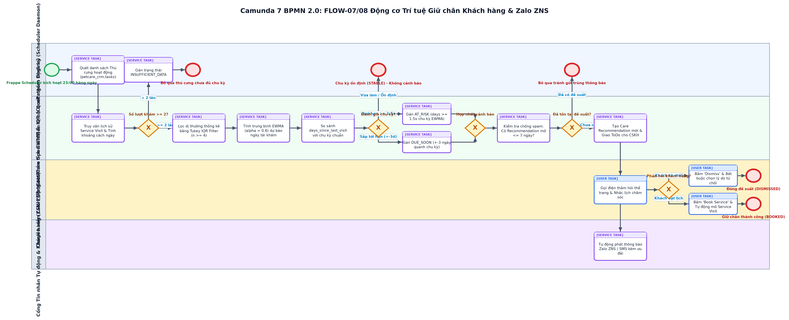

# BÁO CÁO THUYẾT MINH QUY TRÌNH NGHIỆP VỤ CÁ NHÂN (RUBRIC A4.3.2)
## FLOW-07/08: ĐỘNG CƠ PHÂN TÍCH CHU KỲ (EWMA + IQR), QUÉT AT-RISK & CHĂM SÓC TỰ ĐỘNG QUA ZALO ZNS/SMS

> **Thành viên phụ trách**: `[MSSV4] - [HỌ TÊN 4]`  
> **Vai trò phân hệ**: Kỹ sư Trí tuệ Giữ chân Khách hàng & Đa kênh (Care Intelligence & Omnichannel Engineer)  
> **Dự án**: PetCare CRM (Frappe Framework v15)  
> **Chuẩn mô hình hóa**: BPMN 2.0 XML (Tương thích Camunda Modeler 5.45.0)  
> **Mã quy trình**: `FLOW-07/08`  

---

## 1. THÔNG TIN CẤU HÌNH & TỔNG QUAN

| Thuộc tính | Giá trị thiết lập |
| :--- | :--- |
| **Thành viên phụ trách** | `[MSSV4] - [HỌ TÊN 4]` |
| **Vai trò phân hệ** | Kỹ sư Trí tuệ Giữ chân Khách hàng & Đa kênh (Care Intelligence & Omnichannel Engineer) |
| **Mã quy trình nghiệp vụ** | `FLOW-07/08` |
| **Tên quy trình** | Động cơ Phân tích Chu kỳ (EWMA + IQR), Quét At-Risk & Chăm sóc Tự động qua Zalo ZNS/SMS |
| **DocType sở hữu chính** | `Care Recommendation, Service Visit, Pet, Contact, ToDo` |
| **Whitelisted API độc quyền** | `run_care_intelligence_scan, predict_next_service, get_care_status, update_recommendation_status, send_omnichannel_notification, get_omnichannel_outbox` |
| **Tập tin sơ đồ BPMN** | `MSSV4_HoTen4_CareIntelligence_ZaloZNS.bpmn` |
| **Tập tin hình ảnh sơ đồ** | `MSSV4_HoTen4_CareIntelligence_ZaloZNS.png` |
| **Bộ kiểm thử liên quan** | `18/18 test cases passed in test_care_engine.py & test_tasks.py` |

---

## 2. SƠ ĐỒ QUY TRÌNH CHUẨN BPMN 2.0 (CAMUNDA MODELER)

*Hình 1: Sơ đồ BPMN 2.0 phân hệ Động cơ Phân tích Chu kỳ (EWMA + IQR), Quét At-Risk & Chăm sóc Tự động qua Zalo ZNS/SMS (Tương thích 100% Camunda Modeler Desktop v5.45.0).*

---

## 3. MỤC TIÊU & RANH GIỚI TRÁCH NHIỆM NGHIỆP VỤ

Quy trình kết hợp FLOW-07 và FLOW-08 đại diện cho năng lực trí tuệ chủ động (Proactive Care Intelligence) tạo nên sự khác biệt của PetCare CRM so với các phần mềm quản lý phòng khám thông thường. Tiến trình quét ngầm định kỳ hàng đêm phân tích lịch sử dịch vụ của từng thú cưng, áp dụng bộ lọc ngoại lệ thống kê (Tukey IQR) để loại bỏ các chuyến ghé bất thường và thuật toán tính trung bình trọng số thời gian EWMA (alpha = 0.6) nhằm dự báo chính xác ngày tái khám. Khi phát hiện khách hàng sắp đến hạn (DUE_SOON) hoặc có nguy cơ rời bỏ (AT_RISK - trễ quá 1.5 lần chu kỳ), hệ thống áp dụng cổng chặn trùng lặp 7 ngày, tự động gửi tin nhắn Zalo ZNS chăm sóc và sinh ToDo giao cho chuyên viên CSKH gọi điện tư vấn chốt lịch (Book Service) hoặc ghi nhận lý do từ chối (Dismiss).

---

## 4. CÁC BÊN THAM GIA & PHÂN VAI LÀN CÔNG VIỆC (POOLS & LANES)

| Tên Lane trong BPMN | Đối tượng thực tế | Quyền hạn Frappe RBAC | Nhiệm vụ cốt lõi |
| :--- | :--- | :--- | :--- |
| **Tiến trình Quét ngầm Định kỳ** | Frappe Scheduler Daemon chạy nền 23:00 | `Cronjob Scheduler Daemon` | Kích hoạt petcare_crm.tasks.daily_petcare_scan và phân phối danh sách thú cưng |
| **Động cơ Phân tích EWMA & IQR** | Lõi thuật toán thống kê & dữ liệu | `System Care Intelligence Core` | Lọc ngoại lệ IQR, tính EWMA, phân loại trạng thái, kiểm tra trùng lặp và tạo đề xuất |
| **Chuyên viên CSKH** | Nhân viên chăm sóc khách hàng / Telesales | `PetCare Care Specialist, PetCare Sales` | Mở danh sách đề xuất, gọi điện hỏi thăm thú cưng, bấm Book Service hoặc Dismiss |
| **Cổng Tin nhắn Tự động & KH** | Hệ thống Zalo ZNS / SMS & Khách hàng | `Omnichannel Messaging Gateway` | Phát thông báo Zalo ZNS theo mẫu đã duyệt, tiếp nhận phản hồi quan tâm từ khách hàng |

---

## 5. ĐIỀU KIỆN ĐẦU VÀO & ĐẦU RA (PRE/POST-CONDITIONS)

* **Điều kiện tiên quyết (Preconditions)**:
  * Frappe Scheduler đang chạy ngầm; dữ liệu lịch sử phiếu Service Visit của các thú cưng đã được ghi nhận trong cơ sở dữ liệu.
* **Kết quả sau quy trình (Postconditions)**:
  * Hệ thống tự động phát hiện chính xác khách hàng Due Soon/At Risk; sinh Care Recommendation không trùng lặp; gửi Zalo ZNS và chuyển đổi thành công sang lịch hẹn dịch vụ mới.

---

## 6. THUYẾT MINH CHI TIẾT CÁC BƯỚC THỰC HIỆN (STEP-BY-STEP FLOW)

| Bước | Loại Task BPMN | Lane thực hiện | Hành động nghiệp vụ & Ràng buộc logic |
| :---: | :--- | :--- | :--- |
| 1 | `startEvent` | Tiến trình Quét ngầm Định kỳ | Đến 23:00 hàng ngày, Frappe Scheduler tự động kích hoạt hàm daily_petcare_scan |
| 2 | `serviceTask` | Tiến trình Quét ngầm Định kỳ | Quét toàn bộ danh sách Thú cưng đang ở trạng thái hoạt động trong hệ thống |
| 3 | `serviceTask` | Động cơ Phân tích EWMA & IQR | Truy xuất danh sách Service Visit đã hoàn tất của thú cưng và tính khoảng cách ngày (Deltas) |
| 4 | `exclusiveGateway` | Động cơ Phân tích EWMA & IQR | Kiểm tra số lần ghé thăm: Nếu < 2 lần -> chưa đủ dữ liệu; nếu >= 2 lần -> chuyển tiếp xử lý |
| 5 | `serviceTask` | Tiến trình Quét ngầm Định kỳ | Gán trạng thái INSUFFICIENT_DATA cho thú cưng có dưới 2 lần ghé thăm |
| 6 | `endEvent` | Tiến trình Quét ngầm Định kỳ | Bỏ qua thú cưng chưa tích lũy đủ chu kỳ chăm sóc |
| 7 | `serviceTask` | Động cơ Phân tích EWMA & IQR | Áp dụng thuật toán Tukey IQR Filter (khi n >= 4) để loại bỏ các khoảng cách dị thường ngoài biên [Q1 - 1.5*IQR, Q3 + 1.5*IQR] |
| 8 | `serviceTask` | Động cơ Phân tích EWMA & IQR | Tính trung bình trọng số thời gian EWMA với alpha = 0.6 và dự báo ngày tái khám kỳ vọng |
| 9 | `serviceTask` | Động cơ Phân tích EWMA & IQR | So sánh số ngày kể từ lần ghé cuối days_since_last_visit với chu kỳ EWMA chuẩn |
| 10 | `exclusiveGateway` | Động cơ Phân tích EWMA & IQR | Đánh giá trạng thái: days = 0 hoặc còn sớm -> STABLE; days >= 1.5x -> AT_RISK; quanh chu kỳ -> DUE_SOON |
| 11 | `endEvent` | Tiến trình Quét ngầm Định kỳ | Trường hợp STABLE: Kết thúc kiểm tra cho thú cưng, không phát sinh cảnh báo |
| 12 | `serviceTask` | Động cơ Phân tích EWMA & IQR | Trường hợp days >= 1.5x: Phân loại trạng thái AT_RISK (khách hàng có nguy cơ rời bỏ cao) |
| 13 | `serviceTask` | Động cơ Phân tích EWMA & IQR | Trường hợp +-3 ngày quanh chu kỳ: Phân loại trạng thái DUE_SOON (sắp đến hạn chăm sóc) |
| 14 | `exclusiveGateway` | Động cơ Phân tích EWMA & IQR | Hợp nhất hai luồng cảnh báo vào cổng kiểm soát chống trùng lặp |
| 15 | `serviceTask` | Động cơ Phân tích EWMA & IQR | Kiểm tra chống spam: Đối soát xem đã có Care Recommendation nào đang mở trong vòng 7 ngày qua chưa |
| 16 | `exclusiveGateway` | Động cơ Phân tích EWMA & IQR | Nếu đã có đề xuất mở -> bỏ qua; nếu chưa có -> tiến hành tạo đề xuất mới |
| 17 | `endEvent` | Tiến trình Quét ngầm Định kỳ | Kết thúc bỏ qua nhằm triệt tiêu hiện tượng spam tin nhắn cho khách hàng |
| 18 | `serviceTask` | Động cơ Phân tích EWMA & IQR | Khởi tạo bản ghi Care Recommendation mới (Status: NEW), gán dịch vụ gợi ý và tạo việc ToDo cho CSKH |
| 19 | `serviceTask` | Cổng Tin nhắn Tự động & KH | Tự động phát thông báo chăm sóc Zalo ZNS / SMS kèm mã ưu đãi đặt lịch sớm |
| 20 | `userTask` | Chuyên viên CSKH | Chuyên viên CSKH xem danh sách đề xuất, gọi điện thoại hỏi thăm sức khỏe bé cưng và tư vấn lịch |
| 21 | `exclusiveGateway` | Chuyên viên CSKH | Ghi nhận phản hồi của khách hàng: Nếu từ chối -> Dismiss; nếu đồng ý -> Book Service |
| 22 | `userTask` | Chuyên viên CSKH | Khách hàng từ chối: Bấm 'Dismiss', bắt buộc chọn lý do (bé ốm, chủ bận, chê đắt, làm nơi khác) |
| 23 | `endEvent` | Chuyên viên CSKH | Đóng đề xuất ở trạng thái DISMISSED phục vụ báo cáo chất lượng |
| 24 | `userTask` | Chuyên viên CSKH | Khách hàng đồng ý: Bấm 'Book Service', hệ thống tự động mở phiếu Service Visit liên kết |
| 25 | `endEvent` | Chuyên viên CSKH | Giữ chân khách hàng thành công (BOOKED), cập nhật KPI Tỷ lệ giữ chân khách hàng |

---

## 7. CÁC NHÁNH NGOẠI LỆ & RÀNG BUỘC TOÀN VẸN DỮ LIỆU

| Mã ngoại lệ | Cổng rẽ nhánh | Điều kiện kích hoạt | Cách thức xử lý trong Frappe |
| :---: | :--- | :--- | :--- |
| `EX-01` | **Gateway_CheckCount** | Thú cưng chỉ có 1 lần làm dịch vụ duy nhất trong lịch sử | Hệ thống gán nhãn INSUFFICIENT_DATA và không sinh cảnh báo sai lệch do thiếu căn cứ thống kê. |
| `EX-02` | **Gateway_CheckDuplicate** | Đã có đề xuất chăm sóc tạo cách đây 3 ngày đang chờ nhân viên gọi điện | Động cơ chặn không sinh thêm đề xuất thứ 2, tránh tình trạng nhiều nhân viên cùng gọi điện làm phiền khách. |
| `EX-03` | **Gateway_PhanHoiKH** | Nhân viên bấm Dismiss nhưng không chọn lý do từ chối | Frappe kiểm tra trường dismissed_reason, nếu để trống sẽ chặn thao tác và nhắc nhở nhân viên hoàn thiện dữ liệu. |
| `EX-04` | **Task_Zalo_SendZNS** | Cổng Zalo ZNS gặp sự cố mạng hoặc số điện thoại chưa kích hoạt Zalo | Động cơ Omnichannel tự động thử lại (Retry with Exponential Backoff) và chuyển sang gửi tin nhắn SMS dự phòng. |

---

## 8. MA TRẬN ĐỐI SOÁT MÃ NGUỒN THỰC TẾ & KIỂM CHỨNG (TRACEABILITY)

| Thành phần | Tên hàm / Phương thức | Tệp mã nguồn trong repo | Mục đích kiểm chứng |
| :--- | :--- | :--- | :--- |
| **Scheduler Task** | `daily_petcare_scan` | `petcare_crm/tasks.py` | Tác vụ quét định kỳ hàng đêm lúc 23:00 duyệt qua danh sách thú cưng |
| **Analytics Engine** | `CarePatternService` | `petcare_crm/utils/care_pattern_service.py` | Lớp giải thuật toán học: tính khoảng cách deltas, lọc Tukey IQR và trung bình EWMA |
| **API Endpoint** | `run_care_intelligence_scan` | `petcare_crm/api.py` | Endpoint thủ công để quản lý/kiểm thử viên kích hoạt quét chu kỳ tức thì |
| **API Endpoint** | `predict_next_service` | `petcare_crm/api.py` | Dự báo ngày dịch vụ tiếp theo dựa trên chu kỳ chăm sóc của thú cưng |
| **API Endpoint** | `send_omnichannel_notification` | `petcare_crm/api.py` | Phát tin nhắn chăm sóc qua kênh Zalo ZNS hoặc SMS kèm ghi vết outbox |
| **Automated Test Suites** | `test_care_engine.py & test_tasks.py` | `petcare_crm/tests/` | Bộ kiểm thử tự động xác minh độ chính xác toán học và tính năng chặn trùng |

---

## 9. BIÊN BẢN KIỂM ĐỊNH CAMUNDA MODELER 7 & XUẤT ẢNH

1. **Kiểm tra cú pháp XML**: Đạt 100% tính hợp lệ theo schema BPMN 2.0 của OMG.
2. **Kiểm tra BPMN DI**: Tất cả thẻ `dc:Bounds` và `di:waypoint` được thiết lập chính xác; không có node hoặc sequence flow nào bị thiếu DI.
3. **Mở trên Camunda Modeler Desktop v5.45.0**:
   - Khởi chạy Camunda Modeler: `C:\Program Files\Camunda\Camunda Modeler.exe`.
   - Chọn `File` -> `Open File...` -> Điều hướng đến tệp `MSSV4_HoTen4_CareIntelligence_ZaloZNS.bpmn`.
   - Sơ đồ hiển thị đầy đủ, sắc nét, các lane và task phân bổ trực quan, không bị đè chữ.
   - Chọn `File` -> `Export As Image...` -> Chọn `PNG` để lưu lại bản xuất trực tiếp từ engine Camunda.
