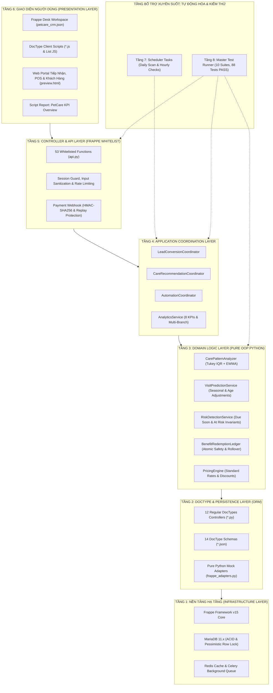
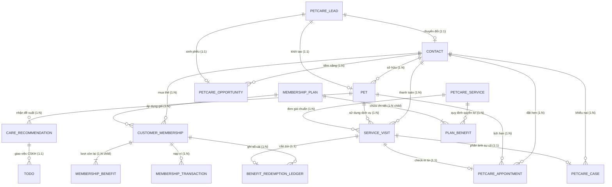
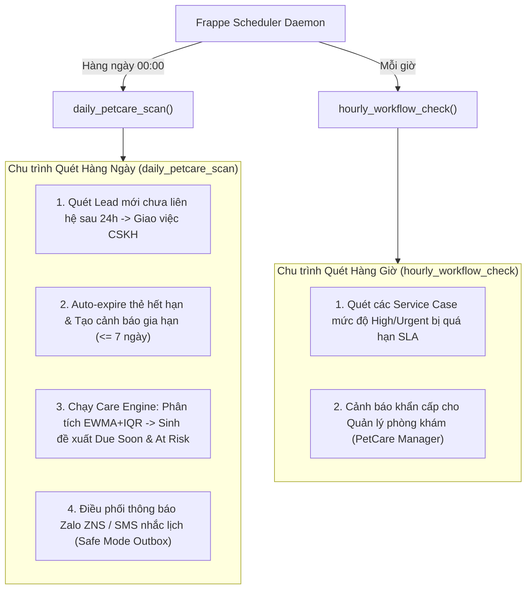

# PETCARE CRM — KIẾN TRÚC KỸ THUẬT & MÔ HÌNH DỮ LIỆU (TECHNICAL ARCHITECTURE & DATA MODEL)

> **Mã hồ sơ**: `ARCH-TECH-2026`  
> **Dự án**: PetCare CRM (Hệ thống CRM Dịch vụ Chăm sóc Thú cưng)  
> **Góc nhìn phân tích**: Senior Frappe/ERPNext Technical Analyst & Solution Architect  
> **Ngày lập hồ sơ**: 07/11/2026  
> **Mục tiêu tài liệu**: Cung cấp kiến trúc kỹ thuật đa tầng, sơ đồ Mermaid chuẩn, đặc tả 14 DocTypes, 53 APIs và các cơ chế bảo mật an toàn giao dịch.  

---

## 1. NGĂN XẾP CÔNG NGHỆ THỰC TẾ (TECHNOLOGY STACK)

| Tầng Công Nghệ | Công Nghệ Thực Tế Đang Sử Dụng | Phiên Bản | Vai Trò Trong Dự Án |
|---|---|:---:|---|
| **Core Framework** | **Frappe Framework** | **v15.x** | Khung ứng dụng Web full-stack, ORM DocType, Quản trị Phân quyền RBAC, Quản trị Tác vụ nền (Scheduler), Desk Native UI. |
| **Ngôn Ngữ Backend** | **Python** | **3.10+ / 3.14.6** | Toàn bộ logic nghiệp vụ, thuật toán thống kê, điều phối API và bộ kiểm thử tự động. |
| **Cơ Sở Dữ Liệu** | **MariaDB** | **11.x / 10.6** | Lưu trữ quan hệ ACID, hỗ trợ khóa dòng dữ liệu (`SELECT ... FOR UPDATE`), quản lý giao dịch và khóa ngoại. |
| **Bộ Nhớ Đệm & Hàng Đợi** | **Redis** | **7.x** | Bộ nhớ đệm phân tán (Redis Cache) và quản lý hàng đợi tác vụ nền bất đồng bộ (Redis Queue). |
| **Frontend Desk** | **Frappe Desk Native** | **v15** | Workspace `PetCare CRM`, Form Views, List Views, Action Dialogs, Script Reports (`petcare_kpi_overview`). |
| **Frontend Portal & POS** | **Web Portal Responsive** | **ES6+** | `preview.html`, `frontend.html`, Tailwind CSS, Font Awesome 6.5.1, SheetJS (XLSX). |
| **Máy Chủ Preview Độc Lập** | **Dual-Stack HTTP Server** | **Python Native** | Máy chủ `start_preview.py` hỗ trợ song song IPv4/IPv6, phục vụ chạy demo tức thì không cần cài Frappe Bench. |
| **Kiểm Thử Tự Động** | **Unittest + Pure Adapters** | **Python Native** | Bộ chạy kiểm thử tổng thể `run_all_tests.py` thực thi 88 test cases độc lập không phụ thuộc môi trường mạng. |

---

## 2. KIẾN TRÚC TỔNG THỂ (CLEAN ARCHITECTURE 8 TẦNG)

Hệ thống được thiết kế theo nguyên lý **Clean Architecture** nghiêm ngặt. Chiều phụ thuộc (Dependency Rule) luôn hướng từ ngoài vào trong: các tầng giao diện và API phụ thuộc vào tầng Application và Domain; tầng Domain hoàn toàn độc lập, không phụ thuộc vào framework Frappe hay cơ sở dữ liệu.



---

## 3. MÔ HÌNH DỮ LIỆU & QUAN HỆ THỰC THỂ (DATA MODEL & ER DIAGRAM)

Hệ thống quản lý **14 DocTypes** (12 Regular DocTypes + 2 Child Tables) kết nối chặt chẽ với các thực thể lõi của Frappe Framework (`Contact`, `Role`, `ToDo`).



### Chi tiết 14 DocTypes và Cấu trúc Bảng:

| STT | Tên DocType | Loại DocType | Naming Series / Autoname | Mục Đích Lưu Trữ | Trường Khóa & Quan Hệ Liên Kết (Foreign Keys) |
|:---:|---|:---:|---|---|---|
| **1** | **`PetCare Lead`** | Regular | `LEAD-.YYYY.-.#####` | Khách hàng tiềm năng đa kênh. | `lead_name`, `phone`, `lead_source`, `converted_contact` (Link -> Contact), `converted_pet` (Link -> Pet). |
| **2** | **`Contact`** *(Frappe Core)* | Regular | `field:first_name` / Auto | Khách hàng chính thức / Chủ nuôi. | `first_name`, `phone`, `mobile_no`, `email_id`, `address`. |
| **3** | **`Pet`** | Regular | `PET-.YYYY.-.#####` | Hồ sơ sinh học của thú cưng. | `customer` (Link -> Contact, Bắt buộc), `pet_name`, `species`, `breed`, `weight_kg`, `birth_date`. |
| **4** | **`PetCare Service`** | Regular | `field:service_code` | Danh mục dịch vụ niêm yết chuẩn. | `service_code`, `service_name`, `category`, `standard_price`, `default_cycle_days`, `target_species`. |
| **5** | **`PetCare Appointment`** | Regular | `APT-.YYYY.-.#####` | Lịch hẹn khám/spa của thú cưng. | `customer` (Link -> Contact), `pet` (Link -> Pet), `service_type`, `appointment_date`, `status`, `linked_service_visit`. |
| **6** | **`Service Visit`** | Regular | `SV-.YYYY.-.#####` | Phiếu thực hiện dịch vụ tại quầy. | `customer` (Link -> Contact), `pet` (Link -> Pet), `service` (Link -> PetCare Service), `original_price`, `final_price`, `status`. |
| **7** | **`PetCare Opportunity`**| Regular | `OPP-.YYYY.-.#####` | Cơ hội bán hàng gói hội viên. | `customer` (Link -> Contact), `expected_amount`, `sales_stage`, `probability`, `lost_reason`. |
| **8** | **`Membership Plan`** | Regular | `field:plan_name` | Cấu hình các gói hội viên chuẩn. | `plan_name`, `price`, `validity_days`, `benefits` (Table -> Plan Benefit). |
| **9** | **`Plan Benefit`** | Child Table | Auto Increment | Dòng chi tiết quyền lợi trong Plan. | `parent` (Link -> Membership Plan), `benefit_type`, `discount_type` (FREE/PERCENTAGE), `total_quantity`. |
| **10** | **`Customer Membership`**| Regular | `MEM-.YYYY.-.#####` | Thẻ hội viên trả trước đã cấp. | `customer` (Link -> Contact), `membership_plan`, `start_date`, `end_date`, `status`, `balance`, `benefits` (Table). |
| **11** | **`Membership Benefit`** | Child Table | Auto Increment | Quyền lợi thực tế còn lại trong thẻ. | `parent` (Link -> Customer Membership), `benefit_type`, `total_quantity`, `used_quantity`, `remaining_quantity`. |
| **12** | **`Benefit Redemption Ledger`**| Regular | `BRL-.YYYY.-.#####` | Sổ cái kiểm toán lịch sử cấn trừ. | `membership` (Link -> Customer Membership), `service_visit` (Link -> Service Visit), `benefit_type`, `quantity_deducted`. |
| **13** | **`Membership Transaction`**| Regular | `MT-.YYYY.-.#####` | Nhật ký nạp tiền/trừ tiền ví thẻ. | `membership` (Link -> Customer Membership), `transaction_type` (Top Up / Payment), `amount`, `balance_after`. |
| **14** | **`Care Recommendation`**| Regular | `REC-.YYYY.-.#####` | Đề xuất nhắc hẹn chăm sóc chu kỳ. | `customer` (Link -> Contact), `pet` (Link -> Pet), `recommendation_type` (DUE_SOON/AT_RISK/RENEWAL), `status`, `priority`. |

---

## 4. DANH MỤC 53 WHITELISTED APIS & TÍCH HỢP HỆ THỐNG

Toàn bộ 53 endpoints được triển khai tập trung tại [`apps/petcare_crm/petcare_crm/api.py`](file:///c:/Users/pc/Documents/Doan_CRM/apps/petcare_crm/petcare_crm/api.py), phân chia thành 8 nhóm chức năng:

```
┌────────────────────────────────────────────────────────┬────────────┬─────────────────────────────┐
│ Phân Hệ Chức Năng                                      │ Số Endpoints│ Cơ Chế Bảo Vệ & Phân Quyền  │
├────────────────────────────────────────────────────────┼────────────┼─────────────────────────────┤
│ 1. CRM Tiếp Thị, Bán Hàng & Hoạt Động (Lead & Deal)   │ 11 APIs    │ 10 Authenticated + 1 Guest  │
│ 2. Vận Hành Dịch Vụ, Bảng Giá & Khiếu Nại (Visits)    │ 06 APIs    │ 05 Authenticated + 1 Guest  │
│ 3. Lịch Hẹn & Điều Phối Tiếp Đón (Appointments)        │ 04 APIs    │ 04 Authenticated (Staff)    │
│ 4. Thẻ Hội Viên, Quyền Lợi & Ví Trả Trước (Membership) │ 10 APIs    │ 01 Authenticated + 9 Guest  │
│ 5. Động Cơ Trí Tuệ & Giữ Chân Khách Hàng (Care Engine) │ 07 APIs    │ 00 Authenticated + 7 Guest  │
│ 6. Tự Động Hóa Định Kỳ & Đa Kênh (Automation/Omni)    │ 05 APIs    │ 03 Authenticated + 2 Guest  │
│ 7. Cổng Thanh Toán Số & Webhook IPN (VietQR)          │ 03 APIs    │ 02 Authenticated + 1 HMAC   │
│ 8. Cổng Tự Phục Vụ Chủ Nuôi (Customer Portal)          │ 06 APIs    │ Signed Token + BOLA Guard   │
│ 9. Quản Trị Báo Cáo & Phân Tích KPI (Reporting)        │ 01 API     │ Role Analyst/Manager Gated  │
├────────────────────────────────────────────────────────┼────────────┼─────────────────────────────┤
│ TỔNG CỘNG                                              │ 53 APIs    │ 27 Token-Auth + 26 Protected│
└────────────────────────────────────────────────────────┴────────────┴─────────────────────────────┘
```

### 4.1. Đặc tả một số API tiêu biểu đáng trình bày trên Slide:

#### API 1: `convert_lead_to_customer` (Chuyển đổi Lead 1 chạm)
* **Endpoint**: `/api/method/petcare_crm.api.convert_lead_to_customer`
* **HTTP Method**: `POST` | **Quyền**: `PetCare Sales`, `PetCare Manager`
* **Tham số đầu vào**: `lead_id` (Bắt buộc), `create_opportunity` (Tùy chọn: 0/1), `opportunity_amount` (Tùy chọn).
* **Cơ chế xử lý**: Khử trùng lặp SĐT trên bảng `Contact`; nếu chưa có tạo Contact mới; tạo hồ sơ `Pet` liên kết; tạo `PetCare Opportunity` nếu có yêu cầu; cập nhật Lead thành `Converted`. Tất cả bọc trong giao dịch `frappe.db.commit()`.
* **Phản hồi**: `{"status": "success", "customer_id": "...", "pet_id": "...", "opportunity_id": "..."}`.

#### API 2: `record_pet_service_visit` (Ghi nhận dịch vụ & cấn trừ quyền lợi)
* **Endpoint**: `/api/method/petcare_crm.api.record_pet_service_visit`
* **HTTP Method**: `POST` | **Quyền**: `PetCare Front Desk`, `PetCare Specialist`
* **Tham số**: `pet` (Bắt buộc), `service_identifier` (Bắt buộc), `membership_id` (Tùy chọn), `weight_kg` (Tùy chọn).
* **Cơ chế xử lý**: Khóa dòng thẻ hội viên (`FOR UPDATE`), kiểm tra số lượt còn lại, cấn trừ quyền lợi thẻ, ghi Sổ cái `Benefit Redemption Ledger`, cập nhật cân nặng mới của thú cưng vào bảng `Pet`.
* **Phản hồi**: `{"status": "success", "visit_id": "SV-2026-00001", "original_price": 350000.0, "final_price": 0.0, "benefit_used": "FREE"}`.

#### API 3: `payment_webhook` (Webhook IPN ngân hàng tự động đối soát)
* **Endpoint**: `/api/method/petcare_crm.api.payment_webhook`
* **HTTP Method**: `POST` | **Quyền**: `allow_guest=True` (Bảo vệ qua Chữ ký số)
* **Tham số / Header**: `gateway="VIETQR"`, `transaction_id`, `amount`, `content`, `signature` (hoặc header `X-Signature`).
* **Cơ chế an toàn**:
  1. *HMAC Verification*: Băm payload với `WEBHOOK_SECRET` bằng thuật toán SHA256, so sánh qua `hmac.compare_digest`. Trả về HTTP 401 nếu sai chữ ký.
  2. *Replay Attack Guard*: Kiểm tra `transaction_id` trong nhật ký. Nếu đã xử lý, trả về HTTP 200 "Already processed" và bỏ qua, không nạp tiền lần 2.
  3. *Syntax Parsing*: Nhận diện tiền tố `PC-SVC-*` (gạch nợ phiếu dịch vụ) hoặc `PC-MEM-*` (nạp tiền vào ví hội viên).
  4. *Amount Mismatch Guard*: Kiểm tra số tiền chuyển khoản có khớp với số nợ trên phiếu hay không.

#### API 4: `owner_portal_get_health_timeline` (Sổ sức khỏe điện tử cho chủ nuôi)
* **Endpoint**: `/api/method/petcare_crm.api.owner_portal_get_health_timeline`
* **HTTP Method**: `POST` | **Quyền**: `allow_guest=True` (Bảo vệ qua BOLA/IDOR Guard)
* **Tham số**: `customer_id`, `pet_id`, `portal_token`.
* **Cơ chế phòng vệ**: Kiểm tra quan hệ sở hữu giữa khách hàng và thú cưng (`validate_cross_entity_relationship`). Nếu là khách vãng lai, bắt buộc phải có `portal_token` khớp chữ ký số; nếu không có hoặc sai token sẽ bị chặn với mã `frappe.PermissionError`.

---

## 5. TỰ ĐỘNG HÓA & TÁC VỤ NỀN (SCHEDULER & BACKGROUND JOBS)

Được cấu hình trong [`hooks.py`](file:///c:/Users/pc/Documents/Doan_CRM/apps/petcare_crm/petcare_crm/hooks.py) và hiện thực tại [`tasks.py`](file:///c:/Users/pc/Documents/Doan_CRM/apps/petcare_crm/petcare_crm/tasks.py):



---

## 6. KIẾN TRÚC MÁY CHỦ XEM TRƯỚC ĐỘC LẬP (DUAL-STACK PREVIEW ENGINE)

Để giải quyết triệt để rào cản phụ thuộc môi trường khi chấm đồ án đại học (nhiều máy chấm không có Docker hoặc MariaDB), dự án đã tích hợp kiến trúc **Máy Chủ Xem Trước Độc Lập** qua [`start_preview.py`](file:///c:/Users/pc/Documents/Doan_CRM/start_preview.py):
* **Cơ chế hoạt động**: Sử dụng `http.server.ThreadingHTTPServer` đa luồng, hỗ trợ đồng thời cả IPv4 (`127.0.0.1`) và IPv6 (`::1/localhost`) với độ trễ phản hồi cực thấp (< 2ms).
* **Phân tuyến URL thông minh (Custom Routing)**:
  * Truy cập `/` hoặc `/frontend` ➔ Phục vụ giao diện Web Portal Tiếp Nhận, POS và Tra cứu 360 (`preview.html`).
  * Truy cập `/app` hoặc `/desk` ➔ Phục vụ giao diện Không gian làm việc Quản trị Desk (`desk_preview.html`).
* **Bộ nhớ đệm giả lập ngoại tuyến (In-Memory Mock Adapter)**: Khi chạy độc lập không có MariaDB, giao diện tự động kết nối với kho dữ liệu mẫu client-side, cho phép giảng viên thao tác tạo Lead, nạp ví, cấn trừ thẻ, lọc chu kỳ và xem biểu đồ KPI mà không phát sinh lỗi kết nối.
