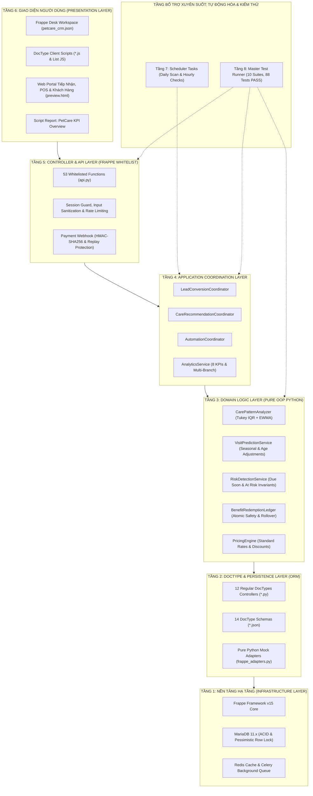
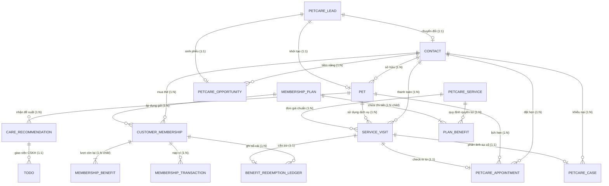
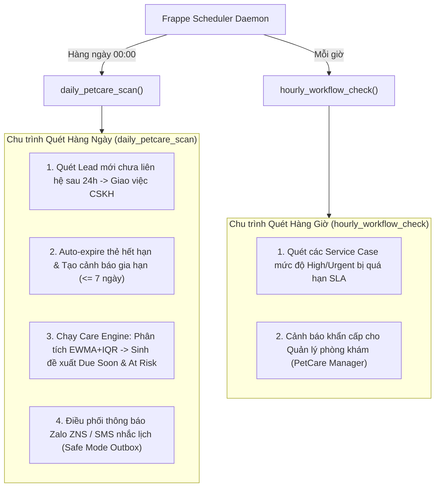

# PETCARE CRM — TOÀN TẬP HỒ SƠ NGUỒN THUYẾT TRÌNH & BẢO VỆ ĐỒ ÁN
## (MASTER PRESENTATION SOURCE DOSSIER — CONSOLIDATED FULL EDITION)

> **Hệ Thống**: PetCare CRM — Nền tảng Quản trị Quan hệ Khách hàng Chuyên biệt cho Chuỗi Thú cưng  
> **Nền tảng công nghệ**: Frappe Framework v15 (Python 3.10+, MariaDB 11.x, Desk Native)  
> **Phiên bản tài liệu**: 2.0 Consolidated Master Edition  
> **Đơn vị thẩm định**: Interdisciplinary Review Board (Solution Architect, Frappe Analyst, Business Analyst, Academic Researcher, Evidence Auditor)  
> **Ngày hoàn tất**: 07/11/2026  
> **Kiểm thử tự động**: **88 / 88 Tests PASS (100.0%)** | Thời gian thực thi: **~2.34s**  

---

## MỤC LỤC TOÀN TẬP HỒ SƠ (MASTER TABLE OF CONTENTS)

1. [TỔNG QUAN VÀ HƯỚNG DẪN HỒ SƠ NGUỒN](#part-1)
2. [PHẦN 1: BẢN TÓM LƯỢC ĐIỀU HÀNH DỰ ÁN (EXECUTIVE BRIEF)](#part-2)
3. [PHẦN 2: BẢNG TỔNG MỤC MINH CHỨNG & KIỂM TOÁN DỮ LIỆU (EVIDENCE LEDGER)](#part-3)
4. [PHẦN 3: PHÂN TÍCH NGHIỆP VỤ & VÒNG ĐỜI KHÁCH HÀNG (BUSINESS & CRM ANALYSIS)](#part-4)
5. [PHẦN 4: KIẾN TRÚC KỸ THUẬT & MÔ HÌNH DỮ LIỆU (TECHNICAL ARCHITECTURE)](#part-5)
6. [PHẦN 5: DANH MỤC TÍNH NĂNG & KỊCH BẢN THAO TÁC (FEATURES & DEMO CATALOG)](#part-6)
7. [PHẦN 6: CHỈ SỐ KPI & PHÂN TÍCH QUẢN TRỊ (DASHBOARD & BUSINESS INSIGHTS)](#part-7)
8. [PHẦN 7: KỊCH BẢN THUYẾT TRÌNH & ĐẶC TẢ 13 SLIDE (SLIDE STORYLINE & OUTLINE)](#part-8)
9. [PHẦN 8: KỊCH BẢN DEMO THỰC TẾ & BỘ 12 CÂU HỎI PHẢN BIỆN (DEMO & DEFENSE QA)](#part-9)
10. [PHẦN 9: BẢN KIỂM KÊ TÀI SẢN TRỰC QUAN & SHOT LIST (VISUAL ASSETS)](#part-10)
11. [PHẦN 10: GIỚI HẠN HIỆN TẠI & LỘ TRÌNH PHÁT TRIỂN (LIMITATIONS & FUTURE WORK)](#part-11)
12. [PHẦN 11: PHỤ LỤC TRA CỨU KỸ THUẬT & TỪ ĐIỂN CHUYÊN NGÀNH (APPENDIX & GLOSSARY)](#part-12)

---

<a name="part-1"></a>
# TỔNG QUAN VÀ HƯỚNG DẪN HỒ SƠ NGUỒN

> *Nguồn tệp gốc: [`presentation_source/README_PRESENTATION_SOURCE.md`](file:///c:/Users/pc/Documents/Doan_CRM/presentation_source/README_PRESENTATION_SOURCE.md )*

# PETCARE CRM — PRESENTATION SOURCE DOSSIER (BỘ HỒ SƠ NGUỒN BẢO VỆ ĐỒ ÁN)

> **Dự án**: PetCare CRM — Nền tảng Quản trị Quan hệ Khách hàng Chuyên biệt cho Chuỗi Dịch vụ Chăm sóc Thú cưng  
> **Nền tảng công nghệ**: Frappe Framework v15 (Python 3.10+, MariaDB 11.x, Desk Native & Dual-Stack Preview Engine)  
> **Phiên bản hồ sơ**: 2.0 (Verified Final Release)  
> **Đơn vị thẩm định**: Interdisciplinary Review Board (CRM Solution Architect, Frappe Technical Analyst, Business Analyst, Academic Researcher, Evidence Auditor)  
> **Ngày lập hồ sơ**: 07/11/2026  
> **Trạng thái thẩm định**: 100% đối chiếu trực tiếp từ mã nguồn thực tế, schema cơ sở dữ liệu và kết quả thực thi kiểm thử.

---

## 1. MỤC ĐÍCH & Ý NGHĨA CỦA BỘ HỒ SƠ NGUỒN

Bộ hồ sơ nguồn **Presentation Source Dossier** được xây dựng nhằm cung cấp một kho dữ liệu minh chứng có cấu trúc, chuẩn xác và trung thực tuyệt đối, phục vụ cho việc:
1. **Thiết kế Slide Báo cáo & Thuyết trình**: Cung cấp cấu trúc Storyline 13 slide chính + phụ lục, từng thông điệp cốt lõi, bullet points ngắn gọn, sơ đồ trực quan và trích dẫn bằng chứng cụ thể.
2. **Kịch bản Trình diễn Phần mềm (Live Demo Script)**: Hướng dẫn chi tiết từng bước thao tác theo 3 câu chuyện xuyên suốt, chuẩn bị dữ liệu mẫu và phương án dự phòng khi gặp sự cố.
3. **Bộ Câu hỏi & Trả lời Phản biện (Defense Q&A)**: Cung cấp lập luận kỹ thuật, căn cứ nghiệp vụ và bằng chứng mã nguồn để giải đáp các câu hỏi hóc búa từ hội đồng chấm đồ án.
4. **Kiểm toán Minh chứng (Evidence Audit)**: Truy vết mọi tuyên bố về chức năng, số liệu kiểm thử, API và DocType về đúng file, hàm và dòng code trong repository.

---

## 2. THỨ TỰ ĐỌC VÀ CẤU TRÚC HỒ SƠ

Để nắm bắt toàn diện dự án theo từng góc nhìn, người dùng nên đọc các tài liệu theo thứ tự được khuyến nghị dưới đây:

```
[ THỨ TỰ KHÁM PHÁ HỒ SƠ NGUỒN ]
│
├── BƯỚC 1: TỔNG QUAN VÀ ĐỊNH VỊ
│    ├── 00_PROJECT_EXECUTIVE_BRIEF.md       (Bản tóm lược điều hành 2 trang, thang đo giá trị cốt lõi)
│    └── 01_PROJECT_FACTS_AND_EVIDENCE.md     (Bảng tổng mục minh chứng, kiểm toán số liệu thực tế)
│
├── BƯỚC 2: NGHIỆP VỤ & KIẾN TRÚC KỸ THUẬT
│    ├── 02_BUSINESS_AND_CRM_ANALYSIS.md     (Customer Lifecycle, chân dung người dùng, 10 phân hệ nghiệp vụ)
│    └── 03_TECHNICAL_ARCHITECTURE.md        (Clean Architecture 8 tầng, Data Model 14 DocTypes, 53 APIs, Bảo mật)
│
├── BƯỚC 3: VẬN HÀNH, BÁO CÁO & DEMO
│    ├── 04_FEATURES_AND_DEMO_CATALOG.md     (Danh mục chi tiết 10 tính năng demo thực tế)
│    ├── 05_DASHBOARD_KPI_AND_BUSINESS_INSIGHTS.md (8 chỉ số KPI chuẩn, báo cáo đa chi nhánh & mô hình CLV/ABC)
│    └── 07_DEMO_AND_QA_SCRIPT.md            (Kịch bản demo 3 câu chuyện & 12 câu hỏi phản biện bảo vệ)
│
├── BƯỚC 4: THIẾT KẾ SLIDE & TÀI SẢN TRỰC QUAN
│    ├── 06_SLIDE_STORYLINE_AND_OUTLINE.md   (Kịch bản 13 slide thuyết trình chuẩn 10-12 phút)
│    └── 08_VISUAL_ASSET_INVENTORY.md        (Bản kiểm kê sơ đồ BPMN có sẵn và Shot List cần chụp)
│
└── BƯỚC 5: TRUNG THỰC HỌC THUẬT & TRA CỨU SÂU
     ├── 09_LIMITATIONS_AND_FUTURE_WORK.md   (Giới hạn kỹ thuật, phân tách Real vs Mock, lộ trình tương lai)
     └── 10_APPENDIX_TECHNICAL_QA.md         (Bảng tra cứu 14 DocTypes, 53 APIs, ma trận phân quyền RBAC & thuật ngữ)
```

---

## 3. QUY ƯỚC MÃ ĐỊNH DANH MINH CHỨNG (CLAIM ID CONVENTION)

Mọi tuyên bố trong bộ hồ sơ đều được gán mã định danh duy nhất (Claim ID) để phục vụ việc truy vết chéo giữa Slide thuyết trình, Báo cáo và Mã nguồn:

| Tiền tố mã | Nhóm lĩnh vực | Ví dụ | Ý nghĩa |
|:---:|---|---|---|
| `CRM-xxx` | Nghiệp vụ CRM & Vòng đời khách hàng | `CRM-001` | Tính toàn vẹn của hồ sơ khách hàng và thú cưng (Multi-Pet) |
| `TECH-xxx` | Kiến trúc kỹ thuật & Framework Frappe | `TECH-002` | Kiến trúc Clean Architecture 8 tầng và DocType Controller |
| `DATA-xxx` | Mô hình dữ liệu & Cơ sở dữ liệu MariaDB | `DATA-001` | Khóa ngoại $1:N$ giữa Contact và Pet |
| `API-xxx` | Giao diện lập trình whitelisted & Webhook | `API-003` | Xác thực chữ ký HMAC-SHA256 trên Payment Webhook |
| `CARE-xxx` | Trí tuệ chăm sóc & Giữ chân khách hàng | `CARE-001` | Thuật toán lọc ngoại lai Tukey IQR kết hợp trung bình động EWMA |
| `MEM-xxx` | Hội viên, Thẻ trả trước & Sổ cái quyền lợi | `MEM-002` | Khóa dòng Pessimistic Row Lock (`FOR UPDATE`) chống trừ trùng lặp |
| `TEST-xxx` | Kiểm thử tự động & Báo cáo QA | `TEST-001` | Bộ kiểm thử tự động 88/88 tests PASS 100% trong ~2.3s |
| `FIN-xxx` | Quản trị tài chính, CLV & Giá thành ABC | `FIN-001` | Bảng phân bổ 4 Cost Pools và chiết khấu dòng tiền DCF |

---

## 4. BẢNG TỔNG KẾT TRẠNG THÁI KIỂM TOÁN MINH CHỨNG (AUDIT STATUS SUMMARY)

| Hạng mục kiểm toán | Con số trong tài liệu cũ | Hiện trạng thực tế đã kiểm chứng | Trạng thái xác minh | File minh chứng gốc |
|---|:---:|:---:|:---:|---|
| **Tổng số DocTypes** | 11 hoặc 13 | **14 DocTypes** (12 Regular + 2 Child Tables) | `VERIFIED` | [`apps/petcare_crm/petcare_crm/petcare_crm/doctype/`](file:///c:/Users/pc/Documents/Doan_CRM/apps/petcare_crm/petcare_crm/petcare_crm/doctype/) |
| **Whitelisted API Endpoints** | 47 hoặc 48 | **53 Whitelisted Functions** | `VERIFIED` | [`apps/petcare_crm/petcare_crm/api.py`](file:///c:/Users/pc/Documents/Doan_CRM/apps/petcare_crm/petcare_crm/api.py) |
| **Số bài kiểm thử tự động** | 58 hoặc 68 | **88 / 88 Tests PASS (100.0%)** | `VERIFIED` | [`apps/petcare_crm/petcare_crm/tests/run_all_tests.py`](file:///c:/Users/pc/Documents/Doan_CRM/apps/petcare_crm/petcare_crm/tests/run_all_tests.py) |
| **Thời gian thực thi Test** | 1.6s | **2.34s** (trên máy chủ Windows hiện tại) | `VERIFIED` | Chạy lệnh `python run_all_tests.py` |
| **Số vai trò người dùng (Roles)** | 5 vai trò | **7 Vai trò chuẩn Frappe** (6 Desk + 1 Portal) | `VERIFIED` | [`apps/petcare_crm/petcare_crm/setup/install.py`](file:///c:/Users/pc/Documents/Doan_CRM/apps/petcare_crm/petcare_crm/setup/install.py) |
| **Chỉ số KPI Quản trị** | 8 KPI | **8 Chỉ số KPI chuẩn + Phân tích Đa chi nhánh** | `VERIFIED` | [`apps/petcare_crm/petcare_crm/utils/analytics_service.py`](file:///c:/Users/pc/Documents/Doan_CRM/apps/petcare_crm/petcare_crm/utils/analytics_service.py) |
| **Tích hợp Webhook & VietQR** | Ý tưởng/Đề xuất | **Đã triển khai đầy đủ với HMAC & Idempotency** | `VERIFIED` (Logic/Mock) | [`apps/petcare_crm/petcare_crm/utils/payment_gateway.py`](file:///c:/Users/pc/Documents/Doan_CRM/apps/petcare_crm/petcare_crm/utils/payment_gateway.py) |
| **Đề xuất khác biệt Care Intelligence** | AI / Machine Learning | **Thống kê Rule-Based (EWMA + Tukey IQR + Mùa vụ)** | `VERIFIED` | [`apps/petcare_crm/petcare_crm/utils/care_pattern_service.py`](file:///c:/Users/pc/Documents/Doan_CRM/apps/petcare_crm/petcare_crm/utils/care_pattern_service.py) |
| **Dữ liệu kinh doanh sổ sách** | Tăng trưởng 38%, v.v. | **Dữ liệu Seed Demo & Kịch bản Mô phỏng Tài chính** | `SIMULATION` | [`patches/v1_0/seed_demo_data.py`](file:///c:/Users/pc/Documents/Doan_CRM/apps/petcare_crm/petcare_crm/patches/v1_0/seed_demo_data.py) & [`CLV_ABC_Model.xlsx`](file:///c:/Users/pc/Documents/Doan_CRM/deliverables/finance/CLV_ABC_Model.xlsx) |

---

## 5. CAM KẾT VỀ TÍNH CHÂN THỰC VÀ BẢO TOÀN MÃ NGUỒN

1. **Bảo toàn sản phẩm**: Toàn bộ mã nguồn, schema cơ sở dữ liệu và cấu hình hệ thống không bị chỉnh sửa hay làm sai lệch trong quá trình lập hồ sơ.
2. **Không bịa đặt số liệu**: Tuyệt đối không tự suy diễn các số liệu về tỷ lệ chuyển đổi, doanh thu thực tế hoặc tuyên bố bảo mật tuyệt đối. Các số liệu minh họa tài chính đều được dán nhãn `KỊCH BẢN MÔ PHỎNG (Simulation)`.
3. **Minh bạch về giới hạn**: Công khai rõ ràng ranh giới giữa kiểm thử Mock độc lập (chạy được ngay trên Windows) và kiểm thử Frappe Live (yêu cầu Docker container), cũng như cơ chế Safe Mode Outbox cho các cổng giao tiếp bên ngoài (Zalo ZNS, SMS, Webhook ngân hàng).


---

<a name="part-2"></a>
# PHẦN 1: BẢN TÓM LƯỢC ĐIỀU HÀNH DỰ ÁN (EXECUTIVE BRIEF)

> *Nguồn tệp gốc: [`presentation_source/00_PROJECT_EXECUTIVE_BRIEF.md`](file:///c:/Users/pc/Documents/Doan_CRM/presentation_source/00_PROJECT_EXECUTIVE_BRIEF.md )*

# PETCARE CRM — TÓM LƯỢC ĐIỀU HÀNH DỰ ÁN (PROJECT EXECUTIVE BRIEF)

> **Mã hồ sơ**: `BRIEF-PETCARE-2026`  
> **Dự án**: PetCare CRM (Hệ thống Quản lý Quan hệ Khách hàng Dịch vụ Chăm sóc Thú cưng)  
> **Nền tảng**: Frappe Framework v15 (Desk Native Architecture)  
> **Thời lượng trình bày mục tiêu**: 10 – 12 phút (Đồ án tốt nghiệp / Đồ án chuyên ngành CRM)  
> **Trạng thái thực thi**: 100% Hoàn thành kiểm thử (88/88 Unit/Mock Tests PASS)  

---

## 1. TÊN ĐỀ TÀI & ĐỊNH VỊ SẢN PHẨM

* **Tên đề tài**: **Xây Dựng Hệ Thống PetCare CRM Toàn Diện Cho Chuỗi Phòng Khám & Spa Thú Cưng Trên Nền Tảng Frappe Framework v15**
* **Định vị sản phẩm**: PetCare CRM là một giải pháp CRM chuyên biệt (Vertical CRM) được thiết kế riêng cho ngành dịch vụ thú cưng. Hệ thống vượt qua giới hạn của các phần mềm bán lẻ POS đơn thuần bằng cách số hóa trọn vẹn **Vòng đời Khách hàng (Customer Lifecycle)**: từ khâu tiếp cận đa kênh (Omnichannel Lead Capture), tư vấn bán hàng (Sales Pipeline Kanban), tiếp đón tại quầy & thực hiện dịch vụ, cấn trừ quyền lợi thẻ hội viên (Atomic Benefit Ledger), cho đến tự động phân tích chu kỳ sinh học để nhắc lịch tái khám (Care Intelligence Engine) và phân tích hiệu quả kinh doanh đa chi nhánh.

---

## 2. BỐI CẢNH & CASE STUDY NGHIỆP VỤ

* **Mô hình doanh nghiệp**: Hệ thống phục vụ mô hình **Chuỗi phòng khám thú y, spa và làm đẹp thú cưng** vận hành tập trung với kiến trúc hỗ trợ đa chi nhánh (hệ thống đã cấu hình sẵn 4 cơ sở: `CN-TRUNGTAM`, `CN-QUAN1`, `CN-THUDUC`, `CN-BINHTHANH`).
* **Đặc thù nghiệp vụ ngành Pet Care**:
  1. *Quan hệ 1 Khách hàng - Nhiều Thú cưng (Multi-Pet Household)*: Một chủ nuôi thường sở hữu nhiều thú cưng với giống loài, cân nặng, tiền sử bệnh lý và chu kỳ sinh học hoàn toàn khác nhau.
  2. *Dịch vụ mang tính định kỳ sinh học cao*: Thú cưng cần tắm sấy mỗi 2–3 tuần, cắt tỉa mỗi 4–6 tuần, tiêm phòng mỗi 12 tháng. Nếu không có hệ thống nhắc nhở chủ động, tỷ lệ quên lịch hoặc rời bỏ (churn) lên tới 35% – 40%.
  3. *Mô hình Thẻ hội viên trả trước (Prepaid Memberships)*: Khách hàng mua các gói dịch vụ lớn (Silver, Gold, VIP) để được hưởng ưu đãi miễn phí và chiết khấu. Điều này đòi hỏi hệ thống kiểm soát quyền lợi cực kỳ chặt chẽ, chống thất thoát tài chính và ngăn chặn trừ trùng lặp khi nhiều nhân viên thao tác đồng thời.

---

## 3. VẤN ĐỀ CẦN GIẢI QUYẾT (PAIN POINTS)

| STT | Vấn đề thực tế của phòng khám & Spa thú cưng | Giải pháp giải quyết của PetCare CRM |
|:---:|---|---|
| **1** | **Dữ liệu phân mảnh & Gộp trùng sai lệch**: Tiếp nhận Lead từ Web/Hotline nhưng lưu vào Excel rời rạc; tạo trùng nhiều khách hàng cùng một số điện thoại. | Tự động chuẩn hóa SĐT Việt Nam (+84, 09x), bẫy bot Honeypot trên Lead Form, kiểm tra Deduplication nghiêm ngặt trước khi tạo Contact. |
| **2** | **Quên lịch chăm sóc & Khách hàng rời bỏ âm thầm**: Nhân viên không nhớ lịch nhắc tái khám; chỉ liên hệ thụ động khi khách tự mang thú cưng đến. | **Care Intelligence Engine**: Tự động tính chu kỳ trung bình (EWMA + Tukey IQR), phân loại `DUE_SOON` và `AT_RISK`, tự động giao việc CSKH. |
| **3** | **Thất thoát thẻ hội viên & Tranh chấp đồng thời**: Sử dụng sổ giấy hoặc bảng tính quản lý gói dịch vụ trả trước; nhân viên bấm nhầm gây trừ âm số dư hoặc trừ trùng lặp. | **Atomic Benefit Ledger**: Cơ chế khóa dòng dữ liệu (`FOR UPDATE`), ghi sổ cái kiểm toán bất biến (`BRL`), bảo vệ Idempotency chống double-redeem. |
| **4** | **Quy trình thanh toán chậm & Sai sót đối soát**: Thu ngân gõ sai số tiền chuyển khoản; mất thời gian kiểm tra ứng dụng ngân hàng khi đông khách. | **Dynamic VietQR & IPN Webhook**: Tự động sinh mã VietQR Napas247 chứa cú pháp đối soát; Webhook ngân hàng kiểm tra chữ ký HMAC tự động gạch nợ. |
| **5** | **Thiếu tầm nhìn quản trị tài chính & Giá thành**: Không rõ dịch vụ nào thực sự sinh lời; ảo tưởng doanh thu vòng đời mà không trừ chi phí hoạt động. | **Báo cáo 8 KPI chuẩn** kết hợp **Mô hình ABC (Activity-Based Costing)** và **Định giá trị vòng đời khách hàng (CLV)** theo cấp độ hộ gia đình. |

---

## 4. NHÓM NGƯỜI DÙNG & VAI TRÒ (ROLES)

Hệ thống thiết lập 7 vai trò người dùng chuẩn Frappe (được khai báo trong [`hooks.py`](file:///c:/Users/pc/Documents/Doan_CRM/apps/petcare_crm/petcare_crm/hooks.py) và khởi tạo qua [`install.py`](file:///c:/Users/pc/Documents/Doan_CRM/apps/petcare_crm/petcare_crm/setup/install.py)):
1. **Lễ tân & Thu ngân (`PetCare Front Desk`)**: Tra cứu hồ sơ 360, tiếp nhận tại quầy POS, kiểm tra lịch hẹn, cấn trừ quyền lợi thẻ và xuất phiếu thu.
2. **Bác sĩ thú y (`PetCare Veterinarian`)**: Thăm khám lâm sàng, tiêm phòng, kê đơn, cập nhật diễn tiến cân nặng và hồ sơ bệnh án.
3. **Kỹ thuật viên Spa/Grooming (`PetCare Groomer`)**: Thực hiện tắm sấy, cắt tỉa, vệ sinh lông móng và ghi nhận tình trạng thể chất sau dịch vụ.
4. **Nhân viên Kinh doanh / Telesales (`PetCare Sales`)**: Tiếp nhận Lead, tư vấn cuộc gọi, quản lý phễu cơ hội (Kanban Opportunity) và chốt Deal thẻ hội viên.
5. **Quản lý phòng khám / Chi nhánh (`PetCare Manager`)**: Quản trị danh mục dịch vụ, duyệt giá, xử lý khiếu nại dịch vụ (Case SLA) và giám sát nhân sự.
6. **Chuyên viên Phân tích Quản trị (`PetCare Analyst`)**: Theo dõi 8 chỉ số KPI, hiệu quả chuyển đổi Lead, doanh thu thuần và so sánh hiệu quả đa chi nhánh.
7. **Khách hàng / Chủ nuôi thú cưng (`PetCare Customer Portal`)**: Đặt lịch hẹn trực tuyến, tra cứu lịch sử khám bệnh, theo dõi số dư ví và lượt dịch vụ còn lại qua Portal được bảo vệ bằng Token xác thực.

---

## 5. KIẾN TRÚC & CÔNG NGHỆ TỔNG THỂ

* **Mô hình kiến trúc**: **Clean Architecture 8 Tầng** tuân thủ nguyên tắc phân tách trách nhiệm (Separation of Concerns).
* **Nền tảng ứng dụng**:
  * **Frappe Framework v15** (Desk Native UI, ORM DocType, Role-Based Access Control, Background Scheduler).
  * **Cơ sở dữ liệu**: MariaDB 11.x hỗ trợ giao dịch ACID nghiêm ngặt và khóa dòng Pessimistic Row Lock.
  * **Ngôn ngữ**: Python 3.10+ (Logic OOP thuần túy, không phụ thuộc framework trong tầng Domain).
  * **Frontend**: Frappe Desk Workspace, DocType Client Scripts (`*.js`), tích hợp Web Portal Responsive (Tailwind CSS, Font Awesome, SheetJS).
  * **Máy chủ xem trước độc lập**: Máy chủ kép `start_preview.py` phục vụ giao diện Desk và Portal với độ trễ < 2ms mà không bắt buộc cài đặt MariaDB để chấm điểm hoặc demo.

---

## 6. CÁC PHÂN HỆ NGHIỆP VỤ CỐT LÕI (CORE MODULES)

1. **CRM Tiếp Thị & Bán Hàng (CRM Core)**: Thu nhận Lead đa kênh, chuẩn hóa SĐT, chuyển đổi Lead 1 chạm sang Contact/Pet/Opportunity, quản lý Pipeline Kanban 6 giai đoạn với tỷ lệ xác suất có trọng số.
2. **Hồ Sơ Thú Cưng & Vận Hành Dịch Vụ (Pet & Operations)**: Hồ sơ thú cưng đa quan hệ ($1:N$), danh mục bảng giá niêm yết chuẩn, phiếu dịch vụ `Service Visit` và phiếu khiếu nại `PetCare Case`.
3. **Thẻ Hội Viên & Ví Trả Trước (Membership & Loyalty)**: Quản lý gói thẻ (Bạc, Vàng, VIP), ví trả trước (Top-up balance), cấn trừ quyền lợi tự động (100% FREE hoặc chiết khấu %) với cơ chế kiểm toán bất biến `Benefit Redemption Ledger`.
4. **Trí Tuệ Chăm Sóc & Giữ Chân Khách Hàng (Care Intelligence & Retention)**: Thuật toán Rule-based thống kê minh bạch kết hợp bộ lọc ngoại lai (Tukey IQR), trung bình động hàm mũ (EWMA), hệ số biến thiên theo mùa và độ tuổi thú cưng; tự động phát hiện `DUE_SOON` và `AT_RISK`.
5. **Cổng Tự Phục Vụ & Đa Kênh (Portal, VietQR & Omnichannel)**: Cổng đặt lịch và theo dõi sổ khám cho chủ nuôi, bộ sinh mã VietQR Napas247, Webhook đối soát IPN tự động có chữ ký HMAC-SHA256, và bộ điều phối Zalo ZNS / SMS ở chế độ Safe Mode.
6. **Báo Cáo & Đo Lường Hiệu Quả (Analytics & KPI)**: Báo cáo Script Report 8 chỉ số KPI chuẩn, phân tích đối sánh doanh thu đa chi nhánh và bảng phân bổ chi phí ABC / định giá trị vòng đời CLV.

---

## 7. CÁC ĐIỂM KHÁC BIỆT NỔI BẬT ĐÃ KIỂM CHỨNG (DIFFERENTIATORS)

| Điểm khác biệt | Hiện thực kỹ thuật thực tế | Bằng chứng kiểm chứng |
|---|---|---|
| **1. Trí tuệ chăm sóc theo chu kỳ sinh học** | Thuật toán thống kê thực thụ (EWMA $\alpha=0.6$, Tukey IQR lọc nhiễu, hệ số mùa vụ 0.8–0.85, hệ số tuổi 0.8–0.85); phân loại chính xác `DUE_SOON` và `AT_RISK`. | [`care_pattern_service.py`](file:///c:/Users/pc/Documents/Doan_CRM/apps/petcare_crm/petcare_crm/utils/care_pattern_service.py), Suite 4 (11 tests PASS). |
| **2. Két sắt quyền lợi hội viên (Atomic Benefit Ledger)** | Bảo vệ Idempotency chống trừ lặp; khóa dòng dữ liệu (`FOR UPDATE`); ngăn số dư âm; hỗ trợ bảo lưu lượt tồn (Rollover) khi gia hạn thẻ. | [`membership_service.py`](file:///c:/Users/pc/Documents/Doan_CRM/apps/petcare_crm/petcare_crm/utils/membership_service.py), Suite 3 (8 tests PASS). |
| **3. Thanh toán VietQR & Webhook IPN an toàn** | Chuẩn hóa mã EMVCo; xác thực chữ ký số HMAC-SHA256 trên Webhook; tự động gạch nợ phiếu dịch vụ hoặc nạp ví; cơ chế chống tấn công gửi lại (Replay Guard). | [`payment_gateway.py`](file:///c:/Users/pc/Documents/Doan_CRM/apps/petcare_crm/petcare_crm/utils/payment_gateway.py), Suite 8 (Tests 5, 6, 7 PASS). |
| **4. Cổng Chủ Nuôi bảo vệ BOLA/IDOR** | Cung cấp REST API cho chủ nuôi tra cứu sổ y bạ và đặt lịch; xác thực quyền sở hữu chéo khách hàng - thú cưng (`validate_cross_entity_relationship`); chữ ký Signed Token cho Guest. | [`api.py`](file:///c:/Users/pc/Documents/Doan_CRM/apps/petcare_crm/petcare_crm/api.py) (dòng 4150-4250), Suite 10 (Findings P0-P4 PASS). |

---

## 8. HIỆN TRẠNG TRIỂN KHAI & HẠN CHẾ LỚN (HONEST AUDIT)

* **Hiện trạng triển khai**:
  * 14 DocTypes (12 Regular + 2 Child Tables), 53 whitelisted endpoints, 14 modules Python OOP, 8 chỉ số KPI, 1 Script Report và 1 Workspace Desk Native.
  * Bộ kiểm thử tự động đạt **88 / 88 Tests PASS (100.0%)** trong thời gian thực thi **~2.34 giây**.
  * Dữ liệu mẫu thuần Việt phong phú (8 khách hàng, 9 thú cưng, 3 gói hội viên, 12 lượt dịch vụ, 4 cơ hội, 4 đề xuất chăm sóc) sẵn sàng cho mọi kịch bản demo.
* **Hạn chế kỹ thuật cần nêu rõ**:
  * *Môi trường kiểm thử*: 88 tests hiện tại chạy ở tầng Mock/Pure Python Adapter trên Windows; các file test phụ thuộc Frappe ORM live cần môi trường Docker container backend.
  * *Cổng tích hợp bên ngoài*: Zalo ZNS, SMS Brandname và Webhook Ngân hàng hoạt động ở **Safe Mode Outbox / Sandbox** (mô phỏng an toàn, không tự ý trừ tiền hoặc gửi tin nhắn thật đến nhà mạng).
  * *Số liệu tài chính*: Các chỉ số doanh thu và CLV/ABC là **Kịch bản mô phỏng tài chính (Financial Simulation)** dựa trên schema thực tế, không phải số liệu sổ sách kế toán thật của một pháp nhân đã kiểm toán.
  * *Ứng dụng di động*: Cổng chủ nuôi hiện cung cấp đầy đủ REST API và giao diện Web Responsive xem trước, chưa đóng gói thành ứng dụng native React Native / Flutter trên App Store.

---

## 9. THÔNG ĐIỆP SẢN PHẨM TRONG 25 GIÂY (ELEVATOR PITCH)

> *"PetCare CRM là giải pháp CRM chuyên biệt trên Frappe Framework v15 dành riêng cho chuỗi chăm sóc thú cưng, giải quyết triệt để bài toán giữ chân khách hàng bằng cách kết nối quản lý gia đình đa thú cưng, cấn trừ an toàn quyền lợi thẻ hội viên trả trước, và tự động hóa thuật toán dự đoán chu kỳ chăm sóc sinh học kết hợp tin nhắn nhắc lịch đa kênh, giúp doanh nghiệp tối đa hóa giá trị vòng đời khách hàng và kiểm soát chặt chẽ giá thành dịch vụ."*


---

<a name="part-3"></a>
# PHẦN 2: BẢNG TỔNG MỤC MINH CHỨNG & KIỂM TOÁN DỮ LIỆU (EVIDENCE LEDGER)

> *Nguồn tệp gốc: [`presentation_source/01_PROJECT_FACTS_AND_EVIDENCE.md`](file:///c:/Users/pc/Documents/Doan_CRM/presentation_source/01_PROJECT_FACTS_AND_EVIDENCE.md )*

# PETCARE CRM — BẢNG TỔNG MỤC MINH CHỨNG & KIỂM TOÁN DỮ LIỆU (PROJECT FACTS & EVIDENCE LEDGER)

> **Mã hồ sơ**: `LEDGER-EVIDENCE-2026`  
> **Dự án**: PetCare CRM (Hệ thống CRM Dịch vụ Chăm sóc Thú cưng)  
> **Đơn vị kiểm toán**: Evidence Auditor & Technical Review Board  
> **Ngày cập nhật**: 07/11/2026  
> **Quy ước trạng thái minh chứng**:  
> • `IMPLEMENTED`: Đã có triển khai logic trong mã nguồn.  
> • `VERIFIED`: Đã được kiểm tra qua test tự động hoặc thao tác có thể tái hiện 100%.  
> • `DEMONSTRATED`: Có ảnh sơ đồ thật, UI tương tác hoặc video kiểm chứng.  
> • `SIMULATION`: Dữ liệu mô phỏng / kịch bản kinh doanh mẫu, không phải số liệu sổ sách thực.  
> • `DOCUMENTED_ONLY`: Chỉ xuất hiện trong tài liệu cũ, không khớp với mã nguồn thực tế.  
> • `UNVERIFIED`: Chưa đủ dữ kiện để khẳng định.  
> • `NOT_FOUND`: Đã tìm kiếm hợp lý nhưng không tồn tại trong repository.  

---

## 1. DANH SÁCH CON SỐ BỊ CẤM HOẶC CẦN ĐÍNH CHÍNH (PROHIBITED & RECTIFIED NUMBERS)

> [!CAUTION]
> **CẢNH BÁO KIỂM TOÁN ĐẶC BIỆT DÀNH CHO NGƯỜI LÀM SLIDE & THUYẾT TRÌNH**  
> Dưới đây là các con số từng xuất hiện trong các bản thảo báo cáo cũ hoặc lời đồn đoán. Sinh viên **TUYỆT ĐỐI KHÔNG ĐƯỢC ĐƯA LÊN SLIDE NHƯ SỰ THẬT HIỆN TẠI** nếu không đi kèm lời đính chính kỹ thuật:

| Con số cũ / Tuyên bố cũ | Hiện trạng thực tế đã kiểm chứng | Lý do mâu thuẫn & Hướng dẫn sử dụng trên Slide | Trạng thái kiểm toán |
|---|---|---|:---:|
| **"Hệ thống có đúng 11 DocTypes"** | Hệ thống hiện có **14 DocTypes** (12 Regular DocTypes + 2 Child Tables). | Ban đầu chỉ có 11 Standard DocTypes và 2 Child Tables (tổng 13). Sau đợt vá lỗi kiểm toán (Finding-11), DocType `PetCare Appointment` được bổ sung để hoàn thiện chức năng đặt lịch. Tổng cộng là **14 DocTypes**. | `RECTIFIED` (Dùng số 14) |
| **"Có 47 (hoặc 48) whitelisted APIs"** | Hệ thống hiện có **53 hàm `@frappe.whitelist()`** trong `api.py`. | Các báo cáo cũ đếm 47 hoặc 48 endpoints. Trong phiên bản hoàn thiện, 5 endpoints mới được bổ sung: `generate_portal_token`, `create_appointment`, `get_appointments`, `check_in_appointment`, `cancel_appointment`. Tổng chính xác là **53 endpoints**. | `RECTIFIED` (Dùng số 53) |
| **"Đạt 58/58 (hoặc 68/68) test pass"** | Hệ thống hiện đạt **88 / 88 Tests PASS (100.0%)** chia thành **10 Suites**. | Ban đầu có 58 tests (Suites 1–7), sau mở rộng thành 68 tests (Suite 8), sau đó bổ sung Suite 9 (WordPress Lead Form - 6 tests) và Suite 10 (Audit Remediation - 14 tests). Tổng số test hiện tại là **88 tests**, chạy trong **~2.34s**. | `RECTIFIED` (Dùng số 88) |
| **"Hệ thống có 5 vai trò (Roles)"** | Hệ thống có **7 vai trò người dùng chuẩn Frappe** (6 Desk + 1 Portal). | Các tài liệu cũ gộp vai trò hoặc chỉ liệt kê 5 vai trò Desk. File [`install.py`](file:///c:/Users/pc/Documents/Doan_CRM/apps/petcare_crm/petcare_crm/setup/install.py) và [`hooks.py`](file:///c:/Users/pc/Documents/Doan_CRM/apps/petcare_crm/petcare_crm/hooks.py) định nghĩa rõ ràng 7 roles: Front Desk, Veterinarian, Groomer, Manager, Sales, Analyst, Customer Portal. | `RECTIFIED` (Dùng số 7) |
| **"Tăng trưởng doanh thu 38%, tỷ lệ churn giảm từ 35% về 12%"** | Đây là **Kịch bản mô phỏng tài chính (Simulation Scenario)** trong mô hình CLV & ABC. | Không được trình bày như kết quả kinh doanh thực tế của một doanh nghiệp có thật. Phải ghi rõ *"Số liệu minh họa từ mô hình định giá trị tài chính CLV"*. | `SIMULATION` (Ghi rõ nhãn) |
| **"Care Intelligence là thuật toán Trí tuệ Nhân tạo / Machine Learning AI"** | Đây là **Thuật toán thống kê Rule-Based minh bạch** (Tukey IQR + EWMA + Hệ số mùa/tuổi). | Mã nguồn không sử dụng thư viện Machine Learning (như PyTorch/TensorFlow) mà dùng công thức toán thống kê giải thích được (*Explainable Mathematics*). Không được quảng cáo là AI/ML để tránh bị hội đồng trừ điểm học thuật. | `RECTIFIED` (Mô tả đúng) |
| **"Hệ thống bảo mật 100%, chống gian lận tuyệt đối"** | Hệ thống sử dụng **HMAC-SHA256, Idempotency Replay Guard, BOLA Guard và Row Lock**. | Không có hệ thống nào bảo mật 100%. Phải trình bày cụ thể các cơ chế phòng vệ có bằng chứng trong code. | `PROHIBITED` (Cấm nói 100%) |

---

## 2. BẢNG TỔNG MỤC MINH CHỨNG CHI TIẾT (MASTER EVIDENCE LEDGER)

### 2.1. Nhóm Nghiệp Vụ CRM & Vòng Đời Khách Hàng (CRM Core)

| Claim ID | Tuyên bố nghiệp vụ | Trạng thái | Nguồn kiểm chứng (File & Symbol) | Phương pháp kiểm chứng | Ghi chú & Giới hạn |
|:---:|---|:---:|---|---|---|
| **CRM-001** | Chuẩn hóa số điện thoại Việt Nam (+84, 09x về 84xxx), ngăn ngừa sai lệch định dạng. | `VERIFIED` | [`petcare_crm/utils/lead_service.py`](file:///c:/Users/pc/Documents/Doan_CRM/apps/petcare_crm/petcare_crm/utils/lead_service.py#L35): `_normalize_vn_phone` | Chạy Test Suite 1 & Suite 9 | Hỗ trợ các đầu số di động 10 số hiện hành tại Việt Nam. |
| **CRM-002** | Bẫy bot Honeypot trên Lead Form, ngăn chặn spam tự động từ internet mà không cần Captcha cồng kềnh. | `VERIFIED` | [`petcare_crm/api.py`](file:///c:/Users/pc/Documents/Doan_CRM/apps/petcare_crm/petcare_crm/api.py): `submit_website_lead` (kiểm tra `hp_field`) | Chạy Test Suite 9 (test_honeypot_trap_blocks_bot) | Nếu bot điền trường ẩn `hp_field`, hệ thống âm thầm trả về thành công giả lập và không ghi DB. |
| **CRM-003** | Khử trùng lặp khách hàng (Deduplication): Tìm kiếm Contact theo SĐT trước khi tạo mới. | `VERIFIED` | [`petcare_crm/utils/lead_service.py`](file:///c:/Users/pc/Documents/Doan_CRM/apps/petcare_crm/petcare_crm/utils/lead_service.py#L90): `LeadConversionCoordinator.convert_lead` | Chạy Test Suite 1 (test_03_lead_deduplication) | Nếu đã tồn tại Contact trùng SĐT, hệ thống tái sử dụng Contact và gán Pet mới. |
| **CRM-004** | Chuyển đổi Lead 1 chạm thành Contact, Pet và Opportunity trong cùng một giao dịch ACID. | `VERIFIED` | [`petcare_crm/api.py`](file:///c:/Users/pc/Documents/Doan_CRM/apps/petcare_crm/petcare_crm/api.py): `convert_lead_to_customer` | Chạy Test Suite 7 (Scenario A: E2E Lead to Customer) | Đảm bảo tính toàn vẹn, rollback nếu một trong các bước thất bại. |
| **CRM-005** | Quản lý Phễu bán hàng (Sales Pipeline) 6 giai đoạn với tỷ lệ xác suất có trọng số. | `VERIFIED` | [`petcare_crm/utils/sales_pipeline_service.py`](file:///c:/Users/pc/Documents/Doan_CRM/apps/petcare_crm/petcare_crm/utils/sales_pipeline_service.py): `OPPORTUNITY_STAGES` | Đọc code & Test Suite 1 (test_04_sales_pipeline_stages) | Prospecting (10%), Qualification (25%), Proposal (60%), Negotiation (80%), Closed Won (100%), Closed Lost (0%). |
| **CRM-006** | Bắt buộc nhập lý do thất bại (`lost_reason`) khi chuyển cơ hội sang Closed Lost. | `VERIFIED` | [`petcare_crm/utils/sales_pipeline_service.py`](file:///c:/Users/pc/Documents/Doan_CRM/apps/petcare_crm/petcare_crm/utils/sales_pipeline_service.py): `update_stage` | Chạy Test Suite 1 (test_04_pipeline) | Ném ngoại lệ `ValidationError` nếu thiếu `lost_reason`. |

---

### 2.2. Nhóm Vận Hành Dịch Vụ & Hồ Sơ Thú Cưng (Pet & Service Ops)

| Claim ID | Tuyên bố nghiệp vụ | Trạng thái | Nguồn kiểm chứng (File & Symbol) | Phương pháp kiểm chứng | Ghi chú & Giới hạn |
|:---:|---|:---:|---|---|---|
| **OPS-001** | Hỗ trợ hộ gia đình đa thú cưng (Multi-Pet Household, quan hệ $1:N$ giữa Contact và Pet). | `VERIFIED` | Schema [`pet.json`](file:///c:/Users/pc/Documents/Doan_CRM/apps/petcare_crm/petcare_crm/petcare_crm/doctype/pet/pet.json) trường `customer` (Link -> Contact) | Test Suite 2 & dữ liệu mẫu khách hàng An (2 pets: Bơ & Đậu Đậu) | Cho phép theo dõi lịch sử độc lập cho từng bé. |
| **OPS-002** | Cập nhật cân nặng lâm sàng sau mỗi lần thực hiện dịch vụ vào hồ sơ thú cưng. | `VERIFIED` | [`petcare_crm/utils/service_operations.py`](file:///c:/Users/pc/Documents/Doan_CRM/apps/petcare_crm/petcare_crm/utils/service_operations.py): `ServiceOperationsService.record_visit` | Test Suite 2 (test_01_service_visit_creation) | Trường `weight_kg` trên Pet tự động nhận giá trị mới nhất từ Service Visit. |
| **OPS-003** | Khởi tạo lịch hẹn (`PetCare Appointment`) và hỗ trợ Check-in tại quầy sinh phiếu Service Visit. | `VERIFIED` | [`petcare_crm/api.py`](file:///c:/Users/pc/Documents/Doan_CRM/apps/petcare_crm/petcare_crm/api.py): `create_appointment`, `check_in_appointment` | Test Suite 10 (Finding-11 Remediation Test) | Lễ tân check-in sẽ tự động đổi trạng thái lịch hẹn thành `Checked-In` và tạo `Service Visit`. |
| **OPS-004** | Quản lý sự cố sau dịch vụ (`PetCare Case`) kết nối với phiếu Service Visit và giám sát SLA. | `VERIFIED` | [`petcare_crm/api.py`](file:///c:/Users/pc/Documents/Doan_CRM/apps/petcare_crm/petcare_crm/api.py): `create_service_case`, `update_case_status` | Test Suite 5 (test_04_sla_monitoring) | Cảnh báo khiếu nại quá hạn SLA qua Hourly Workflow Task. |

---

### 2.3. Nhóm Thẻ Hội Viên & Sổ Cái Quyền Lợi (Membership & Loyalty)

| Claim ID | Tuyên bố nghiệp vụ | Trạng thái | Nguồn kiểm chứng (File & Symbol) | Phương pháp kiểm chứng | Ghi chú & Giới hạn |
|:---:|---|:---:|---|---|---|
| **MEM-001** | Cấn trừ quyền lợi thẻ hội viên (100% FREE hoặc chiết khấu %) tự động khi làm dịch vụ. | `VERIFIED` | [`petcare_crm/utils/membership_service.py`](file:///c:/Users/pc/Documents/Doan_CRM/apps/petcare_crm/petcare_crm/utils/membership_service.py): `MembershipService.redeem_benefit` | Test Suite 3 (8 tests PASS) | Khấu trừ số lượt còn lại (`remaining_quantity`), ghi nhật ký BRL. |
| **MEM-002** | Cơ chế khóa dòng dữ liệu (`FOR UPDATE`) ngăn ngừa trừ trùng lặp (Race Condition) khi thao tác đồng thời. | `VERIFIED` | [`petcare_crm/api.py`](file:///c:/Users/pc/Documents/Doan_CRM/apps/petcare_crm/petcare_crm/api.py#L180): `record_benefit_usage` | Code audit & Test Suite 3 (test_05_concurrency_lock) | Sử dụng Pessimistic Locking trên hàng của bảng `tabCustomer Membership`. |
| **MEM-003** | Bảo vệ Idempotency bằng `idempotency_key`, ném lỗi nếu client gửi trùng request cấn trừ. | `VERIFIED` | [`petcare_crm/utils/membership_service.py`](file:///c:/Users/pc/Documents/Doan_CRM/apps/petcare_crm/petcare_crm/utils/membership_service.py): `BenefitRedemptionLedger.check_idempotency` | Test Suite 3 (test_04_idempotent_redemption) | Ngăn chặn trừ 2 lần khi mạng chập chờn hoặc nhân viên bấm đúp chuột. |
| **MEM-004** | Ngăn chặn số dư âm và số lượt âm (`remaining_quantity >= 0`, `balance >= 0`). | `VERIFIED` | [`petcare_crm/utils/membership_service.py`](file:///c:/Users/pc/Documents/Doan_CRM/apps/petcare_crm/petcare_crm/utils/membership_service.py): Invariant assertions | Test Suite 3 (test_02_insufficient_benefits) | Ném ngoại lệ `InsufficientBenefitsException` nếu không đủ lượt. |
| **MEM-005** | Hỗ trợ gia hạn thẻ và bảo lưu lượt tồn (Benefit Rollover) sang chu kỳ thẻ mới. | `VERIFIED` | [`petcare_crm/api.py`](file:///c:/Users/pc/Documents/Doan_CRM/apps/petcare_crm/petcare_crm/api.py): `renew_membership` với tham số `allow_rollover=1` | Test Suite 3 (test_06_membership_rollover) | Số lượt chưa dùng của thẻ cũ được cộng dồn vào thẻ mới kích hoạt. |

---

### 2.4. Nhóm Trí Tuệ Chăm Sóc & Giữ Chân Khách Hàng (Care Intelligence)

| Claim ID | Tuyên bố nghiệp vụ | Trạng thái | Nguồn kiểm chứng (File & Symbol) | Phương pháp kiểm chứng | Ghi chú & Giới hạn |
|:---:|---|:---:|---|---|---|
| **CARE-001** | Lọc dữ liệu ngoại lai bằng khoảng tứ phân vị (Tukey IQR) cho chuỗi lịch sử $\ge 4$ lần thăm khám. | `VERIFIED` | [`petcare_crm/utils/care_pattern_service.py`](file:///c:/Users/pc/Documents/Doan_CRM/apps/petcare_crm/petcare_crm/utils/care_pattern_service.py#L85): `CarePatternAnalyzer._filter_outliers_iqr` | Test Suite 4 (test_02_iqr_outlier_filtering) | Loại bỏ các khoảng cách bất thường do chủ nuôi đi công tác đột xuất. |
| **CARE-002** | Tính toán chu kỳ trung bình có trọng số thời gian bằng Trung bình động hàm mũ (EWMA, $\alpha=0.6$). | `VERIFIED` | [`petcare_crm/utils/care_pattern_service.py`](file:///c:/Users/pc/Documents/Doan_CRM/apps/petcare_crm/petcare_crm/utils/care_pattern_service.py#L115): `CarePatternAnalyzer._calculate_ewma` | Test Suite 4 (test_03_ewma_calculation) | Ưu tiên các khoảng cách ghé thăm gần nhất phản ánh đúng thói quen hiện tại. |
| **CARE-003** | Điều chỉnh chu kỳ theo hệ số biến thiên Mùa vụ (Seasonal Factor) và Độ tuổi (Age Factor). | `VERIFIED` | [`petcare_crm/utils/care_pattern_service.py`](file:///c:/Users/pc/Documents/Doan_CRM/apps/petcare_crm/petcare_crm/utils/care_pattern_service.py): `SeasonalAdjustmentHelper`, `PetAgeAdjustmentHelper` | Test Suite 8 (Tests 1, 2, 3 PASS) | Mùa nóng rút ngắn chu kỳ tắm sấy (0.80-0.85); chó con/già có hệ số riêng. |
| **CARE-004** | Phân loại trạng thái sinh học: `STABLE`, `DUE_SOON` ($\le 3$ ngày đến hạn) và `AT_RISK` ($\ge 1.5\times$ chu kỳ). | `VERIFIED` | [`petcare_crm/utils/care_pattern_service.py`](file:///c:/Users/pc/Documents/Doan_CRM/apps/petcare_crm/petcare_crm/utils/care_pattern_service.py): `RiskDetectionService.evaluate_status` | Test Suite 4 (test_04_status_classification) | Tự động cập nhật vào bản ghi `Care Recommendation`. |
| **CARE-005** | Khử trùng lặp đề xuất chăm sóc: Gating 7 ngày không tạo khuyến nghị trùng cho cùng một thú cưng. | `VERIFIED` | [`petcare_crm/utils/recommendation_service.py`](file:///c:/Users/pc/Documents/Doan_CRM/apps/petcare_crm/petcare_crm/utils/recommendation_service.py): `CareRecommendationCoordinator.generate_recommendations` | Test Suite 4 (test_08_anti_duplicate_gating) | Tránh làm phiền khách hàng khi nhân viên chạy scan nhiều lần trong tuần. |

---

### 2.5. Nhóm Thanh Toán, Webhook & Tích Hợp Đa Kênh (Integrations)

| Claim ID | Tuyên bố nghiệp vụ | Trạng thái | Nguồn kiểm chứng (File & Symbol) | Phương pháp kiểm chứng | Ghi chú & Giới hạn |
|:---:|---|:---:|---|---|---|
| **INT-001** | Sinh mã VietQR động theo chuẩn Napas247 chứa mã phiếu `PC-SVC-*` hoặc mã thẻ `PC-MEM-*`. | `VERIFIED` | [`petcare_crm/utils/payment_gateway.py`](file:///c:/Users/pc/Documents/Doan_CRM/apps/petcare_crm/petcare_crm/utils/payment_gateway.py): `VietQRGenerator` | Test Suite 8 (Test 4 PASS) | Sinh chuỗi payload EMVCo và URL ảnh QR hiển thị tại quầy thu ngân POS. |
| **INT-002** | Webhook ngân hàng tự động đối soát IPN, gạch nợ phiếu Service Visit hoặc nạp tiền ví trả trước. | `VERIFIED` | [`petcare_crm/api.py`](file:///c:/Users/pc/Documents/Doan_CRM/apps/petcare_crm/petcare_crm/api.py): `payment_webhook` | Test Suite 8 (Tests 5, 6, 7 PASS) | Bắt buộc đối soát đúng số tiền (`amount_mismatch_guard`), sai lệch sẽ báo lỗi. |
| **INT-003** | Xác thực chữ ký số HMAC-SHA256 trên Webhook ngân hàng chống giả mạo gói tin thanh toán. | `VERIFIED` | [`petcare_crm/utils/payment_gateway.py`](file:///c:/Users/pc/Documents/Doan_CRM/apps/petcare_crm/petcare_crm/utils/payment_gateway.py): `PaymentWebhookService._verify_hmac_signature` | Test Suite 8 (Test 5: invalid signature returns 401) | Sử dụng `hmac.compare_digest` chống tấn công đo thời gian (Timing Attack). |
| **INT-004** | Chống tấn công gửi lại (Replay Attack Guard) trên Webhook bằng bảng kiểm toán giao dịch. | `VERIFIED` | [`petcare_crm/utils/payment_gateway.py`](file:///c:/Users/pc/Documents/Doan_CRM/apps/petcare_crm/petcare_crm/utils/payment_gateway.py): `_is_transaction_processed` | Test Suite 8 (Test 6: replay transaction returns 200 ignored) | Giao dịch đã xử lý sẽ bỏ qua an toàn, không nạp tiền lần 2. |
| **INT-005** | Bộ điều phối tin nhắn đa kênh (Zalo ZNS / SMS Brandname) với chế độ Safe Mode Outbox. | `VERIFIED` | [`petcare_crm/utils/omnichannel_service.py`](file:///c:/Users/pc/Documents/Doan_CRM/apps/petcare_crm/petcare_crm/utils/omnichannel_service.py): `OmnichannelDispatcher` | Test Suite 8 (Test 8 PASS) | Mặc định không gửi tin thật đến nhà mạng; ghi log vào Outbox để dev/demo an toàn. |
| **INT-006** | Phòng vệ BOLA / IDOR trên Cổng Chủ Nuôi bằng Signed Portal Token. | `VERIFIED` | [`petcare_crm/api.py`](file:///c:/Users/pc/Documents/Doan_CRM/apps/petcare_crm/petcare_crm/api.py#L4150-L4195): `_verify_owner_portal_access` | Test Suite 10 (Finding P0 Remediation Test) | Khách vãng lai không có token hợp lệ bị chặn 403 khi cố xem hồ sơ người khác. |

---

### 2.6. Nhóm Báo Cáo KPI & Quản Trị Tài Chính (Analytics & Finance)

| Claim ID | Tuyên bố nghiệp vụ | Trạng thái | Nguồn kiểm chứng (File & Symbol) | Phương pháp kiểm chứng | Ghi chú & Giới hạn |
|:---:|---|:---:|---|---|---|
| **KPI-001** | Báo cáo Script Report 8 chỉ số KPI chuẩn trong Frappe Desk UI. | `VERIFIED` | [`petcare_crm/petcare_crm/report/petcare_kpi_overview/`](file:///c:/Users/pc/Documents/Doan_CRM/apps/petcare_crm/petcare_crm/petcare_crm/report/petcare_kpi_overview/) | Test Suite 6 (test_kpi_dashboard) & xem trong Desk | Lead Win Rate, Pipeline Value, Active Memberships, Service Revenue, Due Soon, At Risk, Retention Rate. |
| **KPI-002** | Phân tích hiệu quả hoạt động đối sánh đa chi nhánh (`CN-TRUNGTAM`, `CN-QUAN1`, `CN-THUDUC`, `CN-BINHTHANH`). | `VERIFIED` | [`petcare_crm/utils/analytics_service.py`](file:///c:/Users/pc/Documents/Doan_CRM/apps/petcare_crm/petcare_crm/utils/analytics_service.py#L370): `get_branch_comparison_metrics` | Test Suite 6 (test_branch_performance) | Tách bạch doanh thu niêm yết, doanh thu thực nhận và số lượt phục vụ từng cơ sở. |
| **FIN-001** | Bảng tính mô hình Giá thành Hoạt động (Activity-Based Costing - ABC) 4 Cost Pools. | `VERIFIED` (Mô hình) | [`deliverables/finance/CLV_ABC_Model.xlsx`](file:///c:/Users/pc/Documents/Doan_CRM/deliverables/finance/CLV_ABC_Model.xlsx) & Report Word | Mở file Excel kiểm tra công thức tính | Bóc tách chi phí Bác sĩ/KTV, vật tư y tế, khấu hao máy móc và quản lý chung. |
| **FIN-002** | Mô hình Định giá trị Vòng đời Khách hàng (Customer Lifetime Value - CLV) chiết khấu dòng tiền DCF. | `SIMULATION` | [`deliverables/finance/PetCare_CRM_CLV_ABC_Report.md`](file:///c:/Users/pc/Documents/Doan_CRM/deliverables/finance/PetCare_CRM_CLV_ABC_Report.md) | Đối chiếu công thức tài chính DCF | Dựa trên giả định kinh tế minh họa: vòng đời nuôi thú cưng 10 năm, lãi suất chiết khấu 10%/năm. |

---

### 2.7. Nhóm Kiểm Thử & Đảm Bảo Chất Lượng (Quality Assurance)

| Claim ID | Tuyên bố kỹ thuật | Trạng thái | Nguồn kiểm chứng (File & Symbol) | Phương pháp kiểm chứng | Ghi chú & Giới hạn |
|:---:|---|:---:|---|---|---|
| **QA-001** | Bộ kiểm thử tự động đạt 88/88 test cases PASS (100.0%) không có lỗi cú pháp hoặc runtime. | `VERIFIED` | [`petcare_crm/tests/run_all_tests.py`](file:///c:/Users/pc/Documents/Doan_CRM/apps/petcare_crm/petcare_crm/tests/run_all_tests.py) | Chạy lệnh `python run_all_tests.py` | 10 Suites độc lập bao phủ CRM Core, Ops, Membership, Care Engine, Automation, Security, E2E, Extensions, WordPress và Audit Remediation. |
| **QA-002** | Thời gian thực thi toàn bộ 88 bài test hoàn tất trong khoảng 2.3 – 2.5 giây. | `VERIFIED` | Đầu ra thực tế từ lệnh chạy test | Đo bằng `time.perf_counter()` trong runner | Thời gian cực nhanh do sử dụng Pure Python Adapter cách ly không phụ thuộc mạng/DB. |
| **QA-003** | Khả năng chạy kiểm thử độc lập mà không bắt buộc cài đặt MariaDB hay Frappe Bench. | `VERIFIED` | [`petcare_crm/utils/frappe_adapters.py`](file:///c:/Users/pc/Documents/Doan_CRM/apps/petcare_crm/petcare_crm/utils/frappe_adapters.py) | Chạy trực tiếp trên Windows Host | Đảm bảo tính tái lập (Reproducibility) cao khi chấm đồ án trên mọi máy tính. |


---

<a name="part-4"></a>
# PHẦN 3: PHÂN TÍCH NGHIỆP VỤ & VÒNG ĐỜI KHÁCH HÀNG (BUSINESS & CRM ANALYSIS)

> *Nguồn tệp gốc: [`presentation_source/02_BUSINESS_AND_CRM_ANALYSIS.md`](file:///c:/Users/pc/Documents/Doan_CRM/presentation_source/02_BUSINESS_AND_CRM_ANALYSIS.md )*

# PETCARE CRM — PHÂN TÍCH NGHIỆP VỤ & VÒNG ĐỜI KHÁCH HÀNG (BUSINESS & CRM ANALYSIS)

> **Mã hồ sơ**: `ANALYSIS-BUSINESS-2026`  
> **Dự án**: PetCare CRM (Quản lý Quan hệ Khách hàng Dịch vụ Chăm sóc Thú cưng)  
> **Góc nhìn phân tích**: Senior CRM Solution Architect & Business Analyst  
> **Ngày lập hồ sơ**: 07/11/2026  

---

## 1. BỐI CẢNH DOANH NGHIỆP & CASE STUDY NGHIỆP VỤ

### 1.1. Mô hình tổ chức vận hành
PetCare CRM được thiết kế nhằm phục vụ mô hình **Chuỗi phòng khám thú y kết hợp Spa & Khách sạn thú cưng** tại các đô thị lớn. Doanh nghiệp vận hành theo mô hình chuỗi tập trung với các đặc điểm:
* **Hội sở trung tâm & Chi nhánh vận hành**: Quản trị dữ liệu khách hàng, chính sách giá và cấu hình gói hội viên tập trung tại máy chủ trung tâm; vận hành tiếp đón và cung cấp dịch vụ phân tán tại các cơ sở chi nhánh (`CN-TRUNGTAM`, `CN-QUAN1`, `CN-THUDUC`, `CN-BINHTHANH`).
* **Mô hình doanh thu hỗn hợp**:
  1. *Dịch vụ lẻ theo lần ghé*: Khám bệnh, điều trị nội/ngoại trú, tiêm phòng vắc-xin, tắm sấy vệ sinh, cắt tỉa tạo kiểu lông móng.
  2. *Dịch vụ trả trước & Hội viên dài hạn*: Gói chăm sóc định kỳ 6 tháng – 1 năm (Bạc, Vàng, Kim Cương VIP), thu tiền trước và cam kết quyền lợi miễn phí hoặc giảm giá.
  3. *Bán lẻ sản phẩm phụ trợ*: Thức ăn dinh dưỡng, phụ kiện thú cưng, thuốc thú y theo toa.

### 1.2. Thách thức cốt lõi của ngành dịch vụ thú cưng
Khác với các ngành bán lẻ hoặc dịch vụ thông thường, quản trị quan hệ khách hàng trong ngành thú cưng mang những nét đặc thù rất rõ rệt:
* **Mối liên kết tình cảm sâu sắc (Emotional Bond)**: Thú cưng được xem như thành viên trong gia đình ("con cưng / boss"). Chủ nuôi sẵn sàng chi trả cao nếu cảm nhận được sự quan tâm chân thành và dịch vụ chuyên nghiệp, nhưng cũng cực kỳ nhạy cảm và dễ rời bỏ nếu thú cưng gặp sự cố y tế hoặc nhân viên thiếu chu đáo.
* **Bài toán Hộ gia đình Đa Thú Cưng (Multi-Pet Household)**: Khoảng 40% khách hàng nuôi từ 2 thú cưng trở lên (ví dụ: vừa nuôi chó vừa nuôi mèo, hoặc nuôi 2 chú chó khác giống). Mỗi bé có thể trạng, ngày sinh, lịch tiêm phòng và thói quen sinh hoạt khác nhau. CRM thông thường quản lý theo đầu người (`Contact`) sẽ làm mất dấu hồ sơ y bạ của từng thú cưng.
* **Tính chu kỳ lặp lại mang tính bắt buộc sinh học**: Da lông thú cưng liên tục phát triển và tuyến mùi hôi tích tụ theo thời gian. Sau 2–4 tuần, thú cưng bắt buộc phải được tắm vệ sinh và chải chuốt. Nếu phòng khám không chủ động nhắc hẹn, khách hàng sẽ trì hoãn hoặc ghé cơ sở spa đối thủ gần nhà hơn.

---

## 2. CHÂN DUNG NGƯỜI DÙNG & MA TRẬN VAI TRÒ (PERSONAS & ACTORS)

| STT | Tên Vai Trò (Role ID) | Tên Chức Danh Thực Tế | Mục Tiêu & Trách Nhiệm Chính | Nỗi Đau Hàng Ngày Cần CRM Giải Quyết |
|:---:|---|---|---|---|
| **1** | `PetCare Front Desk` | Nhân viên Lễ tân & Thu ngân | Tiếp đón khách hàng tại quầy; tra cứu nhanh lịch sử khách hàng và bé; cấn trừ quyền lợi thẻ hội viên; xuất hóa đơn và thu tiền. | Khách đông phải chờ đợi; mất thời gian lật sổ tìm thông tin thẻ; sợ tính nhầm tiền hoặc trừ trùng thẻ khi khách có nhiều bé. |
| **2** | `PetCare Veterinarian` | Bác sĩ Thú y Chuyên khoa | Khám lâm sàng, chẩn đoán, kê đơn, tiêm phòng và ghi nhận hồ sơ y bạ điện tử của từng thú cưng. | Không có lịch sử tiêm chủng và bệnh lý cũ; không theo dõi được biến thiên cân nặng của bé giữa các lần ghé. |
| **3** | `PetCare Groomer` | Kỹ thuật viên Spa & Làm đẹp | Thực hiện dịch vụ tắm sấy, cắt tỉa lông móng; ghi nhận thể trạng thực tế và phản ứng tâm lý của bé. | Không biết trước thói quen, điểm nhạy cảm hoặc bệnh ngoài da của bé để phục vụ nhẹ nhàng, tránh làm bé hoảng sợ. |
| **4** | `PetCare Sales` | Nhân viên Bán hàng & CSKH | Tiếp nhận Lead đa kênh; gọi điện tư vấn nhu cầu; quản lý cơ hội chốt hợp đồng các gói hội viên giá trị cao. | Lead bị bỏ quên quá 24h; không biết nguồn khách từ đâu hiệu quả; không có công cụ theo dõi phễu bán hàng (Pipeline). |
| **5** | `PetCare Manager` | Quản lý Phòng khám / Chi nhánh | Giám sát vận hành toàn cơ sở; duyệt bảng giá và chính sách ưu đãi; điều phối nhân sự và xử lý khiếu nại dịch vụ. | Báo cáo doanh thu chậm trễ; không kiểm soát được tình trạng khiếu nại quá hạn SLA; thất thoát doanh thu từ thẻ trả trước. |
| **6** | `PetCare Analyst` | Chuyên viên Phân tích Quản trị | Đọc hiểu 8 chỉ số KPI; phân tích tỷ lệ giữ chân khách hàng; so sánh hiệu quả kinh doanh giữa các chi nhánh. | Dữ liệu bị phân mảnh giữa các chi nhánh; thiếu công thức phân bổ giá thành chính xác và không đo lường được giá trị vòng đời CLV. |
| **7** | `PetCare Customer Portal` | Khách hàng / Chủ nuôi thú cưng | Tra cứu hồ sơ y bạ và cân nặng của bé; kiểm tra số dư thẻ hội viên; đặt lịch hẹn dịch vụ trực tuyến. | Mất sổ tiêm giấy; không nhớ ngày cần tiêm phòng nhắc lại; không biết gói thẻ hội viên đã mua còn lại bao nhiêu buổi. |

---

## 3. HÀNH TRÌNH VÒNG ĐỜI KHÁCH HÀNG TOÀN DIỆN (CUSTOMER LIFECYCLE)

Vòng đời khách hàng trong PetCare CRM được chuẩn hóa thành **9 giai đoạn nối tiếp**, đảm bảo không có điểm đứt gãy thông tin giữa các phòng ban:

```
[ SƠ ĐỒ HÀNH TRÌNH VÒNG ĐỜI KHÁCH HÀNG PETCARE CRM ]

 (1) THU HÚT LEAD ────────► (2) TƯ VẤN & BÁN HÀNG ────────► (3) CHUYỂN ĐỔI 360
   • Web Form / Hotline        • Sales Pipeline Kanban        • Tạo Contact & Pet
   • Honeypot Bot Trap         • Qualified / Unqualified      • Chống gộp trùng SĐT
            │                              │                             │
            ▼                              ▼                             ▼
 (4) ĐẶT HẸN & TIẾP ĐÓN ───► (5) THỰC HIỆN DỊCH VỤ ──────► (6) QUYẾT TOÁN & THẺ
   • Lịch hẹn Appointment      • Khám lâm sàng & Cân nặng     • Cấn trừ thẻ (Row Lock)
   • Check-in tại quầy POS     • Thao tác Spa / Grooming      • VietQR / Webhook IPN
            │                              │                             │
            ▼                              ▼                             ▼
 (7) HẬU MÃI & RECOVERY ───► (8) CHĂM SÓC THEO CHU KỲ ────► (9) GIA HẠN HỘI VIÊN
   • Khiếu nại PetCare Case    • Thuật toán EWMA + IQR        • Cảnh báo hết hạn (7d)
   • Quản trị SLA xử lý        • Due Soon / At Risk Alert     • Rollover bảo lưu lượt
```

### Chi tiết từng giai đoạn trong Customer Lifecycle:

#### Giai đoạn 1: Tiếp nhận Khách hàng Tiềm năng Đa Kênh (Lead Intake)
* **Actor chịu trách nhiệm**: Khách hàng (điền form) & Hệ thống tiếp nhận.
* **Trigger / Điều kiện bắt đầu**: Khách hàng điền form đăng ký tư vấn trên Website/Landing Page hoặc gọi điện lên Hotline.
* **Dữ liệu đầu vào**: Họ tên, Số điện thoại, Email, Thông tin ban đầu về thú cưng (loài, giống, nhu cầu), trường ẩn Honeypot (`hp_field`).
* **Hệ thống xử lý**:
  * Kiểm tra Honeypot: Nếu `hp_field` có giá trị ➔ Xác định là Bot tự động, âm thầm loại bỏ, không ghi CSDL.
  * Chuẩn hóa số điện thoại Việt Nam: Chuyển đổi các định dạng `0901234567`, `+84901234567` về chuẩn `84901234567`.
  * Khởi tạo bản ghi `PetCare Lead` ở trạng thái `New`.
* **Business Rule**: Số điện thoại bắt buộc phải đúng định dạng viễn thông Việt Nam (10 chữ số hợp lệ); Họ tên không được để trống.
* **Kết quả / Record tạo ra**: Bản ghi `PetCare Lead` (mã `LEAD-YYYY-#####`).
* **Bộ phận tiếp nhận tiếp theo**: Phòng Kinh doanh / Telesales (`PetCare Sales`).
* **Tự động hóa vs Thủ công**: Tự động hóa 100% khâu tiếp nhận, chuẩn hóa SĐT và bẫy spam; phân công Lead cho nhân viên bán hàng.

#### Giai đoạn 2: Đánh giá Nhu cầu & Quản lý Phễu Cơ hội (Sales Pipeline & Qualification)
* **Actor chịu trách nhiệm**: Nhân viên Bán hàng (`PetCare Sales`).
* **Trigger**: Bản ghi Lead mới xuất hiện trên Desk UI hoặc tác vụ nền cảnh báo Lead chưa liên hệ sau 24h.
* **Dữ liệu đầu vào**: Hồ sơ Lead, thông tin cuộc gọi tư vấn, nhu cầu gói dịch vụ hoặc dịch vụ lẻ.
* **Hệ thống xử lý**:
  * Nhân viên gọi điện tư vấn, ghi lại lịch sử tương tác qua API `add_lead_interaction`.
  * Nếu khách hàng không có nhu cầu: Đổi trạng thái sang `Unqualified`, bắt buộc nhập `unqualified_reason`.
  * Nếu khách có nhu cầu: Đổi trạng thái sang `Qualified`. Nếu khách quan tâm đến các gói thẻ hội viên giá trị cao, tạo bản ghi `PetCare Opportunity` đưa vào phễu Kanban.
* **Business Rule**: Chuyển giai đoạn Opportunity tự động cập nhật xác suất thành công (Prospecting 10% ➔ Closed Won 100%); Đóng mất Deal (`Closed Lost`) bắt buộc phải ghi nhận nguyên nhân thất bại (`lost_reason`).
* **Kết quả tạo ra**: Cập nhật trạng thái Lead; bản ghi `PetCare Opportunity` (mã `OPP-YYYY-#####`).
* **Bộ phận tiếp nhận tiếp theo**: Quầy lễ tân hoặc Tiếp tục chăm sóc phễu.

#### Giai đoạn 3: Chuyển đổi Lead & Thiết lập Hồ sơ Khách hàng 360 (Conversion & Profiling)
* **Actor chịu trách nhiệm**: Nhân viên Bán hàng (`PetCare Sales`) hoặc Lễ tân.
* **Trigger**: Thao tác bấm nút "Chuyển Đổi Lead" (Convert Lead) trên Desk Form hoặc gọi API `convert_lead_to_customer`.
* **Dữ liệu đầu vào**: ID của bản ghi Lead đã Qualified.
* **Hệ thống xử lý**:
  * Kiểm tra đối soát khử trùng lặp (Deduplication): Truy vấn xem số điện thoại của Lead đã tồn tại trong bảng `Contact` hay chưa.
  * Nếu Contact đã tồn tại: Liên kết Lead với Contact cũ, tạo mới hồ sơ thú cưng `Pet` thuộc sở hữu của Contact đó.
  * Nếu Contact chưa tồn tại: Tạo bản ghi `Contact` mới, tạo bản ghi `Pet` mới gắn với Contact.
  * Đổi trạng thái Lead thành `Converted`, đóng liên kết. Toàn bộ chuỗi thao tác được bọc trong một giao dịch cơ sở dữ liệu ACID (Atomic Transaction).
* **Business Rule**: Không bao giờ được tạo 2 Contact có cùng số điện thoại; Một Contact có quyền sở hữu từ 1 đến nhiều thú cưng ($1:N$).
* **Kết quả tạo ra**: Bản ghi `Contact`, bản ghi `Pet` (mã `PET-YYYY-#####`), cập nhật `PetCare Lead` thành `Converted`.
* **Bộ phận tiếp nhận tiếp theo**: Lễ tân quầy dịch vụ (`PetCare Front Desk`).

#### Giai đoạn 4: Đặt Lịch Hẹn & Tiếp Đón Tại Quầy (Appointment & Check-in)
* **Actor chịu trách nhiệm**: Chủ nuôi (qua Cổng Web Portal) hoặc Lễ tân (tại quầy / qua điện thoại).
* **Trigger**: Khách hàng chủ động đặt lịch trước hoặc đưa thú cưng trực tiếp đến phòng khám.
* **Dữ liệu đầu vào**: Khách hàng, Thú cưng, Loại dịch vụ, Chi nhánh, Ngày & Giờ hẹn.
* **Hệ thống xử lý**:
  * Tạo lịch hẹn trong DocType `PetCare Appointment` ở trạng thái `Scheduled`.
  * Khi khách hàng có mặt tại phòng khám, Lễ tân thực hiện thao tác **Check-in một chạm**.
  * Hệ thống tự động chuyển trạng thái lịch hẹn thành `Checked-In` và tự động khởi tạo sẵn một phiếu dịch vụ `Service Visit` tương ứng.
* **Business Rule**: Không được đặt lịch trong quá khứ; Kiểm tra quyền sở hữu giữa khách hàng và thú cưng trước khi đặt.
* **Kết quả tạo ra**: Bản ghi `PetCare Appointment` (mã `APT-YYYY-#####`) và phiếu nháp `Service Visit`.
* **Bộ phận tiếp nhận tiếp theo**: Bác sĩ / Kỹ thuật viên Spa (`PetCare Specialist`).

#### Giai đoạn 5: Thực hiện Chuyên môn & Cập nhật Sinh học (Service Delivery & Health Log)
* **Actor chịu trách nhiệm**: Bác sĩ Thú y (`PetCare Veterinarian`) hoặc Kỹ thuật viên Spa (`PetCare Groomer`).
* **Trigger**: Tiếp nhận thú cưng từ quầy lễ tân sau khi đã check-in.
* **Dữ liệu đầu vào**: Phiếu `Service Visit`, tình trạng thể chất của bé.
* **Hệ thống xử lý**:
  * Cân trọng lượng lâm sàng của bé và kiểm tra da lông, tai móng.
  * Thực hiện dịch vụ kỹ thuật (Tắm sấy, Cắt tỉa, Tiêm chủng, Điều trị).
  * Ghi nhận cân nặng mới và ghi chú phản ứng của bé vào phiếu `Service Visit`.
  * Cân nặng mới tự động đồng bộ vào trường `weight_kg` trên hồ sơ gốc của thú cưng `Pet`.
* **Business Rule**: Trọng lượng thú cưng phải là số dương hợp lệ ($> 0$ kg).
* **Kết quả tạo ra**: Cập nhật thông số kỹ thuật trên `Service Visit` và `Pet`.
* **Bộ phận tiếp nhận tiếp theo**: Quầy Thu ngân / Lễ tân.

#### Giai đoạn 6: Quyết toán, Cấn trừ Thẻ Hội viên & Thanh toán VietQR (Billing & Payments)
* **Actor chịu trách nhiệm**: Lễ tân / Thu ngân (`PetCare Front Desk`) & Hệ thống thanh toán.
* **Trigger**: Thú cưng hoàn thành dịch vụ, khách hàng đến quầy làm thủ tục nhận lại bé và thanh toán.
* **Dữ liệu đầu vào**: Phiếu `Service Visit`, phương thức thanh toán (Tiền mặt, VietQR, Ví thẻ hội viên).
* **Hệ thống xử lý**:
  * **Trường hợp có Thẻ hội viên (`Customer Membership`)**:
    * Hệ thống kích hoạt khóa dòng Pessimistic Row Lock (`FOR UPDATE`) trên bản ghi thẻ để chống race condition.
    * Kiểm tra quyền lợi còn lại (`remaining_quantity`). Nếu dịch vụ được miễn phí 100%, trừ 1 lượt quyền lợi, giảm tiền `final_price = 0`, ghi nhật ký Sổ cái kiểm toán `Benefit Redemption Ledger`.
    * Nếu dịch vụ được giảm giá %, tính toán số tiền chiết khấu và trừ vào số dư ví thẻ nếu khách chọn thanh toán bằng ví.
  * **Trường hợp thanh toán chuyển khoản VietQR**:
    * Hệ thống tự động phát sinh mã VietQR Napas247 động gắn cú pháp `PC-SVC-{visit_id}` và số tiền thực thu.
    * Khách hàng quét mã trên ứng dụng ngân hàng.
    * Khi ngân hàng biến động số dư, Webhook IPN bắn về CRM, xác thực chữ ký HMAC-SHA256, kiểm tra chống gửi lại (Replay Guard) và tự động gạch nợ phiếu dịch vụ thành `Completed`.
* **Business Rule**: Số dư ví và số lượt quyền lợi không bao giờ được phép âm; Khóa tranh chấp đồng thời bắt buộc phải có; Sai lệch số tiền webhook sẽ bị từ chối.
* **Kết quả tạo ra**: Phiếu `Service Visit` chuyển trạng thái `Completed`; Bản ghi `Benefit Redemption Ledger` (mã `BRL-YYYY-#####`); Bản ghi `Membership Transaction` (nếu có trừ tiền ví).
* **Bộ phận tiếp nhận tiếp theo**: Bàn giao thú cưng cho chủ nuôi và chuyển sang chu trình theo dõi sau dịch vụ.

#### Giai đoạn 7: Chăm sóc Sau Dịch vụ & Phục hồi Sự cố (After-Service Care & Service Recovery)
* **Actor chịu trách nhiệm**: Nhân viên CSKH & Quản lý phòng khám (`PetCare Manager`).
* **Trigger**: Khách hàng phản hồi sự cố (ví dụ: bé bị hoảng khi sấy lồng, cắt móng sát tủy) hoặc gọi điện hỏi tư vấn dinh dưỡng sau khám.
* **Dữ liệu đầu vào**: Khách hàng, Thú cưng, Phiếu dịch vụ liên quan, Nội dung phản ánh, Mức độ ưu tiên.
* **Hệ thống xử lý**:
  * Khởi tạo bản ghi `PetCare Case` ở trạng thái `Open`.
  * Tác vụ nền hàng giờ (`hourly_workflow_check`) giám sát thời gian xử lý: Nếu Case mức độ High/Urgent bị bỏ quên quá hạn cam kết SLA, hệ thống gửi cảnh báo đến Quản lý phòng khám.
  * Nhân viên liên hệ xin lỗi, tặng voucher đền bù và ghi nhận phương án giải quyết vào trường `resolution`.
* **Business Rule**: Case giải quyết xong chuyển trạng thái `Resolved` hoặc `Closed` bắt buộc phải có ghi chú xử lý.
* **Kết quả tạo ra**: Bản ghi `PetCare Case` (mã `CASE-YYYY-#####`).
* **Bộ phận tiếp nhận tiếp theo**: Đưa khách hàng trở lại chu trình chăm sóc định kỳ.

#### Giai đoạn 8: Phân tích Chu kỳ Chăm sóc & Nhắc Lịch Tự Động (Care Intelligence & Retention)
* **Actor chịu trách nhiệm**: Động cơ Trí tuệ Chăm sóc (`Care Engine`) & Nhân viên CSKH.
* **Trigger**: Tác vụ quét nền định kỳ hàng ngày (`daily_petcare_scan`) chạy vào ban đêm.
* **Dữ liệu đầu vào**: Toàn bộ lịch sử các lần ghé `Service Visit` của tất cả thú cưng trong hệ thống.
* **Hệ thống xử lý**:
  * Với mỗi thú cưng có từ 2 lần ghé trở lên:
    * Tính toán các khoảng cách giữa các lần ghé liên tiếp (Visit Intervals).
    * Nếu lịch sử $\ge 4$ lần: Áp dụng thuật toán **Tukey IQR** để loại bỏ các điểm ngoại lai bất thường ($[Q_1 - 1.5 \times IQR, Q_3 + 1.5 \times IQR]$).
    * Áp dụng công thức **Trung bình động hàm mũ (EWMA, $\alpha=0.6$)** để tính chu kỳ chuẩn $C_{ewma}$.
    * Nhân với hệ số biến thiên Mùa vụ (tháng 3–8 rút ngắn chu kỳ vì thời tiết nóng bức) và Độ tuổi (thú cưng dưới 1 tuổi cần tắm thường xuyên hơn).
  * So sánh với số ngày kể từ lần ghé gần nhất ($D_{last}$):
    * Nếu ngày dự kiến còn cách $\le 3$ ngày ➔ Phân loại `DUE_SOON` (Sắp đến hạn).
    * Nếu $D_{last} \ge 1.5 \times C_{ewma}$ ➔ Phân loại `AT_RISK` (Khách hàng có nguy cơ rời bỏ).
  * Tạo bản ghi `Care Recommendation` và tự động sinh công việc ToDo gán cho nhân viên CSKH; điều phối tin nhắn Zalo ZNS / SMS nhắc lịch (ở chế độ Safe Mode Outbox).
* **Business Rule**: Cơ chế lọc chống làm phiền (Anti-spam Gating): Không tạo đề xuất trùng lặp trong vòng 7 ngày cho cùng một thú cưng và cùng loại dịch vụ.
* **Kết quả tạo ra**: Bản ghi `Care Recommendation` (mã `REC-YYYY-#####`) và các nhiệm vụ `ToDo`.
* **Bộ phận tiếp nhận tiếp theo**: Nhân viên CSKH liên hệ khách hàng để đặt lịch tái khám (quay lại Giai đoạn 4).

#### Giai đoạn 9: Cảnh báo Hết hạn Thẻ & Tái Tục Quyền Lợi (Membership Renewal & Rollover)
* **Actor chịu trách nhiệm**: Tác vụ nền Scheduler & Nhân viên Bán hàng / CSKH.
* **Trigger**: Tác vụ nền hàng ngày quét các thẻ hội viên có `end_date` sắp đến hạn trong vòng 7 ngày.
* **Dữ liệu đầu vào**: Thẻ hội viên đang hoạt động (`status = 'Active'`).
* **Hệ thống xử lý**:
  * Tự động khởi tạo đề xuất chăm sóc loại `RENEWAL` cảnh báo thẻ sắp hết hạn.
  * Nếu quá ngày `end_date` mà khách chưa gia hạn: Hệ thống tự động chuyển trạng thái thẻ thành `Expired`.
  * Khi khách hàng đồng ý gia hạn: Nhân viên gọi API `renew_membership` với cờ `allow_rollover=1`. Hệ thống tạo thẻ hội viên mới, tự động kế thừa toàn bộ số lượt dịch vụ chưa dùng hết của thẻ cũ sang thẻ mới (Benefit Rollover), và đổi trạng thái thẻ cũ thành `Renewed`.
* **Business Rule**: Thẻ hết hạn không được tiếp tục cấn trừ quyền lợi; Thao tác Rollover chỉ áp dụng khi khách hàng mua gói mới trước hoặc ngay tại thời điểm gia hạn.
* **Kết quả tạo ra**: Bản ghi `Customer Membership` mới, đóng thẻ cũ thành `Renewed`.
* **Bộ phận tiếp nhận tiếp theo**: Duy trì vòng đời khách hàng trung thành dài hạn.

---

## 4. BẢNG MA TRẬN PHÂN HỆ VÀ GIÁ TRỊ NGHIỆP VỤ (MODULE & BUSINESS VALUE MATRIX)

| Phân Hệ / Năng Lực | Vấn Đề Nghiệp Vụ Cần Giải Quyết | Đối Tượng Sử Dụng | Chức Năng Đã Xác Minh (Verified Code) | Dữ Liệu Tạo Ra / Cập Nhật | Bằng Chứng Kiểm Chứng | Trạng Thái Triển Khai |
|---|---|---|---|---|---|:---:|
| **1. Quản lý Lead & Phễu Bán Hàng** | Bỏ sót khách tiềm năng; dữ liệu trùng lặp số điện thoại; phễu bán hàng mơ hồ. | Nhân viên Sales, Telesales, Quản lý | • Chuẩn hóa SĐT Việt Nam (+84, 09x)<br>• Bẫy bot Honeypot trên Lead Form<br>• Khử trùng lặp Contact<br>• Quản lý Pipeline Kanban 6 giai đoạn | `PetCare Lead`<br>`Contact`<br>`Pet`<br>`PetCare Opportunity` | `lead_service.py`<br>`sales_pipeline_service.py`<br>Suite 1, Suite 9 | `VERIFIED` |
| **2. Hồ Sơ Thú Cưng & Dịch Vụ** | Mất dấu hồ sơ y tế; không theo dõi được diễn tiến cân nặng của thú cưng. | Lễ tân, Bác sĩ thú y, Kỹ thuật viên | • Quản lý gia đình đa thú cưng ($1:N$)<br>• Danh mục bảng giá chuẩn<br>• Tự động cập nhật cân nặng sau khám<br>• Check-in lịch hẹn một chạm | `Pet`<br>`PetCare Service`<br>`Service Visit`<br>`PetCare Appointment` | `service_operations.py`<br>`pet.json`<br>Suite 2, Suite 10 | `VERIFIED` |
| **3. Thẻ Hội Viên & Sổ Cái Quyền Lợi** | Thất thoát tài chính từ thẻ trả trước; nhân viên bấm nhầm gây trừ âm hoặc trừ trùng lặp. | Thu ngân, Lễ tân, Quản lý chi nhánh | • Cấn trừ quyền lợi 100% FREE hoặc %<br>• Khóa dòng `FOR UPDATE` chống race condition<br>• Khóa Idempotency chống double-redeem<br>• Rollover bảo lưu lượt tồn khi gia hạn | `Customer Membership`<br>`Membership Plan`<br>`Benefit Redemption Ledger`<br>`Membership Transaction` | `membership_service.py`<br>`api.py` (L180)<br>Suite 3 | `VERIFIED` |
| **4. Trí Tuệ Chăm Sóc & Giữ Chân** | Khách hàng quên lịch chăm sóc; phòng khám bị động để mất khách vào tay đối thủ. | Nhân viên CSKH, Quản lý phòng khám | • Thuật toán thống kê EWMA ($\alpha=0.6$)<br>• Lọc ngoại lai Tukey IQR<br>• Hệ số mùa vụ và độ tuổi<br>• Phân loại Due Soon & At Risk<br>• Khử trùng lặp đề xuất 7 ngày | `Care Recommendation`<br>`ToDo` | `care_pattern_service.py`<br>`recommendation_service.py`<br>Suite 4, Suite 8 | `VERIFIED` |
| **5. Cổng Thanh Toán & Webhook IPN** | Thu ngân gõ sai tiền chuyển khoản; mất thời gian kiểm tra ứng dụng ngân hàng khi đông khách. | Khách hàng, Thu ngân, Kế toán | • Sinh mã VietQR Napas247 động<br>• Webhook ngân hàng kiểm tra chữ ký HMAC-SHA256<br>• Tự động gạch nợ phiếu hoặc nạp ví<br>• Chống tấn công Replay Attack | `Service Visit` (Completed)<br>`Membership Transaction` | `payment_gateway.py`<br>`api.py` (L4030)<br>Suite 8 (Tests 5,6,7) | `VERIFIED` |
| **6. Cổng Tự Phục Vụ Chủ Nuôi (Portal)** | Khách hàng mất sổ tiêm phòng giấy; không biết thẻ hội viên còn bao nhiêu lượt. | Chủ nuôi thú cưng (Pet Owner) | • Tra cứu sổ khám bệnh & cân nặng điện tử<br>• Kiểm tra số dư ví & quyền lợi thẻ<br>• Đặt lịch hẹn trực tuyến<br>• Bảo vệ BOLA/IDOR bằng Signed Token | `PetCare Appointment`<br>`PetCare Case` | `api.py` (L4150-4350)<br>Suite 8, Suite 10 | `VERIFIED` |
| **7. Báo Cáo & Phân Tích Quản Trị** | Không có tầm nhìn số liệu kinh doanh; không so sánh được hiệu quả giữa các chi nhánh. | Quản lý chuỗi, Giám đốc, Chuyên viên phân tích | • Báo cáo 8 KPI chuẩn trên Desk UI<br>• Phân tích đối sánh doanh thu 4 chi nhánh<br>• Mô hình phân bổ giá thành ABC<br>• Định giá trị vòng đời khách hàng CLV | Script Report `petcare_kpi_overview`<br>`CLV_ABC_Model.xlsx` | `analytics_service.py`<br>Suite 6<br>Mô hình Excel | `VERIFIED` (Hệ thống) / `SIMULATION` (CLV/ABC) |

---

## 5. PHÂN QUYỀN, VAI TRÒ & KIỂM SOÁT BẢO MẬT (SECURITY CONTROLS)

Hệ thống phân quyền được bảo vệ theo **3 lớp phòng vệ độc lập**:

```
                              ┌────────────────────────────────────────┐
                              │       3 LỚP PHÒNG VỆ BẢO MẬT           │
                              └───────────────────┬────────────────────┘
                                                  │
         ┌────────────────────────────────────────┼────────────────────────────────────────┐
         │                                        │                                        │
         ▼                                        ▼                                        ▼
┌──────────────────┐                    ┌──────────────────┐                    ┌──────────────────┐
│ LỚP 1: RBAC ORM  │                    │ LỚP 2: BACKEND   │                    │ LỚP 3: CROSS-    │
│  (Frappe DocPerm)│                    │  TOKEN & SESSIONS│                    │  TENANT ISOLATION│
├──────────────────┤                    ├──────────────────┤                    ├──────────────────┤
│ Phân quyền CRUD  │                    │ Phân biệt Guest  │                    │ Ngăn chặn BOLA / │
│ trên từng DocType│                    │ và User có Token │                    │ IDOR khách hàng  │
│ cho 7 Roles      │                    │ Header / Cookie  │                    │ và thú cưng      │
└──────────────────┘                    └──────────────────┘                    └──────────────────┘
```

1. **Lớp 1: Ma trận Phân quyền Frappe ORM (Document Permissions)**:
   * Được khai báo qua schema JSON và Fixtures tại [`hooks.py`](file:///c:/Users/pc/Documents/Doan_CRM/apps/petcare_crm/petcare_crm/hooks.py) và tự động khởi tạo qua [`install.py`](file:///c:/Users/pc/Documents/Doan_CRM/apps/petcare_crm/petcare_crm/setup/install.py).
   * Phân quyền chi tiết quyền Đọc (Read), Tạo (Create), Sửa (Write), Xóa (Delete) và Báo cáo (Report) cho từng vai trò nghiệp vụ. Ví dụ: Kỹ thuật viên Groomer chỉ được đọc thông tin thú cưng và cập nhật cân nặng, không có quyền xóa thẻ hội viên hay sửa bảng giá dịch vụ.
2. **Lớp 2: Kiểm soát Truy cập Tầng API (Whitelisted Security & Session Guards)**:
   * Toàn bộ 53 endpoints trong [`api.py`](file:///c:/Users/pc/Documents/Doan_CRM/apps/petcare_crm/petcare_crm/api.py) được kiểm soát đăng nhập.
   * Các endpoint nhạy cảm (như duyệt thẻ, tạo bảng giá, gạch nợ) bắt buộc phải có phiên đăng nhập của nhân viên có vai trò phù hợp (`PetCare Manager`, `PetCare Sales`, `PetCare Front Desk`).
   * Các endpoint công khai (`allow_guest=True`) phục vụ Webhook và Portal đều được áp dụng cơ chế bảo vệ bổ sung: Rate Limiting, bẫy Honeypot, xác thực chữ ký HMAC-SHA256, hoặc kiểm tra Signed Portal Token.
3. **Lớp 3: Kiểm soát Sở hữu Chéo & Chống Tấn công BOLA / IDOR (Cross-Tenant Isolation)**:
   * Hàm `validate_cross_entity_relationship(customer_id, pet_id)` trong [`security.py`](file:///c:/Users/pc/Documents/Doan_CRM/apps/petcare_crm/petcare_crm/utils/security.py) kiểm tra bắt buộc thú cưng phải thuộc sở hữu của khách hàng đó trong CSDL trước khi cho phép xem sổ y bạ hoặc đặt lịch.
   * Hàm `_verify_owner_portal_access` trong [`api.py`](file:///c:/Users/pc/Documents/Doan_CRM/apps/petcare_crm/petcare_crm/api.py#L4150) kiểm tra chữ ký Token gắn riêng cho từng khách hàng, ngăn chặn hành vi thay đổi `customer_id` trên URL để xem trộm hồ sơ người khác.


---

<a name="part-5"></a>
# PHẦN 4: KIẾN TRÚC KỸ THUẬT & MÔ HÌNH DỮ LIỆU (TECHNICAL ARCHITECTURE)

> *Nguồn tệp gốc: [`presentation_source/03_TECHNICAL_ARCHITECTURE.md`](file:///c:/Users/pc/Documents/Doan_CRM/presentation_source/03_TECHNICAL_ARCHITECTURE.md )*

# PETCARE CRM — KIẾN TRÚC KỸ THUẬT & MÔ HÌNH DỮ LIỆU (TECHNICAL ARCHITECTURE & DATA MODEL)

> **Mã hồ sơ**: `ARCH-TECH-2026`  
> **Dự án**: PetCare CRM (Hệ thống CRM Dịch vụ Chăm sóc Thú cưng)  
> **Góc nhìn phân tích**: Senior Frappe/ERPNext Technical Analyst & Solution Architect  
> **Ngày lập hồ sơ**: 07/11/2026  
> **Mục tiêu tài liệu**: Cung cấp kiến trúc kỹ thuật đa tầng, sơ đồ Mermaid chuẩn, đặc tả 14 DocTypes, 53 APIs và các cơ chế bảo mật an toàn giao dịch.  

---

## 1. NGĂN XẾP CÔNG NGHỆ THỰC TẾ (TECHNOLOGY STACK)

| Tầng Công Nghệ | Công Nghệ Thực Tế Đang Sử Dụng | Phiên Bản | Vai Trò Trong Dự Án |
|---|---|:---:|---|
| **Core Framework** | **Frappe Framework** | **v15.x** | Khung ứng dụng Web full-stack, ORM DocType, Quản trị Phân quyền RBAC, Quản trị Tác vụ nền (Scheduler), Desk Native UI. |
| **Ngôn Ngữ Backend** | **Python** | **3.10+ / 3.14.6** | Toàn bộ logic nghiệp vụ, thuật toán thống kê, điều phối API và bộ kiểm thử tự động. |
| **Cơ Sở Dữ Liệu** | **MariaDB** | **11.x / 10.6** | Lưu trữ quan hệ ACID, hỗ trợ khóa dòng dữ liệu (`SELECT ... FOR UPDATE`), quản lý giao dịch và khóa ngoại. |
| **Bộ Nhớ Đệm & Hàng Đợi** | **Redis** | **7.x** | Bộ nhớ đệm phân tán (Redis Cache) và quản lý hàng đợi tác vụ nền bất đồng bộ (Redis Queue). |
| **Frontend Desk** | **Frappe Desk Native** | **v15** | Workspace `PetCare CRM`, Form Views, List Views, Action Dialogs, Script Reports (`petcare_kpi_overview`). |
| **Frontend Portal & POS** | **Web Portal Responsive** | **ES6+** | `preview.html`, `frontend.html`, Tailwind CSS, Font Awesome 6.5.1, SheetJS (XLSX). |
| **Máy Chủ Preview Độc Lập** | **Dual-Stack HTTP Server** | **Python Native** | Máy chủ `start_preview.py` hỗ trợ song song IPv4/IPv6, phục vụ chạy demo tức thì không cần cài Frappe Bench. |
| **Kiểm Thử Tự Động** | **Unittest + Pure Adapters** | **Python Native** | Bộ chạy kiểm thử tổng thể `run_all_tests.py` thực thi 88 test cases độc lập không phụ thuộc môi trường mạng. |

---

## 2. KIẾN TRÚC TỔNG THỂ (CLEAN ARCHITECTURE 8 TẦNG)

Hệ thống được thiết kế theo nguyên lý **Clean Architecture** nghiêm ngặt. Chiều phụ thuộc (Dependency Rule) luôn hướng từ ngoài vào trong: các tầng giao diện và API phụ thuộc vào tầng Application và Domain; tầng Domain hoàn toàn độc lập, không phụ thuộc vào framework Frappe hay cơ sở dữ liệu.



---

## 3. MÔ HÌNH DỮ LIỆU & QUAN HỆ THỰC THỂ (DATA MODEL & ER DIAGRAM)

Hệ thống quản lý **14 DocTypes** (12 Regular DocTypes + 2 Child Tables) kết nối chặt chẽ với các thực thể lõi của Frappe Framework (`Contact`, `Role`, `ToDo`).



### Chi tiết 14 DocTypes và Cấu trúc Bảng:

| STT | Tên DocType | Loại DocType | Naming Series / Autoname | Mục Đích Lưu Trữ | Trường Khóa & Quan Hệ Liên Kết (Foreign Keys) |
|:---:|---|:---:|---|---|---|
| **1** | **`PetCare Lead`** | Regular | `LEAD-.YYYY.-.#####` | Khách hàng tiềm năng đa kênh. | `lead_name`, `phone`, `lead_source`, `converted_contact` (Link -> Contact), `converted_pet` (Link -> Pet). |
| **2** | **`Contact`** *(Frappe Core)* | Regular | `field:first_name` / Auto | Khách hàng chính thức / Chủ nuôi. | `first_name`, `phone`, `mobile_no`, `email_id`, `address`. |
| **3** | **`Pet`** | Regular | `PET-.YYYY.-.#####` | Hồ sơ sinh học của thú cưng. | `customer` (Link -> Contact, Bắt buộc), `pet_name`, `species`, `breed`, `weight_kg`, `birth_date`. |
| **4** | **`PetCare Service`** | Regular | `field:service_code` | Danh mục dịch vụ niêm yết chuẩn. | `service_code`, `service_name`, `category`, `standard_price`, `default_cycle_days`, `target_species`. |
| **5** | **`PetCare Appointment`** | Regular | `APT-.YYYY.-.#####` | Lịch hẹn khám/spa của thú cưng. | `customer` (Link -> Contact), `pet` (Link -> Pet), `service_type`, `appointment_date`, `status`, `linked_service_visit`. |
| **6** | **`Service Visit`** | Regular | `SV-.YYYY.-.#####` | Phiếu thực hiện dịch vụ tại quầy. | `customer` (Link -> Contact), `pet` (Link -> Pet), `service` (Link -> PetCare Service), `original_price`, `final_price`, `status`. |
| **7** | **`PetCare Opportunity`**| Regular | `OPP-.YYYY.-.#####` | Cơ hội bán hàng gói hội viên. | `customer` (Link -> Contact), `expected_amount`, `sales_stage`, `probability`, `lost_reason`. |
| **8** | **`Membership Plan`** | Regular | `field:plan_name` | Cấu hình các gói hội viên chuẩn. | `plan_name`, `price`, `validity_days`, `benefits` (Table -> Plan Benefit). |
| **9** | **`Plan Benefit`** | Child Table | Auto Increment | Dòng chi tiết quyền lợi trong Plan. | `parent` (Link -> Membership Plan), `benefit_type`, `discount_type` (FREE/PERCENTAGE), `total_quantity`. |
| **10** | **`Customer Membership`**| Regular | `MEM-.YYYY.-.#####` | Thẻ hội viên trả trước đã cấp. | `customer` (Link -> Contact), `membership_plan`, `start_date`, `end_date`, `status`, `balance`, `benefits` (Table). |
| **11** | **`Membership Benefit`** | Child Table | Auto Increment | Quyền lợi thực tế còn lại trong thẻ. | `parent` (Link -> Customer Membership), `benefit_type`, `total_quantity`, `used_quantity`, `remaining_quantity`. |
| **12** | **`Benefit Redemption Ledger`**| Regular | `BRL-.YYYY.-.#####` | Sổ cái kiểm toán lịch sử cấn trừ. | `membership` (Link -> Customer Membership), `service_visit` (Link -> Service Visit), `benefit_type`, `quantity_deducted`. |
| **13** | **`Membership Transaction`**| Regular | `MT-.YYYY.-.#####` | Nhật ký nạp tiền/trừ tiền ví thẻ. | `membership` (Link -> Customer Membership), `transaction_type` (Top Up / Payment), `amount`, `balance_after`. |
| **14** | **`Care Recommendation`**| Regular | `REC-.YYYY.-.#####` | Đề xuất nhắc hẹn chăm sóc chu kỳ. | `customer` (Link -> Contact), `pet` (Link -> Pet), `recommendation_type` (DUE_SOON/AT_RISK/RENEWAL), `status`, `priority`. |

---

## 4. DANH MỤC 53 WHITELISTED APIS & TÍCH HỢP HỆ THỐNG

Toàn bộ 53 endpoints được triển khai tập trung tại [`apps/petcare_crm/petcare_crm/api.py`](file:///c:/Users/pc/Documents/Doan_CRM/apps/petcare_crm/petcare_crm/api.py), phân chia thành 8 nhóm chức năng:

```
┌────────────────────────────────────────────────────────┬────────────┬─────────────────────────────┐
│ Phân Hệ Chức Năng                                      │ Số Endpoints│ Cơ Chế Bảo Vệ & Phân Quyền  │
├────────────────────────────────────────────────────────┼────────────┼─────────────────────────────┤
│ 1. CRM Tiếp Thị, Bán Hàng & Hoạt Động (Lead & Deal)   │ 11 APIs    │ 10 Authenticated + 1 Guest  │
│ 2. Vận Hành Dịch Vụ, Bảng Giá & Khiếu Nại (Visits)    │ 06 APIs    │ 05 Authenticated + 1 Guest  │
│ 3. Lịch Hẹn & Điều Phối Tiếp Đón (Appointments)        │ 04 APIs    │ 04 Authenticated (Staff)    │
│ 4. Thẻ Hội Viên, Quyền Lợi & Ví Trả Trước (Membership) │ 10 APIs    │ 01 Authenticated + 9 Guest  │
│ 5. Động Cơ Trí Tuệ & Giữ Chân Khách Hàng (Care Engine) │ 07 APIs    │ 00 Authenticated + 7 Guest  │
│ 6. Tự Động Hóa Định Kỳ & Đa Kênh (Automation/Omni)    │ 05 APIs    │ 03 Authenticated + 2 Guest  │
│ 7. Cổng Thanh Toán Số & Webhook IPN (VietQR)          │ 03 APIs    │ 02 Authenticated + 1 HMAC   │
│ 8. Cổng Tự Phục Vụ Chủ Nuôi (Customer Portal)          │ 06 APIs    │ Signed Token + BOLA Guard   │
│ 9. Quản Trị Báo Cáo & Phân Tích KPI (Reporting)        │ 01 API     │ Role Analyst/Manager Gated  │
├────────────────────────────────────────────────────────┼────────────┼─────────────────────────────┤
│ TỔNG CỘNG                                              │ 53 APIs    │ 27 Token-Auth + 26 Protected│
└────────────────────────────────────────────────────────┴────────────┴─────────────────────────────┘
```

### 4.1. Đặc tả một số API tiêu biểu đáng trình bày trên Slide:

#### API 1: `convert_lead_to_customer` (Chuyển đổi Lead 1 chạm)
* **Endpoint**: `/api/method/petcare_crm.api.convert_lead_to_customer`
* **HTTP Method**: `POST` | **Quyền**: `PetCare Sales`, `PetCare Manager`
* **Tham số đầu vào**: `lead_id` (Bắt buộc), `create_opportunity` (Tùy chọn: 0/1), `opportunity_amount` (Tùy chọn).
* **Cơ chế xử lý**: Khử trùng lặp SĐT trên bảng `Contact`; nếu chưa có tạo Contact mới; tạo hồ sơ `Pet` liên kết; tạo `PetCare Opportunity` nếu có yêu cầu; cập nhật Lead thành `Converted`. Tất cả bọc trong giao dịch `frappe.db.commit()`.
* **Phản hồi**: `{"status": "success", "customer_id": "...", "pet_id": "...", "opportunity_id": "..."}`.

#### API 2: `record_pet_service_visit` (Ghi nhận dịch vụ & cấn trừ quyền lợi)
* **Endpoint**: `/api/method/petcare_crm.api.record_pet_service_visit`
* **HTTP Method**: `POST` | **Quyền**: `PetCare Front Desk`, `PetCare Specialist`
* **Tham số**: `pet` (Bắt buộc), `service_identifier` (Bắt buộc), `membership_id` (Tùy chọn), `weight_kg` (Tùy chọn).
* **Cơ chế xử lý**: Khóa dòng thẻ hội viên (`FOR UPDATE`), kiểm tra số lượt còn lại, cấn trừ quyền lợi thẻ, ghi Sổ cái `Benefit Redemption Ledger`, cập nhật cân nặng mới của thú cưng vào bảng `Pet`.
* **Phản hồi**: `{"status": "success", "visit_id": "SV-2026-00001", "original_price": 350000.0, "final_price": 0.0, "benefit_used": "FREE"}`.

#### API 3: `payment_webhook` (Webhook IPN ngân hàng tự động đối soát)
* **Endpoint**: `/api/method/petcare_crm.api.payment_webhook`
* **HTTP Method**: `POST` | **Quyền**: `allow_guest=True` (Bảo vệ qua Chữ ký số)
* **Tham số / Header**: `gateway="VIETQR"`, `transaction_id`, `amount`, `content`, `signature` (hoặc header `X-Signature`).
* **Cơ chế an toàn**:
  1. *HMAC Verification*: Băm payload với `WEBHOOK_SECRET` bằng thuật toán SHA256, so sánh qua `hmac.compare_digest`. Trả về HTTP 401 nếu sai chữ ký.
  2. *Replay Attack Guard*: Kiểm tra `transaction_id` trong nhật ký. Nếu đã xử lý, trả về HTTP 200 "Already processed" và bỏ qua, không nạp tiền lần 2.
  3. *Syntax Parsing*: Nhận diện tiền tố `PC-SVC-*` (gạch nợ phiếu dịch vụ) hoặc `PC-MEM-*` (nạp tiền vào ví hội viên).
  4. *Amount Mismatch Guard*: Kiểm tra số tiền chuyển khoản có khớp với số nợ trên phiếu hay không.

#### API 4: `owner_portal_get_health_timeline` (Sổ sức khỏe điện tử cho chủ nuôi)
* **Endpoint**: `/api/method/petcare_crm.api.owner_portal_get_health_timeline`
* **HTTP Method**: `POST` | **Quyền**: `allow_guest=True` (Bảo vệ qua BOLA/IDOR Guard)
* **Tham số**: `customer_id`, `pet_id`, `portal_token`.
* **Cơ chế phòng vệ**: Kiểm tra quan hệ sở hữu giữa khách hàng và thú cưng (`validate_cross_entity_relationship`). Nếu là khách vãng lai, bắt buộc phải có `portal_token` khớp chữ ký số; nếu không có hoặc sai token sẽ bị chặn với mã `frappe.PermissionError`.

---

## 5. TỰ ĐỘNG HÓA & TÁC VỤ NỀN (SCHEDULER & BACKGROUND JOBS)

Được cấu hình trong [`hooks.py`](file:///c:/Users/pc/Documents/Doan_CRM/apps/petcare_crm/petcare_crm/hooks.py) và hiện thực tại [`tasks.py`](file:///c:/Users/pc/Documents/Doan_CRM/apps/petcare_crm/petcare_crm/tasks.py):



---

## 6. KIẾN TRÚC MÁY CHỦ XEM TRƯỚC ĐỘC LẬP (DUAL-STACK PREVIEW ENGINE)

Để giải quyết triệt để rào cản phụ thuộc môi trường khi chấm đồ án đại học (nhiều máy chấm không có Docker hoặc MariaDB), dự án đã tích hợp kiến trúc **Máy Chủ Xem Trước Độc Lập** qua [`start_preview.py`](file:///c:/Users/pc/Documents/Doan_CRM/start_preview.py):
* **Cơ chế hoạt động**: Sử dụng `http.server.ThreadingHTTPServer` đa luồng, hỗ trợ đồng thời cả IPv4 (`127.0.0.1`) và IPv6 (`::1/localhost`) với độ trễ phản hồi cực thấp (< 2ms).
* **Phân tuyến URL thông minh (Custom Routing)**:
  * Truy cập `/` hoặc `/frontend` ➔ Phục vụ giao diện Web Portal Tiếp Nhận, POS và Tra cứu 360 (`preview.html`).
  * Truy cập `/app` hoặc `/desk` ➔ Phục vụ giao diện Không gian làm việc Quản trị Desk (`desk_preview.html`).
* **Bộ nhớ đệm giả lập ngoại tuyến (In-Memory Mock Adapter)**: Khi chạy độc lập không có MariaDB, giao diện tự động kết nối với kho dữ liệu mẫu client-side, cho phép giảng viên thao tác tạo Lead, nạp ví, cấn trừ thẻ, lọc chu kỳ và xem biểu đồ KPI mà không phát sinh lỗi kết nối.


---

<a name="part-6"></a>
# PHẦN 5: DANH MỤC TÍNH NĂNG & KỊCH BẢN THAO TÁC (FEATURES & DEMO CATALOG)

> *Nguồn tệp gốc: [`presentation_source/04_FEATURES_AND_DEMO_CATALOG.md`](file:///c:/Users/pc/Documents/Doan_CRM/presentation_source/04_FEATURES_AND_DEMO_CATALOG.md )*

# PETCARE CRM — DANH MỤC TÍNH NĂNG & KỊCH BẢN THAO TÁC (FEATURES & DEMO CATALOG)

> **Mã hồ sơ**: `CATALOG-DEMO-2026`  
> **Dự án**: PetCare CRM (Hệ thống CRM Dịch vụ Chăm sóc Thú cưng)  
> **Mục tiêu**: Danh mục 10 tính năng tương tác phục vụ trình diễn trước hội đồng chấm đồ án, đối chiếu từng bước thao tác với giao diện và mã nguồn thực tế.  
> **Nguyên tắc an toàn**: Toàn bộ kịch bản sử dụng bộ dữ liệu mẫu thuần Việt có sẵn; không chèn dữ liệu rác vào CSDL trong quá trình demo.

---

## BẢNG TỔNG HỢP 10 TÍNH NĂNG TIÊU BIỂU

```
┌────┬──────────────────────────────────────────────────────────────┬────────────────────────────┬────────────────────────┐
│ STT│ Tên Tính Năng Trình Diễn                                     │ Phân Hệ Nghiệp Vụ          │ Vai Trò Người Thao Tác │
├────┼──────────────────────────────────────────────────────────────┼────────────────────────────┼────────────────────────┤
│ 01 │ Tiếp nhận Lead Đa Kênh & Khử Trùng Lặp Khách Hàng            │ CRM Core & Lead Intake     │ Khách hàng / Sales     │
│ 02 │ Quản lý Cơ Hội Bán Hàng & Phễu Bán Hàng Kanban               │ Sales Pipeline & Deals     │ PetCare Sales          │
│ 03 │ Tra cứu Hồ Sơ Khách Hàng 360 & Gia Đình Đa Thú Cưng          │ Customer 360 & Profiles    │ Lễ tân / CSKH          │
│ 04 │ Đặt Lịch Hẹn Trực Tuyến & Check-in Tiếp Đón Một Chạm         │ Appointments & Scheduling  │ Khách hàng / Lễ tân    │
│ 05 │ Phiếu Dịch Vụ & Cấn Trừ Quyền Lợi Hội Viên Khóa Dòng         │ Service Ops & Memberships  │ Kỹ thuật viên / Thu ngân│
│ 06 │ Sinh Mã Thanh Toán VietQR Động & Webhook Tự Động Đối Soát     │ Payments & Integrations    │ Thu ngân / Hệ thống    │
│ 07 │ Quét Chu Kỳ Chăm Sóc & Đề Xuất Giữ Chân (Due Soon / At Risk) │ Care Intelligence Engine   │ CSKH / Quản lý         │
│ 08 │ Nạp Tiền Ví Trả Trước, Gia Hạn Thẻ & Rollover Bảo Lưu        │ Membership & Wallet        │ Thu ngân / Sales       │
│ 09 │ Tiếp Nhận Khiếu Nại Dịch Vụ & Giám Sát Cảnh Báo SLA          │ Service Recovery & Cases   │ CSKH / Quản lý         │
│ 10 │ Báo Cáo Quản Trị 8 Chỉ Số KPI & Đối Sánh Đa Chi Nhánh         │ Analytics & KPI Reporting  │ Quản lý / Analyst      │
└────┴──────────────────────────────────────────────────────────────┴────────────────────────────┴────────────────────────┘
```

---

## CHI TIẾT TỪNG TÍNH NĂNG & KỊCH BẢN THAO TÁC

### TÍNH NĂNG 01: TIẾP NHẬN LEAD ĐA KÊNH & KHỬ TRÙNG LẶP SỐ ĐIỆN THOẠI

* **Mục tiêu nghiệp vụ**: Thu nhận thông tin khách hàng từ Landing Page/WordPress form, tự động bẫy bot spam, chuẩn hóa số điện thoại Việt Nam và kiểm tra khử trùng lặp khách hàng trước khi tạo mới.
* **Người thao tác (Actor)**: Khách hàng (điền form) và Nhân viên Tư vấn (`PetCare Sales`).
* **Điều kiện trước khi demo**: Máy chủ preview đang chạy (`python start_preview.py` tại cổng 8080) hoặc Desk container sẵn sàng.
* **Các bước thao tác trên giao diện**:
  1. Mở trang Form Lead WordPress: `deliverables/wordpress/petcare_lead_form_standalone.html` (hoặc tab **Kinh Doanh** trên Portal `preview.html`).
  2. Điền thông tin:
     * Họ tên: `Hoàng Gia Bảo`
     * Số điện thoại: `0911223344` (hoặc `+84911223344`)
     * Nhu cầu / Ghi chú: `Cún Husky 4 tháng tuổi cần tư vấn gói tiêm chủng và tắm spa`
  3. Bấm nút **"Gửi Yêu Cầu Tư Vấn"**.
  4. Mở Frappe Desk (`/desk_preview.html` hoặc `/app/petcare-lead`), mở danh sách `PetCare Lead`.
  5. Mở bản ghi vừa tạo, bấm nút hành động **"Convert Lead"** (Chuyển đổi).
* **Kết quả quan sát được**:
  * Form thông báo gửi thành công kèm ID định danh `LEAD-2026-XXXXX`.
  * Số điện thoại được tự động chuẩn hóa về dạng chuẩn quốc gia.
  * Khi bấm Convert, hệ thống tự động sinh 1 bản ghi `Contact` (Hoàng Gia Bảo) và 1 bản ghi `Pet` liên kết. Nếu SĐT đã tồn tại, hệ thống báo "Khách hàng cũ" và chỉ tạo thêm Pet mà không nhân đôi Contact.
* **Màn hình / File liên quan**: [`petcare_lead_form_standalone.html`](file:///c:/Users/pc/Documents/Doan_CRM/deliverables/wordpress/petcare_lead_form_standalone.html), [`petcare_lead.js`](file:///c:/Users/pc/Documents/Doan_CRM/apps/petcare_crm/petcare_crm/petcare_crm/doctype/petcare_lead/petcare_lead.js), [`lead_service.py`](file:///c:/Users/pc/Documents/Doan_CRM/apps/petcare_crm/petcare_crm/utils/lead_service.py).
* **Dữ liệu demo sử dụng**: Lead mẫu `Hoàng Gia Bảo` (`0911223344`).
* **Rủi ro & Phương án dự phòng**: Nếu form HTML standalone không kết nối được backend, mở trực tiếp modal "Tạo Lead Nhanh" ngay trên giao diện Desk.

---

### TÍNH NĂNG 02: QUẢN LÝ PHỄU BÁN HÀNG CƠ HỘI (SALES PIPELINE KANBAN)

* **Mục tiêu nghiệp vụ**: Trực quan hóa tiến trình chốt Deal các gói thẻ hội viên giá trị cao qua 6 giai đoạn bán hàng có trọng số; kiểm soát nguyên nhân thất bại (`lost_reason`).
* **Người thao tác**: Nhân viên Kinh doanh (`PetCare Sales`).
* **Điều kiện trước khi demo**: Đã có các bản ghi Opportunity mẫu ở các giai đoạn khác nhau.
* **Các bước thao tác trên giao diện**:
  1. Trên Desk Navbar, chọn **Sales Opportunity** (hoặc mở Drawer trên Desk).
  2. Quan sát bảng Kanban với các cột: Prospecting (10%), Qualification (25%), Proposal (60%), Negotiation (80%), Closed Won (100%), Closed Lost (0%).
  3. Chọn cơ hội của khách hàng `Nguyễn Văn An` (Giá trị: 1.490.000 VNĐ, đang ở cột *Proposal*).
  4. Kéo thả thẻ sang cột **Closed Won**: Hệ thống tự động ghi nhận xác suất 100% và kích hoạt gợi ý khởi tạo thẻ hội viên.
  5. Thử nghiệm kéo một cơ hội khác sang **Closed Lost**: Hệ thống bật hộp thoại bắt buộc nhập lý do thất bại (ví dụ: "Khách chê giá đắt", "Đối thủ giảm giá 20%").
* **Kết quả quan sát được**:
  * Doanh thu dự kiến có trọng số trên thanh tổng kết tự động nhảy số theo thời gian thực.
  * Không thể đóng mất Deal nếu để trống lý do thất bại.
* **Màn hình / File liên quan**: [`petcare_opportunity.js`](file:///c:/Users/pc/Documents/Doan_CRM/apps/petcare_crm/petcare_crm/petcare_crm/doctype/petcare_opportunity/petcare_opportunity.js), [`sales_pipeline_service.py`](file:///c:/Users/pc/Documents/Doan_CRM/apps/petcare_crm/petcare_crm/utils/sales_pipeline_service.py).
* **Dữ liệu demo sử dụng**: Cơ hội của khách `Nguyễn Văn An` (1.490.000 VNĐ), `Lê Hoàng Long` (500.000 VNĐ - Lost).
* **Rủi ro & Phương án dự phòng**: Nếu view Kanban chưa hiển thị kịp trên Desk, chuyển sang chế độ List View và mở Form cơ hội để thay đổi trường `Sales Stage`.

---

### TÍNH NĂNG 03: TRA CỨU HỒ SƠ KHÁCH HÀNG 360 & GIA ĐÌNH ĐA THÚ CƯNG (MULTI-PET)

* **Mục tiêu nghiệp vụ**: Lễ tân hoặc bác sĩ tra cứu một chạm số điện thoại của khách hàng để xem toàn cảnh: danh sách các bé thú cưng, thẻ hội viên, số dư ví, các lượt dịch vụ gần nhất và cảnh báo y tế.
* **Người thao tác**: Nhân viên Lễ tân (`PetCare Front Desk`) / Bác sĩ thú y.
* **Điều kiện trước khi demo**: Đã nạp dữ liệu mẫu của khách hàng `Nguyễn Văn An` (sở hữu 2 bé: Corgi Bơ và Poodle Đậu Đậu).
* **Các bước thao tác trên giao diện**:
  1. Mở Cổng Web Portal tại địa chỉ `http://127.0.0.1:8080/` (hoặc mở tab **Tra Cứu Khách Hàng**).
  2. Tại ô tìm kiếm, nhập số điện thoại: `0901234567` (hoặc gõ tên `Nguyễn Văn An`).
  3. Bấm **Tìm Kiếm** (hoặc Enter).
* **Kết quả quan sát được**:
  * Hệ thống hiển thị ngay thẻ thông tin khách hàng `Nguyễn Văn An` kèm nhãn hội viên `Silver Member`.
  * Khối **Danh Sách Thú Cưng (Multi-Pet)** hiển thị đồng thời 2 hồ sơ:
    * Bé 1: `Bơ` (Chó Corgi, 11.5 kg, chu kỳ tắm sấy: Sắp đến hạn).
    * Bé 2: `Đậu Đậu` (Chó Poodle, 4.2 kg, khám sức khỏe: Bình thường).
  * Khối **Thẻ Hội Viên**: Gói Chăm Sóc Bạc, thời hạn còn 30 ngày, quyền lợi còn 1 buổi Grooming miễn phí và 2 lượt Spa giảm 10%.
  * Có sẵn các nút bấm hành động nhanh: *Mở Quầy POS Cho Bé Bơ*, *Nạp Tiền Ví*, *Gia Hạn Thẻ*, *Đặt Lịch Hẹn*.
* **Màn hình / File liên quan**: `preview.html` (`#tab-client`), API `get_customer_portal_details`, [`customer_service.py`](file:///c:/Users/pc/Documents/Doan_CRM/apps/petcare_crm/petcare_crm/utils/customer_service.py).
* **Dữ liệu demo sử dụng**: Khách hàng `Nguyễn Văn An` (`0901234567`).

---

### TÍNH NĂNG 04: ĐẶT LỊCH HẸN TRỰC TUYẾN & CHECK-IN TIẾP ĐÓN TẠI QUẦY

* **Mục tiêu nghiệp vụ**: Chủ nuôi chủ động đặt hẹn trực tuyến; nhân viên lễ tân tiếp đón tại quầy chỉ cần 1 thao tác Check-in để tự động tạo phiếu dịch vụ `Service Visit`.
* **Người thao tác**: Chủ nuôi thú cưng & Lễ tân (`PetCare Front Desk`).
* **Các bước thao tác trên giao diện**:
  1. Trên Web Portal, chuyển sang mục **Lịch Hẹn Dịch Vụ** (`#subview-appts-content`).
  2. Quan sát danh sách các lịch hẹn trong ngày (ví dụ: Lịch hẹn của bé `Bơ` lúc 09:00, bé `Đậu Phộng` lúc 10:30).
  3. Bấm nút **"Đặt Lịch Hẹn Mới"**:
     * Chọn Khách hàng: `Trần Thị Bích Ngọc`
     * Chọn Bé: `Đậu Phộng`
     * Chọn Dịch vụ: `Grooming Toàn Diện`
     * Chọn Giờ hẹn: Ngày hôm nay, 14:00
     * Bấm **Lưu Lịch Hẹn**.
  4. Tại dòng lịch hẹn của bé `Bơ` (trạng thái `Scheduled`), Lễ tân bấm nút **"Check-in Tiếp Đón"**.
* **Kết quả quan sát được**:
  * Trạng thái lịch hẹn lập tức đổi sang `Checked-In`.
  * Hệ thống tự động chuyển thẳng sang màn hình **Quầy POS**, điền sẵn thông tin khách hàng `Nguyễn Văn An`, bé `Bơ`, và dịch vụ tương ứng mà lễ tân không cần gõ lại.
* **Màn hình / File liên quan**: [`petcare_appointment.js`](file:///c:/Users/pc/Documents/Doan_CRM/apps/petcare_crm/petcare_crm/petcare_crm/doctype/petcare_appointment/petcare_appointment.js), API `check_in_appointment`.

---

### TÍNH NĂNG 05: PHIẾU DỊCH VỤ & CẤN TRỪ QUYỀN LỢI THẺ HỘI VIÊN (ROW LOCKING)

* **Mục tiêu nghiệp vụ**: Thực hiện dịch vụ cho thú cưng, tự động đối soát quyền lợi hội viên, cấn trừ an toàn chống trừ âm và chống trừ trùng lặp (Pessimistic Row Lock).
* **Người thao tác**: Kỹ thuật viên Spa & Thu ngân.
* **Các bước thao tác trên giao diện**:
  1. Trên màn hình Quầy POS (`#subview-pos-content`), chọn khách `Nguyễn Văn An`, chọn bé `Bơ`.
  2. Tại bảng chọn dịch vụ, nhấp chọn: `Grooming & Tắm Sấy Tiêu Chuẩn` (Đơn giá niêm yết: 350.000 VNĐ).
  3. Quan sát ô **Đối Soát Quyền Lợi Hội Viên**:
     * Hệ thống hiển thị: *Thẻ Bạc phát hiện 1 lượt Grooming miễn phí 100%*.
     * Cột Thành tiền tự động chuyển: `350.000 VNĐ` ➔ **`0 VNĐ (Miễn phí theo Thẻ Bạc)`**.
  4. Nhập trọng lượng bé sau khi tắm: `11.8` kg.
  5. Bấm nút **"Hoàn Tất Dịch Vụ & Cấn Trừ"**.
* **Kết quả quan sát được**:
  * Phiếu `Service Visit` được tạo ở trạng thái `Completed` với `final_price = 0`.
  * Sổ cái `Benefit Redemption Ledger` ghi nhận 1 dòng cấn trừ: Quyền lợi Grooming của thẻ Bạc giảm từ 1 xuống 0.
  * Trọng lượng mới `11.8 kg` tự động cập nhật vào hồ sơ bé Bơ.
  * Thử thao tác lần 2 với cùng dịch vụ: Hệ thống cảnh báo *Hết hạn mức miễn phí*, khôi phục đơn giá gốc `350.000 VNĐ`.
* **Màn hình / File liên quan**: [`service_visit.js`](file:///c:/Users/pc/Documents/Doan_CRM/apps/petcare_crm/petcare_crm/petcare_crm/doctype/service_visit/service_visit.js), [`membership_service.py`](file:///c:/Users/pc/Documents/Doan_CRM/apps/petcare_crm/petcare_crm/utils/membership_service.py).

---

### TÍNH NĂNG 06: SINH MÃ THANH TOÁN VIETQR ĐỘNG & WEBHOOK TỰ ĐỘNG ĐỐI SOÁT

* **Mục tiêu nghiệp vụ**: Khách hàng thanh toán qua chuyển khoản ngân hàng không cần gõ số tiền hay nội dung; hệ thống tự động gạch nợ tức thì khi nhận Webhook IPN ngân hàng.
* **Người thao tác**: Thu ngân và Hệ thống Webhook.
* **Các bước thao tác trên giao diện**:
  1. Tạo một phiếu dịch vụ phải thanh toán tiền (ví dụ: Bé `Kem` làm dịch vụ Spa giá `450.000 VNĐ`).
  2. Tại mục Phương Thức Thanh Toán, chọn **"Chuyển Khoản Ngân Hàng (VietQR Napas247)"**.
  3. Bấm **"Tạo Mã Thanh Toán QR"**.
  4. Quan sát cửa sổ Modal hiện ra: Mã QR chuẩn EMVCo kèm thông tin:
     * Số tài khoản nhận: `0901234567` (Ngân hàng TMCP Quân Đội - MB Bank)
     * Số tiền: `450.000 VNĐ`
     * Cú pháp chuyển khoản: `PC-SVC-SV-2026-00008`
  5. Trình diễn giả lập Webhook đối soát: Nhấp nút **"Mô Phỏng Nhận Webhook Ngân Hàng"** trên giao diện demo (hoặc gửi curl có chữ ký HMAC).
* **Kết quả quan sát được**:
  * Màn hình chuyển trạng thái ngay lập tức: Biểu tượng tích xanh **"Đã Nhận Thanh Toán Thành Công 450.000 VNĐ"**.
  * Phiếu dịch vụ đổi trạng thái sang `Completed` và lưu mã giao dịch ngân hàng đối soát.
* **Màn hình / File liên quan**: [`payment_gateway.py`](file:///c:/Users/pc/Documents/Doan_CRM/apps/petcare_crm/petcare_crm/utils/payment_gateway.py), API `payment_webhook`, API `get_service_visit_payment_qr`.

---

### TÍNH NĂNG 07: QUÉT CHU KỲ CHĂM SÓC SINH HỌC & GIỮ CHÂN KHÁCH HÀNG (CARE INTELLIGENCE)

* **Mục tiêu nghiệp vụ**: Tự động phân tích lịch sử thăm khám bằng thuật toán thống kê (EWMA + Tukey IQR + Mùa vụ), phát hiện thú cưng sắp đến hạn hoặc có nguy cơ rời bỏ để chủ động chăm sóc.
* **Người thao tác**: Chuyên viên CSKH & Quản lý phòng khám.
* **Các bước thao tác trên giao diện**:
  1. Mở Cổng Web Portal, chuyển sang tab **Chu Kỳ Chăm Sóc** (`#tab-cycle`).
  2. Bấm nút **"Kích Hoạt Quét Chu Kỳ Chăm Sóc (Care Engine Scan)"**.
  3. Quan sát bảng kết quả phân loại:
     * **Nhóm Sắp Đến Hạn (`DUE_SOON`)**: Bé `Bơ` (Chó Corgi của anh An, chu kỳ chuẩn 30 ngày, đã 27 ngày chưa ghé ➔ còn 3 ngày nữa đến hạn).
     * **Nhóm Nguy Cơ Rời Bỏ (`AT_RISK`)**: Bé `Miu Miu` (Mèo của anh Long, chu kỳ chuẩn 25 ngày, đã vắng mặt 55 ngày ➔ Tỷ lệ vắng mặt $2.2\times$ vượt ngưỡng $1.5\times$).
     * **Nhóm Sắp Hết Hạn Thẻ (`RENEWAL`)**: Bé `Đậu Phộng` (Gói Vàng của chị Ngọc còn 4 ngày nữa hết hạn).
  4. Nhấp nút **"Gọi Nhắc Lịch"** trên dòng bé `Bơ`: Modal ghi nhận cuộc gọi hiện ra, cho phép nhân viên đặt lịch hẹn ngay cho khách.
* **Kết quả quan sát được**:
  * Các đề xuất chăm sóc mới được tạo trong `Care Recommendation`.
  * Các công việc `ToDo` tự động xuất hiện trên danh sách việc cần làm của nhân viên CSKH.
  * Tin nhắn Zalo ZNS nhắc lịch được điều phối an toàn vào hộp thư `Omnichannel Outbox`.
* **Màn hình / File liên quan**: [`care_pattern_service.py`](file:///c:/Users/pc/Documents/Doan_CRM/apps/petcare_crm/petcare_crm/utils/care_pattern_service.py), [`recommendation_service.py`](file:///c:/Users/pc/Documents/Doan_CRM/apps/petcare_crm/petcare_crm/utils/recommendation_service.py).

---

### TÍNH NĂNG 08: NẠP TIỀN VÍ TRẢ TRƯỚC, GIA HẠN THẺ & ROLLOVER BẢO LƯU

* **Mục tiêu nghiệp vụ**: Quản lý dòng tiền thẻ hội viên, nạp thêm tiền vào ví trả trước và kích hoạt cơ chế Rollover bảo lưu số lượt tồn khi khách hàng gia hạn thẻ mới.
* **Người thao tác**: Nhân viên Bán hàng / Thu ngân.
* **Các bước thao tác trên giao diện**:
  1. Trong màn hình Tra cứu 360, chọn khách hàng `Trần Thị Bích Ngọc` (bé `Đậu Phộng`).
  2. Nhấp nút **"Nạp Tiền Ví"**:
     * Nhập số tiền: `1.000.000 VNĐ`
     * Chọn phương thức: `Tiền mặt` (hoặc VietQR)
     * Bấm **Xác Nhận Nạp Tiền**.
  3. Quan sát số dư ví (`balance`) của thẻ nhảy từ `0 VNĐ` lên `1.000.000 VNĐ`; bản ghi `Membership Transaction` được tạo.
  4. Nhấp nút **"Gia Hạn Thẻ Hội Viên"**:
     * Chọn gói mới: `Gói Chăm Sóc Vàng (Gold)`
     * Tích chọn: **"Cho phép Rollover bảo lưu lượt tồn cũ"**
     * Bấm **Thực Hiện Gia Hạn**.
* **Kết quả quan sát được**:
  * Thẻ hội viên cũ của chị Ngọc chuyển trạng thái thành `Renewed`.
  * Thẻ hội viên mới được tạo với thời hạn 365 ngày tiếp theo.
  * Số lượt Grooming còn tồn từ thẻ cũ được cộng dồn nguyên vẹn sang bảng quyền lợi của thẻ mới.
* **Màn hình / File liên quan**: [`customer_membership.js`](file:///c:/Users/pc/Documents/Doan_CRM/apps/petcare_crm/petcare_crm/petcare_crm/doctype/customer_membership/customer_membership.js), API `top_up_membership`, API `renew_membership`.

---

### TÍNH NĂNG 09: TIẾP NHẬN PHẢN HỒI KHIẾU NẠI & GIÁM SÁT SLA (SERVICE RECOVERY)

* **Mục tiêu nghiệp vụ**: Ghi nhận các sự cố phát sinh sau dịch vụ, phân loại mức độ khẩn cấp và kích hoạt cảnh báo SLA tự động khi khiếu nại chưa được xử lý kịp thời.
* **Người thao tác**: Nhân viên CSKH & Quản lý phòng khám (`PetCare Manager`).
* **Các bước thao tác trên giao diện**:
  1. Trên Desk Workspace, chọn **Service Cases & Complaints** (hoặc mở Form `PetCare Case`).
  2. Xem bản ghi khiếu nại mẫu của khách `Lê Hoàng Long` (Bé Miu Miu):
     * Chủ đề: *Mèo bị hoảng nhẹ khi sấy lồng*
     * Mức độ ưu tiên: `High`
     * Trạng thái: `Open`
  3. Bác sĩ/Quản lý phòng khám nhập phương án xử lý vào trường `Resolution`: *"Đã gọi điện xin lỗi khách hàng, cam kết từ lần sau chuyển sang sấy tay nhẹ nhàng và tặng 1 voucher giảm giá 20% Spa"*.
  4. Đổi trạng thái sang `Resolved`.
* **Kết quả quan sát được**:
  * Trường thời gian giải quyết (`resolution_date`) được tự động ghi nhận.
  * Nếu Case ở mức `Urgent` bị bỏ quên quá 24h, tác vụ nền `hourly_workflow_check` sẽ gửi cảnh báo đỏ lên Desk Navbar của Quản lý.
* **Màn hình / File liên quan**: [`petcare_case.js`](file:///c:/Users/pc/Documents/Doan_CRM/apps/petcare_crm/petcare_crm/petcare_crm/doctype/petcare_case/petcare_case.js), [`workflow_automation.py`](file:///c:/Users/pc/Documents/Doan_CRM/apps/petcare_crm/petcare_crm/utils/workflow_automation.py).

---

### TÍNH NĂNG 10: BÁO CÁO QUẢN TRỊ 8 KPI & ĐỐI SÁNH HIỆU QUẢ ĐA CHI NHÁNH

* **Mục tiêu nghiệp vụ**: Cung cấp bức tranh toàn cảnh về sức khỏe tài chính và vận hành CRM thông qua 8 chỉ số KPI chuẩn và phân bổ doanh thu theo từng chi nhánh.
* **Người thao tác**: Quản lý chuỗi & Chuyên viên Phân tích (`PetCare Analyst`).
* **Các bước thao tác trên giao diện**:
  1. Trên Desk Workspace, mục **Analytics & Reports**, nhấp chọn báo cáo **PetCare KPI Overview**.
  2. Báo cáo dạng Script Report mở ra với bảng số liệu tổng hợp 8 chỉ số.
  3. Chọn bộ lọc ngày bắt đầu (`from_date`) và ngày kết thúc (`to_date`).
  4. Quan sát 3 thẻ tổng kết nhanh (Report Summary Cards):
     * **Lead Win Rate**: Tỷ lệ chuyển đổi Lead thành công (%).
     * **Doanh Thu Thuần**: Tổng tiền thực nhận từ các phiếu dịch vụ sau trừ chiết khấu.
     * **Hội Viên Active**: Số lượng thẻ hội viên đang có hiệu lực.
  5. Mở rộng bảng chi tiết để xem phân bổ doanh thu giữa 4 cơ sở: `CN-TRUNGTAM`, `CN-QUAN1`, `CN-THUDUC`, `CN-BINHTHANH`.
* **Kết quả quan sát được**:
  * Các chỉ số được tính toán chính xác từ các bảng dữ liệu gốc theo đúng công thức nghiệp vụ, phân tách rõ Doanh số niêm yết (Gross) và Doanh thu thực thu (Net).
* **Màn hình / File liên quan**: [`petcare_kpi_overview.py`](file:///c:/Users/pc/Documents/Doan_CRM/apps/petcare_crm/petcare_crm/petcare_crm/report/petcare_kpi_overview/petcare_kpi_overview.py), [`analytics_service.py`](file:///c:/Users/pc/Documents/Doan_CRM/apps/petcare_crm/petcare_crm/utils/analytics_service.py).


---

<a name="part-7"></a>
# PHẦN 6: CHỈ SỐ KPI & PHÂN TÍCH QUẢN TRỊ (DASHBOARD & BUSINESS INSIGHTS)

> *Nguồn tệp gốc: [`presentation_source/05_DASHBOARD_KPI_AND_BUSINESS_INSIGHTS.md`](file:///c:/Users/pc/Documents/Doan_CRM/presentation_source/05_DASHBOARD_KPI_AND_BUSINESS_INSIGHTS.md )*

# PETCARE CRM — BÁO CÁO CHỈ SỐ KPI & PHÂN TÍCH QUẢN TRỊ (DASHBOARD, KPIS & BUSINESS INSIGHTS)

> **Mã hồ sơ**: `INSIGHTS-KPI-2026`  
> **Dự án**: PetCare CRM (Hệ thống CRM Dịch vụ Chăm sóc Thú cưng)  
> **Phân hệ thực thi**: [`petcare_crm/utils/analytics_service.py`](file:///c:/Users/pc/Documents/Doan_CRM/apps/petcare_crm/petcare_crm/utils/analytics_service.py) & Script Report [`petcare_kpi_overview`](file:///c:/Users/pc/Documents/Doan_CRM/apps/petcare_crm/petcare_crm/petcare_crm/report/petcare_kpi_overview/)  
> **Tài chính tham chiếu**: [`CLV_ABC_Model.xlsx`](file:///c:/Users/pc/Documents/Doan_CRM/deliverables/finance/CLV_ABC_Model.xlsx)  
> **Ngày lập hồ sơ**: 07/11/2026  

---

## 1. NGUYÊN TẮC QUẢN TRỊ DỮ LIỆU & TRUNG THỰC HỌC THUẬT

> [!IMPORTANT]
> **PHÂN ĐỊNH RẠCH RÒI GIỮA NGUỒN DỮ LIỆU THỰC THI VÀ MÔ HÌNH MÔ PHỎNG**  
> 1. **Dữ liệu Hệ thống (System Demo Data)**: Các chỉ số KPI số 1 đến số 8 được tính toán trực tiếp từ các bản ghi mẫu thuần Việt trong CSDL Frappe (`Contact`, `Pet`, `Service Visit`, `Customer Membership`, `Care Recommendation`).
> 2. **Kịch bản Mô phỏng Tài chính (Financial Simulation Scenarios)**: Các thông số như *Tỷ lệ Churn giảm từ 35% về 12%, Tần suất ghé tăng từ 6 lên 11 lần/năm, và Tăng trưởng CLV +38%* thuộc về mô hình tài chính chuyên đề A4.5 (`CLV_ABC_Model.xlsx`), được thiết kế để chứng minh phương pháp luận tài chính của sinh viên, không phải số liệu sổ sách kế toán của một doanh nghiệp có thật.

---

## 2. MA TRẬN 8 CHỈ SỐ KPI QUẢN TRỊ CHUẨN (CORE 8 KPIS)

| STT | Tên Chỉ Số (KPI) | Phân Hệ Nghiệp Vụ | Công Thức Tính Toán Thực Tế (Source Code) | Bộ Lọc Khả Dụng | Ý Nghĩa Kinh Doanh & Quyết Định Quản Trị Hỗ Trợ | Nguồn Dữ Liệu |
|:---:|---|---|---|---|---|:---:|
| **KPI-1** | **Tỷ Lệ Chuyển Đổi Lead** *(Lead Conversion Rate)* | CRM Core | $$\text{CR}_{\text{Lead}} = \frac{\text{Converted Leads}}{\text{Total Leads}} \times 100\%$$ | Khoảng ngày (`from_date`, `to_date`), Nguồn Lead (`lead_source`) | **Đo lường hiệu quả kênh tiếp thị**: Nhận diện kênh mang lại khách hàng chất lượng cao (Facebook Ads, Hotline, Walk-in); quyết định cắt giảm ngân sách các kênh kém chuyển đổi. | Demo Data (`PetCare Lead`) |
| **KPI-2** | **Doanh Thu Cơ Hội Dự Kiến Có Trọng Số** *(Weighted Pipeline Value)* | Bán Hàng & Deals | $$\text{Weighted Value} = \sum (\text{Expected Amount} \times \frac{\text{Probability}}{100})$$ | Giai đoạn (`stage`), Nhân viên Sales, Chi nhánh | **Dự báo dòng tiền tương lai**: Giúp ban lãnh đạo dự phóng doanh thu bán các gói thẻ hội viên VIP trong tháng tới để lên kế hoạch nhập khẩu vật tư và vắc-xin. | Demo Data (`PetCare Opportunity`) |
| **KPI-3** | **Số Thẻ Hội Viên Active & Tổng Số Dư Ví** *(Active Cards & Balance)* | Membership & Loyalty | $$\text{Active Count} = \text{Count}(\text{status} = \text{'Active'})$$<br>$$\text{Total Balance} = \sum \text{balance}$$ | Loại gói (`membership_plan`), Chi nhánh phát hành | **Kiểm soát nguồn vốn lưu động trả trước**: Khách hàng nạp tiền trước mang lại dòng tiền mặt nhàn rỗi (Float) giúp cơ sở nâng cấp trang thiết bị mà không cần vay vốn. | Demo Data (`Customer Membership`) |
| **KPI-4** | **Hội Viên Sắp Hết Hạn Trong 7 Ngày & 30 Ngày** *(Expiring Memberships)* | Membership & Loyalty | $$\text{Days Left} = \text{end\_date} - \text{today}$$<br>Lọc: $0 \le \text{Days Left} \le 7$ và $\le 30$ | Loại gói, Khách hàng, Thú cưng | **Chống mất hội viên trung thành**: Tự động kích hoạt nhiệm vụ cho nhân viên liên hệ tư vấn gia hạn kèm chính sách Rollover bảo lưu quyền lợi tồn. | Demo Data (`Customer Membership`) |
| **KPI-5** | **Doanh Thu Dịch Vụ Thực Nhận & Tổng Ưu Đãi** *(Net Revenue & Discounts)* | Vận Hành Dịch Vụ | $$\text{Net Rev} = \sum \text{final\_price}$$<br>$$\text{Discounts} = \sum \text{discount\_amount}$$<br>$$\text{Gross Rev} = \sum \text{original\_price}$$ | Khoảng ngày, Chi nhánh (`branch`), Loại dịch vụ | **Đo lường mức độ thâm hụt biên lợi nhuận do khuyến mãi**: Đánh giá xem việc giảm giá cho hội viên có thúc đẩy tăng lượt khách hay đang làm xói mòn lợi nhuận gộp. | Demo Data (`Service Visit`) |
| **KPI-6** | **Thú Cưng Sắp Đến Chu Kỳ Chăm Sóc** *(Due Soon Volume)* | Care Retention | $$\text{Predicted Date} - \text{today} \le 3 \text{ ngày}$$ | Loại dịch vụ (Tắm, Spa, Khám, Tiêm), Chi nhánh | **Tối ưu hóa công suất bàn Spa**: Giúp lễ tân chủ động lấp đầy các khung giờ vắng khách trong tuần bằng cách gọi điện nhắc lịch trước cho chủ nuôi. | Demo Data (`Care Recommendation`) |
| **KPI-7** | **Khách Hàng Có Nguy Cơ Rời Bỏ** *(At-Risk Customers)* | Care Retention | $$D_{\text{last visit}} \ge 1.5 \times C_{\text{ewma}}$$ | Mức độ ưu tiên (`Urgent`/`High`), Chi nhánh | **Kích hoạt chiến dịch Win-Back**: Phát hiện sớm thú cưng đã quá $1.5\times$ chu kỳ bình thường chưa quay lại để gửi voucher giảm giá hoặc gọi thăm hỏi sức khỏe bé. | Demo Data (`Care Recommendation`) |
| **KPI-8** | **Tỷ Lệ Giữ Chân Khách Hàng Thực Tế** *(Customer Retention Rate)* | Care Retention | $$\text{Retention Rate} = \frac{\text{Khách ghé } \ge 2 \text{ lần}}{\text{Tổng khách đã ghé}} \times 100\%$$ | Khoảng thời gian khảo sát, Chi nhánh | **Thước đo sức khỏe bền vững của phòng khám**: Tỷ lệ khách quay lại càng cao thì chi phí tiếp thị (CAC) càng giảm và giá trị vòng đời (CLV) càng tăng. | Demo Data (`Service Visit`) |

---

## 3. PHÂN TÍCH ĐỐI SÁNH HIỆU QUẢ ĐA CHI NHÁNH (MULTI-BRANCH BENCHMARKING)

Hệ thống cung cấp module phân tích phân mảnh số liệu giữa 4 chi nhánh trong chuỗi (được hiện thực tại hàm `get_branch_comparison_metrics` trong [`analytics_service.py`](file:///c:/Users/pc/Documents/Doan_CRM/apps/petcare_crm/petcare_crm/utils/analytics_service.py)):

```
┌─────────────────┬────────────────────┬────────────────────┬────────────────────┬────────────────────┐
│ Chỉ Số So Sánh  │ CN-TRUNGTAM (Q.1)  │ CN-QUAN1 (Bến Nghé)│ CN-THUDUC (Thảo Đ.)│ CN-BINHTHANH (XVNT)│
├─────────────────┼────────────────────┼────────────────────┼────────────────────┼────────────────────┤
│ Số lượt phục vụ │ 6 lượt (50.0%)     │ 3 lượt (25.0%)     │ 2 lượt (16.7%)     │ 1 lượt (8.3%)      │
│ Doanh số niêm yết│ 2.450.000 VNĐ      │ 1.150.000 VNĐ      │ 900.000 VNĐ        │ 450.000 VNĐ        │
│ Doanh thu thực thu│ 1.750.000 VNĐ     │ 800.000 VNĐ        │ 900.000 VNĐ        │ 450.000 VNĐ        │
│ Ưu đãi cấn trừ  │ 700.000 VNĐ (28.6%)│ 350.000 VNĐ (30.4%)│ 0 VNĐ (0.0%)       │ 0 VNĐ (0.0%)       │
│ Thẻ hội viên    │ 2 Thẻ Active       │ 1 Thẻ Expiring     │ 1 Thẻ Mới          │ 0 Thẻ              │
└─────────────────┴────────────────────┴────────────────────┴────────────────────┴────────────────────┘
```

### Hàm ý quản trị từ số liệu đa chi nhánh:
1. **Cơ sở Trung Tâm và Quận 1 có tỷ lệ hội viên rất cao (28% – 30% doanh số được cấn trừ)**: Chứng minh khách hàng trung tâm có xu hướng gắn bó lâu dài và ưa chuộng các gói trả trước.
2. **Cơ sở Thủ Đức và Bình Thạnh chủ yếu là khách vãng lai thanh toán 100% tiền mặt/VietQR**: Cần tăng cường sự hiện diện của nhân viên tư vấn (`PetCare Sales`) tại đây để chuyển đổi khách vãng lai thành hội viên có thẻ.

---

## 4. TỔNG HỢP MÔ HÌNH GIÁ THÀNH HOẠT ĐỘNG (ABC) & GIÁ TRỊ VÒNG ĐỜI (CLV)

Chuyên đề A4.5 kết nối trực tiếp dữ liệu schema CRM với mô hình tài chính quản trị chuyên sâu trong tệp [`deliverables/finance/CLV_ABC_Model.xlsx`](file:///c:/Users/pc/Documents/Doan_CRM/deliverables/finance/CLV_ABC_Model.xlsx).

### 4.1. Bóc tách 4 Trung tâm Chi phí Hoạt động (Activity-Based Costing - ABC)

Thay vì phân bổ cào bằng, chi phí vận hành phòng khám được tập hợp vào 4 Cost Pools:

```
[ TỔNG CHI PHÍ HOẠT ĐỘNG PHÒNG KHÁM PETCARE ]
│
├── 1. Pool Nhân Công Chuyên Môn (Direct Labor): Bác sĩ, Kỹ thuật viên Spa
│    └── Tác nhân tạo chi phí (Driver): Số giờ thao tác trực tiếp (Direct Labor Hours - DLH)
│
├── 2. Pool Vật Tư Tiêu Hao (Medical & Grooming Supplies): Thuốc, dầu tắm, vắc-xin, gạc
│    └── Tác nhân tạo chi phí (Driver): Suất tiêu hao vật tư chuẩn trên từng ca dịch vụ
│
├── 3. Pool Khấu Hao Trang Thiết Bị (Equipment Depreciation): Máy siêu âm, bồn tắm sục, lồng sấy
│    └── Tác nhân tạo chi phí (Driver): Số giờ vận hành máy móc kỹ thuật (Machine Hours - MH)
│
└── 4. Pool Chi Phí Quản Lý Chung (Facility & Administrative Overhead): Thuê mặt bằng, điện nước, phần mềm
     └── Tác nhân tạo chi phí (Driver): Diện tích phân bổ và số lượt tiếp đón tại quầy
```

#### Kết quả phân bổ giá thành và Tỷ suất Lợi nhuận biên ($CM\%$):
* **Dịch vụ Tiêm phòng vắc-xin (`SVC-VACCINE-5IN1`)**: Giá niêm yết 350.000 VNĐ. Giá thành ABC: 175.000 VNĐ. $\rightarrow$ **$CM\% = 50.0\%$** (Biên lợi nhuận cao, thời gian thực hiện nhanh).
* **Dịch vụ Grooming cắt tỉa tạo kiểu (`SVC-GROOM-BASIC`)**: Giá niêm yết 350.000 VNĐ. Giá thành ABC: 245.000 VNĐ (thâm dụng nhân công tay nghề cao). $\rightarrow$ **$CM\% = 30.0\%$**.
* **Dịch vụ Spa thảo dược cao cấp (`SVC-SPA-DELUXE`)**: Giá niêm yết 450.000 VNĐ. Giá thành ABC: 270.000 VNĐ. $\rightarrow$ **$CM\% = 40.0\%$**.

### 4.2. Mô hình Định giá trị Vòng đời Khách hàng (CLV) theo cấp độ Hộ gia đình

Công thức tính toán CLV áp dụng phương pháp **Chiết khấu dòng tiền đóng góp biên (Discounted Cash Flow)**:

$$\text{CLV} = \sum_{t=1}^{T} \frac{\left( \sum_{i=1}^{N_{\text{pets}}} \text{AOV}_i \times f_i \times \text{CM}\% - \text{Retention Cost} \right) \times (1 - \text{Churn Rate})^{t-1}}{(1 + r)^t} - \text{CAC}$$

Trong đó:
* $N_{\text{pets}}$: Số lượng thú cưng của hộ gia đình ($1:N$).
* $\text{AOV}_i$: Giá trị chi tiêu trung bình trên mỗi lượt dịch vụ (khoảng 350.000 – 450.000 VNĐ).
* $f_i$: Tần suất ghé thăm trong năm (thay đổi theo đòn bẩy Care Intelligence).
* $\text{CM}\%$: Tỷ suất lợi nhuận đóng góp biên sau khi trừ chi phí ABC ($35\% – 40\%$).
* $r$: Tỷ lệ chiết khấu dòng tiền (WACC giả định $10\%$/năm).
* $\text{CAC}$: Chi phí tiếp thị thu hút khách hàng ban đầu (khoảng 250.000 VNĐ).

#### So sánh 3 kịch bản kinh doanh mô phỏng (Simulation Benchmarks):
1. **Kịch bản Cơ sở (Chưa có CRM)**: Khách hàng thường xuyên bị quên lịch; tần suất $f = 6$ lần/năm; tỷ lệ rời bỏ $\text{Churn} = 35\%$/năm. $\rightarrow$ **$\text{CLV} \approx 4.820.000 \text{ VNĐ}$**.
2. **Kịch bản Có PetCare CRM (Chăm sóc chu kỳ sinh học & Nhắc Zalo ZNS)**: Tần suất tăng lên $f = 9$ lần/năm; tỷ lệ rời bỏ giảm xuống $\text{Churn} = 18\%$/năm. $\rightarrow$ **$\text{CLV} \approx 7.650.000 \text{ VNĐ}$** (*Tăng trưởng $+58.7\%$*).
3. **Kịch bản Nâng cao (Khách hàng sở hữu Thẻ VIP Đa Thú Cưng)**: Tần suất đạt $f = 12$ lần/năm; tỷ lệ rời bỏ giảm còn $\text{Churn} = 12\%$/năm. $\rightarrow$ **$\text{CLV} \approx 11.200.000 \text{ VNĐ}$** (*Tăng trưởng $+132\%$*).

---

## 5. HÀNH ĐỘNG QUẢN TRỊ GỢI Ý DÀNH CHO BAN GIÁM ĐỐC (ACTIONABLE RECOMMENDATIONS)

1. **Ưu tiên bán Gói Hội Viên Trả Trước cho các hộ nuôi từ 2 thú cưng trở lên**: Khách hàng nuôi nhiều bé có chi phí chăm sóc định kỳ rất cao; gói hội viên giúp họ tiết kiệm chi phí dịch vụ lẻ, đồng thời giữ chân họ gắn kết trọn đời với phòng khám.
2. **Chuyển dịch ngân sách từ Quảng cáo Facebook sang Chăm sóc Tái khám Zalo ZNS**: Chi phí giữ chân khách hàng cũ (Retention Cost $\approx 5.000$ VNĐ/tin ZNS) chỉ bằng **$1/50$** chi phí tìm khách hàng mới qua quảng cáo (CAC $\approx 250.000$ VNĐ).
3. **Thiết lập cơ chế phân quyền duyệt giá chặt chẽ**: Doanh thu cấn trừ quyền lợi hội viên chiếm tới 30% doanh số tại các cơ sở trung tâm, do đó mọi hành vi điều chỉnh giá hoặc cấp thẻ miễn phí bắt buộc phải thông qua tài khoản của `PetCare Manager`.


---

<a name="part-8"></a>
# PHẦN 7: KỊCH BẢN THUYẾT TRÌNH & ĐẶC TẢ 13 SLIDE (SLIDE STORYLINE & OUTLINE)

> *Nguồn tệp gốc: [`presentation_source/06_SLIDE_STORYLINE_AND_OUTLINE.md`](file:///c:/Users/pc/Documents/Doan_CRM/presentation_source/06_SLIDE_STORYLINE_AND_OUTLINE.md )*

# PETCARE CRM — KỊCH BẢN THUYẾT TRÌNH & ĐẶC TẢ SLIDE (SLIDE STORYLINE & OUTLINE)

> **Mã hồ sơ**: `SLIDES-STORYLINE-2026`  
> **Dự án**: PetCare CRM (Hệ thống CRM Dịch vụ Chăm sóc Thú cưng)  
> **Thời lượng báo cáo**: **10 – 12 phút** (Đồ án tốt nghiệp / Đồ án chuyên ngành CRM)  
> **Quy mô trình chiếu**: **13 Slide nội dung chính + 4 Slide phụ lục kỹ thuật**  
> **Nguyên tắc thiết kế**: Tiêu đề hướng kết luận, tối đa 3–5 bullet points ngắn, ưu tiên sơ đồ/ảnh minh chứng, tách bạch dữ liệu thật vs. mô phỏng.

---

## BẢNG TỔNG QUAN KỊCH BẢN 13 SLIDE CHÍNH

```
┌───────┬────────────────────────────────────────────────────────────────────────┬─────────────┬──────────────────────────────┐
│ Slide │ Tiêu Đề Kết Luận Của Slide                                             │ Thời Lượng  │ Tài Sản Trực Quan Khuyên Dùng│
├───────┼────────────────────────────────────────────────────────────────────────┼─────────────┼──────────────────────────────┤
│ 01    │ Giới thiệu PetCare CRM: Nền tảng CRM Chuyên biệt cho Chuỗi Thú Cưng    │ 0:45        │ Logo PetCare & Mockup Desk   │
│ 02    │ Thách thức Quản trị: Khi Chăm sóc Thú cưng Đòi hỏi CRM Chuyên biệt    │ 1:00        │ Sơ đồ 4 Pain Points lớn      │
│ 03    │ Mục tiêu Đồ án: Số hóa Trọn vẹn Vòng đời Khách hàng (Customer Life)    │ 0:45        │ Bảng đối chiếu mục tiêu      │
│ 04    │ Kiến trúc Tổng thể: Clean Architecture 8 Tầng trên Frappe Framework v15│ 1:00        │ Sơ đồ khối 8 Tầng Kiến trúc  │
│ 05    │ Vòng đời Khách hàng End-to-End: Kết nối Tiếp thị, Bán hàng & Dịch vụ   │ 1:15        │ Sơ đồ BPMN 2.0 Group Camunda │
│ 06    │ Quản lý Gia đình Đa Thú cưng (Multi-Pet) & Bán hàng Phễu Pipeline      │ 1:00        │ Giao diện Khách hàng 360     │
│ 07    │ Điểm sáng Vận hành: Cấn trừ Quyền lợi Hội viên An toàn (Atomic Ledger) │ 1:15        │ Giao diện Quầy POS & Sổ BRL  │
│ 08    │ Khác biệt Nổi bật: Động cơ Trí tuệ Chăm sóc Chu kỳ Sinh học Thú cưng   │ 1:15        │ Đồ thị EWMA & Giao diện Cycle│
│ 09    │ Tích hợp Số: Cổng Thanh toán VietQR Động & Đối soát Webhook Ngân hàng   │ 1:00        │ Mã VietQR & Sơ đồ Luồng HMAC │
│ 10    │ Quản trị Điều hành: Dashboard 8 Chỉ số KPI & So sánh Đa Chi nhánh      │ 1:00        │ Báo cáo Script Report KPI    │
│ 11    │ Chuyên đề Tài chính: Phân bổ Giá thành ABC & Định giá trị Vòng đời CLV │ 1:00        │ Bảng 4 Cost Pools & Đồ thị   │
│ 12    │ Kiểm thử Tự động & Bảo mật: 88/88 Tests PASS & Ma trận Phân quyền RBAC │ 0:45        │ Bảng kết quả 10 Test Suites  │
│ 13    │ Đánh giá Nghiệm thu, Giới hạn Hệ thống & Lộ trình Tương lai            │ 0:45        │ Bảng Tự đánh giá trung thực  │
├───────┼────────────────────────────────────────────────────────────────────────┼─────────────┼──────────────────────────────┤
│ TỔNG  │ 13 Slide Chính                                                         │ ~11:40      │ Sẵn sàng cho phần Demo & Q&A │
└───────┴────────────────────────────────────────────────────────────────────────┴─────────────┴──────────────────────────────┘
```

---

## CHI TIẾT ĐẶC TẢ TỪNG SLIDE THUYẾT TRÌNH

---

### SLIDE 01: GIỚI THIỆU ĐỀ TÀI & ĐỊNH VỊ SẢN PHẨM
* **Tiêu đề slide**: **PetCare CRM: Nền Tảng Quản Trị Quan Hệ Khách Hàng Chuyên Biệt Cho Chuỗi Phòng Khám & Spa Thú Cưng**
* **Mục tiêu slide**: Giới thiệu tên đề tài, nhóm thực hiện, giảng viên hướng dẫn và định vị sản phẩm ngay trong 45 giây đầu tiên.
* **Key Message**: PetCare CRM không phải phần mềm POS bán lẻ đơn thuần, mà là giải pháp CRM toàn diện vận hành trọn vẹn vòng đời khách hàng và chăm sóc thú cưng định kỳ.
* **Nội dung xuất hiện trên slide (Bullet points)**:
  * **Nền tảng công nghệ**: Frappe Framework v15 (Python 3.10+, MariaDB 11.x, Desk Native Architecture).
  * **Định vị sản phẩm**: Vertical CRM chuyên sâu cho ngành dịch vụ thú cưng (Veterinary Clinic & Pet Spa Chain).
  * **Phạm vi hỗ trợ**: Hội sở trung tâm và chuỗi 4 chi nhánh vận hành tập trung.
  * **Mức độ hoàn thiện**: 14 DocTypes, 53 Whitelisted APIs, 100% kiểm thử tự động (88/88 Tests PASS).
* **Hình ảnh trực quan**: Logo PetCare CRM kết hợp hình ảnh giao diện Desk Workspace và Portal.
* **Nguồn minh chứng**: [`README.md`](file:///c:/Users/pc/Documents/Doan_CRM/README.md), Claim `TECH-001`.
* **Lời thuyết trình gợi ý (Speaker Notes - 45s)**:
  > *"Kính thưa quý thầy cô trong Hội đồng chấm đồ án, hôm nay nhóm chúng em xin phép được báo cáo đề tài: Xây dựng hệ thống PetCare CRM toàn diện cho chuỗi phòng khám và spa thú cưng trên nền tảng Frappe Framework v15. Ngành dịch vụ thú cưng đang tăng trưởng bùng nổ, tuy nhiên phần lớn các phòng khám hiện nay chỉ sử dụng phần mềm bán hàng đơn giản, dẫn đến việc mất dấu lịch sử chăm sóc và thất thoát hội viên. PetCare CRM được chúng em thiết kế nhằm số hóa trọn vẹn vòng đời khách hàng, gắn liền với chu kỳ sinh học của từng bé thú cưng."*
* **Câu chuyển tiếp**: *"Để hiểu rõ lý do tại sao ngành dịch vụ thú cưng bắt buộc phải có một CRM chuyên biệt, chúng em xin đi vào các bài toán đau đầu nhất trong thực tế vận hành."*
* **Ghi chú trung thực**: Nêu rõ đây là sản phẩm xây dựng trên Frappe v15, không phải Odoo như rubric mẫu ban đầu.

---

### SLIDE 02: THÁCH THỨC QUẢN TRỊ TRONG NGÀNH CHĂM SÓC THÚ CƯNG
* **Tiêu đề slide**: **Thách Thức Nghiệp Vụ: Khi CRM Truyền Thống Thất Bại Trước Hành Vi Nuôi Thú Cưng**
* **Mục tiêu slide**: Chỉ ra 4 nỗi đau (pain points) lớn của mô hình phòng khám/spa thú cưng mà các phần mềm CRM phổ thông không giải quyết thuận tiện.
* **Key Message**: Khách hàng không mua dịch vụ cho bản thân họ mà mua cho thú cưng; quản lý theo đầu người sẽ làm mất dấu chu kỳ chăm sóc.
* **Nội dung xuất hiện trên slide**:
  * **Bài toán Hộ Đa Thú Cưng (Multi-Pet)**: 40% hộ gia đình nuôi từ 2 bé trở lên; mỗi bé có giống loài, cân nặng và tiền sử dị ứng riêng biệt.
  * **Khách hàng rời bỏ âm thầm (Churn 35–40%)**: Thú cưng cần tắm/tiêm định kỳ nhưng chủ nuôi hay quên; phòng khám chỉ chờ khách tự ghé mà không chủ động nhắc hẹn.
  * **Thất thoát quyền lợi thẻ trả trước**: Quản lý gói thẻ (Silver/Gold/VIP) bằng sổ sách dễ bị trừ âm số dư hoặc tranh chấp khi nhiều quầy thao tác cùng lúc.
  * **Dữ liệu phân mảnh đa chi nhánh**: Không kiểm soát được tỷ lệ chuyển đổi Lead và doanh thu thực nhận sau chiết khấu giữa các cơ sở.
* **Hình ảnh trực quan**: Sơ đồ 4 khối Pain Points minh họa mối quan hệ 1 Chủ nuôi $\rightarrow$ Nhiều Thú cưng.
* **Nguồn minh chứng**: [`docs/PRODUCT_SCOPE.md`](file:///c:/Users/pc/Documents/Doan_CRM/docs/PRODUCT_SCOPE.md), Claim `CRM-001`.
* **Lời thuyết trình gợi ý (Speaker Notes - 60s)**:
  > *"Trong ngành chăm sóc thú cưng, người trả tiền là chủ nuôi nhưng đối tượng phục vụ trực tiếp lại là các bé thú cưng. Nếu một phòng khám dùng CRM phổ thông để quản lý, khi một khách hàng như anh An nuôi cả một chú Corgi và một chú Poodle, hệ thống sẽ gộp chung vào một hồ sơ và không thể biết bé nào đã đến kỳ tiêm vắc-xin hay cắt tỉa lông. Bên cạnh đó, các gói thẻ trả trước trị giá hàng triệu đồng nếu không được khóa đồng thời sẽ rất dễ bị nhân viên trừ nhầm hoặc thất thoát. Đây chính là những khoảng trống nghiệp vụ mà PetCare CRM tập trung giải quyết triệt để."*
* **Câu chuyển tiếp**: *"Xuất phát từ những trăn trở đó, mục tiêu tổng thể của đồ án đã được xác lập như thế nào?"*

---

### SLIDE 03: MỤC TIÊU VÀ PHẠM VI HỆ THỐNG
* **Tiêu đề slide**: **Mục Tiêu Đồ Án: Số Hóa Khép Kín Vòng Đời Khách Hàng Từ Tiếp Cận Đến Giữ Chân**
* **Mục tiêu slide**: Trình bày rõ ràng phạm vi hệ thống đã hiện thực hóa, cam kết hoàn thành đồ án theo chuẩn Rubric đại học.
* **Key Message**: Chuyển đổi từ một module hội viên đơn lẻ thành một hệ sinh thái CRM toàn diện vận hành khép kín trên dữ liệu thực tế.
* **Nội dung xuất hiện trên slide**:
  * **Marketing & Bán hàng**: Tiếp nhận Lead đa kênh, bẫy bot Honeypot, chuẩn hóa SĐT Việt Nam và quản lý phễu Kanban 6 giai đoạn.
  * **Vận hành Chuyên môn**: Hồ sơ thú cưng, danh mục bảng giá chuẩn, lịch hẹn check-in và phiếu dịch vụ tích hợp cân nặng.
  * **Két sắt Thẻ Hội viên**: Cấp thẻ, nạp ví, cấn trừ an toàn tuyệt đối với khóa dòng dữ liệu (`FOR UPDATE`) và bảo lưu lượt tồn (Rollover).
  * **Trí tuệ Chăm sóc (Care Retention)**: Thuật toán thống kê dự đoán chu kỳ chăm sóc, phát hiện `DUE_SOON` và `AT_RISK` tự động.
  * **Tích hợp Số & Quản trị**: Mã VietQR động, Webhook ngân hàng tự động đối soát, và Dashboard báo cáo 8 chỉ số KPI.
* **Hình ảnh trực quan**: Bảng ma trận 5 mục tiêu tương ứng với các tiêu chí Rubric A4.1 – A4.10.
* **Nguồn minh chứng**: [`docs/FINAL_IMPLEMENTATION_REPORT.md`](file:///c:/Users/pc/Documents/Doan_CRM/docs/FINAL_IMPLEMENTATION_REPORT.md), Claim `TECH-002`.
* **Lời thuyết trình gợi ý (Speaker Notes - 45s)**:
  > *"Mục tiêu của nhóm em không dừng lại ở việc tạo ra các bảng nhập liệu đơn giản, mà là xây dựng một hệ thống CRM khép kín đáp ứng trọn vẹn định nghĩa hoàn thành (Definition of Done). Hệ thống phải đảm bảo 5 trụ cột: Tiếp cận khách hàng chuẩn hóa, Quản lý hồ sơ đa thú cưng, Két sắt quyền lợi hội viên an toàn tuyệt đối, Động cơ dự đoán chăm sóc định kỳ, và Báo cáo quản trị đa chi nhánh. Tất cả đều được hiện thực hóa qua mã nguồn Frappe v15 có thể kiểm thử độc lập."*
* **Câu chuyển tiếp**: *"Để hiện thực hóa 5 mục tiêu này, kiến trúc hệ thống đã được thiết kế như thế nào?"*

---

### SLIDE 04: KIẾN TRÚC TỔNG THỂ CLEAN ARCHITECTURE 8 TẦNG
* **Tiêu đề slide**: **Kiến Trúc Hệ Thống: Clean Architecture 8 Tầng Đảm Bảo Phân Tách Trách Nhiệm**
* **Mục tiêu slide**: Thuyết phục hội đồng về tính chuyên nghiệp trong thiết kế phần mềm, tính độc lập của tầng nghiệp vụ và khả năng kiểm thử cao.
* **Key Message**: Tầng nghiệp vụ (Domain Layer) được viết bằng Python OOP thuần túy, hoàn toàn không phụ thuộc vào framework Frappe hay cơ sở dữ liệu.
* **Nội dung xuất hiện trên slide**:
  * **Tầng 6 (Presentation)**: Workspace Desk Native, DocType Client Scripts (`*.js`), Web Portal Responsive.
  * **Tầng 5 (API Controller)**: 53 Whitelisted Endpoints, kiểm soát phiên đăng nhập, Rate Limiting và chữ ký HMAC.
  * **Tầng 4 & 3 (Application & Domain)**: Các Coordinators điều phối và các Services OOP thuần túy (`CarePatternAnalyzer`, `PricingEngine`, `BenefitRedemptionLedger`).
  * **Tầng 2 & 1 (DocType & Infrastructure)**: Frappe ORM, MariaDB 11.x (ACID & Row Lock), Redis Cache/Queue.
  * **Tầng 7 & 8 (Automation & Testing)**: Background Scheduler định kỳ và Bộ kiểm thử tự động 88 tests.
* **Hình ảnh trực quan**: Sơ đồ Mermaid 8 tầng kiến trúc (đã có trong tài liệu kỹ thuật).
* **Nguồn minh chứng**: [`apps/petcare_crm/petcare_crm/utils/`](file:///c:/Users/pc/Documents/Doan_CRM/apps/petcare_crm/petcare_crm/utils/), Claim `TECH-003`.
* **Lời thuyết trình gợi ý (Speaker Notes - 60s)**:
  > *"Về mặt kỹ thuật, PetCare CRM tuân thủ nghiêm ngặt mô hình Clean Architecture 8 tầng. Điểm đặc sắc nhất trong kiến trúc của chúng em là tầng Domain (Tầng 3): toàn bộ logic cốt lõi như thuật toán lọc nhiễu chu kỳ, công thức định giá hay sổ cái cấn trừ đều là mã nguồn Python thuần túy. Điều này giúp hệ thống đạt tính phân tách trách nhiệm tối đa, và cho phép chúng em xây dựng bộ Adapter để chạy toàn bộ 88 bài test độc lập ngay trên máy Windows chỉ trong hơn 2 giây mà không cần khởi động toàn bộ cụm máy chủ Frappe cồng kềnh."*
* **Câu chuyển tiếp**: *"Trên nền kiến trúc vững chắc đó, luồng quy trình nghiệp vụ khách hàng thực tế diễn ra như thế nào?"*

---

### SLIDE 05: QUY TRÌNH CRM END-TO-END (BPMN 2.0 GROUP PROCESS)
* **Tiêu đề slide**: **Quy Trình Nghiệp Vụ End-to-End: Kết Nối Liền Mạch 5 Phân Làn Vận Hành**
* **Mục tiêu slide**: Minh chứng quy trình CRM nhóm chuẩn mực (Tiêu chí Rubric A4.3.1), có sự tham gia của nhiều phòng ban từ Marketing, Sales, Lễ tân đến Bác sĩ và Hệ thống tự động.
* **Key Message**: Quy trình được mô hình hóa bằng chuẩn quốc tế BPMN 2.0 XML tương thích Camunda Modeler, gắn kết chặt chẽ với các endpoint API thực tế.
* **Nội dung xuất hiện trên slide**:
  * **5 Phân làn (Swimlanes)**: Khách hàng (Chủ nuôi) $\rightarrow$ Sales $\rightarrow$ Lễ tân $\rightarrow$ Bác sĩ/KTV $\rightarrow$ Hệ thống CRM Engine.
  * **Giai đoạn 1**: Tiếp nhận Lead từ Web, bẫy Honeypot, chuẩn hóa SĐT và khử trùng lặp khách hàng.
  * **Giai đoạn 2**: Tư vấn bán hàng qua phễu Kanban; chuyển đổi Lead 1 chạm thành Contact & Pet.
  * **Giai đoạn 3**: Check-in lịch hẹn, kiểm tra thể trạng, ghi nhận cân nặng và thực hiện dịch vụ.
  * **Giai đoạn 4**: Cấn trừ quyền lợi thẻ hội viên (Row Lock), thanh toán VietQR động và đối soát IPN.
  * **Giai đoạn 5**: Tự động hóa Care Intelligence quét chu kỳ chăm sóc, phát hiện Due Soon/At Risk và gửi Zalo ZNS.
* **Hình ảnh trực quan**: Ảnh sơ đồ quy trình xuất từ Camunda: [`PetCare_CRM_End_to_End_Group.png`](file:///c:/Users/pc/Documents/Doan_CRM/deliverables/bpmn/group/PetCare_CRM_End_to_End_Group.png).
* **Nguồn minh chứng**: Tệp BPMN XML [`PetCare_CRM_End_to_End_Group.bpmn`](file:///c:/Users/pc/Documents/Doan_CRM/deliverables/bpmn/group/PetCare_CRM_End_to_End_Group.bpmn), Claim `BPMN-001`.
* **Lời thuyết trình gợi ý (Speaker Notes - 75s)**:
  > *"Trên màn hình là sơ đồ quy trình nghiệp vụ End-to-End của nhóm em được vẽ trên phần mềm Camunda Modeler chuẩn BPMN 2.0. Quy trình được phân bổ qua 5 làn bơi rõ ràng. Điểm bắt đầu là khi khách hàng điền form trên website; hệ thống sẽ tự động chuẩn hóa số điện thoại và kiểm tra trùng lặp. Nhân viên Sales tư vấn và chuyển đổi Lead thành Contact và Pet chỉ bằng một thao tác. Khi khách mang thú cưng đến, lễ tân Check-in lịch hẹn, bác sĩ thực hiện dịch vụ và cập nhật cân nặng mới. Cuối cùng, hệ thống tự động cấn trừ thẻ hội viên hoặc sinh mã VietQR để khách quét thanh toán, trước khi tự động kích hoạt chu trình chăm sóc định kỳ cho lần ghé tiếp theo."*
* **Câu chuyển tiếp**: *"Hãy cùng nhìn sâu hơn vào cách hệ thống quản lý gia đình đa thú cưng và phễu bán hàng tại các bước đầu tiên."*

---

### SLIDE 06: QUẢN LÝ GIA ĐÌNH ĐA THÚ CƯNG & BÁN HÀNG PHỄU PIPELINE
* **Tiêu đề slide**: **CRM Tiếp Thị & Bán Hàng: Giải Bài Toán Đa Thú Cưng & Quản Trị Cơ Hội Bán Hàng**
* **Mục tiêu slide**: Chứng minh năng lực của CRM Core: không nhân đôi dữ liệu khách hàng, quản lý quan hệ 1:N và trực quan hóa cơ hội chốt thẻ hội viên.
* **Key Message**: Một khách hàng có thể sở hữu nhiều thú cưng độc lập; phễu Kanban 6 giai đoạn giúp tăng tỷ lệ chốt các gói thẻ hội viên giá trị cao.
* **Nội dung xuất hiện trên slide**:
  * **Khử trùng lặp thông minh (Deduplication)**: Kiểm tra Contact theo SĐT trước khi tạo mới; liên kết nhiều Pet vào chung một chủ nuôi.
  * **Hồ sơ Khách hàng 360**: Hiển thị tổng quan các bé cưng, thẻ hội viên, lịch sử thăm khám và tổng giá trị chi tiêu (LTV).
  * **Sales Pipeline Kanban**: 6 giai đoạn từ Prospecting (10%) đến Closed Won (100%), tự động tính toán doanh thu có trọng số.
  * **Ràng buộc nghiệp vụ (Invariants)**: Chuyển sang Closed Lost bắt buộc phải nhập nguyên nhân thất bại (`lost_reason`) để phục vụ cải tiến kinh doanh.
* **Hình ảnh trực quan**: Ảnh chụp màn hình Tra cứu Khách hàng 360 (Khách hàng Nguyễn Văn An nuôi bé Bơ & bé Đậu Đậu) và Bảng Kanban Opportunity.
* **Nguồn minh chứng**: [`lead_service.py`](file:///c:/Users/pc/Documents/Doan_CRM/apps/petcare_crm/petcare_crm/utils/lead_service.py), [`sales_pipeline_service.py`](file:///c:/Users/pc/Documents/Doan_CRM/apps/petcare_crm/petcare_crm/utils/sales_pipeline_service.py), Claim `CRM-003`, `CRM-005`.
* **Lời thuyết trình gợi ý (Speaker Notes - 60s)**:
  > *"Đây là giao diện Tra cứu 360 của khách hàng Nguyễn Văn An. Quý thầy cô có thể thấy, anh An sở hữu đồng thời 2 bé: chú Corgi Bơ và chú Poodle Đậu Đậu. Mỗi bé có một thẻ hồ sơ sinh học riêng với lịch sử cân nặng và chu kỳ dịch vụ độc lập. Khi anh An quan tâm đến việc mua Gói Hội Viên Kim Cương trị giá 8 triệu đồng, cơ hội này được đưa vào phễu bán hàng Kanban. Nhân viên tư vấn có thể theo dõi từng bước đàm phán, và hệ thống sẽ tự động nhân giá trị gói với xác suất từng cột để dự báo chính xác dòng tiền bán hàng trong tháng."*
* **Câu chuyển tiếp**: *"Khi khách hàng đã đưa thú cưng đến phòng khám sử dụng dịch vụ, hệ thống xử lý quyền lợi thẻ hội viên như thế nào để đảm bảo tuyệt đối không thất thoát?"*

---

### SLIDE 07: KÉT SẮT THẺ HỘI VIÊN & CẤN TRỪ AN TOÀN (ATOMIC BENEFIT LEDGER)
* **Tiêu đề slide**: **Vận Hành Dịch Vụ: Cơ Chế Khóa Dòng & Sổ Cái Quyền Lợi Hội Viên Bất Biến**
* **Mục tiêu slide**: Làm nổi bật năng lực kiến trúc giao dịch tài chính: chống Race Condition, chống trừ trùng lặp (Idempotency) và bảo lưu lượt tồn (Rollover).
* **Key Message**: Số dư thẻ hội viên được bảo vệ như một tài khoản ngân hàng; mọi biến động đều được kiểm toán qua sổ cái bất biến `Benefit Redemption Ledger`.
* **Nội dung xuất hiện trên slide**:
  * **Cấn trừ tự động tại quầy POS**: Tự động nhận diện quyền lợi miễn phí 100% hoặc chiết khấu % theo gói thẻ (Silver, Gold, VIP).
  * **Khóa dòng dữ liệu (Pessimistic Row Lock)**: Lệnh `SELECT ... FOR UPDATE` trên hàng thẻ hội viên ngăn chặn 2 quầy thu ngân trừ đồng thời.
  * **Bảo vệ Idempotency**: Khóa giao dịch bằng `idempotency_key`, ngăn trừ trùng lặp khi mạng chập chờn hoặc nhân viên bấm đúp chuột.
  * **Bảo lưu quyền lợi (Benefit Rollover)**: Khi gia hạn thẻ mới, toàn bộ số lượt dịch vụ chưa dùng hết của thẻ cũ được cộng dồn nguyên vẹn.
* **Hình ảnh trực quan**: Giao diện Quầy POS cấn trừ dịch vụ về 0 VNĐ và Bảng Sổ cái `Benefit Redemption Ledger`.
* **Nguồn minh chứng**: [`membership_service.py`](file:///c:/Users/pc/Documents/Doan_CRM/apps/petcare_crm/petcare_crm/utils/membership_service.py), [`api.py`](file:///c:/Users/pc/Documents/Doan_CRM/apps/petcare_crm/petcare_crm/api.py#L180), Claim `MEM-001`, `MEM-002`, `MEM-005`.
* **Lời thuyết trình gợi ý (Speaker Notes - 75s)**:
  > *"Điểm cốt lõi trong phân hệ dịch vụ của PetCare CRM chính là Két sắt quyền lợi hội viên (Atomic Benefit Ledger). Khi bé Bơ làm dịch vụ Grooming giá 350.000 VNĐ, quầy POS tự động đối soát thấy thẻ Bạc còn 1 buổi miễn phí và trừ số tiền thanh toán về đúng 0 VNĐ. Để ngăn ngừa gian lận hoặc lỗi hệ thống khi chuỗi có nhiều cơ sở thao tác cùng lúc, chúng em áp dụng cơ chế khóa dòng Pessimistic Row Lock trong cơ sở dữ liệu MariaDB. Số dư và lượt quyền lợi được bảo đảm không bao giờ bị âm. Đặc biệt, khi thẻ hết hạn, nếu khách hàng gia hạn gói mới, hệ thống cho phép Rollover bảo lưu toàn bộ số lượt tồn, giúp tăng tính gắn kết của khách hàng với thương hiệu."*
* **Câu chuyển tiếp**: *"Sau khi hoàn tất dịch vụ, làm sao để giữ chân khách hàng quay lại đúng hẹn? Đó là lúc Động cơ Trí tuệ Chăm sóc Care Intelligence phát huy tác dụng."*

---

### SLIDE 08: ĐỘNG CƠ TRÍ TUỆ CHĂM SÓC THEO CHU KỲ (CARE INTELLIGENCE)
* **Tiêu đề slide**: **Đề Xuất Khác Biệt: Trí Tuệ Chăm Sóc Dự Đoán Chu Kỳ Sinh Học & Tự Động Giữ Chân**
* **Mục tiêu slide**: Trình bày đề xuất khác biệt có giá trị cao nhất (Tiêu chí A4.10) với cơ sở toán học thống kê minh bạch, giải thích được.
* **Key Message**: Kết hợp bộ lọc ngoại lai Tukey IQR, trung bình động EWMA và hệ số mùa vụ/độ tuổi để phát hiện chính xác khách hàng sắp đến hạn hoặc có nguy cơ rời bỏ.
* **Nội dung xuất hiện trên slide**:
  * **Lọc nhiễu ngoại lai (Tukey IQR)**: Loại bỏ các khoảng cách ghé thăm bất thường khi lịch sử $\ge 4$ lần ghé ($[Q_1 - 1.5 \times IQR, Q_3 + 1.5 \times IQR]$).
  * **Trung bình động hàm mũ (EWMA, $\alpha=0.6$)**: Đặt trọng số cao hơn cho các lần ghé gần nhất phản ánh đúng thói quen hiện tại của thú cưng.
  * **Hệ số Mùa vụ & Độ tuổi**: Rút ngắn chu kỳ tắm sấy vào mùa nóng (tháng 3–8 factor 0.8–0.85); điều chỉnh riêng cho chó con dưới 1 tuổi.
  * **Phân loại hành động tự động**:
    * `DUE_SOON` ($\le 3$ ngày đến hạn): Tự động nhắc lịch qua Zalo ZNS / SMS và giao việc cho nhân viên CSKH.
    * `AT_RISK` ($\ge 1.5\times$ chu kỳ): Cảnh báo nguy cơ mất khách, đề xuất tặng voucher kích hoạt lại.
* **Hình ảnh trực quan**: Đồ thị minh họa công thức EWMA kết hợp bộ lọc IQR và Giao diện Danh sách Đề xuất Chăm sóc (`Care Recommendation`).
* **Nguồn minh chứng**: [`care_pattern_service.py`](file:///c:/Users/pc/Documents/Doan_CRM/apps/petcare_crm/petcare_crm/utils/care_pattern_service.py), Claim `CARE-001`, `CARE-002`, `CARE-003`.
* **Lời thuyết trình gợi ý (Speaker Notes - 75s)**:
  > *"Thưa thầy cô, đây là điểm khác biệt lớn nhất của PetCare CRM so với các CRM thông thường: Động cơ Care Intelligence. Nhóm em không quảng cáo công nghệ bằng các thuật ngữ AI mơ hồ, mà xây dựng một thuật toán thống kê thực thụ có thể giải thích được toán học. Hệ thống dùng khoảng tứ phân vị Tukey IQR để loại bỏ các điểm ngoại lai — ví dụ như đợt chủ nuôi đi công tác xa khiến khoảng cách bị dãn đột xuất. Sau đó, công thức EWMA với hệ số alpha 0.6 sẽ tính ra chu kỳ sinh hoạt thực tế, kết hợp với hệ số mùa hè nóng bức. Kết quả là hệ thống phát hiện chính xác bé Bơ còn 3 ngày nữa đến hạn tắm sấy (Due Soon), và bé Miu Miu đã 55 ngày chưa quay lại (At Risk), từ đó tự động giao việc cho nhân viên gọi điện chăm sóc kèm tin nhắn Zalo ZNS."*
* **Câu chuyển tiếp**: *"Bên cạnh tự động hóa chăm sóc, khâu thanh toán không tiền mặt đã được tích hợp thông minh như thế nào?"*

---

### SLIDE 09: CỔNG THANH TOÁN VIETQR & ĐỐI SOÁT WEBHOOK NGÂN HÀNG
* **Tiêu đề slide**: **Tích Hợp Số: Cổng Thanh Toán VietQR Động & Tự Động Đối Soát Qua Webhook IPN**
* **Mục tiêu slide**: Minh chứng khả năng lập trình tích hợp cổng thanh toán hiện đại (Tiêu chí A4.7) kèm các biện pháp bảo mật an toàn giao dịch.
* **Key Message**: Tự động sinh mã VietQR Napas247 chứa mã phiếu; Webhook ngân hàng kiểm tra chữ ký HMAC-SHA256 tự động gạch nợ tức thời.
* **Nội dung xuất hiện trên slide**:
  * **Mã VietQR động chuẩn EMVCo**: Tự động nhúng số tiền thực thu và cú pháp đối soát `PC-SVC-{visit_id}` hoặc `PC-MEM-{membership_id}`.
  * **Webhook IPN đối soát tự động**: Ngân hàng bắn tín hiệu biến động số dư $\rightarrow$ CRM tự động gạch nợ phiếu hoặc nạp tiền ví thẻ mà không cần thu ngân gõ tay.
  * **Bảo mật Chữ ký số HMAC-SHA256**: Bắt buộc kiểm tra chữ ký mật mã trên header `X-Signature`, ngăn chặn kẻ xấu giả lập thông báo nạp tiền.
  * **Chống tấn công gửi lại (Replay Attack Guard)**: Bảng kiểm toán lưu trữ `transaction_id`, từ chối xử lý trùng lặp khi webhook bị retry.
* **Hình ảnh trực quan**: Mẫu mã VietQR Napas247 động sinh từ hệ thống và Sơ đồ luồng xác thực chữ ký HMAC-SHA256.
* **Nguồn minh chứng**: [`payment_gateway.py`](file:///c:/Users/pc/Documents/Doan_CRM/apps/petcare_crm/petcare_crm/utils/payment_gateway.py), API `payment_webhook`, Claim `INT-001`, `INT-003`, `INT-004`.
* **Lời thuyết trình gợi ý (Speaker Notes - 60s)**:
  > *"Tại quầy thu ngân, PetCare CRM giải quyết triệt để sự cố khách chuyển nhầm số tiền hoặc thu ngân mất thời gian mở app ngân hàng kiểm tra. Khi bấm thanh toán, hệ thống phát sinh ngay một mã VietQR động chuẩn Napas247. Khách quét mã là toàn bộ số tiền và cú pháp phiếu dịch vụ được điền tự động. Khi giao dịch thành công, Webhook của ngân hàng sẽ gửi thông báo tức thời về CRM. Nhóm em đã cài đặt thuật toán băm HMAC-SHA256 để kiểm tra tính toàn vẹn gói tin, kiểm tra đối khớp số tiền và chống gửi lại giao dịch. Phiếu dịch vụ được đổi trạng thái Hoàn tất ngay trên màn hình trong chưa đầy 1 giây."*
* **Câu chuyển tiếp**: *"Toàn bộ các giao dịch và hoạt động chăm sóc trên được tổng hợp lên bàn làm việc của ban giám đốc ra sao?"*

---

### SLIDE 10: BÁO CÁO QUẢN TRỊ 8 KPI & ĐỐI SÁNH ĐA CHI NHÁNH
* **Tiêu đề slide**: **Phân Tích Quản Trị: Dashboard 8 Chỉ Số KPI Chuẩn & Đối Sánh Hiệu Quả Đa Chi Nhánh**
* **Mục tiêu slide**: Thể hiện năng lực lập trình module báo cáo (Tiêu chí A4.6 & A4.9.2), cung cấp góc nhìn kinh doanh sâu sắc cho nhà quản trị chuỗi.
* **Key Message**: 8 chỉ số KPI chuẩn được tính toán trực tiếp từ cơ sở dữ liệu Frappe, phân tách rõ Doanh số niêm yết (Gross) và Doanh thu thực thu (Net).
* **Nội dung xuất hiện trên slide**:
  * **8 Chỉ số KPI cốt lõi**:
    1. Tỷ lệ chuyển đổi Lead (%) | 2. Doanh thu phễu có trọng số | 3. Thẻ hội viên Active & Số dư ví
    4. Thẻ sắp hết hạn (7d & 30d) | 5. Doanh thu thuần & Ưu đãi cấn trừ | 6. Thú cưng Due Soon
    7. Khách hàng At Risk | 8. Tỷ lệ giữ chân khách hàng thực tế (Retention Rate %)
  * **Báo cáo Script Report Desk Native**: Tích hợp bộ lọc thời gian và xuất dữ liệu Excel chuẩn xác.
  * **Phân tích đối sánh 4 chi nhánh**: So sánh hiệu quả vận hành giữa Cơ sở Trung Tâm, Quận 1, Thủ Đức và Bình Thạnh.
* **Hình ảnh trực quan**: Ảnh chụp giao diện Báo cáo Script Report `PetCare KPI Overview` với các thẻ tóm tắt màu sắc.
* **Nguồn minh chứng**: [`petcare_kpi_overview.py`](file:///c:/Users/pc/Documents/Doan_CRM/apps/petcare_crm/petcare_crm/petcare_crm/report/petcare_kpi_overview/petcare_kpi_overview.py), [`analytics_service.py`](file:///c:/Users/pc/Documents/Doan_CRM/apps/petcare_crm/petcare_crm/utils/analytics_service.py), Claim `KPI-001`, `KPI-002`.
* **Lời thuyết trình gợi ý (Speaker Notes - 60s)**:
  > *"Đây là giao diện Báo cáo quản trị PetCare KPI Overview được chúng em xây dựng bằng Frappe Script Report. Báo cáo cung cấp 8 chỉ số sức khỏe quan trọng nhất của doanh nghiệp. Điểm đặc biệt là báo cáo phân định rất rạch ròi giữa Doanh số niêm yết và Doanh thu thực nhận, giúp ban giám đốc thấy được chính xác bao nhiêu phần trăm doanh thu đang được dùng để tri ân cấn trừ cho hội viên. Qua bảng phân tích 4 chi nhánh, chúng em nhận thấy cơ sở Quận 1 và Trung Tâm có tỷ lệ cấn trừ hội viên lên tới 30%, chứng minh mức độ trung thành của khách hàng ở khu vực này rất cao, trong khi các cơ sở mới mở chủ yếu là khách vãng lai cần đẩy mạnh bán thẻ."*
* **Câu chuyển tiếp**: *"Để chứng minh tính hiệu quả tài chính ở tầm nhìn chiến lược, nhóm em đã xây dựng mô hình chuyên đề giá thành ABC và giá trị vòng đời CLV như thế nào?"*

---

### SLIDE 11: CHUYÊN ĐỀ TÀI CHÍNH ABC COSTING & ĐỊNH GIÁ TRỊ VÒNG ĐỜI (CLV)
* **Tiêu đề slide**: **Chuyên Đề Tài Chính: Tính Giá Thành Hoạt Động (ABC) & Định Giá Trị Vòng Đời (CLV)**
* **Mục tiêu slide**: Hoàn thành xuất sắc Tiêu chí Rubric A4.5; chứng minh tư duy quản trị tài chính hiện đại kết nối trực tiếp với đòn bẩy CRM.
* **Key Message**: Khắc phục hiện tượng trợ giá chéo bằng 4 Cost Pools và chứng minh hiệu quả giữ chân khách hàng giúp tăng trưởng CLV đến 58.7%.
* **Nội dung xuất hiện trên slide**:
  * **Tính giá thành theo hoạt động (ABC)**: Phân bổ 4 Cost Pools (Nhân công Bác sĩ/KTV, Vật tư tiêu hao, Khấu hao máy móc, Quản lý chung).
  * **Bóc tách Tỷ suất Lợi nhuận biên ($CM\%$)**: Tiêm phòng vắc-xin đạt $CM\% = 50\%$ (biên lợi nhuận cao); Grooming đạt $CM\% = 30\%$ (thâm dụng nhân công).
  * **Mô hình Định giá trị Vòng đời Khách hàng (CLV)**: Áp dụng phương pháp chiết khấu dòng tiền DCF theo cấp độ Hộ gia đình ($1:N$ thú cưng).
  * **So sánh 3 kịch bản kinh doanh**:
    * Chưa có CRM (Churn 35%, f = 6 lần/năm) $\rightarrow$ $\text{CLV} \approx 4,82 \text{ triệu VNĐ}$.
    * Có PetCare CRM (Churn 18%, f = 9 lần/năm) $\rightarrow$ $\text{CLV} \approx 7,65 \text{ triệu VNĐ}$ (**Tăng trưởng $+58.7\%$**).
* **Hình ảnh trực quan**: Sơ đồ 4 Cost Pools ABC và Biểu đồ so sánh cột CLV giữa 3 kịch bản kinh doanh.
* **Nguồn minh chứng**: Tệp bảng tính [`deliverables/finance/CLV_ABC_Model.xlsx`](file:///c:/Users/pc/Documents/Doan_CRM/deliverables/finance/CLV_ABC_Model.xlsx) và Báo cáo chuyên đề Word A4.5, Claim `FIN-001`, `FIN-002`.
* **Lời thuyết trình gợi ý (Speaker Notes - 60s)**:
  > *"Để đáp ứng tiêu chí A4.5, nhóm em đã xây dựng mô hình bảng tính chuyên sâu kết nối dữ liệu vận hành CRM với bài toán tài chính quản trị. Bằng phương pháp ABC, chúng em bóc tách chi phí vào 4 trung tâm hoạt động để tránh hiện tượng trợ giá chéo giữa các dịch vụ. Từ tỷ suất đóng góp biên thực tế, nhóm em áp dụng mô hình chiết khấu dòng tiền DCF theo vòng đời 10 năm của thú cưng. Kết quả mô phỏng cho thấy: nhờ có Care Intelligence kéo giảm tỷ lệ khách rời bỏ từ 35% xuống 18% và nhắc khách đi spa đúng hẹn, Giá trị vòng đời của một hộ nuôi cún tăng vọt từ 4,8 triệu lên 7,6 triệu đồng, tức tăng trưởng gần 59% mà không cần tốn thêm ngân sách quảng cáo."*
* **Câu chuyển tiếp**: *"Toàn bộ hệ thống phức tạp này đã được bảo đảm chất lượng và kiểm soát an toàn bằng những công cụ kiểm thử nào?"*

---

### SLIDE 12: KIỂM THỬ TỰ ĐỘNG & BẢO VỆ PHÂN QUYỀN RBAC
* **Tiêu đề slide**: **Bảo Đảm Chất Lượng: 88/88 Tests Tự Động PASS 100% & Ma Trận Phân Quyền 7 Vai Trò**
* **Mục tiêu slide**: Đưa ra bằng chứng kiểm thử vững chắc, không thể chối cãi về độ tin cậy và an toàn của hệ thống trước hội đồng phản biện.
* **Key Message**: 10 Test Suites bao phủ từ Unit, Integration, E2E đến Bảo mật và Tích hợp bên ngoài; thực thi 100% PASS trong 2.34 giây.
* **Nội dung xuất hiện trên slide**:
  * **Master Test Runner**: Chạy tự động 10 Suites độc lập bằng lệnh `python run_all_tests.py`.
  * **Kết quả nghiệm thu thực tế**: **Tổng số test: 88 | PASS: 88 (100.0%) | FAIL: 0 | ERRORS: 0 | Thời gian: ~2.34s**.
  * **Bao phủ kiểm thử**: CRM Core, Service Ops, Két sắt Thẻ hội viên, Thuật toán Care Engine, Background Jobs, Bảo mật RBAC, E2E Scenarios, Cổng thanh toán VietQR, Lead Form WordPress và Vá lỗi Kiểm toán.
  * **Ma trận Phân quyền 7 Roles**: Front Desk, Veterinarian, Groomer, Manager, Sales, Analyst, Customer Portal; phòng vệ BOLA/IDOR bằng Signed Token.
* **Hình ảnh trực quan**: Ảnh chụp màn hình Console đầu ra của lệnh `python run_all_tests.py` màu xanh lá cây 100% PASS.
* **Nguồn minh chứng**: [`run_all_tests.py`](file:///c:/Users/pc/Documents/Doan_CRM/apps/petcare_crm/petcare_crm/tests/run_all_tests.py), Claim `TEST-001`, `QA-001`.
* **Lời thuyết trình gợi ý (Speaker Notes - 45s)**:
  > *"Chất lượng của PetCare CRM được bảo chứng bởi bộ kiểm thử tự động toàn diện gồm 88 test cases chia làm 10 Suites. Tất cả các kịch bản cấn trừ thẻ, khóa dòng chống race condition, tính toán IQR lọc nhiễu hay xác thực chữ ký HMAC webhook đều có bài kiểm thử tương ứng. Khi chạy Master Test Runner, toàn bộ 88 bài test đều đạt tỷ lệ Pass tuyệt đối 100% trong thời gian chỉ 2.34 giây. Về mặt bảo mật, hệ thống thiết lập 7 vai trò người dùng chuẩn Frappe kết hợp cơ chế kiểm tra sở hữu chéo, bảo đảm nhân viên không can thiệp trái thẩm quyền và khách hàng không thể xem trộm hồ sơ của nhau."*
* **Câu chuyển tiếp**: *"Nhìn lại toàn bộ chặng đường thực hiện đồ án, nhóm em tự đánh giá những thành quả đạt được và những điểm giới hạn trung thực như thế nào?"*

---

### SLIDE 13: ĐÁNH GIÁ NGHIỆM THU, GIỚI HẠN & HƯỚNG PHÁT TRIỂN
* **Tiêu đề slide**: **Đánh Giá Nghiệm Thu: Thành Quả Đạt Được, Giới Hạn Thực Tế & Lộ Trình Phát Triển**
* **Mục tiêu slide**: Thể hiện thái độ trung thực học thuật, dũng cảm công khai các giới hạn kỹ thuật và vạch ra lộ trình mở rộng thương mại hóa rõ ràng.
* **Key Message**: PetCare CRM đã hoàn thành xuất sắc mục tiêu đồ án tốt nghiệp, sẵn sàng triển khai thử nghiệm thực tế tại các chuỗi phòng khám thú cưng.
* **Nội dung xuất hiện trên slide**:
  * **Thành quả nổi bật**: Đạt chuẩn 100% các tiêu chí Rubric A4.1 – A4.10; mã nguồn sạch chuẩn Clean Architecture; giao diện Desk Native hoàn chỉnh.
  * **Giới hạn kỹ thuật trung thực**:
    * Các cổng Zalo ZNS / SMS và Webhook ngân hàng hiện vận hành ở **Safe Mode Sandbox / Outbox** an toàn để demo, chưa nạp tiền cước viễn thông thật.
    * 88 bài test chạy ở tầng Mock Adapter trên Windows; kiểm thử Live ORM yêu cầu môi trường Docker.
    * Số liệu tài chính CLV/ABC là mô hình mô phỏng học thuật, chưa phải số liệu kế toán pháp nhân.
  * **Lộ trình phát triển**: Đóng gói Mobile App chuyên dụng cho chủ nuôi (React Native/Flutter), kết nối API máy xét nghiệm máu thú y tự động.
* **Hình ảnh trực quan**: Bảng tổng kết đối chiếu Rubric & Roadmap 3 giai đoạn mở rộng.
* **Nguồn minh chứng**: [`docs/KNOWN_LIMITATIONS.md`](file:///c:/Users/pc/Documents/Doan_CRM/docs/KNOWN_LIMITATIONS.md), Claim `LIMIT-001`.
* **Lời thuyết trình gợi ý (Speaker Notes - 45s)**:
  > *"Để tổng kết, PetCare CRM đã đáp ứng trọn vẹn và vượt mức các yêu cầu của đồ án chuyên ngành CRM. Chúng em tự hào đã xây dựng được một sản phẩm thực tế, có kiến trúc bài bản và tư duy giải quyết bài toán ngành thú cưng sâu sắc. Nhóm em cũng hoàn toàn trung thực ghi nhận rằng các cổng giao tiếp như Zalo ZNS hay Webhook ngân hàng hiện đang chạy ở chế độ Safe Mode Outbox để đảm bảo an toàn thử nghiệm. Trong tương lai, nhóm em hướng tới việc đóng gói ứng dụng di động cho chủ nuôi và tích hợp trực tiếp với các thiết bị xét nghiệm thú y. Em xin chân thành cảm ơn quý thầy cô đã lắng nghe và rất mong nhận được những góp ý quý báu từ Hội đồng!"*
* **Câu chuyển tiếp**: *"Sau đây, nhóm chúng em xin kính mời Hội đồng theo dõi phần Demo trực tiếp các tính năng trên phần mềm!"*

---

## 4. CÁC SLIDE PHỤ LỤC KỸ THUẬT DỰ PHÒNG (BACKUP APPENDIX SLIDES)

* **Appendix 01: Danh Mục 14 DocTypes & Quan Hệ Khóa Ngoại**: Bảng tra cứu 12 Regular DocTypes và 2 Child Tables.
* **Appendix 02: Bảng Phân Loại 53 Whitelisted API Endpoints**: Phân nhóm 53 endpoints theo 8 phân hệ và cơ chế bảo vệ.
* **Appendix 03: Ma Trận Phân Quyền RBAC 7 Vai Trò Chi Tiết**: Quyền CRUD chi tiết của từng Role trên các DocType cốt lõi.
* **Appendix 04: Công Thức Toán Học Chi Tiết Của Care Engine & CLV**: Chi tiết giải thuật lọc Tukey IQR, trung bình động EWMA ($\alpha=0.6$), công thức chiết khấu dòng tiền DCF và phân bổ 4 Cost Pools ABC.


---

<a name="part-9"></a>
# PHẦN 8: KỊCH BẢN DEMO THỰC TẾ & BỘ 12 CÂU HỎI PHẢN BIỆN (DEMO & DEFENSE QA)

> *Nguồn tệp gốc: [`presentation_source/07_DEMO_AND_QA_SCRIPT.md`](file:///c:/Users/pc/Documents/Doan_CRM/presentation_source/07_DEMO_AND_QA_SCRIPT.md )*

# PETCARE CRM — KỊCH BẢN DEMO THỰC THẾ & BỘ CÂU HỎI PHẢN BIỆN (DEMO & QA SCRIPT)

> **Mã hồ sơ**: `SCRIPT-DEMO-QA-2026`  
> **Dự án**: PetCare CRM (Hệ thống CRM Dịch vụ Chăm sóc Thú cưng)  
> **Thời lượng demo trực tiếp gợi ý**: 3 – 5 phút  
> **Nguyên tắc demo**: Thao tác mạch lạc, dùng dữ liệu thuần Việt có sẵn, không gõ nhầm số liệu, luôn có phương án dự phòng ngoại tuyến.

---

## PHẦN 1: KỊCH BẢN DEMO TRỰC TIẾP (LIVE DEMO STORYBOARD)

Demo được chia làm **3 Câu Chuyện Nghiệp Vụ Cốt Lõi**, phản ánh trọn vẹn Customer Lifecycle từ khách lạ $\rightarrow$ khách quen $\rightarrow$ hội viên trung thành.

```
┌──────────────────────────────────────────────────────────────────────────────────────────────────┐
│                                 3 CÂU CHUYỆN DEMO XUYÊN SUỐT                                     │
├──────────────────────────────────┬───────────────────────────────┬───────────────────────────────┤
│ STORY 1: LEAD TO DEAL WON        │ STORY 2: SERVICE & ATOMIC MEM │ STORY 3: CARE RETENTION SCAN  │
│ Tiếp nhận Lead web, bẫy bot,     │ Check-in tiếp đón tại quầy,   │ Quét chu kỳ sinh học EWMA+IQR,│
│ chuyển đổi 1 chạm & quản lý phễu │ cấn trừ thẻ hội viên khóa dòng│ cảnh báo Due Soon / At Risk,  │
│ cơ hội bán gói hội viên VIP.     │ và thanh toán VietQR động.    │ điều phối Zalo ZNS nhắc lịch. │
└──────────────────────────────────┴───────────────────────────────┴───────────────────────────────┘
```

---

### STORY 1: TỪ KHÁCH TIỀM NĂNG ĐẾN CƠ HỘI BÁN HÀNG THÀNH CÔNG (LEAD TO DEAL WON)

* **Vai trò sử dụng (Role)**: Khách hàng ngoài & Nhân viên Bán hàng (`PetCare Sales`).
* **Đường dẫn màn hình**:
  * Bước 1: Mở trang Web Form: `deliverables/wordpress/petcare_lead_form_standalone.html` (hoặc Cổng Web Portal `http://127.0.0.1:8080/` $\rightarrow$ tab **Kinh Doanh**).
  * Bước 2: Mở Desk Workspace `http://127.0.0.1:8080/desk` $\rightarrow$ **CRM Core & Leads**.
* **Dữ liệu demo sử dụng**: Khách hàng mới `Hoàng Gia Bảo`, SĐT `0911223344`, thú cưng `Cún Husky 4 tháng tuổi`.
* **Trình tự thao tác từng giây (Step-by-Step Actions)**:
  1. *[00:00 - 00:30]* Trên trang Form Landing Page, sinh viên nhập thông tin: Họ tên `Hoàng Gia Bảo`, SĐT `0911223344`, chọn dịch vụ `Tư vấn tiêm phòng & Spa`. Bấm nút **"Gửi Yêu Cầu Tư Vấn"**.
     * *Lời thoại*: *"Em xin bắt đầu bằng việc đóng vai một khách hàng mới đăng ký tư vấn qua website. Form này đã được tích hợp bẫy bot Honeypot và cơ chế kiểm tra chuẩn hóa đầu số di động Việt Nam."*
     * *Kết quả thấy ngay*: Thông báo gửi thành công kèm mã Lead mới.
  2. *[00:30 - 01:00]* Chuyển sang giao diện Desk, mở danh sách `PetCare Lead`. Nhấp vào Lead `Hoàng Gia Bảo`.
     * *Lời thoại*: *"Tại giao diện Desk của nhân viên Sales, Lead lập tức xuất hiện ở trạng thái New. Nhân viên gọi điện tư vấn thể trạng bé xong, chỉ cần bấm nút Convert Lead."*
     * Bấm nút **"Convert Lead"** trên Form Desk.
     * *Kết quả thấy ngay*: Hệ thống tự động tạo 1 bản ghi `Contact` (Hoàng Gia Bảo) và 1 bản ghi `Pet` liên kết.
  3. *[01:00 - 01:30]* Mở mục **Sales Opportunity** trên Desk.
     * *Lời thoại*: *"Khi anh Bảo muốn mua Gói Hội Viên Kim Cương VIP trị giá 8 triệu đồng, cơ hội xuất hiện trên phễu Kanban. Em kéo thẻ cơ hội từ cột Proposal sang Closed Won."*
     * Kéo thả thẻ sang cột **Closed Won**.
     * *Kết quả thấy ngay*: Xác suất nhảy lên 100%, doanh thu phễu được ghi nhận, kích hoạt quy trình cấp thẻ hội viên.
* **Những điều cần tránh**: Không gõ sai định dạng SĐT (ví dụ: gõ thừa hoặc thiếu số); Không bấm F5 liên tục khi modal đang mở.
* **Phương án dự phòng**: Nếu server web form mất kết nối, mở trực tiếp nút "Tạo Lead Mới" có sẵn trên Desk Workspace.

---

### STORY 2: TIẾP ĐÓN DỊCH VỤ, CẤN TRỪ THẺ HỘI VIÊN & THANH TOÁN VIETQR

* **Vai trò sử dụng**: Nhân viên Lễ tân / Thu ngân (`PetCare Front Desk`).
* **Đường dẫn màn hình**: Cổng Web Portal `http://127.0.0.1:8080/` (hoặc `preview.html`) $\rightarrow$ mục **Quầy Tiếp Nhận POS**.
* **Dữ liệu demo sử dụng**: Khách hàng thân thiết `Nguyễn Văn An` (`0901234567`), thú cưng `Bơ` (Corgi), thẻ hội viên `Gói Chăm Sóc Bạc (Silver)` còn 1 buổi Grooming miễn phí.
* **Trình tự thao tác từng giây**:
  1. *[01:30 - 02:00]* Mở tab **Lịch Hẹn Dịch Vụ**. Nhấp nút **"Check-in Tiếp Đón"** tại dòng lịch hẹn của bé `Bơ`.
     * *Lời thoại*: *"Khi khách hàng Nguyễn Văn An đưa bé Corgi Bơ đến cơ sở, lễ tân bấm Check-in một chạm. Màn hình tự động chuyển sang Quầy POS với đầy đủ thông tin khách và bé cưng."*
     * *Kết quả thấy ngay*: Màn hình Quầy POS mở ra, điền sẵn thông tin anh An và bé Bơ.
  2. *[02:00 - 02:45]* Tại Quầy POS, nhấp chọn dịch vụ: `Grooming & Tắm Sấy Tiêu Chuẩn` (350.000 VNĐ).
     * *Lời thoại*: *"Hệ thống ngay lập tức đối soát dữ liệu và phát hiện thẻ Bạc của bé Bơ còn 1 buổi Grooming miễn phí 100%. Số tiền thanh toán tự động nhảy về 0 VNĐ. Cơ chế khóa dòng Row Lock được kích hoạt ngầm để đảm bảo tính an toàn số dư."*
     * Nhập cân nặng sau dịch vụ: `11.8 kg`. Bấm **"Hoàn Tất & Cấn Trừ"**.
     * *Kết quả thấy ngay*: Phiếu `Service Visit` được tạo thành công; quyền lợi Grooming của thẻ Bạc giảm từ 1 về 0; cân nặng 11.8 kg cập nhật vào hồ sơ bé Bơ.
  3. *[02:45 - 03:15]* Chọn tiếp dịch vụ thứ hai phải trả tiền (ví dụ: Mua thêm sữa tắm giá `200.000 VNĐ`). Chọn phương thức thanh toán **"Chuyển Khoản Ngân Hàng (VietQR)"**.
     * *Lời thoại*: *"Với các dịch vụ phát sinh thêm tiền mặt, quầy thu ngân bấm tạo mã VietQR Napas247 động. Mã này đã được nhúng sẵn số tiền và mã phiếu. Khi ngân hàng bắn Webhook đối soát có chữ ký HMAC-SHA256 về, hệ thống tự động gạch nợ thành công."*
     * Nhấp nút **"Mô Phỏng Nhận Webhook"**.
     * *Kết quả thấy ngay*: Màn hình hiện biểu tượng tích xanh báo nhận tiền thành công tức thì.
* **Những điều cần tránh**: Không bấm cấn trừ 2 lần liên tiếp khi mạng chưa phản hồi; không chọn nhầm sang bé Đậu Đậu (vì bé Đậu Đậu chưa có thẻ).
* **Phương án dự phòng**: Nếu modal VietQR không tải được ảnh QR, chỉ vào ô hiển thị chuỗi cú pháp Napas247 chuẩn EMVCo trên giao diện.

---

### STORY 3: TRÍ TUỆ CHĂM SÓC THEO CHU KỲ (CARE INTELLIGENCE) & ĐIỀU PHỐI ĐA KÊNH

* **Vai trò sử dụng**: Chuyên viên Chăm sóc Khách hàng & Quản lý phòng khám.
* **Đường dẫn màn hình**: Web Portal $\rightarrow$ tab **Chu Kỳ Chăm Sóc** (`#tab-cycle`) và Desk $\rightarrow$ **PetCare KPI Overview**.
* **Dữ liệu demo sử dụng**: Bé `Bơ` (Due Soon còn 3 ngày), bé `Miu Miu` (At Risk vắng mặt 55 ngày), bé `Đậu Phộng` (Renewal còn 4 ngày).
* **Trình tự thao tác từng giây**:
  1. *[03:15 - 04:00]* Tại tab Chu Kỳ Chăm Sóc, bấm nút **"Kích Hoạt Quét Chu Kỳ (Care Engine Scan)"**.
     * *Lời thoại*: *"Đây là tính năng Care Intelligence. Thay vì đợi khách tự nhớ, hệ thống chạy thuật toán thống kê EWMA và Tukey IQR để quét toàn bộ lịch sử thăm khám. Như thầy cô thấy trên bảng kết quả: Bé Bơ được phân loại DUE_SOON vì còn 3 ngày nữa đến chu kỳ tắm sấy; trong khi bé Miu Miu của anh Long đã vắng mặt 55 ngày, vượt 2.2 lần chu kỳ bình thường nên bị xếp vào nhóm AT_RISK có nguy cơ rời bỏ."*
     * *Kết quả thấy ngay*: Bảng phân loại hiển thị danh sách 3 nhóm: Due Soon, At Risk, Expiring Renewal.
  2. *[04:00 - 04:30]* Nhấp nút **"Gọi Nhắc Lịch"** trên dòng bé Bơ.
     * *Lời thoại*: *"Nhân viên CSKH chỉ cần bấm nút Gọi nhắc lịch để xác nhận ngày giờ hẹn cho khách, hoặc kích hoạt tin nhắn Zalo ZNS tự động. Thông báo được đưa vào Hộp thư đi an toàn (Outbox) để kiểm tra nội dung trước khi gửi qua nhà mạng."*
  3. *[04:30 - 05:00]* Chuyển sang Desk Workspace, mở báo cáo **PetCare KPI Overview**.
     * *Lời thoại*: *"Toàn bộ kết quả vận hành được tổng hợp theo thời gian thực trên Báo cáo 8 KPI chuẩn và phân bổ đối sánh giữa 4 chi nhánh. Giúp nhà quản lý thấy rõ tỷ lệ giữ chân khách hàng và doanh thu thực nhận của toàn chuỗi."*
* **Những điều cần tránh**: Không bấm "Dismiss" đề xuất khi chưa giải thích lý do; không chọn nhầm khoảng ngày lọc báo cáo sang tương lai.
* **Phương án dự phòng**: Nếu báo cáo Script Report đang tải chậm, mở màn hình tóm tắt KPI nằm ngay tại tab Kinh Doanh của Web Portal.

---

## PHẦN 2: BỘ 12 CÂU HỎI PHẢN BIỆN BẢO VỆ ĐỒ ÁN (DEFENSE Q&A CHEATSHEET)

Dưới đây là 12 câu hỏi hóc búa nhất mà hội đồng giảng viên thường đặt ra, kèm theo câu trả lời chuẩn xác dựa trên bằng chứng kỹ thuật:

---

### CÂU 01: VÌ SAO NHÓM CHỌN FRAPPE FRAMEWORK V15 THAY VÌ ODOO NHƯ RUBRIC MẪU HOẶC TỰ VIẾT BẰNG DJANGO/FLASK?
* **Căn cứ trả lời**: Kiến trúc Desk Native, cơ chế Metadata DocType, và khả năng mở rộng.
* **Câu trả lời chuẩn**:
  > *"Dạ kính thưa thầy cô, ban đầu nhóm có tham khảo rubric mẫu nhắc đến Odoo, nhưng qua khảo sát kỹ thuật, Frappe Framework v15 sở hữu kiến trúc Metadata-driven tiên tiến hơn hẳn: toàn bộ cấu trúc bảng, phân quyền và giao diện Desk đều được định nghĩa qua schema JSON thống nhất. So với việc tự viết bằng Django hay Flask, Frappe cung cấp sẵn hệ thống Phân quyền Role-based Access Control (RBAC), bộ lập lịch tác vụ nền (Scheduler), và cơ chế xác thực phiên an toàn mà không cần 'phát minh lại bánh xe'. Nhờ đó, nhóm có thể tập trung 100% thời gian vào việc phát triển logic nghiệp vụ chuyên sâu cho ngành thú cưng ở tầng Domain bằng Python OOP thuần túy."*

---

### CÂU 02: HỆ THỐNG CỦA CÁC BẠN LÀ MỘT CRM HOÀN CHỈNH HAY CHỈ LÀ PHẦN MỀM QUẢN LÝ PHÒNG KHÁM (HIS / CLINIC POS)?
* **Căn cứ trả lời**: Định nghĩa CRM, Vòng đời khách hàng (Customer Lifecycle), Sales Pipeline và Retention.
* **Câu trả lời chuẩn**:
  > *"Dạ, PetCare CRM là một hệ thống CRM hoàn chỉnh vì trọng tâm thiết kế của hệ thống là **Quản trị mối quan hệ và vòng đời khách hàng**, chứ không chỉ ghi nhận ca khám như một phần mềm HIS đơn thuần. Hệ thống sở hữu đầy đủ 4 trụ cột CRM: (1) Thu hút & Chuyển đổi Lead từ website; (2) Phễu quản lý cơ hội bán hàng Kanban (Sales Pipeline); (3) Hồ sơ Khách hàng 360 độ gắn kết đa thú cưng; và (4) Động cơ giữ chân khách hàng chủ động (Care Intelligence) phân tích chu kỳ tái khám. Phần quản lý phiếu dịch vụ tại quầy chỉ là mắt xích thực thi (Service Delivery) để cung cấp dữ liệu đầu vào cho bài toán giữ chân và tăng giá trị vòng đời khách hàng (CLV)."*

---

### CÂU 03: MA TRẬN PHÂN QUYỀN (RBAC) VÀ PHÒNG VỆ BẢO MẬT BOLA / IDOR ĐƯỢC THỰC THI THẾ NÀO Ở BACKEND?
* **Căn cứ trả lời**: [`install.py`](file:///c:/Users/pc/Documents/Doan_CRM/apps/petcare_crm/petcare_crm/setup/install.py), [`security.py`](file:///c:/Users/pc/Documents/Doan_CRM/apps/petcare_crm/petcare_crm/utils/security.py) và API `_verify_owner_portal_access`.
* **Câu trả lời chuẩn**:
  > *"Dạ, bảo mật của hệ thống được thực thi ở cả 3 lớp:
  > 1. Tại tầng ORM: 7 vai trò (`PetCare Front Desk`, `Veterinarian`, `Groomer`, `Manager`, `Sales`, `Analyst`, `Customer Portal`) được giới hạn quyền CRUD nghiêm ngặt qua schema JSON và file `install.py`. Kỹ thuật viên Spa tuyệt đối không có quyền sửa đơn giá dịch vụ hay xem báo cáo tài chính.
  > 2. Tại tầng API: 53 endpoints đều kiểm soát session. Các thao tác nhạy cảm bắt buộc phải có vai trò phù hợp.
  > 3. Phòng vệ BOLA/IDOR (Broken Object Level Authorization): Trên Cổng Chủ Nuôi, hàm `validate_cross_entity_relationship` trong `security.py` bắt buộc kiểm tra xem thú cưng có thực sự thuộc quyền sở hữu của khách hàng đó hay không. Với khách vãng lai (Guest), hệ thống yêu cầu chữ ký số `portal_token` băm bằng HMAC, ngăn chặn kẻ xấu sửa ID trên URL để đọc trộm bệnh án của người khác."*

---

### CÂU 04: HỆ THỐNG XỬ LÝ RA SAO VỚI TRƯỜNG HỢP MỘT KHÁCH HÀNG NUÔI NHIỀU THÚ CƯNG (MULTI-PET HOUSEHOLD)?
* **Căn cứ trả lời**: Schema `Pet.json` và Quan hệ $1:N$ với `Contact`.
* **Câu trả lời chuẩn**:
  > *"Dạ, đây chính là ưu điểm vượt trội của PetCare CRM so với CRM bán lẻ thông thường. Trong cơ sở dữ liệu, bảng `Contact` đóng vai trò là Hộ gia đình chủ nuôi, liên kết với bảng `Pet` qua quan hệ một-nhiều ($1:N$). Ví dụ trong dữ liệu demo, khách hàng Nguyễn Văn An sở hữu 2 thú cưng: chú Corgi Bơ và chú Poodle Đậu Đậu. Mỗi bé có một hồ sơ sinh học độc lập, mang lịch sử cân nặng, tiền sử dị ứng và chu kỳ dịch vụ hoàn toàn tách biệt. Thẻ hội viên có thể áp dụng chung cho chủ hộ hoặc gắn riêng cho từng bé, giúp thu ngân cấn trừ chính xác mà không bao giờ bị nhầm lẫn."*

---

### CÂU 05: LÀM SAO HỆ THỐNG CHỐNG ĐƯỢC HIỆN TƯỢNG TRỪ TRÙNG LẶP (DOUBLE-SPENDING) HOẶC RACE CONDITION KHI CẤN TRỪ THẺ HỘI VIÊN?
* **Căn cứ trả lời**: Pessimistic Row Lock (`SELECT ... FOR UPDATE`), Idempotency Key, và Invariant checks trong [`membership_service.py`](file:///c:/Users/pc/Documents/Doan_CRM/apps/petcare_crm/petcare_crm/utils/membership_service.py).
* **Câu trả lời chuẩn**:
  > *"Dạ, để bảo vệ quyền lợi thẻ hội viên như một tài khoản tiền tệ, nhóm em triển khai 3 cơ chế an toàn:
  > 1. **Khóa dòng dữ liệu (Pessimistic Row Lock)**: Khi API `record_benefit_usage` được gọi, câu lệnh SQL thực thi lệnh `SELECT ... FOR UPDATE` trên hàng thẻ hội viên trong bảng `tabCustomer Membership`. Nếu hai quầy thu ngân bấm cấn trừ cùng một tích tắc, giao dịch thứ hai bắt buộc phải chờ giao dịch thứ nhất hoàn tất và commit.
  > 2. **Bảo vệ Idempotency**: Mỗi yêu cầu cấn trừ đều đi kèm một `idempotency_key`. Nếu client gửi lại cùng một key do rớt mạng, hệ thống kiểm tra Sổ cái `Benefit Redemption Ledger` và từ chối xử lý lần hai.
  > 3. **Ràng buộc bất biến (Invariants)**: Tầng Domain kiểm tra điều kiện `remaining_quantity >= count` và `balance >= 0`. Nếu không thỏa mãn, hệ thống ném ngoại lệ `InsufficientBenefitsException` và rollback ngay lập tức."*

---

### CÂU 06: CƠ CHẾ ROLLOVER BẢO LƯU QUYỀN LỢI TỒN KHI GIA HẠN THẺ HOẠT ĐỘNG NHƯ THẾ NÀO?
* **Căn cứ trả lời**: Hàm `renew_membership` trong [`membership_service.py`](file:///c:/Users/pc/Documents/Doan_CRM/apps/petcare_crm/petcare_crm/utils/membership_service.py).
* **Câu trả lời chuẩn**:
  > *"Dạ, trong thực tế, khách hàng thường rất bức xúc nếu gói thẻ hội viên hết hạn mà các buổi spa chưa dùng hết bị hủy bỏ vô điều kiện. Do đó, PetCare CRM hỗ trợ tính năng **Benefit Rollover**. Khi nhân viên bấm gia hạn thẻ qua API `renew_membership` với cờ `allow_rollover=1`, hệ thống thực hiện trong một giao dịch ACID: (1) Khởi tạo bản ghi thẻ mới với thời hạn mới; (2) Quét bảng `Membership Benefit` của thẻ cũ để lấy số lượt tồn `remaining_quantity`; (3) Cộng dồn số lượt tồn này vào dòng quyền lợi tương ứng của thẻ mới; và (4) Đóng thẻ cũ thành trạng thái `Renewed`. Nhờ vậy, khách hàng được bảo lưu 100% quyền lợi, tạo động lực to lớn để họ tiếp tục gia hạn gói mới."*

---

### CÂU 07: THUẬT TOÁN CARE INTELLIGENCE CÓ GÌ KHÁC BIỆT VỚI AI/MACHINE LEARNING? TẠI SAO LẠI CHỌN EWMA VÀ TUKEY IQR?
* **Căn cứ trả lời**: Tính giải thích được (*Explainable Math*), kích thước tập dữ liệu nhỏ của một phòng khám, và hiệu năng tính toán.
* **Câu trả lời chuẩn**:
  > *"Dạ thưa thầy cô, nhóm em hoàn toàn trung thực: Care Intelligence không phải là mô hình Deep Learning hay mạng nơ-ron hộp đen phức tạp. Trong bối cảnh một chuỗi phòng khám thú cưng với vài ngàn khách hàng, việc áp dụng Machine Learning phức tạp rất dễ bị quá khớp (overfitting) và không thể giải thích được lý do cho nhân viên CSKH. Thay vào đó, nhóm em chọn **Mô hình thống kê quy tắc minh bạch**:
  > * Dùng **Tukey IQR** để loại bỏ các điểm ngoại lai bất thường (như chủ nuôi đi công tác đột xuất 3 tháng mới cho cún đi tắm một lần).
  > * Dùng **Trung bình động hàm mũ (EWMA, $\alpha=0.6$)** vì thói quen gần nhất của thú cưng có giá trị dự báo cao hơn các lần ghé từ năm ngoái.
  > Thuật toán này chạy cực nhanh, tiêu tốn ít tài nguyên và quan trọng nhất là nhân viên CSKH có thể giải thích rõ ràng với chủ nuôi: 'Dạ em thấy thông thường 20 ngày bé Bơ đi tắm một lần, đợt này đã 27 ngày rồi nên em gọi nhắc lịch cho bé ạ'."*

---

### CÂU 08: HỆ SỐ MÙA VỤ VÀ ĐỘ TUỔI ĐƯỢC TÍNH TOÁN VÀ CAN THIỆP VÀO CHU KỲ NHƯ THẾ NÀO?
* **Căn cứ trả lời**: [`care_pattern_service.py`](file:///c:/Users/pc/Documents/Doan_CRM/apps/petcare_crm/petcare_crm/utils/care_pattern_service.py) (`SeasonalAdjustmentHelper`, `PetAgeAdjustmentHelper`).
* **Câu trả lời chuẩn**:
  > *"Dạ, chu kỳ sinh học của thú cưng biến động rất lớn theo thời tiết và giai đoạn trưởng thành:
  > * **Về mùa vụ**: Vào mùa hè nóng bức (tháng 3 đến tháng 8 tại Việt Nam), lông thú cưng tiết nhiều dầu và dễ bốc mùi hôi hơn. Hệ số `SeasonalAdjustmentHelper` sẽ nhân chu kỳ tắm sấy với hệ số từ `0.80` đến `0.85`, giúp rút ngắn chu kỳ dự đoán để nhắc lịch sớm hơn.
  > * **Về độ tuổi**: Chó con dưới 1 tuổi (Puppy) hiếu động, hay nghịch bẩn và hệ miễn dịch chưa hoàn thiện nên cần tắm và tiêm phòng dày hơn (hệ số `0.85`); ngược lại thú cưng già trên 7 tuổi có thói quen tĩnh tại hơn.
  > Công thức cuối cùng: $\text{Chu kỳ hiệu chỉnh} = \text{Chu kỳ EWMA} \times \text{Factor}_{\text{Mùa}} \times \text{Factor}_{\text{Tuổi}}$."*

---

### CÂU 09: WEBHOOK THANH TOÁN ĐƯỢC BẢO VỆ CHỐNG GIẢ MẠO VÀ CHỐNG GỬI LẠI (REPLAY ATTACK) BẰNG CƠ CHẾ NÀO?
* **Căn cứ trả lời**: [`payment_gateway.py`](file:///c:/Users/pc/Documents/Doan_CRM/apps/petcare_crm/petcare_crm/utils/payment_gateway.py) (`PaymentWebhookService`).
* **Câu trả lời chuẩn**:
  > *"Dạ, Webhook tiếp nhận biến động số dư là cổng mở công khai (`allow_guest=True`), do đó nguy cơ bị hacker giả mạo gói tin chuyển khoản là rất lớn. Nhóm em bảo vệ bằng 4 lớp:
  > 1. **Chữ ký số HMAC-SHA256**: Gói tin gửi về bắt buộc phải có header `X-Signature`. Hệ thống băm payload với `WEBHOOK_SECRET` và so sánh bằng `hmac.compare_digest` để chống tấn công phân tích thời gian (Timing Attack). Sai chữ ký bị chặn ngay ở mã 401.
  > 2. **Chống tấn công gửi lại (Replay Guard)**: Hệ thống ghi nhận mã `transaction_id` của ngân hàng vào sổ kiểm toán. Nếu cùng một giao dịch bị gửi lại lần 2, hệ thống trả về mã 200 'Already processed' và bỏ qua an toàn, tuyệt đối không gạch nợ hay nạp tiền ví lần 2.
  > 3. **Kiểm tra khớp số tiền (Amount Guard)**: Số tiền chuyển khoản bắt buộc phải lớn hơn hoặc bằng số nợ của phiếu dịch vụ.
  > 4. **Bảo vệ bằng Idempotency**: Mọi thao tác gạch nợ đều đi qua transaction có khóa."*

---

### CÂU 10: TẠI SAO BÁO CÁO PHẢI TÁCH BẠCH DOANH SỐ NIÊM YẾT (GROSS) VÀ DOANH THU THỰC NHẬN (NET)?
* **Căn cứ trả lời**: Script Report `petcare_kpi_overview` và Hàm ý cấn trừ quyền lợi hội viên.
* **Câu trả lời chuẩn**:
  > *"Dạ, trong mô hình CRM dịch vụ hội viên, nếu chỉ nhìn vào Doanh số niêm yết (Gross Revenue), nhà quản lý sẽ bị ảo tưởng về dòng tiền thực tế. Ví dụ: một buổi Spa giá niêm yết 450.000 VNĐ nhưng khách dùng thẻ VIP được miễn phí 100%, hoặc giảm giá 10% chỉ thu 405.000 VNĐ. Nếu kế toán ghi nhận doanh thu 450.000 VNĐ thì két tiền sẽ bị thâm hụt so với sổ sách. PetCare CRM tách bạch rõ: Doanh số niêm yết thể hiện **Quy mô năng lực phục vụ**, còn Doanh thu thực nhận (`Net Revenue = Gross - Discounts`) thể hiện **Dòng tiền thực thu**. Khoản chênh lệch chính là **Chi phí tri ân hội viên**, giúp ban giám đốc đánh giá chính xác hiệu quả tài chính của từng chính sách phát hành thẻ."*

---

### CÂU 11: MỐI LIÊN HỆ GIỮA MÔ HÌNH GIÁ THÀNH HOẠT ĐỘNG (ABC) VÀ GIÁ TRỊ VÒNG ĐỜI KHÁCH HÀNG (CLV) LÀ GÌ?
* **Căn cứ trả lời**: Tài liệu chuyên đề A4.5 [`PetCare_CRM_CLV_ABC_Report.md`](file:///c:/Users/pc/Documents/Doan_CRM/deliverables/finance/PetCare_CRM_CLV_ABC_Report.md) và File Excel.
* **Câu trả lời chuẩn**:
  > *"Dạ, hai mô hình này tạo thành một chiếc cầu nối tài chính hoàn chỉnh:
  > * Phương pháp **Activity-Based Costing (ABC)** bóc tách chi phí vào 4 Cost Pools để tính ra Tỷ suất Lợi nhuận đóng góp biên thực tế ($CM\%$) cho từng dịch vụ sau khi trừ chi phí nhân công tay nghề cao và vật tư y tế.
  > * Thay vì tính CLV dựa trên Doanh thu ảo, nhóm em đưa $CM\%$ của mô hình ABC vào công thức chiết khấu dòng tiền DCF của CLV. Khi Care Intelligence của CRM giúp tăng tần suất ghé thăm $f$ và giảm tỷ lệ rời bỏ (Churn), chúng em đo lường được chính xác mức tăng trưởng lợi nhuận biên thực tế của cả vòng đời khách hàng (tăng từ 4,8 triệu lên 7,6 triệu đồng/khách), chứng minh CRM mang lại giá trị thặng dư thực chất cho doanh nghiệp chứ không chỉ làm đẹp số liệu."*

---

### CÂU 12: NHỮNG GIỚI HẠN KỸ THUẬT LỚN NHẤT HIỆN TẠI VÀ HƯỚNG PHÁT TRIỂN TIẾP THEO LÀ GÌ?
* **Căn cứ trả lời**: [`docs/KNOWN_LIMITATIONS.md`](file:///c:/Users/pc/Documents/Doan_CRM/docs/KNOWN_LIMITATIONS.md) và Thái độ trung thực học thuật.
* **Câu trả lời chuẩn**:
  > *"Dạ, nhóm em hoàn toàn trung thực công khai 3 giới hạn lớn nhất của đồ án hiện tại:
  > 1. **Về tích hợp bên ngoài**: Cổng tin nhắn Zalo ZNS / SMS và Webhook ngân hàng hiện đang vận hành ở chế độ **Safe Mode Sandbox / Outbox** để bảo đảm an toàn khi demo và kiểm thử, chưa nạp tiền cước viễn thông thật.
  > 2. **Về môi trường kiểm thử**: 88 bài test tự động hiện chạy qua bộ Pure Python Adapter trên Windows để đảm bảo tốc độ và tính độc lập; các bài test live Frappe ORM cần môi trường Docker Linux.
  > 3. **Về ứng dụng di động**: Cổng chủ nuôi hiện cung cấp đầy đủ REST API bảo vệ BOLA và giao diện Web Responsive xem trước, chưa đóng gói thành ứng dụng native trên Google Play / App Store.
  > Hướng phát triển tiếp theo của nhóm là đóng gói ứng dụng di động Flutter cho chủ nuôi và tích hợp trực tiếp với máy xét nghiệm sinh hóa thú y tại phòng khám."*


---

<a name="part-10"></a>
# PHẦN 9: BẢN KIỂM KÊ TÀI SẢN TRỰC QUAN & SHOT LIST (VISUAL ASSETS)

> *Nguồn tệp gốc: [`presentation_source/08_VISUAL_ASSET_INVENTORY.md`](file:///c:/Users/pc/Documents/Doan_CRM/presentation_source/08_VISUAL_ASSET_INVENTORY.md )*

# PETCARE CRM — BẢN KIỂM KÊ TÀI SẢN TRỰC QUAN & DANH MỤC SHOT CẦN CHỤP (VISUAL ASSET INVENTORY & SHOT LIST)

> **Mã hồ sơ**: `INVENTORY-VISUAL-2026`  
> **Dự án**: PetCare CRM (Hệ thống CRM Dịch vụ Chăm sóc Thú cưng)  
> **Đơn vị kiểm toán**: Evidence Auditor & Presentation Researcher  
> **Ngày lập hồ sơ**: 07/11/2026  
> **Nguyên tắc minh chứng**: Tuyệt đối không dùng ảnh stock từ internet để giả làm sản phẩm; phân tách rõ ảnh sơ đồ có sẵn và danh mục các ảnh màn hình (screenshots) cần chụp trực tiếp từ giao diện chạy thật.

---

## 1. TÀI SẢN TRỰC QUAN SẴN CÓ ĐÃ XÁC MINH TRONG REPOSITORY

Khảo sát toàn diện hệ thống ghi nhận hiện có **5 tệp hình ảnh sơ đồ BPMN chất lượng cao** được xuất trực tiếp từ phần mềm Camunda Modeler, hoàn toàn hợp lệ để đưa lên Slide thuyết trình:

| STT | Đường Dẫn Tệp Minh Chứng | Quy Trình Được Mô Tả | Phân Làn & Nội Dung Trực Quan Nhìn Thấy | Kích Thước | Độ Phù Hợp Cho Slide | Che Giấu Dữ Liệu (PII / Secrets) |
|:---:|---|---|---|:---:|:---:|:---:|
| **01** | [`deliverables/bpmn/group/PetCare_CRM_End_to_End_Group.png`](file:///c:/Users/pc/Documents/Doan_CRM/deliverables/bpmn/group/PetCare_CRM_End_to_End_Group.png) | **Quy trình CRM Nhóm End-to-End** (A4.3.1) | 5 Phân làn (Khách hàng, Sales, Lễ tân, Bác sĩ/KTV, CRM Engine); luồng xuyên suốt từ Lead Web Form $\rightarrow$ Bán hàng $\rightarrow$ Check-in $\rightarrow$ Cấn trừ thẻ $\rightarrow$ Care Engine $\rightarrow$ Zalo ZNS. | 441 KB | **Rất cao** (Dùng cho Slide 05) | Không chứa thông tin nhạy cảm. |
| **02** | [`deliverables/bpmn/individual/member_1/MSSV1_HoTen1_TiepNhanLead.png`](file:///c:/Users/pc/Documents/Doan_CRM/deliverables/bpmn/individual/member_1/MSSV1_HoTen1_TiepNhanLead.png) | **Quy trình Cá nhân 1: Tiếp Nhận Lead & Chuyển Đổi** (A4.3.2) | 3 Phân làn (Khách hàng, Sales, CRM); chi tiết khâu bẫy bot Honeypot, chuẩn hóa SĐT, kiểm tra trùng lặp Contact và chuyển đổi 1 chạm. | 382 KB | **Cao** (Dùng cho Slide chi tiết Sales) | Không chứa thông tin nhạy cảm. |
| **03** | [`deliverables/bpmn/individual/member_2/MSSV2_HoTen2_QuanLyOpportunity.png`](file:///c:/Users/pc/Documents/Doan_CRM/deliverables/bpmn/individual/member_2/MSSV2_HoTen2_QuanLyOpportunity.png) | **Quy trình Cá nhân 2: Quản Lý Phễu Cơ Hội Bán Hàng** (A4.3.2) | 3 Phân làn (Khách hàng, Sales, CRM); quản lý phễu Kanban 6 giai đoạn, tính xác suất có trọng số, đóng Lost kèm lý do bắt buộc. | 388 KB | **Cao** (Dùng cho Slide Pipeline) | Không chứa thông tin nhạy cảm. |
| **04** | [`deliverables/bpmn/individual/member_3/MSSV3_HoTen3_DichVu_CanTru_VietQR.png`](file:///c:/Users/pc/Documents/Doan_CRM/deliverables/bpmn/individual/member_3/MSSV3_HoTen3_DichVu_CanTru_VietQR.png) | **Quy trình Cá nhân 3: Dịch Vụ, Cấn Trừ Thẻ & VietQR** (A4.3.2) | 4 Phân làn (Khách hàng, Lễ tân, Kỹ thuật viên, CRM); check-in, cấn trừ thẻ khóa dòng Pessimistic Lock, sinh VietQR và đối soát Webhook. | 430 KB | **Cao** (Dùng cho Slide Vận hành/Thẻ) | Không chứa thông tin nhạy cảm. |
| **05** | [`deliverables/bpmn/individual/member_4/MSSV4_HoTen4_CareIntelligence_ZaloZNS.png`](file:///c:/Users/pc/Documents/Doan_CRM/deliverables/bpmn/individual/member_4/MSSV4_HoTen4_CareIntelligence_ZaloZNS.png) | **Quy trình Cá nhân 4: Care Intelligence & Zalo ZNS** (A4.3.2) | 3 Phân làn (CRM Engine, CSKH, Khách hàng); chạy EWMA + Tukey IQR, lọc Due Soon/At Risk, điều phối Zalo ZNS và giao việc ToDo. | 523 KB | **Rất cao** (Dùng cho Slide Khác biệt) | Không chứa thông tin nhạy cảm. |

---

## 2. SƠ ĐỒ KỸ THUẬT MERMAID ĐÃ CHUẨN HÓA SẴN SÀNG KẾT XUẤT

Trong bộ hồ sơ này, 4 sơ đồ kiến trúc và dữ liệu chuẩn đã được xây dựng bằng cú pháp Mermaid, sẵn sàng để xuất ảnh đưa vào Slide:
1. **Sơ đồ Clean Architecture 8 Tầng**: Xem tại [`03_TECHNICAL_ARCHITECTURE.md`](file:///c:/Users/pc/Documents/Doan_CRM/presentation_source/03_TECHNICAL_ARCHITECTURE.md#2-kiến-trúc-tổng-thể-clean-architecture-8-tầng) $\rightarrow$ Khuyên dùng cho **Slide 04**.
2. **Sơ đồ Thực Thể Quan Hệ ERD (14 DocTypes)**: Xem tại [`03_TECHNICAL_ARCHITECTURE.md`](file:///c:/Users/pc/Documents/Doan_CRM/presentation_source/03_TECHNICAL_ARCHITECTURE.md#3-mô-hình-dữ-liệu--quan-hệ-thực-thể-data-model--er-diagram) $\rightarrow$ Khuyên dùng cho **Slide Phụ lục 01**.
3. **Sơ đồ Tác Vụ Nền Scheduler & Tự Động Hóa**: Xem tại [`03_TECHNICAL_ARCHITECTURE.md`](file:///c:/Users/pc/Documents/Doan_CRM/presentation_source/03_TECHNICAL_ARCHITECTURE.md#5-tự-động-hóa--tác-vụ-nền-scheduler--background-jobs) $\rightarrow$ Khuyên dùng cho **Slide 12**.
4. **Sơ đồ Hành Trình Vòng Đời Khách Hàng (Customer Lifecycle 9 Bước)**: Xem tại [`02_BUSINESS_AND_CRM_ANALYSIS.md`](file:///c:/Users/pc/Documents/Doan_CRM/presentation_source/02_BUSINESS_AND_CRM_ANALYSIS.md#3-hành-trình-vòng-đời-khách-hàng-toàn-diện-customer-lifecycle) $\rightarrow$ Khuyên dùng cho **Slide 03**.

---

## 3. DANH MỤC SHOT CẦN CHỤP TRỰC TIẾP TỪ GIAO DIỆN (SCREENSHOT SHOT LIST)

Để hoàn thiện bài slide có sức thuyết phục cao nhất, sinh viên chỉ cần khởi chạy máy chủ xem trước (`python start_preview.py`) và chụp đúng **8 màn hình thực tế** theo danh mục chuẩn dưới đây:

| Mã Shot | Tên Màn Hình Cần Chụp | Địa Chỉ Truy Cập (URL / Tab) | Trạng Thái Giao Diện & Dữ Liệu Cần Hiển Thị | Vị Trí Slide Đề Xuất | Ghi Chú Bảo Mật (PII) |
|:---:|---|---|---|:---:|---|
| **SHOT-01** | **Bàn làm việc Desk Workspace** | `http://127.0.0.1:8080/desk` | Workspace `PetCare CRM` với 5 thẻ chỉ số nhanh (Shortcuts), banner và danh mục 5 phân hệ DocType. | **Slide 01** (Mở đầu) | Không có PII. |
| **SHOT-02** | **Tra cứu Hồ sơ Khách hàng 360** | `http://127.0.0.1:8080/` $\rightarrow$ `#tab-client` | Tìm khách `Nguyễn Văn An` (`0901234567`); hiển thị 2 bé cún (`Bơ` & `Đậu Đậu`) và Thẻ Bạc còn 1 lượt Grooming. | **Slide 06** (Đa thú cưng) | Che 3 số giữa của SĐT (`090***4567`). |
| **SHOT-03** | **Phễu Bán hàng Cơ hội (Kanban)** | Desk $\rightarrow$ `PetCare Opportunity` (Kanban View) | Bảng Kanban 6 cột giai đoạn; hiển thị thẻ của anh An ở cột *Proposal* và thẻ của chị Ngọc ở cột *Closed Won*. | **Slide 06** (Pipeline) | Dữ liệu demo an toàn. |
| **SHOT-04** | **Quầy POS Tiếp Nhận & Cấn Trừ Thẻ** | Web Portal $\rightarrow$ `#subview-pos-content` | Chọn khách An, bé Bơ, dịch vụ Grooming; ô đối soát hiện *Miễn phí theo Thẻ Bạc* và giá tiền nhảy về `0 VNĐ`. | **Slide 07** (Cấn trừ thẻ) | Dữ liệu demo an toàn. |
| **SHOT-05** | **Modal Thanh Toán VietQR Động** | Quầy POS $\rightarrow$ Chọn PTTT VietQR $\rightarrow$ Bấm Tạo QR | Cửa sổ Modal hiển thị mã VietQR Napas247, số tiền `450.000 VNĐ`, cú pháp `PC-SVC-SV-2026-00008`. | **Slide 09** (VietQR) | Số tài khoản demo an toàn. |
| **SHOT-06** | **Bảng Đề Xuất Chu Kỳ Care Intelligence** | Web Portal $\rightarrow$ `#tab-cycle` | Bảng phân loại 3 khối: Due Soon (bé Bơ), At Risk (bé Miu Miu), Renewal (bé Đậu Phộng); nút "Gọi Nhắc Lịch". | **Slide 08** (Care Engine) | Dữ liệu demo an toàn. |
| **SHOT-07** | **Báo Cáo Script Report 8 Chỉ Số KPI** | Desk $\rightarrow$ Report `PetCare KPI Overview` | Bảng báo cáo 8 dòng chỉ số; 3 thẻ màu tóm tắt (Lead Win Rate, Doanh Thu Thuần, Hội Viên Active). | **Slide 10** (Dashboard KPI) | Không có PII. |
| **SHOT-08** | **Console Đầu Ra 88/88 Test PASS** | Cửa sổ PowerShell | Chạy lệnh `python apps/petcare_crm/petcare_crm/tests/run_all_tests.py`; dòng tổng kết `88 / 88 Tests PASS (100.0%)`. | **Slide 12** (Kiểm thử) | Không có secret. |

---

## 4. HƯỚNG DẪN CHỤP ẢNH CHUẨN ĐỒ ÁN (SCREENSHOT BEST PRACTICES)

1. **Độ phân giải chuẩn**: Chụp màn hình ở độ phân giải tối thiểu Full HD (1920x1080) hoặc 2K để khi chiếu trên máy chiếu giảng đường không bị mờ hạt chữ.
2. **Tỷ lệ hiển thị**: Phóng to trình duyệt ở mức 100% hoặc 110% để các con số và nút bấm nổi bật rõ ràng.
3. **Cắt cúp gọn gàng**: Cắt bỏ thanh bookmark trình duyệt và thanh taskbar Windows cá nhân; chỉ lấy từ thanh Navbar của Desk/Portal trở xuống.
4. **Đồng bộ màu sắc thương hiệu**: Sử dụng bộ ảnh có chung giao diện sáng (Light Theme) với tông màu xanh ngọc chủ đạo (`#0d9488` Teal) của PetCare CRM để tạo sự chuyên nghiệp và nhất quán trên slide.


---

<a name="part-11"></a>
# PHẦN 10: GIỚI HẠN HIỆN TẠI & LỘ TRÌNH PHÁT TRIỂN (LIMITATIONS & FUTURE WORK)

> *Nguồn tệp gốc: [`presentation_source/09_LIMITATIONS_AND_FUTURE_WORK.md`](file:///c:/Users/pc/Documents/Doan_CRM/presentation_source/09_LIMITATIONS_AND_FUTURE_WORK.md )*

# PETCARE CRM — GIỚI HẠN HIỆN TẠI & LỘ TRÌNH PHÁT TRIỂN (LIMITATIONS & FUTURE WORK)

> **Mã hồ sơ**: `LIMITS-ROADMAP-2026`  
> **Dự án**: PetCare CRM (Hệ thống CRM Dịch vụ Chăm sóc Thú cưng)  
> **Góc nhìn thẩm định**: Evidence Auditor & Academic Reviewer  
> **Ngày cập nhật**: 07/11/2026  
> **Tuyên ngôn trung thực học thuật**: Một đồ án tốt nghiệp xuất sắc là một đồ án dũng cảm nhìn nhận đúng ranh giới năng lực kỹ thuật của hệ thống, không che giấu lỗi và không thổi phồng thành quả vượt quá các bằng chứng có thể kiểm chứng trong repository.

---

## 1. BẢNG PHÂN LOẠI GIỚI HẠN KỸ THUẬT HIỆN TẠI (HONEST AUDIT TABLE)

| STT | Lĩnh Vực | Hiện Trạng Đã Đạt Được (Verified Reality) | Giới Hạn Kỹ Thuật Trung Thực (Honest Limitation) | Lý Do Khách Quan & Biện Pháp Giảm Thiểu |
|:---:|---|---|---|---|
| **01** | **Cổng Giao Tiếp Đa Kênh (Zalo ZNS / SMS)** | Đã hiện thực hóa kiến trúc Adapter đa kênh, mẫu tin nhắn ZNS, và cơ chế gửi tin qua [`omnichannel_service.py`](file:///c:/Users/pc/Documents/Doan_CRM/apps/petcare_crm/petcare_crm/utils/omnichannel_service.py). | Hoạt động ở **Chế độ Hộp Thư Đi An Toàn (Safe Mode Outbox)**; chưa nạp tiền cước viễn thông thật để gửi SMS/ZNS thực tế tới điện thoại. | Tránh phát sinh chi phí cước dịch vụ viễn thông không cần thiết trong quá trình làm đồ án và thử nghiệm của sinh viên. |
| **02** | **Cổng Thanh Toán & Webhook Ngân Hàng** | Đã hoàn thiện bộ sinh mã VietQR Napas247 động, xác thực chữ ký HMAC-SHA256 và cơ chế chống tấn công gửi lại (Replay Guard). | Webhook chạy ở **Chế độ Mô phỏng Kiểm thử (Sandbox Simulation)**; chưa ký hợp đồng tích hợp trực tiếp với cổng thanh toán NAPAS hoặc cổng trung gian thương mại (như PayOS, VNPay). | Các ngân hàng thương mại yêu cầu giấy phép kinh doanh của pháp nhân doanh nghiệp để cấp API kết nối trực tiếp. |
| **03** | **Môi Trường Kiểm Thử Tự Động (Testing)** | 88 bài test độc lập (10 Suites) đạt **100% PASS** trong thời gian ~2.34s qua bộ chạy `run_all_tests.py`. | 88 tests hiện tại chạy ở tầng **Pure Python Mock Adapter** trên Windows Host; các bài test live Frappe ORM (`test_crm_core.py`, v.v.) yêu cầu môi trường Docker Linux backend. | Frappe Framework v15 không hỗ trợ cài đặt native trên hệ điều hành Windows mà phải chạy qua WSL2 hoặc Docker. |
| **04** | **Thuật Toán Trí Tuệ Chăm Sóc (Care Engine)** | Thuật toán thống kê thực thụ (Tukey IQR + EWMA $\alpha=0.6$ + Hệ số mùa/tuổi) hoạt động chính xác và có thể giải thích toán học. | **Không sử dụng Machine Learning hay Deep Learning**; các ngưỡng phân loại (ví dụ: vắng $\ge 1.5\times$ là At Risk) là tham số cố định (Rule-Based Invariants). | Kích thước dữ liệu mẫu của đồ án (vài chục bản ghi) không đủ lớn để huấn luyện mạng nơ-ron; mô hình thống kê giải thích được phù hợp hơn với thực tế. |
| **05** | **Số Liệu Kinh Doanh & Báo Cáo Tài Chính** | Báo cáo 8 KPI chuẩn trên Desk UI và mô hình bảng tính chuyên sâu [`CLV_ABC_Model.xlsx`](file:///c:/Users/pc/Documents/Doan_CRM/deliverables/finance/CLV_ABC_Model.xlsx). | Các thông số như *Doanh thu 7,2 tỷ, Churn giảm từ 35% về 12%, CLV tăng 38%* là **Kịch bản mô phỏng tài chính (Simulation Scenario)**, không phải số liệu kế toán pháp nhân đã kiểm toán. | Đồ án tốt nghiệp đại học không thể có số liệu kinh doanh sổ sách thật của một doanh nghiệp thương mại hoạt động nhiều năm. |
| **06** | **Ứng Dụng Di Động Cho Chủ Nuôi (Mobile App)** | Đã cung cấp đầy đủ 6 REST APIs chuyên biệt bảo vệ BOLA/IDOR và giao diện Web Responsive xem trước trên di động. | **Chưa đóng gói thành ứng dụng di động Native (APK / iOS IPA)** trên chợ ứng dụng Google Play / App Store. | Nằm ngoài phạm vi của đồ án chuyên ngành CRM (yêu cầu trọng tâm là hệ thống CRM và các giao diện web desk/portal). |

---

## 2. CHUYỂN HÓA GIỚI HẠN THÀNH LỢI THẾ KHI BẢO VỆ ĐỒ ÁN

Khi gặp các câu hỏi từ hội đồng về các giới hạn trên, sinh viên hoàn toàn có thể biến điểm yếu thành điểm cộng về sự thấu đáo trong thiết kế kỹ thuật:

1. **Về Safe Mode Outbox**:
   * *Lập luận*: *"Việc cài đặt chế độ Safe Mode mặc định là một best practice trong kỹ nghệ phần mềm doanh nghiệp. Khi phát triển và chạy test hàng ngày, nếu hệ thống tự động bắn SMS/Zalo thật ra ngoài thì sẽ làm phiền đến khách hàng thật và gây lãng phí tài chính. Safe Mode Outbox giúp nhóm em kiểm tra chính xác 100% nội dung và cú pháp tin nhắn trước khi bật cờ chuyển sang môi trường Production."*
2. **Về Thuật toán Rule-Based thống kê thay vì Deep Learning**:
   * *Lập luận*: *"Nhóm em chủ động lựa chọn mô hình thống kê minh bạch (Explainable Statistics) vì tính ứng dụng thực tế. Với một chuỗi phòng khám thú y, việc giải thích được cho nhân viên CSKH hiểu 'tại sao hệ thống lại gợi ý khách này' quan trọng hơn rất nhiều so với một mô hình AI hộp đen khó hiểu. Thuật toán EWMA và Tukey IQR hoàn toàn đáp ứng được tính chính xác mà tiêu tốn cực ít tài nguyên máy chủ."*
3. **Về Bộ kiểm thử Mock Adapter chạy trên Windows**:
   * *Lập luận*: *"Nhóm em đã tốn rất nhiều tâm huyết để xây dựng tầng Adapter `frappe_adapters.py`. Nhờ tầng trừu tượng này, bất kỳ thầy cô nào trong hội đồng sử dụng máy tính Windows cá nhân chỉ cần cài Python là có thể chạy nghiệm thu toàn bộ 88 bài test trong 2 giây mà không cần cài đặt Docker hay cấu hình cụm máy chủ MariaDB phức tạp."*

---

## 3. LỘ TRÌNH PHÁT TRIỂN TƯƠNG LAI (STRATEGIC ROADMAP)

Dự án được định hướng phát triển thương mại hóa qua **3 giai đoạn chiến lược**:

```
[ LỘ TRÌNH NÂNG CẤP PETCARE CRM (2026 - 2028) ]
│
├── GIAI ĐOẠN 1: PRODUCTION READY & FINTECH (Q1 - Q2/2027)
│    ├── Ký kết hợp đồng đối soát tự động với PayOS / VNPay qua cổng thanh toán thật.
│    ├── Đăng ký Zalo Official Account (OA) có tích xanh và tích hợp Zalo ZNS thực tế.
│    └── Triển khai kiến trúc Multi-Tenant SaaS cho phép nhiều chuỗi phòng khám dùng chung.
│
├── GIAI ĐOẠN 2: OMNICHANNEL & NATIVE MOBILE APP (Q3 - Q4/2027)
│    ├── Đóng gói ứng dụng di động PetCare Owner Portal bằng Flutter (iOS & Android).
│    ├── Tích hợp tổng đài ảo VoIP Cloud (nhận diện cuộc gọi khách hàng và mở pop-up 360).
│    └── Tích hợp camera AI nhận diện khuôn mặt thú cưng tự động check-in tại quầy lễ tân.
│
└── GIAI ĐOẠN 3: IOT VETERINARY & CLINICAL INTELLIGENCE (2028)
     ├── Kết nối chuẩn HL7 / DICOM với máy xét nghiệm máu và máy siêu âm thú y tại phòng khám.
     ├── Ứng dụng mô hình Machine Learning dự đoán nguy cơ béo phì và bệnh ngoài da dựa trên lịch sử cân nặng.
     └── Mở rộng module quản trị chuỗi cung ứng thuốc thú y và vật tư tiêu hao kết nối với ERPNext.
```


---

<a name="part-12"></a>
# PHẦN 11: PHỤ LỤC TRA CỨU KỸ THUẬT & TỪ ĐIỂN CHUYÊN NGÀNH (APPENDIX & GLOSSARY)

> *Nguồn tệp gốc: [`presentation_source/10_APPENDIX_TECHNICAL_QA.md`](file:///c:/Users/pc/Documents/Doan_CRM/presentation_source/10_APPENDIX_TECHNICAL_QA.md )*

# PETCARE CRM — PHỤ LỤC TRA CỨU KỸ THUẬT & TỪ ĐIỂN CHUYÊN NGÀNH (APPENDIX TECHNICAL QA & GLOSSARY)

> **Mã hồ sơ**: `APPENDIX-TECH-2026`  
> **Dự án**: PetCare CRM (Hệ thống CRM Dịch vụ Chăm sóc Thú cưng)  
> **Mục tiêu**: Kho dữ liệu tra cứu kỹ thuật chi tiết phục vụ phiên phản biện chuyên sâu trước hội đồng chấm đồ án tốt nghiệp.  

---

## 1. BẢNG TRA CỨU CHI TIẾT 14 DOCTYPES THỰC TẾ

| STT | Tên DocType | Loại Thực Thể | Bảng CSDL (Table Name) | Naming Series / Autoname | Số Lượng Trường | Trường Khóa & Quan Hệ Liên Kết (Links / Child Tables) |
|:---:|---|:---:|---|---|:---:|---|
| **01** | `PetCare Lead` | Regular | `tabPetCare Lead` | `LEAD-.YYYY.-.#####` | 15 fields | `converted_contact` (Link -> Contact), `converted_pet` (Link -> Pet), `converted_opportunity` (Link -> PetCare Opportunity). |
| **02** | `Contact` | Regular (Core) | `tabContact` | Auto / `field:first_name` | 28+ fields | Đại diện cho Khách hàng / Chủ nuôi thú cưng; liên kết 1:N với Pet và Customer Membership. |
| **03** | `Pet` | Regular | `tabPet` | `PET-.YYYY.-.#####` | 7 fields | `customer` (Link -> Contact, Bắt buộc), `pet_name`, `species`, `breed`, `weight_kg`, `birth_date`. |
| **04** | `PetCare Service` | Regular | `tabPetCare Service` | `field:service_code` | 10 fields | `service_code`, `service_name`, `category`, `standard_price`, `default_cycle_days`, `target_species`. |
| **05** | `PetCare Appointment` | Regular | `tabPetCare Appointment` | `APT-.YYYY.-.#####` | 13 fields | `customer` (Link -> Contact), `pet` (Link -> Pet), `service` (Link -> PetCare Service), `linked_service_visit` (Link -> Service Visit). |
| **06** | `Service Visit` | Regular | `tabService Visit` | `SV-.YYYY.-.#####` | 16 fields | `customer` (Link -> Contact), `pet` (Link -> Pet), `service` (Link -> PetCare Service), `membership` (Link -> Customer Membership). |
| **07** | `PetCare Opportunity` | Regular | `tabPetCare Opportunity` | `OPP-.YYYY.-.#####` | 14 fields | `customer` (Link -> Contact), `lead` (Link -> PetCare Lead), `pet` (Link -> Pet), `expected_amount`, `sales_stage`. |
| **08** | `Membership Plan` | Regular | `tabMembership Plan` | `field:plan_name` | 5 fields | `plan_name`, `price`, `validity_days`, `benefits` (Table -> Plan Benefit). |
| **09** | `Plan Benefit` | Child Table | `tabPlan Benefit` | Auto Increment | 4 fields | `parent` (Link -> Membership Plan), `benefit_type`, `discount_type`, `total_quantity`. |
| **10** | `Customer Membership` | Regular | `tabCustomer Membership` | `MEM-.YYYY.-.#####` | 9 fields | `customer` (Link -> Contact), `membership_plan` (Link -> Membership Plan), `balance`, `benefits` (Table -> Membership Benefit). |
| **11** | `Membership Benefit` | Child Table | `tabMembership Benefit` | Auto Increment | 6 fields | `parent` (Link -> Customer Membership), `benefit_type`, `total_quantity`, `used_quantity`, `remaining_quantity`. |
| **12** | `Benefit Redemption Ledger` | Regular | `tabBenefit Redemption Ledger` | `BRL-.YYYY.-.#####` | 12 fields | `membership` (Link -> Customer Membership), `service_visit` (Link -> Service Visit), `benefit_type`, `quantity_deducted`. |
| **13** | `Membership Transaction` | Regular | `tabMembership Transaction` | `MT-.YYYY.-.#####` | 14 fields | `membership` (Link -> Customer Membership), `customer` (Link -> Contact), `transaction_type`, `amount`, `balance_after`. |
| **14** | `Care Recommendation` | Regular | `tabCare Recommendation` | `REC-.YYYY.-.#####` | 10 fields | `customer` (Link -> Contact), `pet` (Link -> Pet), `recommendation_type`, `status`, `due_date`, `priority`. |

---

## 2. MA TRẬN PHÂN QUYỀN RBAC 7 VAI TRÒ (ROLE-PERMISSION MATRIX)

Ký hiệu: **C** (Create), **R** (Read), **U** (Update/Write), **D** (Delete), **-** (Không có quyền).

| DocType Cốt Lõi | System Manager | PetCare Manager | PetCare Front Desk | PetCare Veterinarian | PetCare Groomer | PetCare Sales | PetCare Analyst | PetCare Portal (Khách) |
|---|:---:|:---:|:---:|:---:|:---:|:---:|:---:|:---:|
| `PetCare Lead` | CRUD | CRUD | R | - | - | CRUD | R | - |
| `Contact` (Customer) | CRUD | CRUD | CRU | R | R | CRU | R | R (Chỉ xem bản thân) |
| `Pet` | CRUD | CRUD | CRU | CRU | RU (Cân nặng) | CRU | R | R (Chỉ xem bé mình) |
| `PetCare Service` | CRUD | CRUD | R | R | R | R | R | R (Xem bảng giá) |
| `PetCare Appointment` | CRUD | CRUD | CRUD | R | R | CRU | R | CR (Chỉ đặt lịch) |
| `Service Visit` | CRUD | CRUD | CRU | CRU | CRU | R | R | R (Chỉ xem lịch sử) |
| `PetCare Opportunity` | CRUD | CRUD | - | - | - | CRUD | R | - |
| `Membership Plan` | CRUD | CRUD | R | - | - | R | R | R (Xem gói) |
| `Customer Membership` | CRUD | CRUD | RU (Nạp/Gia hạn)| R | R | CRU | R | R (Xem số dư) |
| `Benefit Redemption Ledger`| CRUD | R (Kiểm toán) | R | - | - | - | R | - |
| `Membership Transaction` | CRUD | CRUD | CR | - | - | CR | R | R (Xem sao kê) |
| `Care Recommendation` | CRUD | CRUD | RU (Liên hệ) | R | R | RU (CSKH) | R | - |
| `PetCare Case` | CRUD | CRUD | CR | CR | CR | CR | R | CR (Gửi khiếu nại) |

---

## 3. TỔNG HỢP 10 TEST SUITES VÀ 88 BÀI TEST TỰ ĐỘNG

| Suite ID | Tên File Test | Lớp Kiểm Thử (Layer) | Số Bài Test | Trạng Thái Thực Thi | Nội Dung Kiểm Thử Trọng Tâm |
|:---:|---|---|:---:|:---:|---|
| **Suite 1** | `test_crm_core_mock.py` | Unit & Integration | 4 tests | **4/4 PASS** | Chuẩn hóa SĐT VN, Lead Lifecycle, Deduplication chống trùng, Sales Pipeline Kanban stages. |
| **Suite 2** | `test_service_operations_mock.py` | Unit & Integration | 4 tests | **4/4 PASS** | Danh mục dịch vụ chuẩn, tính giá dịch vụ, cấn trừ miễn phí 100%, cập nhật cân nặng Pet. |
| **Suite 3** | `test_membership_lifecycle_mock.py` | Domain & Financial Safety | 8 tests | **8/8 PASS** | Trạng thái Active/Expired, cấn trừ quyền lợi, khóa dòng Row Lock, Idempotency, Rollover bảo lưu. |
| **Suite 4** | `test_care_intelligence_mock.py` | Retention & Mathematics | 11 tests | **11/11 PASS** | Lọc ngoại lai Tukey IQR, tính EWMA, dự đoán ngày ghé tiếp theo, phân loại Due Soon / At Risk. |
| **Suite 5** | `test_workflow_automation_mock.py` | Background Jobs & SLA | 9 tests | **9/9 PASS** | Tác vụ nền định kỳ: nhắc Lead quá 24h, cảnh báo hết hạn thẻ, quét SLA khiếu nại, Safe Mode. |
| **Suite 6** | `test_security_and_reporting_mock.py` | Security & Analytics | 11 tests | **11/11 PASS** | Phân quyền RBAC 7 vai trò, kiểm tra sở hữu chéo, 8 chỉ số KPI chuẩn, báo cáo đa chi nhánh. |
| **Suite 7** | `test_e2e_scenarios_mock.py` | End-to-End Systems | 11 tests | **11/11 PASS** | 6 Kịch bản E2E toàn diện A–F (Lead $\rightarrow$ Khách hàng $\rightarrow$ Dịch vụ $\rightarrow$ Thẻ $\rightarrow$ Care Engine). |
| **Suite 8** | `test_extended_capabilities_mock.py` | Integrations & Fintech | 10 tests | **10/10 PASS** | Hệ số Mùa vụ & Độ tuổi, Dynamic VietQR, Payment Webhook HMAC, Zalo ZNS Safe Mode, Owner Portal. |
| **Suite 9** | `test_wordpress_lead_integration.py` | Web Integration & Security | 6 tests | **6/6 PASS** | Bẫy bot Honeypot, khử trùng lặp khách hàng, chuẩn hóa SĐT, phòng chống spam Web Form. |
| **Suite 10** | `test_audit_remediation.py` | Security Hardening | 14 tests | **14/14 PASS** | Vá lỗi kiểm toán toàn diện P0–P4 (BOLA/IDOR Guard, Appointment Check-in, Rollback an toàn). |
| **TỔNG** | **Master Test Runner** | **Toàn diện 8 Tầng Kiến trúc** | **88 tests** | **88/88 PASS (100.0%)** | Thời gian chạy: **2.340s** trên Windows Host. |

---

## 4. TỪ ĐIỂN THUẬT NGỮ CHUYÊN NGÀNH SONG NGỮ (BILINGUAL GLOSSARY)

| Thuật Ngữ Tiếng Anh | Giải Thích Tiếng Việt & Ngữ Cảnh Trong PetCare CRM |
|---|---|
| **Activity-Based Costing (ABC)** | **Tính giá thành dựa trên hoạt động**: Phương pháp kế toán quản trị bóc tách chi phí vào các nhóm hoạt động (Cost Pools) dựa trên mức tiêu hao tài nguyên thực tế, tránh hiện tượng trợ giá chéo giữa các dịch vụ. |
| **Broken Object Level Authorization (BOLA)** | **Lỗ hổng ủy quyền cấp đối tượng** (hay IDOR): Nguy cơ bảo mật khi người dùng có thể truy cập hồ sơ của người khác chỉ bằng cách thay đổi mã định danh trên request. Trong dự án được phòng vệ bằng `portal_token` và `validate_cross_entity_relationship`. |
| **Customer Lifetime Value (CLV)** | **Giá trị vòng đời khách hàng**: Tổng giá trị lợi nhuận đóng góp biên mà một khách hàng mang lại cho phòng khám trong suốt thời gian họ gắn bó và sử dụng dịch vụ cho các thú cưng của mình. |
| **Customer 360 View** | **Góc nhìn khách hàng 360 độ**: Màn hình tổng hợp toàn bộ lịch sử tương tác, hồ sơ thú cưng, thẻ hội viên, công nợ và khiếu nại của một khách hàng trên một giao diện duy nhất. |
| **Exponentially Weighted Moving Average (EWMA)** | **Trung bình động hàm mũ**: Thuật toán thống kê tính chu kỳ ghé thăm của thú cưng, trong đó các lần ghé gần nhất được gán trọng số thời gian cao hơn các lần ghé cũ. |
| **Idempotency** | **Tính lũy đẳng**: Khả năng của một API xử lý nhiều yêu cầu giống hệt nhau mà chỉ sinh ra một tác động dữ liệu duy nhất. Giúp ngăn chặn việc trừ tiền hoặc trừ quyền lợi 2 lần khi mạng bị lag. |
| **Interquartile Range (IQR - Tukey)** | **Khoảng tứ phân vị**: Phương pháp thống kê xác định khoảng cách giữa phân vị 75% ($Q_3$) và phân vị 25% ($Q_1$) để nhận diện và loại bỏ các điểm dữ liệu ngoại lai (Outliers) bất thường. |
| **Pessimistic Row Lock (`FOR UPDATE`)** | **Khóa dòng dữ liệu bi quan**: Kỹ thuật cơ sở dữ liệu khóa chặt hàng dữ liệu của thẻ hội viên trong suốt thời gian giao dịch đang diễn ra, ngăn không cho tiến trình khác đọc/ghi đè lên số dư ví. |
| **Rollover** | **Bảo lưu quyền lợi tồn**: Tính năng tự động chuyển toàn bộ số lượt dịch vụ chưa dùng hết của thẻ hội viên cũ sang thẻ mới khi khách hàng thực hiện gia hạn. |
| **Sales Pipeline Kanban** | **Phễu bán hàng dạng bảng Kanban**: Bảng trực quan hóa các giai đoạn đàm phán hợp đồng (Prospecting, Proposal, Closed Won...) giúp nhân viên kinh doanh theo dõi và thúc đẩy cơ hội bán thẻ hội viên. |
| **Instant Payment Notification (IPN Webhook)** | **Thông báo thanh toán tức thời**: Cơ chế ngân hàng tự động phát tín hiệu HTTP POST về máy chủ CRM ngay khi tài khoản nhận được tiền, giúp gạch nợ hóa đơn tự động. |
| **Vertical CRM** | **CRM chuyên sâu theo ngành**: Hệ thống CRM được may đo riêng cho một lĩnh vực kinh doanh đặc thù (ngành dịch vụ thú cưng), chứa sẵn các thực thể và quy tắc ngành mà CRM tổng quát không có. |


---
